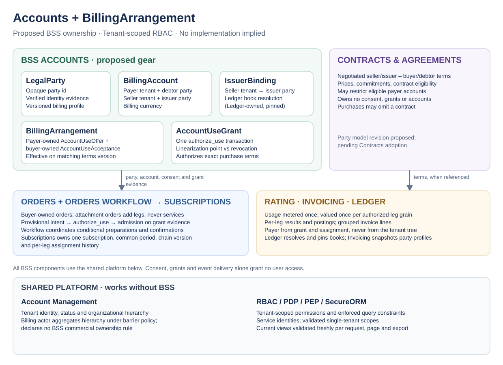

# Technical Design — BSS Commercial Model

<!-- toc -->

- [1. Architecture Overview](#1-architecture-overview)
  - [1.1 Architectural Vision](#11-architectural-vision)
  - [1.2 Architecture Drivers](#12-architecture-drivers)
  - [1.3 Architecture Layers](#13-architecture-layers)
- [2. Principles & Constraints](#2-principles--constraints)
  - [2.1 Design Principles](#21-design-principles)
  - [2.2 Constraints](#22-constraints)
- [3. Technical Architecture](#3-technical-architecture)
  - [3.1 Domain Model](#31-domain-model)
  - [3.2 Component Model](#32-component-model)
  - [3.3 API Contracts](#33-api-contracts)
  - [3.4 Internal Dependencies](#34-internal-dependencies)
  - [3.5 External Dependencies](#35-external-dependencies)
  - [3.6 Interactions & Sequences](#36-interactions--sequences)
  - [3.7 Database schemas & tables](#37-database-schemas--tables)
  - [3.8 Orders, terms and Subscriptions contracts](#38-orders-terms-and-subscriptions-contracts)
  - [3.9 Rating and source evidence contracts](#39-rating-and-source-evidence-contracts)
  - [3.10 Invoicing, Ledger and Payments contracts](#310-invoicing-ledger-and-payments-contracts)
  - [3.11 Read consistency, projections and migration](#311-read-consistency-projections-and-migration)
- [4. Additional context](#4-additional-context)
  - [4.1 Owner reconciliation before adoption](#41-owner-reconciliation-before-adoption)
  - [4.2 Review alternatives](#42-review-alternatives)
  - [4.3 Pre-acceptance scenario checks](#43-pre-acceptance-scenario-checks)
  - [4.4 Proposed GTS contract inventory (commercial model)](#44-proposed-gts-contract-inventory-commercial-model)
- [5. Traceability](#5-traceability)

<!-- /toc -->

- [ ] `p1` - **ID**: `cpt-cf-bss-commercial-model-design-architecture`

## 1. Architecture Overview

### 1.1 Architectural Vision

No new billing-account or seller-specific role-assignment scope is introduced. RBAC roles grant actions within tenant scopes; for a BSS object, authorization evaluates the role's action permission together with the object's authoritative commercial-buyer, resource-tenant, seller-tenant or payer-tenant relationship — four relationships, each with its own agreed platform predicate and response contract. The commercial buyer owns the order; the resource tenant owns the service subscription; the seller owns its commercial leg; the payer owns its account, offers and grants. Each access path is authorized completely; a business relationship alone is insufficient, and where several paths are combined for one action each path keeps its own owner predicate and the union never drops one.

Three classes of operation exist (§3.3): ordinary own-tenant user operations; synchronous trusted business commands between gears executed under dedicated BSS service principals; and outbox-fed production of tenant-owned derived views, also under service principals, whose recipient is resolved from the authoritative grant, offer or document/leg attribution appropriate to the view and cross-checked against validated source facts. Payer-only inquiry uses derived views maintained by Orders and Subscriptions and validated freshly against their authoritative basis on every read; seller inquiry uses seller-owned legs; debtors use document views; financial gears expose separately authorized recipient APIs. This is a proposed multi-component view and feasibility analysis; existing gear DESIGN and SDK contracts are not amended here, and the Accounts mechanisms are in the [Accounts DESIGN](../../../gears/bss/accounts/docs/DESIGN.md).

### 1.2 Architecture Drivers

| Requirement | Design response |
|---|---|
| `cpt-cf-bss-commercial-model-fr-purchase-authority` | Buyer-owned versioned purchase document; grant-backed admission (§3.6) |
| `cpt-cf-bss-commercial-model-fr-chain-topology` | Chain version owned by Subscriptions; readiness evaluation; supply-gap handling (§3.1, §3.6) |
| `cpt-cf-bss-commercial-model-fr-quantity-change` | Conditional preparations per leg; unknown-outcome reconciliation (§3.6) |
| `cpt-cf-bss-commercial-model-fr-sale-parties` | Verified party identity per leg at admission (§4.1) |
| `cpt-cf-bss-commercial-model-fr-contracts` | Optional bilateral terms independent of funding consent |
| `cpt-cf-bss-commercial-model-fr-disclosure` | Scoped recipient schemas; independent resolution authority (§3.3) |
| `cpt-cf-bss-commercial-model-fr-conditional-purchase` | Offer evidence; separately authorized cancellation of prepared orders (§3.5, §3.6) |
| `cpt-cf-bss-commercial-model-fr-initial-financing` | Financing checks before activation; collection afterward under existing semantics |
| `cpt-cf-bss-commercial-model-fr-active-obligations` | Lifecycle coordination preserves independent obligations (§3.6) |
| `cpt-cf-bss-commercial-model-fr-sponsored-coverage` | Full-term grant coverage validated at authorization; prospective revocation (§3.6) |
| `cpt-cf-bss-commercial-model-fr-usage-valuation` | Per-leg contribution grains, count-once per grain, compatible-basis optimization, per-leg corrections (§3.4) |
| `cpt-cf-bss-commercial-model-fr-invoice-grouping` | Account-level cutoff, compatible ready lines with their own service intervals, one due date per invoice and independent readiness (§3.4, S5) |
| `cpt-cf-bss-commercial-model-fr-independent-finance` | Per-leg results with a stable obligation identity and the chain version as evidence; pinned book and party references (§3.4) |
| `cpt-cf-bss-commercial-model-fr-visibility` | Owner matrix, derived views, response contracts (§3.1, §3.3) |

#### NFR Allocation

| NFR ID | Allocated to | Verification |
|---|---|---|
| `cpt-cf-bss-commercial-model-nfr-target-scoping` | Per-call RootOnly scope and returned-scope guard (§3.4), bounded owner-partitioned batches | 100,000-tenant acceptance envelope; 10,000/10,001 threshold regression; unrelated-target and unfenced-OR rejection |
| `cpt-cf-bss-commercial-model-nfr-isolation` | Platform predicates and recipient schemas | S1/S6 negative access traces; runtime gate open |
| `cpt-cf-bss-commercial-model-nfr-replay` | Facts with a stable per-leg obligation identity and chain-version evidence; authoritative recovery | S2/S3/S4 traces; runtime gate open |
| `cpt-cf-bss-commercial-model-nfr-fresh-current-views` | Per-request validation of view bases against Accounts, Orders and Subscriptions status reads (§3.3) | S6 trace; adversarial spike gate open |

#### Key ADRs

- [Ownership ADR](../../../gears/bss/docs/ADR/0002-cpt-cf-bss-adr-commercial-ownership-tenant-rbac.md) — `cpt-cf-bss-adr-commercial-ownership-tenant-rbac`.
- [Resale ADR](../../../gears/bss/docs/ADR/0003-cpt-cf-bss-adr-multi-tier-resale-model.md) — `cpt-cf-bss-adr-multi-tier-resale-model`.

### 1.3 Architecture Layers

**Boundary diagram.** Arrows indicate information or enforcement dependencies, not permission grants.

The [editable SVG](../../../gears/bss/docs/ADR/diagrams/bss-commercial-ownership-tenant-rbac.drawio.svg) embeds the draw.io model. The evaluated and not selected source-object alternative is kept as [bss-payer-access-alternative.drawio.svg](diagrams/bss-payer-access-alternative.drawio.svg) (§4.2).

## 2. Principles & Constraints

### 2.1 Design Principles

- [ ] `p1` - **ID**: `cpt-cf-bss-commercial-model-principle-single-service`

**Selected simplification.** One service subscription with a shared lifecycle and common period carries all commercial legs. Each leg records its seller, commercial buyer, payer account and grant, debtor party, price binding and terms. Legs create no subscriptions, provisioning, entitlements or usage streams. Usage is metered once and attributed once to the service; every leg of the chain version is an authorized grain that counts each record once under that leg's own tariff, and fixed-price components are valued per leg from the shared quantity (§3.4).

**Ownership and hierarchy.** Resource ownership, financial responsibility and ledger-book ownership are distinct. Each object names its single owning tenant and the relationship used by each access path; a commercial relationship creates no ancestor permission; barrier policy per path is explicit. Ledger book ownership is reconciled separately from the payer recorded on an obligation.

**Enforcement boundary.** BSS supplies trusted object relationships and commercial checks; the PDP evaluates user and service authorization through `PolicyEnforcer`; the PEP and SecureORM enforce returned constraints. No second business-owned permission engine, no manually constructed `AccessScope`, no post-filtering of unauthorized rows after loading a collection, and no totals or counts computed outside the enforced predicates.

**ADRs**: `cpt-cf-bss-adr-multi-tier-resale-model`, `cpt-cf-bss-adr-commercial-ownership-tenant-rbac`

### 2.2 Constraints

- [ ] `p1` - **ID**: `cpt-cf-bss-commercial-model-constraint-proposed-contracts`

All mechanisms below are proposed extensions that grant no authority and replace no owner contract. Outside the selected initial flow: different fact cadences per subscription, independent commitment periods, arbitrary pre-activation liabilities, new pre-activation capture, decrease documents, cross-currency re-billing, and consumption-policy modes whose enforcing entitlement the product does not provide.

**ADRs**: `cpt-cf-bss-adr-multi-tier-resale-model`

## 3. Technical Architecture

### 3.1 Domain Model

**Selected buyer purchase document (Q3).** Each upstream purchase is an Orders order owned by that leg's commercial buyer, reusing Orders' versioned commercial document and acceptance mechanisms with explicit revisions to its actor and fulfillment contracts; the resource tenant remains validated service lineage. **Order owner = commercial buyer; service subscription owner = resource tenant.** This is a target model; the current SDK has no buyer axis and its custom-axis storage is not migrated.

An upstream purchase uses an **attachment** category (a GTS category instance, §4). Its admitted positions contribute legs to the service subscription established through the customer-facing service order and must not spawn subscriptions, reserve capacity, provision, issue entitlements or emit usage. Preparation of an attachment order (quote, conditional supplier acceptance) may precede the grant under its own authority; admission, activation and any incurred obligation may not.

The buyer's versioned order is authoritative for purchase intent and accepted terms; Orders derives seller-owned purchase-leg facts from the accepted version with order, version and position lineage, and records the grant evidence; Subscriptions owns the subsequent chain version and assignment segments. Multiple representations of one sale create no duplicate obligation.

**Chain version.** Subscriptions freezes, per service interval, `ChainVersion(subscription_id, version, valid_from)`: the ordered legs with `leg_id`, seller and buyer tenants, debtor party, account, grant, Ledger-pinned book and commitment term — **no prices**; price bindings stay on seller-owned leg records. Required legs are exactly these legs. The chain version is service-read only: no user response schema of the resource tenant exposes it, and resource-tenant users never see upstream legs through it.

| Object | Proposed single owning tenant | Other relationships and boundary |
|---|---|---|
| Order (including attachment orders) | Commercial buyer tenant | Resource tenant is validated lineage without access to upstream purchases; validated seller and payer facts enable their separately authorized views; a requested payer on a draft enables nothing |
| Service subscription | Resource tenant | One lifecycle and common period across legs; no access to upstream orders or private leg terms |
| Chain version | Resource tenant (service-read only) | Leg references and assignments; no prices; not exposed to users |
| Commercial leg | Seller tenant of the leg | Seller read with explicit action and response schema; buyer, payer and debtor access are separate; the subscription reference grants no access to other legs; issuer party and book are explicit references |
| Payer purchase view, payer leg view | Payer tenant of the recorded assignment interval | Derived views maintained by Orders and Subscriptions; whitelisted fields; validated freshly on read (§3.3); source references grant nothing |
| Debtor document view, payer document view | Debtor party's representing tenant; payer tenant | Derived views produced by Invoicing from issued documents; append-only payment and correction events may follow |
| LegalParty, BillingAccount, AccountUseOffer, AccountUseGrant, IssuerBinding | Representing tenant; payer tenant; payer tenant; payer tenant; seller tenant | As defined in the Accounts DESIGN; the buyer owns its acceptance and sees an offer summary |
| Rated result per leg | Seller tenant of the leg | Identified by leg, subscription line or component, meter or grain, and window or period, with a revision (§3.4); the chain version is carried as evidence and is not a second obligation key; carries payer, debtor party, account, grant and book references; consuming book resolved by Ledger |
| Issued invoice and credit/debit note | Issuing seller tenant | Debtor, payer and designated-recipient paths need their own views; the resource tenant receives only a permitted extract |
| Journal entry and balance projection | Seller tenant owning the book | Debtor party, payer and account are financial dimensions; payer inquiry uses a scoped billing view |

The financial-record owner follows Ledger's book-ownership ADR; the payer-owner statement in Ledger's payment-allocation security section conflicts with it and must be reconciled by Ledger (§4.1). Invoicing ownership is selected in §3.10: the selling/book-owner tenant owns the issued document; issuer party is a separate immutable field. Different legal parties or books within one tenant still need their own isolation constraints.

### 3.2 Component Model

- [ ] `p1` - **ID**: `cpt-cf-bss-commercial-model-component-composition`

Collaboration among existing gears plus Accounts; no new process owner or facade gear.

**Selected coordination ownership (Q4).** Orders Workflow coordinates purchase-driven chains, conditional preparations and buyer-confirmation processes; Subscriptions retains service lifecycle, renewal scheduling, chain versions and the timing of service changes; no chain-orchestrator gear exists. Orders Changes remains the increase-document path executed through Workflow; it is not extended to decreases. A renewal **with changed terms** requires a purchase-confirmation process in Orders/Workflow — a scope change to the Workflow PRD statement that renewals produce no order (§4.1); routine renewals within existing authority still produce none.

| Responsibility | Owner and boundary |
|---|---|
| Buyer orders, versions, provisional intents, grant evidence, confirmation evidence | Orders; Workflow consumes authoritative state and requests permitted operations |
| Cross-order preparation and confirmation progress, waits, retries, audit of process execution | Orders Workflow; authoritative for process execution, not for terms, subscription state or money |
| Service transitions, effective time, renewal, chain versions, assignment segments | Subscriptions; Workflow runs no competing scheduler |
| Party identity, account usability, consent, grants | Accounts; Workflow cannot invent consent or override account state |
| Rated amounts, issued documents, debt and settlement, book resolution | Rating, Invoicing, Ledger |

| View / source | Maintainer | Initial contents |
|---|---|---|
| Payer purchase view | Orders | Confirmed purchase position and leg, admitted version, parties, grant evidence, quantity, term, producer-defined committed amounts |
| Payer leg view | Subscriptions | Leg assignment interval, order-position lineage, composition and quantity, pricing references, term and billing-cycle state, renewal and cancellation boundaries |
| Debtor and payer document views, statements | Invoicing and Ledger through recipient contracts | Issued document snapshots with append-only payment and correction events; no copy of monetary state in Accounts or Subscriptions |

### 3.3 API Contracts

#### Operation classes and trust boundaries

| Class | Examples | Transaction and transport | Authorization | Trust boundary to state and test |
|---|---|---|---|---|
| (a) Own-tenant user operation | create or revoke an offer; accept or withdraw an acceptance; approve a use; confirm a party profile; read own views | Ordinary request; SecureORM scope from the PDP decision | Permission on the resource type and action in the user's tenant; owner predicate | Platform baseline |
| (b) Trusted business service command | Orders → Accounts `authorize_use`, `record_use`; Subscriptions → Accounts renewal and transfer authorization; consumers → Accounts `grant_status`; Rating consuming Subscriptions facts | Synchronous platform-plane call executed inside the callee's own transaction | PDP decision for the authenticated calling service principal and the named action, evaluated by the callee without substituting its own identity, with narrow service permissions and a separate `RootOnly` scope for each validated target tenant; the returned-scope guard rejects broader or unfenced answers (§3.4); internal barrier traversal requires explicit service authority | The caller attests only facts about its own objects (Orders attests the order's owner tenant derived from the creator's scope); the callee cross-checks the effective arrangement, the grant-to-use linkage and the caller's consumer identity against its rows; only the named principals hold the action; public routes cannot reach the platform-plane operation; the platform-plane transport token is not business authority; enforcement tests on the service path are required (§3.4) |
| (c) Derived-view production | payer purchase and leg views, debtor and payer document views, offer summaries | Outbox written in the source commit; projector running as its dedicated service principal | Named `project` action per view type plus the source-read permissions needed by that projector, in narrow service roles; source and destination use separate single-target scopes. Recipient is resolved from the authoritative basis and cross-checked against the event's source: the grant's payer for funded purchase views; the recorded document/leg debtor and payer attribution for document views; the offer's named buyer for offer summaries, which exist before any grant | The `project` role bounds the type, not the recipient; recipient correctness is application trust resting on that read-back and on the fact that only the owning gear's transition code writes the outbox; proof fields let a wrong recipient be detected and reconciled, they do not prevent it; a forged event naming another tenant is refused; public callers cannot enqueue; outbox delivery is transport, not authorization |

Tenant authority comes only from PDP-issued scopes; gear code never manufactures or widens that authority. The existing Orders locked-parent path may derive an exact parent-resource scope for its children (§3.4), never for an arbitrary target. No class uses a raw database connection, a hand-built privileged `SecurityContext` or an `allow_all` scope. Class (b) and (c) run under existing platform mechanisms (§3.4); the outbox makes production durable and ordered per aggregate, it does not authorize it.

Service-role operation matrix, with standing roles separated by purpose and every payload operation narrowed to its target tenant; these describe required operations, mapped to the permission inventory in §4.4 or a deployment promise. Consumer and projector identities need not share privileges.

| Service principal | Accounts/source actions | Projection actions | Used for |
|---|---|---|---|
| Orders consumer | account-use authorization; grant outcome recording, release and end; bounded status reads | None | admission and outcomes for its own grants; fresh validation |
| Subscriptions consumer | account-use authorization; grant outcome recording, release and end; bounded status reads | None | renewal/transfer authorization and outcomes for its own grants; fresh validation |
| Orders payer-view projector | `grant_status_read` plus authorized admitted-order source reads | `project` on payer purchase views | payer purchase views |
| Subscriptions payer-view projector | `grant_status_read` plus authorized segment source reads | `project` on payer leg views | payer leg views |
| Accounts offer-summary projector | bounded reads of its authoritative offer basis | `project` on offer summaries | invitations before a grant exists |
| Financial-document owner's projector (for example Invoicing; exact registration remains owner-specific) | bounded document/leg attribution reads and `grant_status_read` where grant-backed | `project` on its document view type | debtor and payer document views |

A grant-backed projector needs both its `project` action and the narrow `grant_status_read`; it must not guess the recipient from an event. Offer-summary projection reads its offer basis and requires no fabricated grant. Incoming Accounts commands are evaluated for the caller's authenticated context; Accounts' autonomous projector identity does not authorize those calls. In-process calls pass the validated context; platform-plane transport authentication alone does not grant business authority.

#### Candidate response contracts

| Access path | Proposed response view | Excluded unless a separate permission and view allow it |
|---|---|---|
| Commercial buyer: its order | Purchase content, versions, confirmation and lifecycle facts | Other buyers' orders, counterparty private terms, payer account data |
| Resource tenant: service subscription | Service configuration, quantities, lifecycle, fulfillment and acceptance information; its own transaction terms | Upstream legs, other payers' instruments, account balances, master agreements |
| Payer: attributed order or leg | Billing view: service identity needed to understand the obligation, quantity, period, attributed amount and currency, assignment, grant, billing-relevant status | Provisioning payloads, topology, operational attachments, administration actions |
| Debtor: its documents | Document snapshot, debt, payment status and corrections of its legal party's obligations | Payer's other accounts, operational service data |
| Seller: its sale | Sales view and fulfillment information for the seller's authorized workflow | Other sellers' transactions, payer's unrelated activity, customer resource administration |
| Buyer: offer summary and its acceptance | Offer id, payer display name, scope, limits, coverage policy, validity, consent state | Full account profile, unrelated offers, balances, instruments |

Trusted internal lineage, the recipient-visible response and the authority to resolve a reference through AM or a source API are three different things; a service reference is not an access capability.

#### Fresh validation of current views (selected first implementation)

Every current-view read, list page, count and export batch:

1. evaluates the PDP for the requesting user and action in the user's tenant for that request, page or batch;
2. collects the distinct **bases** of the rows in scope — for an order view the Orders admission state plus the grant; for a leg view the Subscriptions segment plus the grant; for an offer summary the Accounts offer — and validates them in batched authoritative reads (`grant_status`, `offer_status`, segment and admission status) in the same request;
3. withholds rows whose basis is not current — for an offer or invitation basis: offer revoked, expired or account blocked; for a grant-backed purchase or assignment basis: grant released, ended beyond its coverage, or the Orders admission or Subscriptions segment no longer in force for the shown interval; for any basis: status unavailable (fail closed) — and applies mandatory predicates and field restrictions **before** counting and paginating, so totals and pages leak nothing. A revoked offer or a blocked account stops new uses and does not withdraw grant-backed views of covered billing facts, which never carry operational detail;
4. caches no positive disclosure decision and extends no authorization from a stale event; events trigger projector withdrawal but never serve as the basis.

Not every row has a subscription segment (an admitted order before activation has only Orders admission and a grant). The historical financial slice — obligation evidence of authorized uses and issued documents with their append-only payment and correction events — is served under a separate permission and is not withheld by consent changes. This validation is not atomic with a revocation committed in another database: a revocation that commits while a page is being served is reflected on the next request. The read checkpoints and in-flight semantics are specified in §3.11 and must be verified with an adversarial test (§3.4). A cached or leased validation bound is future work after the authorization owner agrees on a supported bound; no numeric bound is asserted.

#### Seller reads, buyer is not payer, commands are not reads

Seller reads use ordinary tenant-owner authorization plus the seller action and return an explicit seller schema (leg and purchase references, buyer identity, payer identity needed for the sale, service description, quantity, this leg's terms and price binding, shared-period boundaries, permitted fulfillment facts, references to its own documents); other legs' prices, raw consent evidence, operational secrets and unrestricted attachments are excluded; end-customer identity follows Q6. For Distributor → Reseller funded by Holding, Reseller owns and authorizes the purchase; Holding receives the payer view, which grants no authoring authority. Seller, buyer, payer and debtor views confer no mutation rights; the current Orders DESIGN grants seller reads, reasoned cancellation and hold/resume but not buyer authoring or acceptance, and those lifecycle operations are not among the eight delivered standard REST draft operations; Subscriptions commands rely on its own authority, delegation and transition guards. The command contracts in §3.8 and permission inventory in §4.4 define action, target, initiator/executor, consent, approval, idempotency and audit; their implementation is required before the corresponding capability is enabled.

**Access example** (Provider → Distributor 80, Distributor → Reseller 100 funded by Holding, Reseller → Customer 120; roles and read permissions only):

| Participant | L1: 80 | L2: 100 | L3: 120 |
|---|---|---|---|
| Provider | Seller view | No | No |
| Distributor | Buyer and payer views | Seller view | No |
| Reseller | No | Buyer and debtor views | Seller view |
| Holding | No | Payer view | No |
| Customer | No | No | Buyer, payer and debtor views; authorized operational views |

Independently granted views are evaluated separately on their own paths; ancestry alone grants no commercial prices or payer-path visibility, while a separately authorized customer or resource-subtree permission remains a valid path of its own; multiple views of one leg are not additional obligations.

**Hierarchy defaults and optional customer-cost reporting (selected, no new grants).** Buyer-owner order access and resource-owner service access use existing tenant-scoped grants with `self_managed` barriers respected; payer and seller relationship paths match the assigned tenant exactly and never expand to ancestors by default; an explicitly authorized delegate acts within the target tenant under platform rules. Example: Holding's payer-only reader sees only the funded Compute billing view. If Holding is ACME's managed parent and additionally holds an independent customer/resource-subtree permission, that operational path may also expose ACME-paid Backup; if ACME is `self_managed`, the barrier stops that operational path, and in both cases the payer path alone exposes nothing beyond Compute. Consent neither removes nor creates an independent path. Optional customer-cost reporting for a parent is a separate, resource-scoped permission over each customer's **permitted expense data** (its own transaction terms and costs), not a subtree query over payer-owned views — such a query would miss expenses paid by an outside sponsor and include Holding-paid services outside the subtree; it excludes upstream private prices, preserves each view's field contract, deduplicates the same leg, position and period, and is an optional follow-on, not a prerequisite. AM's billing actor (barrier-aware hierarchy aggregation) is AM's reporting capability; this proposal grants users no `BarrierMode::Ignore` bypass and no blanket ancestor access. BSS service principals use `RootOnly` for each target; where self-managed access requires `BarrierMode::Ignore`, it is fixed by an explicitly authorized internal adapter, never by public request parameters (§3.4). A user-facing page may invoke an internal status check as a service, but its own user authorization retains barriers and its field contract; internal traversal grants no additional user reporting access.

### 3.4 Internal Dependencies

**Platform authorization mechanisms used (selected for v1).** Each service call uses the authenticated caller (or the dedicated autonomous worker), narrow action/resource permissions and a PDP-issued **single-target tenant scope**. A role assigned at the platform root establishes where the service may request access; it is not the scope passed to a repository. Apply the singleton owner fence to tenant-bearing resources and authoritative parent access; parent-bound child records follow the guarded child path below. The mandatory per-call request is `AccessRequest::new().context_tenant_id(target).tenant_mode(TenantMode::RootOnly).require_constraints(true)`, with the exact registered action/resource and owner property where applicable. `RootOnly` means only the named target, not the platform root or its subtree. There is no whole-platform tenant enumeration on a purchase, renewal, projection, status or tariff-read path.

**Returned-scope guard.** A `RootOnly` request alone is insufficient: the PEP compiles the provider's answer without proving it matches that requested target. Before accessing a tenant-bearing resource or parent, the BSS service adapter inspects the returned `AccessScope` through its existing read-only accessors. Reject unconstrained/deny-all results and any alternative (OR constraint) without an explicit `owner_tenant_id = target` or `owner_tenant_id IN ([target])` fence. Additional supported AND restrictions are retained. Reject a different tenant, multi-tenant owner set, tenant-subtree predicate, unknown predicate or an unfenced OR branch; never filter a broader scope down by constructing a new scope. A union-of-values helper such as `all_uuid_values_for` is not this proof: one OR branch can lack an owner fence. An incompatible response stops the operation with an authority/configuration error and operator telemetry; there is no fallback to `Subtree`, `allow_all`, a larger expansion limit or raw SQL. SecureORM receives the **unchanged, verified PDP scope**, filters reads and checks inserted ownership. Implement this guard in the service adapters; it requires no new Toolkit API.

| Operation | Target derivation and separate scopes |
|---|---|
| Accounts `authorize_use` | Payer from the scoped account lookup; buyer from the immutable buyer-owned purchase receipt and matching acceptance; consumer home tenant from provisioned principal metadata. Obtain action/type-specific scopes for each. Payer scope covers account/offer/approval/grant rows, buyer scope the acceptance, home scope attempt/use-slot rows; never union them |
| Grant outcome/replay | Payer target from the stored consumer use/grant receipt; home tenant for its attempt/slot. Validate consumer principal, use identity and versions before disclosing or changing outcome |
| Offer/document/payer-view projection | Separate source scopes from verified source lineage; destination scope exactly the recipient derived from the authoritative offer/grant/document. The persisted row owner must equal this recipient |
| Rating → Pricing/Products | Exact catalog tenant from the validated chain's pinned tariff/product receipt. Source identity/revision must match; no search of other tenants or latest-price fallback |
| Current-view status batch | Partition the at-most-200 referenced bases by authoritative owner; evaluate and read each target separately. User response remains restricted by its own PDP scope and source-use checks |
| Issuer/profile/book evidence | Exact seller or representing tenant from setup/party receipts, with the named evidence-read permission. Resolve immutable evidence before the Accounts authorization transaction |

**Ownership bootstrap.** A lookup cannot first read an unscoped row to discover its owner. Internal references carry `{id, owner_tenant_hint, source_id, source_revision}` from previously retained source evidence; where a caller supplies an account locator, treat its owner hint as untrusted routing input only. Request the target scope, read that ID only within it, and compare the actual owner, fixed binding and permitted use lineage. Wrong/missing hint returns no matching authorized source, never a platform-wide search or a guessed recipient. An authorized service may read this narrow validation schema, not arbitrary private account fields. Only the successfully validated source can determine downstream recipient and mutation targets. For projectors the event's recipient is never a destination hint: read back the committed source using its producer/source identity, derive the recipient independently, and reject any mismatch before requesting the destination scope.

**Parent-bound child records.** Existing Orders commercial attempts are `no_tenant` children with `order_id` as the scoping key; they are not consumer-home-owned records. Authorize the buyer-owned order with its validated singleton tenant scope, then lock that parent and use the existing `LockedOrder::child_scope()` exact-parent-ID path for its children. The child scope carries only that authorized parent ID; it is not a service-selected arbitrary ID, a tenant-wide scope or a new authorization bypass. No child query runs before its parent authorization/lock or accepts a separately supplied parent. See [commercial-attempt entity](../../../gears/bss/orders/orders/src/infra/storage/entity/commercial_attempt.rs) and [locked-parent repository](../../../gears/bss/orders/orders/src/infra/storage/repo/mod.rs). Orders recovery discovery supplies bounded order/owner locators and follows this path, rather than scanning attempts under an invented home-tenant owner. The home-tenant scopes in the Accounts table apply to Accounts' own attempt/use-slot records, which actually have that owner.

**Accounts transaction.** Obtain the necessary single-target scopes and immutable external receipts before opening the grant transaction. In the one local transaction use each scope only with its corresponding repository/row type; re-read and lock Accounts-owned account, offer, acceptance and approval rows and validate the buyer/payer links under those locks. The account's payer binding is immutable. Attempt/use-slot ownership comes from principal configuration, never the proposal. Preserve the selected lock order and one-grant-per-use uniqueness; two tenant scopes do not mean two transactions. No network/PDP call runs under database locks and no compound cross-owner join requires a widened scope. Failure to obtain any required scope prevents admission.

**Privileges and barriers.** Dedicated identities and narrow permissions remain mandatory. Root-assigned roles may remain the v1 provisioning model, but cannot substitute for target-scoped operations. Cross-tenant work for a `self_managed` target may still require `BarrierMode::Ignore` for the underlying eligibility check; `RootOnly` does not itself authorize barrier traversal. This option is fixed by the named internal service adapter, never user input, and is permitted only for explicitly authorized service actions. User paths retain `Respect`. The production authorization owner must confirm both the service role and barrier behavior before ADR acceptance; a provider that cannot enforce the contract leaves the capability disabled. Do not present the hierarchy plugin or a mock as proof of production RBAC enforcement.

**Residual trust.** The singleton fence prevents a query/write for tenant B under an approved target-A scope. It does not prevent a broadly privileged or compromised service from requesting a new target-B scope. Correct source/use/recipient derivation remains an application invariant: bind a validated source revision, derived destination, action/resource and returned scope in one internal operation context; the projector repository accepts that context and constructs `owner_tenant_id` from it, rather than accepting a separate recipient argument. Recheck lineage and version fences at mutation. Build projected fields from the verified source snapshot, not an event-supplied payload. Current-view reads independently compare the source-derived recipient with both the stored view owner and the requested recipient scope; mismatch withholds the row and reports a projection-integrity exception even if its tenant predicate would otherwise pass. These checks detect mismatches; they are not cryptographic purchase-bound capabilities or a sandbox against arbitrary service code. Per-tenant service-role provisioning can further reduce standing privilege, but is separate from the mandatory per-call fence. No BSS principal obtains a new general-purpose tenant-read/write endpoint.

**Scale and bounded discovery.** Foreground scope cardinality is **one tenant per PDP decision**, independent of platform tenant count. Work is proportional to the owners/resources in that operation, not all tenants; this design does not claim constant-time RBAC or hierarchy evaluation inside the provider. Batch APIs enforce their existing 200-ID limit and process targets separately with bounded concurrency; an oversized request is rejected or paginated, not turned into an all-tenant scope. The NFR verification envelope is 100,000 platform tenants, explicitly including tests at 10,000 and 10,001; this is a proposed capacity target, not a measured deployment guarantee. Beyond the tested envelope, single-target semantics remain unchanged; overloaded dependencies fail the affected call without a total-tenant-count admission switch. Production readiness requires capacity evidence for its supported envelope, not simply raising `max_expansion_ids`.

Global discovery is limited to named consumer-outcome reconciliation, renewal scheduling and projection-rebuild jobs. Their separate scheduler identity pages an authorized tenant/work roster in bounded batches (maximum 200 tenant references per page); that control-plane roster exposes identifiers and work routing, not BSS payload. Each payload read/mutation then obtains its own `RootOnly` scope and verifies source lineage. A persisted cursor, fair bounded per-tenant work and retries prevent one failed tenant from restarting or blocking the entire sweep. A tenant created during a sweep is picked up on the next pass. V1 grants no whole-platform BSS data scope even to these jobs; a future bulk-data scan requires its own reviewed action/contract. The paginated roster adapter and deployment authority must be implemented/verified before autonomous scanning is enabled, not replaced with unscoped SQL.

**Freshness, tenant status and history.** Target-scoping changes no role/token freshness guarantee. Every current request still performs PDP evaluation and authoritative commercial status checks; no positive disclosure cache is introduced. The local TR RootOnly branch does not apply descendant-status filters and its reflexive ancestry case may skip an existence lookup. Therefore explicitly validate the named tenant's existence/status through the authoritative AM contract (or a production-provider contract that guarantees the same check): active and suspended tenants may participate under their business lifecycle rules, while deleted tenants cannot admit new uses. Historical financial access follows its separately authorized retention path and immutable snapshots; a missing/deleted target never triggers a broad-scope fallback. Cache behavior and in-flight revocation are deployment verification subjects, not a copied 60-second promise.

**Evidence in this repository and acceptance tests.**

- [SDK request builder and PEP](../../../gears/system/authz-resolver/authz-resolver-sdk/src/pep/enforcer.rs): `context_tenant_id`, `tenant_mode`, `require_constraints` and `access_scope_with`; [SDK test](../../../gears/system/authz-resolver/authz-resolver-sdk/src/pep/enforcer_tests.rs) `access_scope_with_for_create` demonstrates singleton compilation with a mock.
- [TR plugin](../../../gears/system/authz-resolver/plugins/tr-authz-plugin/src/domain/service.rs): R1/R5 (`RootOnly` with explicit target) check ancestry and return `allow_eq(target)` without calling `resolve_subtree`; [tests](../../../gears/system/authz-resolver/plugins/tr-authz-plugin/src/domain/service_tests.rs) cover R1/R5 success and wrong-owner/unrelated-target denial. This establishes the local hierarchy mechanism, not action-role enforcement or production-provider behavior.
- [AccessScope](../../../libs/toolkit-security/src/access_scope.rs): `constraints()`, `filters()` and Eq/In accessors permit the returned-scope guard without manufacturing authority. [SecureORM](../../../libs/toolkit-db/src/secure/select.rs) and [Orders repository](../../../gears/bss/orders/orders/src/infra/storage/repo/mod.rs) demonstrate scoped locking with a transaction runner.
- Before ADR acceptance, the authorization owner reviews the role/action/target/barrier contract against the intended production provider and records confirmation in this PR or a linked public-to-reviewers PR. Verify no descendant enumeration for single-target calls, including above the old 10,000 threshold; unrelated/missing/deleted targets; self-managed targets; user and unauthorized-service denial; wrong-recipient insert; maliciously overbroad/unfenced-OR PDP answers; independent payer/buyer scopes in one grant/revoke race; foreign-consumer replay; and per-target batch failure behavior. Source inspection and existing mocks do not count as these integration results.

**Rating reads of leg tariffs (required implementation work).** Rating obtains its authenticated service context through AuthN. Pricing and Products expose only the named pinned-revision/reference reads under a `RootOnly` scope for the catalog tenant derived from validated Subscriptions evidence. The return identity, revision and digest must match; otherwise hold that leg. Each leg converges independently. Price promotion, authoring and public user paths stay unchanged; result-read authority exposes neither raw resource usage nor another leg's tariffs. Existing unrestricted platform-table scopes must be reconciled when implementing this contract, not copied into the new path.

**Per-leg usage and recurring billing (v1).** Current contracts cannot express several obligations from one metered service: Subscriptions' recurring item identity `(subscriptionId, billing period, lineKey)` carries one frozen payer per period; Rating attributes a usage record through one Subscriptions segment naming one seller tenant and one payer, aggregates under an `AggregationKey` of seller, payer, resource, subscription, line, item, meter and dimensions, counts a record once per line-level `CounterKey` (M7), keys parent results by `(fact_id, result_revision)` and carries one seller/payer billing group per fact. Required changes, all owner work:

- *Subscriptions*: publish the chain version with per-leg assignments and pinned tariffs' identities; carry `chain_version` on period facts and attribution segments instead of one payer; keep `lineKey` identity and SUB-D-20 as-of resolution per leg.
- *Rating*: the authorized **leg grain** `(leg_id, leg tariff: meter, unit, window, aggregation)` becomes part of the aggregation and counter identity, so one record contributes exactly once to each authorized leg grain — M7 is restated as "counted once per authorized grain". Only the validated legs of the chain version in force **as of the usage time** are intentional fan-out; missing, overlapping or conflicting segments, duplicate leg ownership, and unauthorized or version-mismatched chains still reject or quarantine as today. Each leg result has a **stable economic obligation identity** `(leg_id, subscription line or component, meter or grain, window or period)` resolved as of the usage, plus a `result_revision`; a later chain version never creates a second obligation for an interval already attributed. Retry of the same revision is idempotent; a correction produces a new revision that adjusts or supersedes under the financial contract, for every affected leg. Initial admission requires accepted, pinned price coverage for every declared billable component of each required leg, with supported meter mappings for its usage components; a missing price is never implicit inclusion, a zero rate or authority to reuse another seller's price. Every necessary binding must be accepted and pinned; a binding that is missing later means retrieval or projection of an already pinned binding is unavailable (`awaiting_spec` for that leg only), never that an unaccepted tariff was admitted.
- *Compatible-basis optimization*: where legs' metering requirements are explicitly identical (meter, unit, window, aggregation scope, boundary rules), Rating may measure one neutral basis once and value it per leg, but only before tier, rounding, minimum, discount and currency logic; a retail priced result is never reused upstream. Where they differ, each leg has its own grain. A leg whose tariff cannot be rated from the service's usage type (no meter mapping, unsupported window) is `not_ready{metering_unsupported}` at admission, which denies that chain version, not the usage model.
- *Boundaries and lateness*: Rating already refuses records that cross a window, slice or payer/segment boundary (`boundary_split_required`; it never assumes uniform consumption) and expects the emitter to re-split; this applies per leg grain. Source consumption-time evidence is required: a point event may use equal window bounds, while an interval aggregate needs its measured interval; arrival time is not a substitute. The reviewed vhp-core `origin/main` (`12e27267`) implements generation 2 of the usage collector with `window_start`, `window_end`, separate `accepted_at`, invalidations, backfill and a feed. The S3 adapter emits source windows; IRM still uses the generation-1 client, and Rating has no production binding of its feed port in that revision. The remaining prerequisite is verified time evidence from each billable source and the generation-2 feed integration, not creation of the collector capability from scratch. Recoverability of generation-1 measurements must be checked per source; their collection timestamp alone proves no consumption interval.
- *Missing consumption-time evidence (selected for v1)*: a billable source record needs the actual event time for a point type or the exact measured window for an aggregate; a received, accepted or created timestamp alone is not evidence. A generation-1 or source record that carries trusted event evidence inside it may be recoverable, so a legacy dataset is not unusable by its schema alone; this is checked per source. **Recovery:** the source restores the exact measurements and submits them to generation 2 as backfill, with the correct natural keys and provenance; the original and its replacement keep a lineage and cannot both contribute. A previously ingested generation-2 record is invalidated through the source protocol; generation-1 data is not assumed to support that API and needs an explicit migration/reconciliation mapping that excludes duplicate contributions; nothing is split evenly or assigned by arrival time. **While recovery is possible** the affected usage stays a visible unresolved exception. **If recovery is impossible**, the gap is closed only by an explicit, authorized source-data-loss decision with evidence and a stated scope (source, resource, metric, interval, affected legs), approved by an authorized person distinct from the requester under Rating's source-loss contract (an implementation prerequisite where that approval path is not delivered); a loss is never automatic or silent, and it is not a way for an operator to erase a valid debt. An accepted loss is not a measurement of zero consumption, a free service, an invoice write-off, a release of existing obligations or the closing of a financial period; known valid usage is still accounted, and no charge is estimated for the missing data. Records and evidence are retained, and a source loss is never moved to a later payer. Exact measurements recovered after an accepted loss follow the controlled recovery rule below; they are neither ignored for ever nor turned into a new debt automatically. Usage finalization follows the selected policy below; invoice grouping follows the selected rule below; its execution and the controls for the selected open-period correction route remain owner contracts. The source-loss mechanism is Rating design and integration work, not delivered behaviour; source time evidence, the remaining emitter migration and the generation-2 feed binding are required for usage in v1.
- *Usage finalization (selected for v1)*: configure Rating's `delay_only` policy with an explicit delay and recorded Finance/Product acceptance for the same policy tenant and window policy; the authorized approver must differ from the policy writer, as required by Rating R-21 and [fact scheduling](../../../gears/bss/rating/docs/features/06-fact-scheduling.md). This is an explicit policy selection, not a change to Rating's general `full` default. No numeric delay is selected here. Rating pins the effective seller policy or platform default, its version and deadline; later policy changes do not move an already pinned deadline. With no applicable policy, the window remains `policy_pending`. Once the window and delay have elapsed, lack of arrival-completeness evidence alone does not prevent finalization; an open source loss still blocks its affected not-yet-final scope, and pricing, attribution and other processing requirements still apply. This mode does not prove all usage arrived: an unattributed or unmapped record can remain a visible exception outside the current counters, so its later eligible reconciliation can require a correction. Each leg delivers only when all its expected windows are final; another leg may proceed independently. Late eligible data produces a new absolute result revision under the same obligation identity and original usage-time attribution, not a second debt or reassignment to the current payer. The financial owner derives any credit/debit adjustment; issued documents remain immutable. Rating finalization, invoice issuance and Ledger period closing are separate operations. When the original accounting period is closed, the selected route below uses the current open accounting period subject to Ledger policy; this document promises no write into a closed period. Policy provisioning, recorded approval, scheduling, source-loss blocking and correction delivery are required integration work, not delivered behaviour.
- *Invoicing and Ledger*: per-leg financial attribution and independently keyed postings — every document line and journal line carries its leg's debtor party, payer, account, grant and pinned book; Invoicing may group compatible lines from different subscriptions under the account-level rule below. Each line keeps its leg and obligation identity; no wholesale amount becomes part of the retail debt.

**Recovered data after accepted loss (selected for v1).** Reuse Rating's administrative re-rate and source-loss evidence contracts. Before monetary processing, verify source provenance, exact event/window evidence, the recovered scope and deduplication against existing contributions and replacements. An authorized operator confirms the re-rate with a durable reference to the original accepted-loss decision, recovery evidence, reason and affected interval/legs. Recovered data may be retained for investigation, but its arrival alone cannot update a billed result. The controlled import/reconciliation and re-rate path must enforce this gate; partial recovery authorizes only its verified scope. Retrying the same recovery must not count a contribution or financial adjustment twice.

The accepted-loss record remains historical evidence. In particular, a retention loss is not relabelled `repaired` merely because a later external import becomes possible. Collector backfill bounds still apply; any exceptional widening or import needs the collector owner's authorized procedure. Once confirmed, Rating re-evaluates the affected grains under their historical tariff and assignment and publishes normal result revisions. Invoicing distinguishes first billing from correction of an already billed result, and Ledger applies its normal approval and posting gates, including the selected open-period route. No operator may invent missing quantities, substitute arrival time or redirect debt to the current payer. Unverified evidence, missing confirmation or a blocked import remains a visible exception. Ordinary late usage that is not recovery of accepted loss keeps its normal processing path. The authenticated operator permission, audited re-rate linkage and isolation of unapproved recovered inputs are required owner integration work, not delivered by this proposal.

**Late corrections after accounting-period close (selected for v1).** Invoicing turns an eligible revised Rating result into the appropriate credit/debit document against the previously billed result; Ledger records compensating entries in the current open period when its policy allows. Rating still sends the full absolute revised result; the financial owner derives the adjustment against the revision already consumed, with durable result/document lineage and idempotency. Original service time, obligation identity, per-leg assignment, payer account, debtor, seller, issuer, currency and pinned book remain historical attribution; posting date and fiscal period are separate. A previously unbilled result follows first-invoice handling and cannot be disguised as an adjustment to evade invoice-posting gates. Issued invoices and original journal entries remain immutable.

No routine worker reopens a period, backdates a post into it or bypasses an approval. The Ledger foundation's `FiscalPeriodGuard` currently requires an `OPEN` period; the [foundation design](../../../gears/bss/ledger/docs/design/01-repository-foundation.md#fiscalperiodguard) requires a formal reopen/re-close under dual control for exceptional posting into a closed period. Selecting the open-period route does not implement that exceptional workflow. If there is no policy-eligible open period, or tax, lifecycle, authorization or approval checks fail, the operation remains a visible Finance exception. Closing a BillingAccount in Accounts is not the same as closing the payer posting state in Ledger; retain historical attribution, but never bypass Ledger's `PAYER_CLOSED` or other gates. Section 3.10 specifies service time versus accounting date, first-invoice/correction gates and retry identity; Ledger retains its configured approval thresholds, which must be provisioned and verified before delivery. No general backdating or automatic debt reassignment is enabled.

**Commercial terms versus account defaults (selected for v1).** Orders/Subscriptions retain the effective accepted terms and their source versions on each immutable use; the canonical proposal digest binds that resolved content. Invoicing derives issuance and payment conditions from those retained values, not from current account defaults. Defaults fill only permitted omissions and changes apply to subsequent authorized versions. Accounts independently validates the exact use against funding consent and its fixed binding; a contract cannot enlarge an offer's product scope, coverage or limits. Products, Pricing and Contracts retain ownership of their own term/price resolution; this is not a new universal precedence engine. Unresolved conflict prevents admission, and a supported amendment or renewal requires the applicable authority and matching grant. Consumer schemas and SDKs must make source/version provenance testable before delivery.

**Invoice grouping (selected for v1).** Accounts records an invoice-cycle preference for each BillingAccount; Invoicing owns the effective schedule, cutoff, grouping and issuance. At a cutoff it selects ready, due-to-be-invoiced results with matching account, payer, seller, issuer party, debtor party, currency and pinned book. One invoice has one payment due date in v1. Compute the candidate lines' due dates under their accepted terms and include that date in the grouping key; different due dates require different invoices, not line-level deadlines. Matching terms labels alone do not establish matching due dates. The run cannot reset an already established date or replace its contractual calculation basis. Tax requirements and authorized recipient disclosure can require further splits; sharing an account is not authority to disclose another buyer's purchase. A subscription-level separate-invoice preference isolates that leg's charges without changing the other legs. No general PO/contract grouping engine is selected. Each line keeps its own service interval, subscription and leg, assignment, grant, stable economic result key and revision. Different service intervals are allowed; neither subscription anchors nor the shared period within a chain are changed to align invoices.

The scheduler does not wait for every subscription using the account. Readiness remains local to the result/leg; Rating/Subscriptions billing groups used as completeness gates must not span independent legs merely because their results may share an invoice. Pending results remain visible and may later be processed under their historical attribution, including after BillingAccount closure, subject to Ledger's separate lifecycle and posting gates. A first billing of a late result is distinct from a correction to a result already billed: the latter uses the original document lineage and financial-owner adjustment rules, never a duplicate full charge. Document consumption of result revisions must be durable and idempotent across concurrent runs and retries; its concrete contract belongs to Invoicing. The invoice-cycle cutoff does not override a contractual issuance deadline or due date; incompatible timing requires separate treatment. Several accounts may share a reporting statement, never one consolidated invoice in v1. Deliberate quarterly/annual accumulation of monthly obligations and new advance instruments are deferred; different periods on lines and late charges are not that accumulation policy. Schedule versioning, authorized preference changes, contractual due-date derivation under the selected single-date rule, result-consumption identity and recipient-safe document views are owner integration gates; no Invoicing implementation is claimed.

**Consumption policy enforcement.** `accepted_variable_under_tariff` needs no new control: the payer explicitly accepts the amounts the pinned tariff produces, and actual facts determine them. `quota_controlled` relies on Subscriptions' usage-quota entitlement (quota state tracked from the rating pipeline; hard limit = blocking check state) enforced at the point of use by the operational support system or resource provider; Subscriptions' own documents leave quota propagation and freshness open, so the offer must specify entitlement scope and units, the permitted point-of-use behaviour (block or degrade) compatible with the sold service terms, stale-state handling and the accepted lag and overshoot exposure; consumption recorded before the check state changed is attributed and invoiced, and a quota is a consumption control, not a guaranteed financial cap. Unsupported or conflicting modes fail at offer setup or admission. Alerts and estimated spend are informational and never caps; declining an invoice after consumption is not a cap; no credit or budget engine is introduced.

**Occupancy, funding limits, instance dimensions, cardinality.** Four controls stay separate: the service occupancy key (Subscriptions, default **resource tenant + catalog product key + declared dimensions**, not any one of several payers); funding limits (Accounts offers); product-declared instance dimensions (Catalog; a funding-related dimension must name the funded leg explicitly — no ambiguous "payer" dimension); and global cardinality (`maxConcurrentActive`). The default differs from Subscriptions' current payer-based key and from Orders' resource-inclusive key with payer: one sponsor may fund one product for two resources, two funders cannot hold one product for one resource, and a payer or account change on one leg does not re-key the service unless an explicit product dimension requires it. Adoption: schema-versioned key across Subscriptions and Orders pending-order claims; a per-product compatibility and collision report comparing current and proposed keys; explicit product policy per product before switching; no automatic widening of `maxConcurrentActive`; legacy pairs are a recorded, explicit migration requirement, not an automatic exception that admits new duplicates.

**Book resolution and pools.** Ledger owns a deterministic, versioned book-resolution contract over explicit context (issuer binding, seller tenant, issuer party, billing currency, accounting profile/version and effective time (§3.10)); consumers pin the resolved book on the grant, the assignment and every financial fact; Accounts stores issuer bindings and references, never resolving books and never assuming one book per issuer. Pool compatibility dimensions are payer tenant, debtor party, seller tenant, issuer party, book and billing currency; the pool itself and allocation are Ledger's; no account wallets exist. Adoption must constrain allocation candidates to those compatibility dimensions and the payment's authorized designation before applying Ledger's existing effective-dated precedence policy. An invoice/account hint cannot widen that eligible set. Within it, preserve the existing default (oldest posting date first, then smallest invoice id), customer-instructed hints and supported tenant overrides; record the policy version and retain prior splits under replay. This is required integration work on [payment allocation](../../../gears/bss/ledger/docs/design/03-payments-allocation.md), not a new Accounts allocator or a claim that the current single-payer implementation enforces all proposed dimensions.

### 3.5 External Dependencies

**Terms and activation evidence.** Each admitted offer must define the common obligation trigger, permitted waiting period and expiry, and cancellation before the trigger; suppliers must actually support conditional preparation — a platform flag, an eligibility read or an Orders status cannot postpone an obligation created by different supplier terms; pricing holds are not supplier reservations. Admission therefore needs an authoritative versioned offer/terms contract making conditional obligation and pre-trigger cancellation evaluable, owned across Products, Pricing and Contracts, before Q5.1 is enabled. Industry comparisons are informative only.

### 3.6 Interactions & Sequences

#### Purchase and activation

- [ ] `p1` - **ID**: `cpt-cf-bss-commercial-model-seq-purchase`

**Use cases**: `cpt-cf-bss-commercial-model-usecase-resale`, `cpt-cf-bss-commercial-model-usecase-failed-activation`

**Actors**: `cpt-cf-bss-commercial-model-actor-buyer`, `cpt-cf-bss-commercial-model-actor-seller`, `cpt-cf-bss-commercial-model-actor-payer`, `cpt-cf-bss-commercial-model-actor-services`

1. For each leg, Orders records the prepared terms version as a **provisional intent** (attempt identifier, use reference, exact terms digest; proposed to map onto Orders' durable commercial attempt of D-188) under the buyer's Q1 authority or confirmation; quotes and conditional, cancellable supplier acceptances may be obtained under their own authority. Nothing is incurred, purchased or activated.
2. Orders calls Accounts `authorize_use` for the leg; Accounts' commit is the linearization point against revocation; Orders admits the version only after storing the returned grant evidence, in a local transaction that also checks the intent was not abandoned (a delayed worker cannot admit an abandoned use). A timeout is an unknown outcome replayed by the same attempt identifier; a recorded refusal needs a new attempt and a new version. A use that was not admitted is released only after that terminal state is committed locally; an admitted use is ended, never released. Admission is never automated: an interrupted attempt is admitted only by the buyer's retry with the same idempotency key. Automation (required v1 work, not delivered) only delivers committed outcomes to Accounts at least once and closes an attempt that can no longer admit under existing rules, then releases ([Accounts DESIGN](../../../gears/bss/accounts/docs/DESIGN.md#36-interactions--sequences)); scheduled Subscriptions renewals keep their own authority. Grant coverage must cover the full commitment term before a multi-period commitment is admitted; coverage is the accepted product term under the product's frozen rules ([Accounts DESIGN](../../../gears/bss/accounts/docs/DESIGN.md#31-domain-model)). The Pricing receipt deadline `hold_until` constrains admission and the chosen activation instant, not the actual service start.
3. Workflow correlates the service order and attachment orders, checks each leg's buyer authority, supplier acceptance, grant and Q5.2 compatibility, and requests the chain version and activation from Subscriptions when all required legs are ready; attachment orders create no service and apply no quantity twice. Automatic buyer-owned order creation and submission still need Q1 authority and explicit service action grants; a coordinator is neither buyer, supplier nor payer.
4. Unknown activation outcomes are resolved through Subscriptions' authoritative transition outcome before any recovery; a timeout is neither success nor cancellation. After confirmed activation, cancellation reverses no obligation automatically.

**Prepared-order cancellation.** Cancelling a prepared or conditionally accepted attachment order before the trigger requires a separately authorized cancellation path valid in those states (a buyer action or an explicit service operation with target and action grants); Q1 authority, consent and process ownership confer no cancellation permission. Orders' current authorization matrix admits `workflow-cancel` only from `in_fulfillment` or `on_hold`; the proposed extension is `attachment_cancel` in §3.8, guarded by the Subscriptions abort receipt and the attachment state mapping below. The existing general `workflow-cancel` permission is not widened. This is specified design, not an implemented compensation path.

**Payments remain separate.** Payment authorizations, received funds and advances keep their own evidence and release or refund workflows; cancellation deletes no record and proves no return of funds (Q12). An existing obligation is preserved and resolved explicitly, never hidden because the service did not activate.

**Renewal confirmation handoff.** Subscriptions decides when renewal evaluation and transitions occur. When new terms need fresh buyer authority, an explicit handoff requests a confirmation process in Orders/Workflow and returns a version-bound result; the renewal use is authorized through `authorize_use` like any other; missing confirmation supplies no authority, and the consequences follow the applicable failure policy under the existing lifecycle contracts with a cause distinct from the debtor's nonpayment. Current order amendments are pre-fulfillment; reopening an executed order is not assumed.

**Readiness and supply gaps.** At each boundary Subscriptions evaluates readiness of the next chain version. A missing, ended or unready leg denies readiness; the outcome is recorded and surfaced to the affected parties; remedies are explicitly invoked (a validated replacement leg with all agreements, or the affected seller's contractual actions through authorized operations). No automatic termination, grace, extension or upstream cancellation follows; what happens to the service follows the retail leg's terms through Subscriptions' existing lifecycle contracts under a distinct cause. Readiness outcomes are evaluation facts, not new subscription statuses; their names are illustrative.

**Shared quantity changes.** The retail change order starts conditional preparations per leg (authority, supplier acceptance, grant for the delta); the quantity changes only when all are confirmed; on denial the prepared deltas are cancelled through the authorized cancellation path with compensation under terms; a timeout is an unknown outcome reconciled by identity before cleanup or retry. No atomic supplier commit; no decrease document; cancellation is not a partial decrease.

#### Assignment changes and late attribution

**Payer or account transfer.** Subscriptions owns assignment history and reuses its ownership-transfer workflow (`OwnershipTransferRequested` → approval → `OwnershipTransferApproved` → `OwnershipTransferCompleted`), extended to identify the leg and the old and new account evidence; the transfer use is authorized through `authorize_use` on the new account; an Orders amendment may request the change but writes no assignment history. **In v1 a planned payer or account transfer of a leg takes effect only at a shared period boundary (selected); a transfer inside a period is deferred.** The request time is not the effective time: a request made during a period takes effect at the next shared boundary. The replacement account must be ready and authorized (its `authorize_use` granted) by that boundary. If it is not, no transfer takes place at that boundary: the current assignment continues only as far as its own grant coverage reaches, nothing extends the old authority, and where that coverage ends the existing supply-gap and lifecycle terms apply. Until the boundary the old assignment carries what the leg's existing terms produce, also when the service ends earlier; the rule adds no obligation for an unserved remainder, no retroactive reassignment and no cancellation right. Activation, a permitted quantity increase, termination and the end of a temporary price keep their own effective instants inside a period; the chain is not frozen for a period. The target must have the same seller, issuer party, debtor party and currency; a change of any of those is a separately supported replacement, not a transfer. The old assignment stays on completed periods, the new one on the next; unaffected legs keep theirs; published facts stay attached to the original assignment; the service occupancy key does not change.

**Late attribution.** Period facts and usage records for a prior interval resolve to that interval's chain version and per-leg assignments (period facts as frozen at period start, SUB-D-20 applied per leg; usage as of the usage time); later arrival, replay or correction never moves an obligation to a later assignment; blocking or closing the former payer's account after the interval reassigns nothing and leaves late documents attached to that interval; Ledger's posting-period and correction rules are independent. Records spanning a window or assignment boundary are split under the metric's supported window rules before valuation (Rating's `boundary_split_required`, emitter re-splits) and are never assigned whole to one assignment; splitting implies no proportional interpolation for every metric — a point event belongs to its timestamp, and an aggregate that cannot be split under its rules stays unresolved rather than being attributed by assumption.

#### View lifecycle

A caller-supplied payer or account on a draft creates no view. Orders publishes the payer purchase view at admission from the grant evidence; Subscriptions publishes the leg view from the segment; Invoicing publishes document views at issuance.

| Change | Proposed view behaviour |
|---|---|
| Order becomes a subscription | Subscriptions publishes its segment; Orders ends the current purchase slice while retaining evidence; correlation by admitted version, position, leg and subscription; replay recreates nothing |
| Payer changes at the boundary | Old segment ends, new one starts for the new payer; forward terms only for the new payer; no copy of the former payer's documents or private terms |
| Offer revoked, acceptance withdrawn or account blocked | New uses refused at Accounts; issued grants and their current views for the authorized use stay valid for the pinned coverage; views whose basis ends are withheld on the next read and withdrawn by the projector; revocation creates no refund |
| Account closes | Future use ends; debt, collections, corrections and historical evidence stay available through their workflows; late documents for prior intervals attach to those intervals |
| Delayed or replayed source event | Applies only to its identified version and interval; an older event never restores withdrawn state or re-attributes a past period |

Current and historical slices are separate in storage and response contracts; after a basis ends, later financial updates for the old obligation remain readable under the historical permission, while unrelated current configuration and the new payer's activity stay excluded.

### 3.7 Database schemas & tables

No cross-gear database or shared writable schema is introduced. The selected per-owner tables, unique keys, version rules and outbox transactions are specified in §§3.8–3.10 and Accounts §3.7. GTS type identifiers are stored as types-registry UUIDs, invariant fields as indexed columns and permitted extension data as validated JSONB. The following contracts select the proposed component designs; migrations and runtime implementation remain delivery work.

### 3.8 Orders, terms and Subscriptions contracts

These are the selected **proposed contracts for this capability**, including amendments to existing component designs. They are not runtime APIs already shipped. Each owner implements its portion in its own SDK and database; the cross-component document fixes their common semantics rather than leaving interface selection to implementation. Existing accepted ADRs remain effective until this proposal is adopted.

**Adjacent-party check.** At initial admission and replacement-chain admission, `prepare_chain` checks both tenant adjacency and Accounts' verified same-party result for each upstream debtor / downstream issuer pair. Store party IDs, comparison/evidence revision and outcome in the candidate and published chain. Different or undetermined parties return `not_ready{legal_party_discontinuity}`; no alias rewrites history or grants a transfer. A reseller using EU GmbH upstream and UK Ltd downstream needs an independently supported inter-entity transfer, outside this v1 chain.

**Terms readiness.** Products defines a versioned fulfillment/activation profile; Pricing resolves and pins each leg's price binding and accepted BillingTerms; Contracts, when referenced, supplies an immutable applicable agreement revision. `CommercialTermsReceipt` contains seller/buyer/issuer/debtor, product and revision, accepted component IDs, tariff/meter mappings, commitment and period geometry, selected activation instant, maximum fulfillment/wait deadline, payment terms, permitted defaults with source versions, and conditional supplier commitment evidence. Its `conditional_commitment` contains the supplier acceptance ID/version, common trigger identity, `cancellable_before_trigger=true`, expiry and cancellation terms. A supplier that cannot give this receipt is unsupported for this v1 chain. Merely setting a platform flag cannot create it. A no-contract purchase resolves catalog terms through Pricing without fabricating an agreement. Conflicting terms or missing required metadata return `not_ready` with exact component/reason; no latest-price or inherited upstream-price fallback.

**Activation compatibility.** The selected profile supports frozen commercial anchors with an asynchronous actual start, as required by Orders D-201/D-217. `check_activation(receipt, actual_candidate_time, service_readiness_receipts)` returns a deterministic compatible interval/partial-period geometry or incompatibility. Both Subscriptions and Rating advertise support for that exact versioned profile. At the guarded activation commit, Subscriptions assigns T, repeats the predicate using T and persists T plus geometry and the readiness receipts atomically. It neither backdates to an OSS callback nor moves the frozen anchors. T outside the accepted fulfillment deadline, an unsupported partial period or changed required terms prevents activation; Workflow reconciles physical effects and obtains a newly accepted execution where needed. No numeric wait period is invented here: a finite contractual deadline must be present in each accepted receipt.

| SDK operation / owner | Input and authority | Durable result / retry |
|---|---|---|
| `prepare_attachment` / Orders | Buyer-authorized attachment order, candidate version, source retail execution and leg ID, terms receipts; same Accounts grant protocol as purchase | Admitted conditional attachment and preparation receipt; no recursive service fulfillment, no debt before the common trigger. Key = order/candidate/leg |
| `cancel_prepared_attachment` / Orders | Authenticated Workflow executor, buyer-authorized process/cancellation evidence, preparation ID/version, cancellation fence | Allowed only before trigger, with coordinated abort receipt below; transition to existing cancellation outcome plus outbox. Same key returns same result; an activated receipt refuses cancellation through this path |
| `prepare_chain` / Subscriptions | Subscription ID/expected revision, ordered stable leg IDs, per-leg admitted preparation, grants, tariffs and finance-readiness evidence, common trigger ID and deadline | Immutable candidate chain + readiness vector; `ready`, `not_ready` or `unknown`. Unknown never counts as a denial or success |
| `apply_chain` / Subscriptions | Candidate ID/expected subscription revision, coordinator fence, service-readiness evidence; owning executor permission | One local activation/change commit publishes active chain version, effective T, assignment segments and outbox. Idempotency key = candidate ID. Competing candidates require a new expected revision |
| `abort_candidate` / Subscriptions | Candidate ID, expected revision/fence, authorized process cancellation | Under the same lock as `apply_chain`, terminal abort receipt or already-applied receipt. Only a terminal abort receipt authorizes cancellation of that candidate's prepared legs |
| `prepare_renewal` / Subscriptions | Next fixed period, current chain/version, existing renewal mandate and terms, fresh required grants | Durable per-leg use versions and candidate. Routine unchanged renewal is service-authorized; a changed price/term outside accepted rules produces `confirmation_required`, not automatic acceptance |
| `prepare_transfer` / Subscriptions | Authorized change request, leg, next shared boundary, target account, expected assignment revision | Target grant and ready candidate; applies exactly at boundary if ready. Missed readiness cannot extend old coverage or backdate a later success |
| `resolve_attribution` / Subscriptions | Internal Rating caller, resource/subscription/line and exact event time or interval | Immutable chain version and all effective leg segments, with grants, tariff pins and source revisions; missing/overlap/conflict is explicit, never guessed |

**Attachment state mapping.** The attachment keeps Orders' existing order states. Its supplier preparation receipt is a separate closed substate `pending/ready/aborted/applied`, not a new order lifecycle. A valid conditional preparation can be retained while the admitted order is `submitted`, `pending_approval`, `approved`, `in_fulfillment` or `on_hold`; only `approved`, `in_fulfillment` or `on_hold` with all required approvals may become chain-ready. `attachment_cancel` accepts those five pre-trigger states only with the same candidate's terminal abort receipt, records preparation `aborted` and order `cancelled`, and ends the admitted grant through outcome delivery. Draft abandonment uses the existing draft path and releases only an unadmitted grant. Applied preparation, `completed`, `rejected`, `cancelled`, `fulfillment_failed` or `expired` cannot be newly cancelled through this command; exact retries return their stored result. Activation consumes the ready preparation and completes the attachment without provisioning another service. Every order transition still passes its current generation/approval guards.

**Common trigger.** `apply_chain` is the sole commercial activation authority; its immutable receipt identifies the common trigger accepted by every supplier preparation. Financial and supplier effects consume that receipt idempotently. Physical readiness is confirmed before this commit; publication/delivery can lag without changing T. There is no distributed database transaction or claim of simultaneous external execution. Failure before commit leaves the candidate unresolved or aborted, with compensation/reconciliation for physical preparation. Failure after commit retries publication/effects, never reclassifies the committed chain as unactivated. Cancellation and activation race only on the Subscriptions candidate lock/fence; Workflow cannot independently cancel one leg after the chain committed. Seller-initiated cancellation first enters the authorized Workflow process and obtains that fence; it is not a direct bypass.

**Finance readiness.** Funding consent, mandate and finance checks remain separate. The per-leg receipt names the seller's accepted postpaid/credit or existing pre-funded arrangement, policy revision, subject account/book/currency, validity and authenticated finance authority. The commercial terms owner requires the applicable receipt and Workflow checks it before activation; unavailable/expired evidence is `unknown/not_ready`. The receipt is not a guarantee of future collection or a money reservation. V1 supports only arrangements that permit conditional preparation and collection after activation. Terms requiring new irrevocable pre-trigger capture or an unimplemented reservation are unsupported, never silently downgraded. Payments retains mandate consent and retries; Accounts neither verifies available money nor issues a mandate. This boundary introduces no new credit engine.

**Consumer handoff.** Orders retains ownership of its grant outcome even after service activation. Subscriptions publishes a durable activation/termination receipt keyed by admitted order version/leg; Orders consumes it, validates lineage and writes the owed grant outcome to its local outbox. A lost handoff leaves a visible pending delivery, not authority for Subscriptions to impersonate Orders. New renewal/transfer grants belong to Subscriptions. A customer acceptance requirement remains the owning product/order contract and is not replaced by grant issuance or service activation.

**Commands and audit.** User admission/confirmation uses the existing buyer purchase action on the buyer-owned order. Workflow preparation/cancellation and Subscriptions apply/abort/renew/transfer are separate internal actions on the source order/candidate/subscription type. Source user actor, effective tenant, confirmed order version, executing service principal, request ID and coordinator fence are stored separately. A user cannot call a service-only method by presenting a source order ID. A seller read role authorizes no command. Retry keys include source execution and operation; changed arguments under a key fail `AlreadyExists(payload_mismatch)`.

### 3.9 Rating and source evidence contracts

| Record / owner | Identity, required fields and invariant |
|---|---|
| Chain / Subscriptions | `(subscription_id, chain_version)` immutable snapshot; ordered unique stable `leg_id`s, adjacency seller/buyer, common period geometry, effective interval and preparation receipts. A changed version is evidence, not a new economic obligation |
| Assignment / Subscriptions | `(leg_id, assignment_version)`; account, payer/seller/issuer/debtor/currency/book, baseline grant/use plus the quantity-authority evidence history below, tariff pins, effective `[from,to)`. No overlapping active interval per leg; preserve old segments |
| Period fact / Subscriptions | Existing line/component identity plus leg and period; stable immutable fact ID, chain/assignment evidence and append-only quantity-change receipt references, service period, quantity/plan inputs and measurement references; the fact remains money-free and Rating owns valuation. Frozen period identity survives later changes |
| Leg grain / Rating | Existing aggregation/counter dimensions **plus stable leg ID and accepted tariff grain identity**. Original source natural key/revision/invalidation lineage remains intact; no replacement with a global `(record, leg)` dedup key |
| Leg result / Rating | Stable obligation UUID allocated uniquely for `(leg_id, line/component, grain, window/period)`; monotonic `result_revision`; absolute priced quantities, net/tax-treatment inputs, currency, source-window evidence, original assignment/book and the complete grant-evidence set below, tariff revision and completeness state. Amount is a decimal string; never a signed ad-hoc delta from Rating |
| Recovery case / Rating | Loss decision ID, source/resource/metric/window/affected legs, evidence and requester/approver; recovered input IDs and verified replacement lineage; authorized re-rate ID and scope; immutable audit records |

`PricingPinnedReadV1` takes explicit catalog tenant, product/SKU reference, exact price binding ID/revision and the accepted use lineage, and returns the immutable requested snapshot plus meter/unit/grain/profile metadata. Rating's authenticated service principal has only exact revision/read actions; no pricing mutation, selection of current revision or promotion. `not_found` for an accepted pin produces `awaiting_spec` for that leg; unavailable is retryable. A schema-valid but unsupported meter/profile is an admission failure, not permission to charge zero. Existing Pricing resolution/hold semantics stay intact; this read contract adds neither a new hold nor mutable price lookup.

Rating consumes generation-2 source windows and invalidations with a durable per-feed checkpoint. Checkpoint advancement and accepted inbox/dedup state commit together; crashes replay the source key safely. It resolves historical assignment, validates exact boundaries, records contributions under each authorized grain, and recomputes the affected absolute result. Persist the result revision and delivery outbox in one transaction. `LegResultReady` carries obligation ID, revision and lookup reference; Invoicing reads the authoritative result snapshot instead of trusting arbitrary event fields. Expected window membership is frozen from the tariff/period geometry; a new chain version cannot silently remove an unresolved expected window.

Finalization checks the pinned approved `delay_only` policy/deadline, all expected windows and source-loss blockers. No policy is `policy_pending`; missing source evidence is a visible exception. A known open source-loss case blocks only its exact affected scope; explicit accepted loss permits finalization of known valid data without creating zero measurements. Recovery after accepted loss enters a quarantined input set; it cannot update financial result counters until the authorized re-rate links verified inputs, replacement exclusions and affected grains. Confirmation atomically records the allowed recovery scope and schedules recomputation. Replaying import/confirmation/re-rate does not double-count. Ordinary late eligible data is not put behind this manual gate.

**Stored shapes.** Subscriptions adds `chain_versions`, `chain_legs`, `leg_assignments`, `use_versions`, `chain_candidates` and transition receipts; PostgreSQL uniqueness and range-overlap checks enforce the invariants above. Rating extends its existing grains/counters rather than creating a second usage ledger, and adds unique obligation/revision records, recovery linkage and delivery inbox/outbox. All are scoped, tenant-owned records with GTS UUIDs; monetary results are seller-owned. No shared database or cross-gear FK is introduced. Raw source usage access remains independent of result access.

**Quantity increases and multiple grant evidence.** The original recurring period fact remains immutable and keeps its existing `(leg, line/component, period)` identity. A mid-period increase does not create a second chargeable recurring fact. Subscriptions appends a quantity-change receipt to the leg's effective-dated quantity history, containing the original fact reference and `grant_evidence[] {contribution_id, grant_id, consumer_principal, use_ref, use_version, component_id, quantity_contribution, effective_from, effective_to, change_receipt_id}`. The baseline contribution names the original grant; each admitted increase adds its own delta grant and effective interval. Contributions are immutable and unique by `(change_receipt_id, component_id, grant_id)`; retries reuse their contribution IDs. Baseline and delta intervals may overlap because their quantities are additive; deduplicate contribution IDs, never intervals. Retrying the same change receipt cannot add another contribution. A changed chain version does not reset that history.

Rating joins this history as of the charge interval, validates each contribution against its exact grant, and rates the effective quantity once under the accepted tariff/partial-period rules. It does not rate each grant as another purchase. Its absolute result revision snapshots the complete evidence set, including baseline and delta grants. For example 10 units for a full period under G0 and +5 from T under G1 use one period fact and one economic obligation; its quantity history is 10 before T and 15 afterward, not separate full-period charges of 10 and 15. If the increase would reprice the baseline beyond G0's accepted terms, delta authority alone is insufficient: require newly accepted authority under the amendment contract or refuse that change.

Invoicing line and Ledger posting provenance retain the result revision and the full grant-evidence set, directly or through an immutable, resolvable evidence snapshot ID/digest. A scalar grant field is only the baseline reference and is never the complete authorization proof. Correction records retain the previous and replacement snapshots; they adjust the existing obligation instead of creating a debt per grant. All contributions in the current v1 increase must match the leg's account/party/currency/book binding; a quantity change cannot bypass boundary-only payer transfer. Current-view validation batches every contributing grant plus authoritative quantity/use-end state for the slice shown, rather than relying only on G0.

**Quota-controlled usage authority.** `quota_controlled` includes explicit tariff-based funding acceptance, with the accepted lag/overshoot exposure pinned in the offer, accepted terms and grant; it adds operational enforcement to that authority. `accepted_variable_under_tariff` supplies tariff-based acceptance without that quota. Admission rejects missing acceptance or unsupported enforcement semantics. Rating records the actual eligible consumption and the applicable policy evidence; it neither truncates invoices at a quota nor treats the quota as a money reservation. Consumption outside accepted scope/coverage is a visible exception, not an implicit extension of payer consent.

### 3.10 Invoicing, Ledger and Payments contracts

**Financial ownership.** Invoicing owns document issuance, correction documents and immutable issue snapshots in the selling tenant that owns the pinned Ledger book, with issuer party recorded separately. Ledger owns entries, AR balances, allocation and financial approval/posting rules. An issuer party is not a tenant scope. Payer/debtor access uses recipient-owned restricted views; it never changes the book owner. This selects the formerly open Invoicing ownership question. Invoicing and Payments are proposed capabilities, not delivered gears in this checkout; their required integration surface is specified here, without claiming a complete PSP/tax-provider implementation.

**Book resolution.** `resolve_book(issuer_binding_id, binding_version, seller_tenant_id, issuer_party_id, billing_currency, accounting_profile_id, accounting_profile_version, effective_at)` returns `{book_id, book_owner_tenant_id, resolution_id, resolution_version, valid_interval, context_digest}`. Accounting profile is an explicit versioned Ledger setup reference, selected by seller configuration; it is not an arbitrary map or a buyer input. Exactly one active matching configured rule is required; no match is `book_unconfigured`, multiple matches are `book_ambiguous`. Both block admission. Pin the receipt on grant, assignment and financial fact; historic lookup resolves that receipt, never current defaults. Provisioning keys issuer legal identity independently of tenant ID and retains the seller-book ownership predicate. Party aliases cannot move a book or merge balances. Setup confirms issuer binding only after an idempotent Ledger provisioning receipt exists; unavailable provisioning leaves setup pending.

| Invoicing SDK operation | Input / transaction contract |
|---|---|
| `accept_result` | Obligation ID/revision and authoritative snapshot/digest. Unique `(obligation_id, revision)` inbox and per-obligation lock. Older revisions are retained as evidence and cannot overwrite newer monetary state; equal revision/different body is conflict |
| `run_cycle` | Account, effective schedule revision, cutoff instant, run ID. Select ready eligible unbilled results with `ready_at <= cutoff` and accepted billing timing due; each result is claimed under its obligation lock. Cutoff does not assert arrival completeness |
| `issue_document` | Reserved document ID, candidate lines/revisions, issuer/debtor profile versions, tax/payment evidence, derived due date and recipient set. Under document lock recheck inputs, freeze snapshot, claim included revisions, set issued, and commit outbox atomically |
| `correct_result` | Revised absolute result and last financially consumed absolute revision. Serialize by obligation; generate delta credit/debit document, or a recorded zero-difference acknowledgment. Each document links original invoice/line, old/new revisions and original attribution |
| `get_document_view` | User PDP-scoped recipient view; issuer full document separately authorized. Buyer with access to only some purchases receives line-limited statement data without whole-document totals, attachments or a full invoice download |

**Invoice states and scheduling.** Candidate states are `assembling → ready → issued`, with `exception` and pre-issue `cancelled`; issued content is immutable. Ledger delivery has a separate `pending/posted/exception` state and cannot unissue a document. A result is not consumed twice while delivery is pending. Invoice-cycle preference is a versioned calendar rule (IANA time zone, local cutoff and cadence). Invoicing resolves each scheduled cutoff to a persisted UTC instant; nonexistent local time uses the first valid instant after the gap, repeated time uses the later occurrence. Retries use that instant, not a fresh clock; changes affect only future unstarted runs. Unready lines remain exceptions for later first billing; due-date obligations cannot be delayed by a convenience cycle, so Invoicing schedules the earlier contractual issuance deadline where one is required.

**Grouping key.** Exact account, payer, seller/book owner, issuer, debtor, currency, book, effective payment terms and **one derived due date**, compatible tax treatment and authorized recipient set; append subscription/leg when separate invoicing is requested. Service-period bounds are line fields and need not match. If any grouping dimension is incompatible or unresolved, split or hold that line; never change accepted terms to consolidate. A borrower/buyer view cannot gain another purchase merely because the legal debtor matches. The payer/represented debtor may receive a complete document only when authorized for every included obligation; otherwise the response is a restricted view, not a mislabeled legal invoice. New privacy restrictions prevent grouping at issue time; they do not rewrite already issued documents.

**Corrections and ordering.** Under the obligation lock, select the highest eligible absolute revision; unissued drafts may be rebuilt. After issue, difference from the last consumed absolute revision yields a correction. For example consumed 100, ready 105, then 103: if 105 was not consumed, correct by +3; if +5 was issued, correct next by −2. A late 102 never regresses 103. All amounts and tax differences are calculated under the pinned financial/tax rules; approval/credit caps still apply. Missing prerequisites retain a Finance exception without moving the consumed pointer. Never-billed data uses first-invoice posting gates. Ledger posting identity is the immutable issued document/line operation, not the Rating delivery event ID.

**Ledger ingress remains call-driven.** Invoicing's outbox worker preserves the original-invoice-before-correction dependency for each obligation (pending predecessor keeps its dependent delivery pending) and calls the Ledger SDK with document ID/version, operation ID, source obligation/revision lineage, original service interval and assignment, pinned book resolution, exact per-leg money and requested accounting date. Ledger validates seller-book ownership, mapping, period and lifecycle/approval gates, atomically deduplicates the operation and posts or returns an explicit refusal. Retries after a lost response reuse that ID; conflicting payloads reject. An issued document with a posting refusal remains visible as an unreconciled financial exception. Late correction defaults to the current policy-eligible OPEN accounting period, records original service time independently and never automatically reopens/backdates. `PAYER_CLOSED`, missing open period, tax restrictions and approval holds are not bypassed. Exceptional reopen follows the existing dual-control workflow.

**Allocation and payment.** A settled payment call supplies immutable payment/provider identity, payer, currency, designated account/invoice where authorized, instrument/mandate evidence and seller/book context. Ledger first filters its own open candidates by `(payer, debtor, seller, issuer, book, currency)` and the authorized designation, then applies the existing pinned allocation policy (default oldest posting date, tie invoice ID). A hint narrows but cannot widen the candidate set. Ambiguous designation remains unapplied cash for Finance; Accounts cannot merge pools. Ledger persists splits and policy version atomically with payment deduplication. Payments records provider requests/replies under a stable operation key, independently checks mandate consent before a new collection, reconciles unknown PSP outcomes before retrying a new effect, and reports settlement through Ledger's existing call-driven ingress. Mandate revocation stops new collections, not recognition of an already settled payment or the historical debt.

**Storage.** Invoicing owns `result_inbox` (unique obligation/revision), `obligation_consumption` (locked consumed pointer), `invoice_runs` (unique account/schedule/cutoff), `documents`, `document_lines` (obligation/from/to revision), `document_views` and transactional outbox. The issued snapshot includes profile versions and rendered legal fields; updating Accounts profiles never mutates it. Ledger extends posting/allocation provenance with account, debtor, issuer, leg, grant, assignment and resolution IDs in indexed columns; its journal and approval state machines remain authoritative. Payments keeps mandates/provider operations in its own store; no Accounts wallet is introduced.

### 3.11 Read consistency, projections and migration

**Source-use status.** Orders `admission_status` and Subscriptions `assignment_status` return source ID/revision, immutable admitted use, effective `[from,to)` and any terminal effective time, plus the authoritative handoff reference. These SDK reads include committed source termination even while Accounts outcome delivery is pending. Every current view checks both this state and its grant; `authorized/used` is necessary but not sufficient. A handoff requires validation of the owning Subscriptions segment, not a stale Orders projection. Missing or unavailable source evidence fails the current response. Historical financial access remains a separate permission and does not depend on current consent.

**Read checkpoint semantics.** A current request first evaluates the user's PDP scope, captures candidate view rows and their local revisions, then reads each authority's relevant records in a single batched database snapshot per authority. Each response includes `(source_id, revision, observed_at)`; the request retains the complete basis vector. It rechecks the local projection revisions and repeats the authoritative version reads before emitting a response. A changed version discards the assembled result and retries the complete read, at most twice; unresolved churn or unavailable authority returns `Unavailable`, never a stale partial success. There is **no global cross-database snapshot**: a change after an authority's final check can be reflected on the next request. A change committed before that authority's check must be reflected in it. Neither an event timestamp nor the latest of the checked-at timestamps is a global linearization point.

Exact counts are computed from the authorized and freshly validated candidate set **before** pagination. For a set too large for the configured positive scan budget, return `ResourceExhausted` without a partial count; use a separately authorized export that validates each bounded batch. Cursors bind user tenant, filter/sort and last key; each page is a new current read and promises no stable total across pages. A required authority outage fails the response rather than reporting a misleading zero. Historical financial endpoints use their own permissions and immutable attribution, not current offer consent.

**Projection protocol.** Source event → source read-back → recipient resolution → local view transaction. Key is `(source_kind, source_id, recipient_tenant, view_kind)` and basis is a vector of source IDs/revisions, never a single maximum across unrelated streams. The transaction compares each source component and rejects older updates; source absence/terminal state writes a tombstone retaining the watermark. If vector components are incomparable, read the authorities again rather than merging payload fields. Source ownership determines recipients (grant payer, offer buyer, document parties); ignore recipient claims in the event until verified. Projector outbox/inbox replay cannot resurrect a tombstoned older revision. Final response schemas have no arbitrary extensions or raw source JSON.

**Occupancy rollout.** Orders and Subscriptions use the same versioned default key `(resource_tenant_id, catalog_subscription_product_key, declared_product_dimensions)`; payer appears only when explicitly declared by that product, never as a hidden default. Migration first produces a collision report under v2, requiring explicit owner resolution of overlapping active occupancies. Build v2 indices while v1 remains authoritative, validate the report is empty, then switch both admission paths under a coordinated feature gate. During mixed-version rollout admit no affected product through an old-only writer; rollback stops new admissions before reverting writers and retains v2 evidence. Existing admitted grants/assignments are backfilled from verified source evidence; absence of such evidence quarantines the affected record, never fabricates consent. Historical financial keys are not rewritten.

**Adoption and delivery boundary.** The contracts in §§3.8–3.11 and Accounts §§3.7–3.9 close the interface, state, persistence and failure-handling choices for this proposal. Owner review must accept these amendments, including Ledger's accepted-ADR changes and Orders D-236; documentation cannot supply that acceptance. Implementation still has to generate/register schemas, implement SDKs/migrations/roles/workers and pass the scenario/concurrency/security tests below. Deployment supplies confirmed identity namespaces, allowed seller types, explicit finance/finalization policies, invitation/read budgets and service-role assignments. Missing required configuration is a readiness failure, not an unspecified alternative design or an unlimited default.

## 4. Additional context

### 4.1 Owner reconciliation before adoption

Each row names an amendment the owner must make in its own documents; none is made here, and none is claimed agreed.

| Owner | Documents and statements to reconcile | Required change |
|---|---|---|
| Ledger | Accepted [book-ownership ADR](../../../gears/bss/ledger/docs/ADR/0001-cpt-cf-bss-ledger-adr-book-ownership-predicate.md): "the buyer hierarchy drives payer resolution" and "the tenant–commercial-account–legal-entity mapping is owned by AMS/Catalog/billing-setup"; `design/01a-invoice-posting.md` payer = nearest self-managed ancestor; `design/02-audit-immutability-observability.md` payer-attribution drift sweep (inactive in MVP); `design/03-payments-allocation.md` P6 and the payer-owner RLS statement; PRD `cpt-cf-bss-ledger-fr-multi-axis-attribution` ("seller is line-level metadata; inter-tenant settlement out of scope"); provisioning code `legal_entity_id = tenant_id` | Payer of a fact = payer of the account in the fact's grant and assignment, with grant, assignment and book provenance stamped on the event; mapping owner = Accounts (party identity, issuer bindings) with Ledger-owned book resolution; redefine the drift sweep against the assignment before activating it; provision by issuer party; seller-book ownership of entries per the accepted ADR and the PRD line revised accordingly; one payer per entry retained. Consequence to state: ancestors of the resource tenant keep showback through `resource_tenant_id` lines but lose payer-axis visibility of sponsored charges |
| Orders | D-215 items 2 and 5; D-198 and D-180 claim keys; authorization matrix (`workflow-cancel` from `in_fulfillment` or `on_hold` only); single-resource and custom-axis storage; D-144 composed-read field assumptions; payer-filtered draft reads and their tests | Predicate changes from "payer in relationship with the resource tenant" (AM profile) to the Accounts grant for the commercial buyer; item 5 reworded: a caller-specific spending authority is a permission on the payer tenant's offer resource under tenant-scoped roles, not an account-scoped role assignment; buyer-owned orders with resource lineage; grant authorization as a remote command of the D-188 commercial attempt, with grant evidence checked in its final commit and release only after a committed refusal; an amendment of D-236 limited to its closing portion: automatic closing of unresolved attempts that can no longer admit, and durable at-least-once outcome delivery to Accounts with the transactional outbox carrier selected in Accounts §3.9 (required v1 work, not delivered; the original order commit stays client-driven; existing refusal reasons preferred); attachment category and a separately authorized prepared-order cancellation path; claim key schema aligned with Subscriptions; recipient schemas and protected lineage; transition plan for existing reads |
| Subscriptions | PRD `cpt-cf-bss-subscriptions-fr-hierarchy-reference` ("references the AMS/BSS account binding"); `design/08` recurring identity with one frozen payer; PRD overlap default `(payerTenantId, catalogSubscriptionProductKey)`; `design/07` transfer; entitlement quota contract | Reference the Accounts binding (grant and assignment) plus AMS topology; chain version on period facts and segments; occupancy default without payer under a schema-versioned rollout; transfer extended with leg and account evidence and `authorize_use`; the immutable use version of renewal and transfer uses; the calendar interval of the accepted term recorded on the assignment from the actual service start; quota entitlement as the enforcing mechanism of `quota_controlled`; supply-gap and authority-unavailable causes distinct from nonpayment within existing lifecycle contracts |
| Orders Workflow | PRD statement that system-driven renewals produce no order | Renewal with changed terms produces a purchase-confirmation process; routine renewals do not; attachment-order participation and conditional preparations without recursive fulfillment |
| Rating | Attribution through one seller segment; `AggregationKey`/`CounterKey` and M7 count-once; `(fact_id, result_revision)` result identity; one billing group per fact; GTS resource types and actions | Leg grain in aggregation and counter identity; count once per authorized grain; per-leg result identity, billing group, corrections; compatible-basis optimization; chain version from Subscriptions as the fan-out authority; new result type and actions registered; source-loss decisions with scope, evidence and second approval, visible exceptions for usage without consumption-time evidence, and controlled recovery after accepted loss with operator-confirmed re-rate and duplicate protection; approved, explicitly delayed `delay_only` policies for v1, pinned schedules and late-data correction revisions; visible per-leg missing-price exceptions for the seller while upstream costs may continue; service context from the AuthN exchange; price reads built on the §3.4 contract; reconciliation of unrestricted platform-table scopes |
| Usage collector and emitters | Generation 2 is implemented in vhp-core `12e27267` with source windows and a separate arrival timestamp; generation-1 clients remain in IRM; Rating's production feed binding is absent | Verify consumption-time evidence per billable source, migrate the remaining emitter paths where needed, and bind the generation-2 feed to Rating; support point events and exact interval boundaries without inferring consumption time from arrival |
| Contracts | Seller–payer party model; "every order" wording | Seller/issuer–buyer/debtor parties with tenant references; optional references; funding restrictions without payer party status; explicit applicable terms and version evidence for consumers, with permitted defaults and independent account-use checks |
| Products, Pricing | Offer terms | Evaluable conditional-obligation terms, activation trigger, pre-trigger cancellation; tariff identities pinnable by grants; admission coverage for every declared billable component on each required leg; metering compatibility metadata; a service read path for the pinned price, the revision resolve and SKU reference reads by explicit catalog tenant, with registered service permissions (§3.4) |
| Invoicing, Payments | Document recipients; instrument mandates | Account-level invoice cycles, ready-result grouping, subscription separate-invoice preference and idempotent result/revision consumption; payment-term and disclosure compatibility; debtor and payer document views with append-only payment and correction events; mandate consent and revocation separate from account attribution |
| Platform authorization | PDP/PEP/SecureORM baseline; service-principal identity; root-scoped role assignments; D-194 service grants; caching design pending | No new mechanism; per-deployment provisioning of the BSS service principals and roles, confirmation of the §3.4 contract, single-target returned-scope validation, target discovery and barrier checks, the 100,000-tenant NFR verification envelope, service-path enforcement tests and the adversarial spike |
| Account Management | Billing actor with barrier-aware hierarchy aggregation | No change; AM declares no BSS commercial ownership rule and this proposal grants users no barrier bypass; service-side barrier traversal stays inside internal BSS operations |
| CFS registry | Shared ADRs and commercial PRD/DESIGN | Explicit docs-only registrations in `.cf-studio/config/artifacts.toml`; Accounts stays under BSS gear autodetection. Validation covers authored specifications, not delivered code |

**Review and implementation verification (named; contract choices are specified in §§3.8–3.11 and Accounts §§3.7–3.9).** Per-use approval protocol; issuer identity, bindings and Ledger book resolution; authorization user paths; service-principal provisioning and the service-path enforcement tests for class (b) and (c) operations; single-target scope cardinality and bounded per-target processing; Rating, Pricing and Products service reads; grant linearization; consumer outcome delivery and automatic closing of attempts that cannot admit; fresh current-view validation and its in-flight semantics; per-leg accounting end to end (facts, grains, results, documents, entries); invoice-cycle execution, due-date and recipient compatibility and idempotent result/revision consumption; open-period late-correction and first-invoice paths with Finance exceptions; operator-confirmed recovery of accepted loss with audited lineage and duplicate protection; consumption-policy enforcement coverage per product; occupancy key rollout; traceability registration. Authored contracts close the design questions; owner acceptance, generated schemas, code and runtime verification are not supplied by this document.

### 4.2 Review alternatives

**Payer inquiry.** A combined Accounts projection would centralize inquiry but needs more producer contracts and reconciliation; source-maintained derived views with fresh validation are preferred initially. The source-object alternative — payer users reading the resource-owned order or subscription directly under a payer predicate — was evaluated and **not selected**: it crosses the resource owner's boundary on every read and needs payer predicates inside the source policy; its diagram is kept as [bss-payer-access-alternative.drawio.svg](diagrams/bss-payer-access-alternative.drawio.svg) for the record.

**Leg ownership.** Resource-owned legs with recipient projections remain possible but make upstream readers cross the resource owner. A `no_tenant` leg with custom party axes depends on platform support that does not exist and leaves field disclosure unsolved. Seller-owned legs align ordinary seller inquiry with one tenant owner.

**Read freshness.** A disclosure lease or cached validation bound was considered and deferred: no supported bound exists in the platform's caching design, so v1 validates each current read against its authoritative basis.

### 4.3 Pre-acceptance scenario checks

Verification method: analysis of the proposed contracts against current repository documents. No runtime test, supplier integration, benchmark or owner approval has occurred; every verdict is conditional and document-level.

#### S1 — Holding funds Compute; ACME funds Backup

Setup: ACME is buyer and resource tenant with party P(ACME Inc.); H-ACME binds Holding / Reseller / Reseller's issuer party / P(ACME Inc.) / EUR; A-ACME has the same seller, issuer, debtor and currency with payer ACME; Holding's offer to ACME covers Compute and ACME accepted it. Trace: each purchase passes buyer, supplier and grant checks; two subscriptions carry their own assignments; Holding's payer view contains Compute only and is validated against the grant on each read; invoices name P(ACME Inc.) as debtor; recipients follow the recipient contract. Counterexample: a second resource tenant Sub2 funded by Holding for Compute collides under the current payer-based default; under the resource-based default `(ACME, Compute)` and `(Sub2, Compute)` are distinct while a repeated `(ACME, Compute)` still collides. Verdict: conditionally coherent; gates — occupancy key rollout with product policy, S6 authorization path.

#### S2 — One service metered once, three legs valued (72 / 90 / 106.40) and the recurring variant (80 / 100 / 120)

| Leg | Seller / issuer party | Buyer / debtor party | Payer, account | Tariff |
|---|---|---|---|---|
| L1 | Provider / P(Provider) | Distributor / P(Distributor) | Distributor, own account | 0.10 per VM-hour |
| L2 | Distributor / P(Distributor) | Reseller / P(Reseller GmbH) | Holding, H-RES | 0.125 per VM-hour |
| L3 | Reseller / P(Reseller) | ACME / P(ACME Inc.) | ACME, A-ACME | 0.16 for the first 500 h, 0.12 beyond |

Trace: 720 VM-hours attributed once to ACME's service; three authorized grains count each record once; results 72.00, 90.00 and 106.40 with obligation identities `(L1|L2|L3, compute line, VM-hour meter, period 2026-06)` at `result_revision 1`, chain and assignments resolved as of the usage; separately attributed documents and postings per leg in three books; redelivery of the window or of one leg result at the same revision yields the same keys; a correction to 700 hours produces `result_revision 2` for all three legs, superseding revision 1 under the financial contract; if L2's pinned binding becomes unavailable after admission, L2 stays `awaiting_spec` while L1 and L3 proceed, and the next chain version is not ready. Recurring variant: 10 licences at 8/10/12 give 80/100/120 the same way. Counterexample without the extension: Rating's single-segment attribution would quarantine the second and third seller or count into one, and the result key would collapse the legs — hence the Rating and Subscriptions changes of §3.4. Verdict: representable; gates — Rating grain, result and billing-group contracts, Subscriptions chain-version facts, collector interval evidence. Additional admission check: if the retail billable component has no accepted price, reject the chain before activation; no upstream price is substituted. Finalization checks: a missing or unapproved policy cannot finalize a window; a configured, approved delay permits finalization without completeness evidence, but an open source loss in its scope still blocks it. A late eligible record yields a new revision for each affected leg, retaining its original payer and requiring financial-owner adjustments after invoice issue.

#### S3 — Prepared upstream purchase; downstream activation fails

Setup: Provider conditionally accepts Distributor's prepared purchase under verified cancellable terms; Holding's `authorize_use` for L2 is refused. Trace: the chain is not ready; no activation; Workflow requests cancellation of the prepared purchases through their authorized cancellation paths and tracks confirmation; a definitive activation failure of an **admitted** leg is recorded as `record_use_ended` under that leg's authorized terms, preserving accrued obligations and financial evidence, while Payments releases payment authorizations under its own contract and earlier funds follow their own workflows; only unadmitted abandoned intents `release` their grants; a timed-out activation is reconciled first, never assumed failed; a successful activation with failed collection preserves the obligation and applies the leg's existing payment terms. Verdict: viable only for verified conditional suppliers; gates — supplier commitment model, activation evidence, prepared-order cancellation path.

#### S4 — Transfer at July 1; June usage arrives July 20; former account closed

Setup: L2 uses Holding/H-RES through June 30 and Reseller/R-RES from July 1 under a new grant; chain version 3 from July; debtor, seller, issuer and currency unchanged. Trace: usage wholly in June resolves to June's chain version and L2/H-RES even when processed on July 20; a record spanning June 30–July 2 is `boundary_split_required` and re-split before any leg is valued; a point event belongs to its timestamp; an aggregate that cannot be split under its rules stays unresolved; replayed June facts produce the same per-leg keys; closing H-RES in August reassigns nothing and June's late documents attach to June's assignment; Holding retains authorized historical evidence and loses the current slice on the next read. Additional close case: a June invoice for 100 EUR is issued and June is closed; eligible June usage received in July revises the amount to 105 EUR. The financial owner issues a +5 EUR debit adjustment referencing the original invoice and posts in July if July is open and policy permits; June remains unchanged, and the adjustment retains June's payer and debtor attribution even if July has another payer. A downward revision uses the corresponding credit flow; a repeat produces no second adjustment. Recovery variant: June data was explicitly accepted as lost and an August backup supplies it. No monetary result changes on arrival; source/time evidence and existing contributions are checked, an authorized operator confirms the scoped re-rate, and only then do ordinary result and financial corrections run. Re-import or re-rate replay produces no duplicate contribution or adjustment; absent approval or unverifiable evidence stays an exception. If no eligible period is open or the Ledger payer state blocks the operation, retain a Finance exception, not an automatic reopen or reassignment. Verdict: coherent conditional on the S2 contracts and collector interval evidence; gates — per-leg assignment identity on facts, window rules per metric, historical access, accounting-date and correction lifecycle contracts.

#### S5 — Common period versus commitment, invoices and collection

| Combination | v1 disposition | Basis |
|---|---|---|
| Shared annual commitment, monthly facts, different due dates | Allowed, subject to full-term sponsor coverage | Q12 permits collection dates |
| Upstream monthly commitment; downstream annual promise | Reject | Q5.2 coverage and notice |
| Different fact cadence per subscription | Outside v1 | one anchor per subscription |
| Different tariffs or meter aggregation windows per leg on one usage | Allowed as separate grains **within the one subscription billing and commitment cadence**: a window is a Rating aggregation granule (hour or billing cycle), never an independent per-leg billing or renewal period; records crossing a window or assignment boundary need exact emitter interval evidence and an authorized grain, with no uniform interpolation; refused only for a leg that cannot be rated from the service's usage type | §3.4, Rating boundary-split rule |
| Compatible subscriptions on one account with different service-period bounds | Consolidate ready, due-to-be-invoiced lines at the account cutoff | Each line keeps its own interval and attribution; payment, tax and recipient rules may split documents |
| Compatible account and period, but Compute due on the 10th and Backup on the 20th | Two invoices, each with its own unchanged due date | One due date per document; grouping cannot alter accepted terms |
| One subscription is not ready at the cutoff | Invoice ready results; retain the exception for a later run | No cross-leg completeness gate; no zero substitution |
| Quarterly or annual accumulation of monthly obligations; new advance instruments | Outside v1 | Distinct from late usage or different intervals on invoice lines |

Example: Compute for June 1–30 (100 EUR) and Backup for June 15–30 (20 EUR), both on A-ACME and otherwise compatible, produce one invoice with two lines at the cutoff. A separate-invoice preference produces two documents. If Backup is pending, Compute is invoiced alone; Backup is first billed when ready. Terms check: a 30-day account default cannot replace accepted 60-day payment terms, and changing the default after admission changes no existing due date. A contract for Backup cannot bypass a Compute-only funding offer; that proposed use is refused. Holding-funded Compute on H-ACME and ACME-funded Backup on A-ACME never share an invoice. Distributor → Reseller stays a separate obligation and document. Verdict: policy selected and structurally coherent; owner gates — invoice scheduling and due-date compatibility, independent readiness, recipient-safe grouping and retry/correction identity.

#### S6 — Payer-only inquiry, pages, exports and source references

Setup: a Holding user with payer-read permission only; Holding-owned views exist for a Compute assignment; Backup is ACME-funded. Trace: PDP evaluation per request; the page's distinct bases (Orders admission plus grant for order rows, Subscriptions segment plus grant for leg rows, the offer for invitation rows) are validated in batched authoritative reads in the same request; rows whose basis is not current — released or out-of-coverage grants, admissions or segments no longer in force, revoked offers for invitation rows, or unavailable status — are withheld before counting and paginating, while a revoked offer leaves grant-backed covered billing rows readable; following a source link invokes the source's own authorization; export batches repeat the validation; events withdraw views but never serve as a basis; the historical slice stays readable under its own permission. Counterexample: a revocation after the final authority checkpoint can be reflected on the next request, under the explicit §3.11 in-flight semantics. Verdict: structurally compatible with the platform scoping model; gates — service-principal provisioning and enforcement tests for class (b)/(c) operations, per-request PDP cost, adversarial spike covering forged recipients, foreign principals, public invocation, out-of-order events, pagination and totals.

#### S7 — Supply gap and shared quantity change

Middle leg L2 not renewed: chain version `[L1, L3]` is not ready; nothing terminates; a validated replacement leg with all agreements admits a new version; otherwise the next period is not admitted and the retail seller's remedies run under L3's terms through authorized operations; L1's obligations survive. Increase 10 → 20: preparations per leg; one denial or an unresolved timeout leaves the quantity at 10 after reconciliation; prepared deltas are cancelled through the authorized path with compensation. Verdict: coherent as evaluation outcomes; gates — readiness outcome contract in Subscriptions and Workflow, prepared-order cancellation path.

#### Evidence summary

| Check | Selected design | Remaining verification |
|---|---|---|
| S1 | Accounts consent/grant transaction; occupancy migration (§3.11) | Grant races, collision migration and negative access checks |
| S2 | Per-leg grains and absolute revisions (§3.9) | Collector feed integration, replay and revision ordering |
| S3 | Conditional receipts, common trigger and guarded cancellation (§3.8) | Real supplier compatibility, activation/abort race and compensation |
| S4 | As-of attribution and open-period correction (§§3.9–3.10) | Boundary splits, original attribution and Ledger posting gates |
| S5 | Cycle/cutoff, grouping and consumed-revision transactions (§3.10) | Due dates, recipient-safe output, concurrent runs and late results |
| S6 | Per-authority read checkpoints and projection vectors (§3.11) | Forged recipient, revocation race, source outage, pages/counts/exports |
| S7 | Candidate readiness and independent obligation lifecycle (§3.8) | Unknown outcome recovery, missing leg and quantity-change races |

These are document-level traces, not executed integration tests. The table distinguishes authored design from the evidence required to accept and release it.

### 4.4 Proposed GTS contract inventory (commercial model)

The following identifiers and invariant shapes are selected for the proposed component SDKs. [Accounts DESIGN §4](../../../gears/bss/accounts/docs/DESIGN.md#41-gts-schemas-extension-and-registration) defines the shared registration, validation, hybrid storage, error and evolution rules; they apply to every row below. Each gear owns its namespace, SDK definitions and registry initialization. This adds no universal commercial-model gear or registry. Generated schemas and registration are not shipped by this documentation change.

| Full type identifier | Invariants / extensibility |
|---|---|
| `gts.cf.bss.orders.payer_purchase_view.v1~` | Final response: owner payer, order/candidate/position/leg, admitted state, grant, quantity, allowed amount/period and basis vector; no generic source metadata |
| `gts.cf.bss.orders.preparation_receipt.v1~` | Final evidence: order/candidate/leg, buyer/seller, conditional commitment, grant, process/fence and deadline |
| `gts.cf.bss.pricing.commercial_terms_receipt.v1~` | Final cross-gear receipt described in §3.8, with explicit source versions and canonical digest; no mutable current-price pointer |
| `gts.cf.bss.products.activation_profile.v1~` | Extensible capability descriptor: profile identity/version, supported period/partial-period geometry, conditional trigger and supported asynchronous-start semantics; `properties` is the registered extension field |
| `gts.cf.bss.subscriptions.chain_version.v1~` | Final immutable evidence: subscription/version, ordered stable legs, effective interval, shared geometry, preparations, verified adjacent-party evidence and grants |
| `gts.cf.bss.subscriptions.leg_assignment.v1~` | Final evidence: leg/assignment version, exact interval, account/party/book/tariff pins, baseline grant and quantity-authority evidence references |
| `gts.cf.bss.subscriptions.chain_candidate.v1~` | Final internal command resource: expected subscription revision, fence, readiness vector, deadline, outcome and apply/abort receipt |
| `gts.cf.bss.subscriptions.payer_leg_view.v1~` | Final response: payer owner, leg, segment, quantity/period, permitted financial status, grant and basis vector |
| `gts.cf.bss.rating.leg_result.v1~` | Final financial evidence: obligation/grain/window, revision, absolute amounts, currency, original attribution, full grant-evidence snapshot, tariff and source lineage, finalization state |
| `gts.cf.bss.rating.recovery_case.v1~` | Final controlled operation resource: accepted-loss link, scope, evidence, approvals and re-rate linkage |
| `gts.cf.bss.invoicing.document.v1~` | Concrete extensible resource: document/issuer/book-owner identity, immutable issue snapshot and line/revision/full grant-evidence lineage; `metadata` for issuer annotations only, never financial or authorization semantics |
| `gts.cf.bss.invoicing.document_view.v1~` | Final response: recipient owner and role, document reference, permitted lines/status, profile snapshot, correction links; no unfiltered metadata or full-document totals for partial views |
| `gts.cf.bss.invoicing.result_consumption.v1~` | Final internal resource: obligation ID, highest received/consumed revision, reserved/issued document lineage and retry state |
| `gts.cf.bss.ledger.book_resolution.v1~` | Final receipt: §3.10 resolution context/version, book ID/owner, validity and context digest |
| `gts.cf.bss.contracts.applicable_terms.v1~` | Final optional receipt: agreement ID/revision, seller/issuer and buyer/debtor, applicable scope/interval, terms/provenance and signature evidence |

Final is intentional for authority evidence and recipient views; changing their semantics needs an explicit versioned contract. It is not a blanket ban on extension. Products activation profiles are registered capability descriptors, resolved by exact type/version and supported implementation capability; adding schema alone never enables unsupported activation/Rating behavior. Invoicing metadata is validated through a derived type (for example `gts.cf.bss.invoicing.document.v1~acme.billing.invoicing.reference.v1~`) and stored in JSONB, but cannot alter amount, due date, attribution, recipient or legal snapshot. New descriptive metadata can be accepted without a DB migration; new money/activation behavior requires an explicit supported semantic contract. No instance may supply schema-level traits.

**Well-known instances.** Attachment category is `gts.cf.bss.orders.category.v1~cf.bss.orders.attachment.v1`, under Orders' existing category schema; use its category properties/registered capabilities rather than a separate enum. Exact profile/consumption-policy references in terms use typed GTS IDs and registry-validated schemas, not free-form names. Closed internal candidate/document states remain state-machine enums.

**Permissions.** Each enumerated permission name below expands to `gts.cf.toolkit.authz.permission.v1~cf.bss.<gear>.<name>.v1`, with `action = <name>` and the exact resource type shown. For example `gts.cf.toolkit.authz.permission.v1~cf.bss.subscriptions.chain_apply.v1`. These supplement existing permissions, not broad wildcard grants. The named SDK-only actions are assigned solely to the owning consumer/projector principals through the service-role matrix in §3.3; user read grants cannot invoke them.

| Gear / resource type | Permission names | Audience |
|---|---|---|
| orders / `gts.cf.bss.orders.payer_purchase_view.v1~` | `payer_view_read`, `payer_view_history_read`, `payer_view_project` | Payer user; project service only |
| orders / `gts.cf.bss.orders.preparation_receipt.v1~` | `preparation_read`, `attachment_prepare`, `attachment_cancel` | Authorized Workflow/service commands; source order purchase/cancellation guards also required |
| subscriptions / `gts.cf.bss.subscriptions.chain_candidate.v1~` | `chain_prepare`, `chain_apply`, `chain_abort`, `renewal_prepare`, `transfer_prepare` | Workflow or Subscriptions scheduler only, bounded by source process/mandate |
| subscriptions / `gts.cf.bss.subscriptions.chain_version.v1~` | `chain_evidence_read` | Rating, owning projectors and authorized consumers |
| subscriptions / `gts.cf.bss.subscriptions.leg_assignment.v1~` | `assignment_evidence_read` | Same bounded consumers |
| subscriptions / `gts.cf.bss.subscriptions.payer_leg_view.v1~` | `payer_leg_view_read`, `payer_leg_history_read`, `payer_leg_view_project` | Payer user; project service only |
| rating / `gts.cf.bss.rating.leg_result.v1~` | `leg_result_read`, `leg_result_consume` | Seller read; consume Invoicing only |
| rating / `gts.cf.bss.rating.recovery_case.v1~` | `recovery_read`, `recovery_confirm` | Authorized source-recovery operator; existing source-loss second-approval policy preserved |
| invoicing / `gts.cf.bss.invoicing.document.v1~` | `document_read`, `document_issue`, `document_correct`, `document_evidence_read` | Seller finance; internal issue/correct worker under approved policy, evidence projector |
| invoicing / `gts.cf.bss.invoicing.document_view.v1~` | `document_view_read`, `document_history_read`, `document_view_project` | Recipient user; project service only |
| invoicing / `gts.cf.bss.invoicing.result_consumption.v1~` | `result_accept`, `cycle_run` | Invoicing finance pipeline only |
| pricing / `gts.cf.bss.pricing.commercial_terms_receipt.v1~` | `pinned_terms_read` | Orders/Subscriptions/Rating; exact source price/SKU read scopes additionally required |
| ledger / `gts.cf.bss.ledger.book_resolution.v1~` | `book_resolve`, `book_resolution_read` | Authorized purchase/financial services; provisioning remains Ledger setup permission |
| contracts / `gts.cf.bss.contracts.applicable_terms.v1~` | `applicable_terms_read` | Purchase consumers, exact agreement lineage only |

A permission on a receipt/view does not provide database scope for every source table. Each adapter obtains the existing source gear's scopes as well, and implements the stated lineage checks. In particular Rating price-read access is the existing Pricing price/revision/SKU read actions scoped to explicit catalog tenants; the receipt action adds no promotion rights. Projection actions require both source-read and target-write decisions. Document history is independent of current consent, but still requires tenant/recipient permission.

**Events.** For each row, the full type is the existing abstract broker base `gts.cf.core.events.event.v1~` + the listed abstract gear-family segment + `~` + concrete segment + `~`; no omitted inheritance levels. For example `gts.cf.core.events.event.v1~cf.bss.subscriptions.event.v1~cf.bss.subscriptions.chain_version_published.v1~`.

| Family segment | Concrete segment | Subject / payload |
|---|---|---|
| `cf.bss.subscriptions.event.v1` | `cf.bss.subscriptions.chain_version_published.v1` | Subscription ID; source revision, chain version, apply receipt ID |
| `cf.bss.subscriptions.event.v1` | `cf.bss.subscriptions.leg_assignment_changed.v1` | Subscription ID; source revision, leg and assignment versions |
| `cf.bss.orders.event.v1` | `cf.bss.orders.payer_view_published.v1` | Order ID; source revision, projection ID and basis vector |
| `cf.bss.orders.event.v1` | `cf.bss.orders.payer_view_withdrawn.v1` | Order ID; source revision, projection ID and tombstone |
| `cf.bss.rating.event.v1` | `cf.bss.rating.leg_result_ready.v1` | Obligation ID; result revision and authoritative lookup reference |
| `cf.bss.invoicing.event.v1` | `cf.bss.invoicing.document_issued.v1` | Document ID; document revision and snapshot reference |
| `cf.bss.invoicing.event.v1` | `cf.bss.invoicing.document_corrected.v1` | Correction-document ID; revision and original-document reference |

Concrete event payloads are final. All use immutable event IDs, source/version, occurrence time and broker subject ordering; there is no order across separate subjects/gears. Recipients are resolved from authoritative source evidence, never accepted solely from an event. Ledger ingress stays SDK-call-driven (§3.10), not a new subscriber to these events. Errors use each owning SDK's canonical GTS category with typed, safe context and the exact conflicting source/version where authorized; unsupported schema/profile is a validation failure, unavailable dependency is retryable, and business refusal is distinct from an unknown transport outcome.

## 5. Traceability

- **Gear catalogue**: [BSS responsibilities](../../GEARS.md).
- **AM PRD**: [Account Management PRD](../../../gears/system/account-management/docs/PRD.md) — the billing actor aggregates hierarchy under a barrier policy for reporting; AM declares no BSS commercial ownership rule.
- **AM DESIGN**: [Account Management DESIGN](../../../gears/system/account-management/docs/DESIGN.md) — tenant, hierarchy and metadata responsibilities independent of BSS.
- **Authorization DESIGN**: [PDP/PEP design](../authorization/DESIGN.md); [permission GTS type](../authorization/PERMISSION_GTS_TYPE.md).
- **Tenant topology ADR**: [Single-root tenant model](../authorization/ADR/0004-single-root-tenant-model-topology.md).
- **Platform baseline**: [Security and scoped database access](../../toolkit_unified_system/06_authn_authz_secure_orm.md).
- **Contracts PRD**: [Contracts & Agreements](../../../gears/bss/contracts/docs/PRD.md); [gear descriptor](../../../gears/bss/contracts/gear.gdl) — design-only.
- **Approvals PRD**: [Approval inbox](../../../gears/bss/approvals/docs/PRD.md).
- **Subscriptions**: [PRD](../../../gears/bss/subscriptions/docs/PRD.md), [events and billing](../../../gears/bss/subscriptions/docs/design/08-events-billing.md), [tenancy and transfer](../../../gears/bss/subscriptions/docs/design/07-tenancy-transfer.md), [entitlements and quotas](../../../gears/bss/subscriptions/docs/design/05-entitlements.md).
- **Orders**: [DECISIONS](../../../gears/bss/orders/docs/DECISIONS.md) (D-215, D-198, D-194, D-130), [DESIGN](../../../gears/bss/orders/docs/DESIGN.md), [UPSTREAM_REQS](../../../gears/bss/orders/docs/UPSTREAM_REQS.md).
- **Orders Workflow**: [PRD](../../../gears/bss/orders-workflow/docs/PRD.md). **Orders Changes**: [PRD](../../../gears/bss/orders-changes/docs/PRD.md).
- **Rating**: [DESIGN](../../../gears/bss/rating/docs/DESIGN.md) — attribution, aggregation and counter keys, result identity, boundary split.
- **Ledger**: [PRD](../../../gears/bss/ledger/docs/PRD.md), [book-ownership ADR](../../../gears/bss/ledger/docs/ADR/0001-cpt-cf-bss-ledger-adr-book-ownership-predicate.md), [invoice posting](../../../gears/bss/ledger/docs/design/01a-invoice-posting.md), [audit and sweeps](../../../gears/bss/ledger/docs/design/02-audit-immutability-observability.md), [payments and allocation](../../../gears/bss/ledger/docs/design/03-payments-allocation.md), [foundation](../../../gears/bss/ledger/docs/design/01-repository-foundation.md).
- [Commercial PRD](PRD.md); [Accounts PRD](../../../gears/bss/accounts/docs/PRD.md) and [DESIGN](../../../gears/bss/accounts/docs/DESIGN.md); [Ownership ADR](../../../gears/bss/docs/ADR/0002-cpt-cf-bss-adr-commercial-ownership-tenant-rbac.md) — `cpt-cf-bss-adr-commercial-ownership-tenant-rbac`; [Resale ADR](../../../gears/bss/docs/ADR/0003-cpt-cf-bss-adr-multi-tier-resale-model.md) — `cpt-cf-bss-adr-multi-tier-resale-model`.
