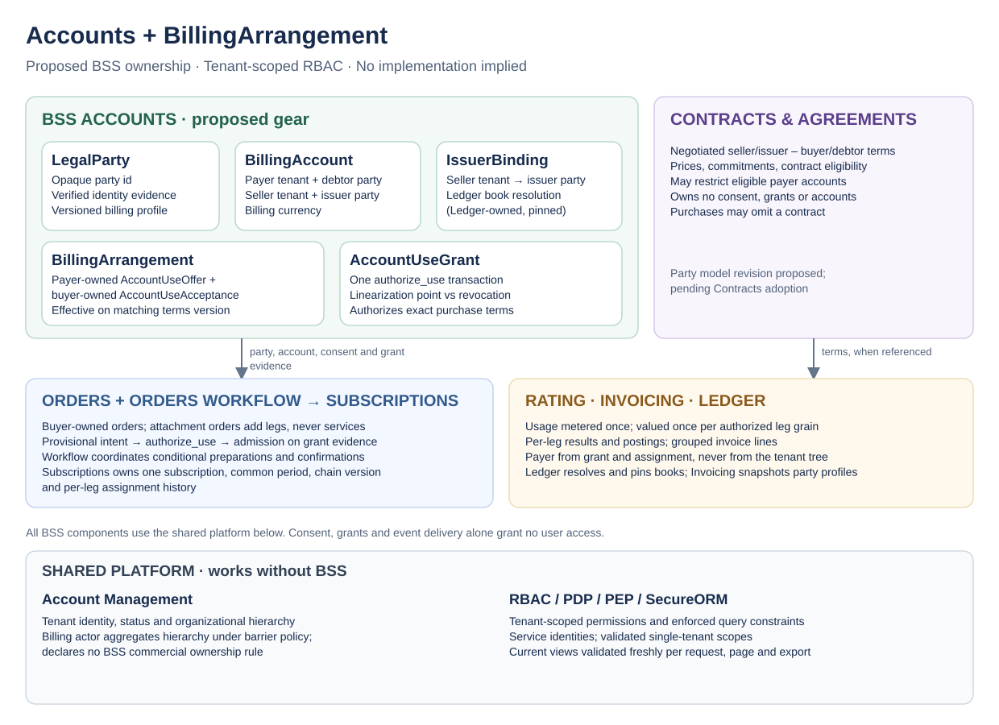

# Keep Commercial Account Use in BSS Accounts and Use Tenant-Scoped RBAC

<!-- toc -->

- [Context and Problem Statement](#context-and-problem-statement)
- [Decision Drivers](#decision-drivers)
- [Considered Options](#considered-options)
- [Decision Outcome](#decision-outcome)
  - [Consequences](#consequences)
  - [Confirmation](#confirmation)
- [Pros and Cons of the Options](#pros-and-cons-of-the-options)
  - [A. BSS Accounts gear owns account use; Contracts owns negotiated terms](#a-bss-accounts-gear-owns-account-use-contracts-owns-negotiated-terms)
  - [B. Account Management owns commercial relationships](#b-account-management-owns-commercial-relationships)
  - [C. Billing-account authorization scopes](#c-billing-account-authorization-scopes)
  - [D. Contracts owns accounts and arrangements](#d-contracts-owns-accounts-and-arrangements)
  - [E. Accounts as a module of a broader Billing gear](#e-accounts-as-a-module-of-a-broader-billing-gear)
- [More Information](#more-information)
- [Traceability](#traceability)

<!-- /toc -->

**ID**: `cpt-cf-bss-adr-commercial-ownership-tenant-rbac`

## Context and Problem Statement

Service consumption, commercial purchase and funding do not follow organizational ancestry: one resource tenant can consume services bought by different commercial buyers and funded by different payers, and one payer can fund services of several tenants. The platform must decide which component owns commercial account-use relationships (who may charge which purchases to whose account), which component owns the billing identity of the legal parties printed on documents, and whether introducing billing accounts requires a new authorization scope. Account Management (AM) must remain usable without BSS. The separate [resale ADR](0003-cpt-cf-bss-adr-multi-tier-resale-model.md) decides how several sales share one service.

## Decision Drivers

- Preserve the boundary between shared tenant management and BSS business rules; AM serves deployments without BSS.
- Separate commercial eligibility, the actual financial assignment of a service, legal-party identity and a user's authority to act.
- Support different payers and sellers across one resource tenant's subscriptions without changing tenant topology.
- Keep tenant-scoped RBAC role assignments and the platform PDP/PEP/SecureORM enforcement path; introduce no speculative account-level authorization.
- Make the moment at which a purchase may use an account unambiguous under concurrent revocation.
- Preserve financial history and attribution when consent, payer or profile data change.

## Considered Options

- **A. BSS Accounts gear owns account use; Contracts owns negotiated terms.** A proposed `bss-accounts` gear owns `BillingAccount`, billing-party identity (`LegalParty`), issuer bindings, the `BillingArrangement` consent (payer-owned offer and buyer-owned acceptance) and the `AccountUseGrant`; Contracts keeps negotiated seller–buyer terms. Role assignments stay tenant-scoped.
- **B. Account Management owns commercial relationships.** AM stores payer/seller eligibility consumed by BSS; role assignments stay tenant-scoped.
- **C. Billing-account authorization scopes.** BSS owns the entities and users receive role assignments on individual billing accounts.
- **D. Contracts owns accounts and arrangements.** The terms gear absorbs operational account lifecycle and consent.
- **E. Accounts as a module of a broader Billing gear.** The same model inside a gear that also absorbs invoicing or settlement responsibilities.

## Decision Outcome

Proposed option: **A**. Introduce a small BSS Accounts gear (`bss-accounts`, working name) as the single owner of:

- `BillingAccount` — fixed to one payer tenant, one commercial seller tenant, one issuer legal party, one debtor legal party and one billing currency;
- `LegalParty` — an opaque canonical identity for the legal parties used as debtor and issuer, with verified identity evidence and versioned, authoritative billing profiles; a narrow billing-party capability, not a general legal registry and not KYC;
- `IssuerBinding` — which issuer parties a seller tenant may invoice under, coordinated with Ledger's book setup;
- `BillingArrangement` — the consent that purchases of one commercial buyer may use one account, recorded as a payer-owned `AccountUseOffer` matched by a buyer-owned `AccountUseAcceptance` on immutable terms;
- `AccountUseGrant` — the durable authorization of one exact use (one purchase or renewal version) against one account, issued in one Accounts transaction that is the linearization point between new uses and revocation.

Contracts remains the owner of negotiated seller–buyer terms and contract-scoped eligibility (Q9). AM retains tenant identity and hierarchy. Ledger owns books, balances, allocation and book resolution; Invoicing owns issued document snapshots; Payments owns payment outcomes and instrument mandates.

Role assignments remain tenant-scoped. Billing accounts are not access scopes: two accounts of one payer provide no confidentiality boundary. A permission on an Accounts resource type (for example, the action to offer account use) is granted through ordinary tenant-scoped roles; that is distinct from, and does not introduce, an account-scoped role assignment. Cross-tenant reads use tenant-owned derived views whose recipients are resolved from the authoritative basis for each view: the grant's payer for funded purchases, the offer's named buyer for invitations, and the recorded debtor and payer attribution for financial documents. Cross-tenant service commands and derived-view production run under dedicated BSS service principals that hold narrow action and resource-type roles assigned at the platform root, through the existing PDP/PEP/SecureORM path, with a mandatory per-call `RootOnly` scope for each named tenant. The service adapter validates that every returned permission path is fenced to that target; broader scopes are rejected. Accounts uses separate payer/buyer scopes in the same transaction, and projectors bind the destination scope to the recipient derived from authoritative source evidence. Deliberate barrier traversal remains restricted to explicitly authorized internal operations. Root roles remain standing privilege: singleton scopes do not cryptographically prove a purchase relationship, so source, recipient and consumer checks remain mandatory. Product rules are in the [Accounts PRD](../../accounts/docs/PRD.md); mechanisms are in the [Accounts DESIGN](../../accounts/docs/DESIGN.md) and the [commercial DESIGN](../../../../docs/arch/bss-commercial-model/DESIGN.md).

The SVG embeds its editable draw.io model and describes proposed boundaries, not delivered components.

### Consequences

- A new gear boundary with its own PRD, DESIGN, SDK, events and lifecycle; no implementation is delivered by this decision.
- The payer of a financial fact is the payer of the account named by that fact's grant and assignment, not a value derived from the tenant tree. Ledger's accepted [book-ownership ADR](../../ledger/docs/ADR/0001-cpt-cf-bss-ledger-adr-book-ownership-predicate.md), its invoice-posting payer rule, the inactive payer-attribution drift sweep and payment rule P6 must be amended by their owner before adoption; this ADR does not amend them.
- Orders decision D-215 must change its predicate from "payer in relationship with the resource tenant" to the Accounts grant for the commercial buyer, and its AM-provided commercial profile is replaced by Accounts.
- Legal-party identity moves from "one tenant is one legal entity" to referenced `LegalParty` ids; Ledger provisioning and Q7 issuer setup depend on this change.
- Cross-tenant service commands and derived-view production use authenticated service identities, narrow action/resource roles and **per-call single-target scopes** via existing `context_tenant_id` + `RootOnly`. Validate the returned scope before use; no whole-platform expansion, manually built scope or `allow_all` fallback. Scope size is independent of platform tenant count; the proposed NFR verification envelope is 100,000 tenants. Existing SDK/TR-plugin evidence is linked in the commercial DESIGN; production action/role/barrier enforcement still requires authorization-owner confirmation before acceptance. No new tenant-closure mechanism is required.
- No separation of user access between two billing accounts of one payer tenant is promised; a demonstrated confidentiality requirement would need a superseding ADR.
- AM-only deployments need no BSS entities; BSS failures must not block AM hierarchy operations.

### Confirmation

Before acceptance: the party/account/consent/grant model is reviewed against the [Accounts PRD](../../accounts/docs/PRD.md); the authorization owner confirms the user paths and the v1 service-principal contract (narrow roles, validated per-call singleton scopes, target lifecycle and internal-path barrier traversal) and the service-path enforcement tests are specified; Ledger, Orders, Subscriptions and Workflow owners accept the named amendments; the [commercial DESIGN scenario checks](../../../../docs/arch/bss-commercial-model/DESIGN.md#43-pre-acceptance-scenario-checks) (sponsored purchases, read freshness, late attribution) are re-read as document-level analysis. No check is claimed executed by this ADR.

## Pros and Cons of the Options

### A. BSS Accounts gear owns account use; Contracts owns negotiated terms

- Good, because AM stays independent of billing terminology and commercial workflows.
- Good, because account usability, consent and grants have one owner and one serialization point.
- Good, because purchases without a negotiated contract remain possible.
- Bad, because it adds a gear, its API, events and admission-consistency rules.
- Bad, because root-assigned service roles remain standing cross-tenant privilege even when each repository operation has a singleton scope. Incorrect source-to-target derivation is still an application risk, requiring bound recipient contexts and explicit negative tests; per-call narrowing alone does not contain a compromised service.

### B. Account Management owns commercial relationships

- Good, because several consumers could share one relationship registry.
- Bad, because the shared tenant service acquires BSS approval, validity and revocation semantics without a non-BSS consumer.
- Bad, because billing agreements would change through a platform component that must also serve deployments without BSS.

### C. Billing-account authorization scopes

- Good, because finance teams could be isolated per account within one payer tenant.
- Bad, because account-level grants, inheritance and related-document access add policy and UX complexity before that requirement exists.
- Bad, because an account scope alone does not resolve access to related orders, subscriptions or documents.

### D. Contracts owns accounts and arrangements

- Good, because it reuses agreement versioning.
- Bad, because a terms-oriented gear absorbs operational account lifecycle and consent, and purchases without contracts would still need an account owner.

### E. Accounts as a module of a broader Billing gear

- Good, because the conceptual model is unchanged.
- Bad, because it requires an explicit decision about which existing Invoicing, Ledger or Payments responsibilities the broader gear absorbs; none is proposed.

## More Information

The proposed component contracts are now specified in [commercial DESIGN §§3.8–3.11](../../../../docs/arch/bss-commercial-model/DESIGN.md#38-orders-terms-and-subscriptions-contracts) and [Accounts DESIGN §§3.7–4](../../accounts/docs/DESIGN.md#37-database-schemas--tables), including GTS schemas, extension/validation/storage rules, SDK operations, state transitions, transaction boundaries, recovery and financial revision handling. These close the design choices for review; owner acceptance and runtime verification remain separate, and this ADR stays **proposed**.

The example throughout the package is one ACME resource tenant with Compute funded by a holding company and Backup funded by ACME itself: distinct financial assignments, not a split of one obligation. The account identifies the payer, the fixed debtor party and the seller/issuer/currency binding; it does not determine document recipients, payment instruments or who is legally liable. Naming precedent: Salesforce uses the term [BillingArrangement](https://developer.salesforce.com/docs/revenue/revenue-management/guide/sforce-api-objects-billingarrangement.html) for invoice allocation including percentage splits; this ADR uses the name for consented account use only.

## Traceability

- [Accounts PRD](../../accounts/docs/PRD.md): `cpt-cf-bss-accounts-fr-party-identity`, `cpt-cf-bss-accounts-fr-account-binding`, `cpt-cf-bss-accounts-fr-arrangement`, `cpt-cf-bss-accounts-fr-use-grant`, `cpt-cf-bss-accounts-fr-seller-setup`, `cpt-cf-bss-accounts-nfr-isolation`
- [Accounts DESIGN](../../accounts/docs/DESIGN.md): `cpt-cf-bss-accounts-design-architecture`
- [Commercial PRD](../../../../docs/arch/bss-commercial-model/PRD.md) and [commercial DESIGN](../../../../docs/arch/bss-commercial-model/DESIGN.md): `cpt-cf-bss-commercial-model-design-architecture`
- [Resale ADR](0003-cpt-cf-bss-adr-multi-tier-resale-model.md): `cpt-cf-bss-adr-multi-tier-resale-model`
- Ledger: [book-ownership ADR](../../ledger/docs/ADR/0001-cpt-cf-bss-ledger-adr-book-ownership-predicate.md) (`cpt-cf-bss-ledger-adr-book-ownership-predicate`, amendment required)
