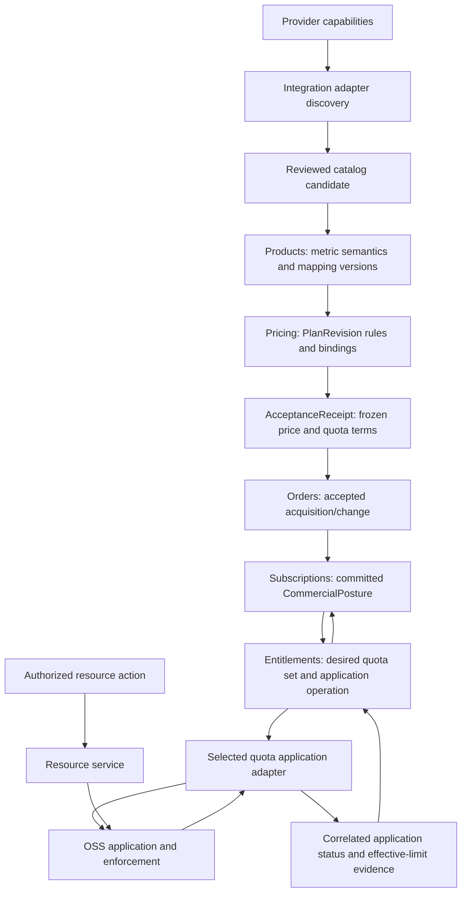

# Technical Design — Commercial Quotas


<!-- toc -->

- [1. Architecture Overview](#1-architecture-overview)
  - [1.1 Architectural Vision](#11-architectural-vision)
  - [1.2 Architecture Drivers](#12-architecture-drivers)
  - [1.3 Architecture Layers](#13-architecture-layers)
- [2. Principles & Constraints](#2-principles--constraints)
  - [2.1 Design Principles](#21-design-principles)
  - [2.2 Constraints](#22-constraints)
- [3. Technical Architecture](#3-technical-architecture)
  - [3.1 Domain Model](#31-domain-model)
  - [3.2 Component Model](#32-component-model)
  - [3.3 API Contracts](#33-api-contracts)
  - [3.4 Internal Dependencies](#34-internal-dependencies)
  - [3.5 External Dependencies](#35-external-dependencies)
  - [3.6 Interactions & Sequences](#36-interactions--sequences)
  - [3.7 Database schemas & tables](#37-database-schemas--tables)
  - [3.8 Deployment Topology](#38-deployment-topology)
- [4. Additional context](#4-additional-context)
  - [4.1 Future scope](#41-future-scope)
  - [4.2 Integration qualification gates](#42-integration-qualification-gates)
  - [4.3 Contract conformance criteria](#43-contract-conformance-criteria)
  - [4.4 Qualification evidence](#44-qualification-evidence)
- [5. Traceability](#5-traceability)

<!-- /toc -->

- [ ] `p1` - **ID**: `cpt-cf-bss-quotas-design-lifecycle`

**Status: draft design.** Logical models and operations below define the required contracts. [§4.2–4.4](#42-integration-qualification-gates) specifies integration qualification and required evidence; [PRD §9](PRD.md#9-acceptance-criteria) defines business acceptance criteria.
## 1. Architecture Overview

### 1.1 Architectural Vision

Quota management spans Products, Pricing, Subscriptions, Entitlements and the enforcement providers. Products describes resources; Pricing stores quota rules on plans and freezes accepted terms; Subscriptions commits purchased posture; Entitlements derives, applies and reconciles limits. QE and resource providers own enforcement state. No separate Quota Manager gear, catalog, purchase ledger or counter store is required.

A provider capability is technical evidence; a plan rule is an offer; a receipt preserves accepted terms; and a correlated adapter result proves the required application outcome. None of these alone substitutes for the next owner's authorization or readiness decision. The BSS-selected adapter may maintain several internal limits, but they represent one purchased allowance.

Each quota assignment has one BSS-selected adapter binding. Entitlements submits the complete desired quota set as one operation and tracks its application through that adapter. The adapter coordinates every OSS system needed to establish those limits and reports one correlated result. Its internal systems, ordering and recovery steps are outside the BSS orchestration model.

### 1.2 Architecture Drivers

| Driver | Architectural response |
| --- | --- |
| Exact accepted rights | Immutable descriptor/rule/binding snapshots; derive from committed posture and retained receipt |
| Shared tenant allowance | Verified resource-owner mapping, one exclusive source, mandatory aggregate admission |
| Consistent application | One desired set, one adapter operation, complete-result confirmation and no duplicate allowance |
| Lost replies and stale commands | Stable source identity, provider fencing, durable observations and terminal tombstones |
| Small ownership surface | Fulfillment in Entitlements, runtime in QE, no second orchestration gear |

| NFR ID | Allocation | Verification |
| --- | --- | --- |
| `cpt-cf-bss-quotas-nfr-isolation` | Owner SDK admission, authorized resource bindings, source ownership and scoped reads | Q-C11, Q-C48 |
| `cpt-cf-bss-quotas-nfr-durability` | Transactional intake/outbox, source-head CAS, operation recovery, retained fences | Q-C08, Q-C09, Q-C23, Q-C24, Q-C25, Q-C41, Q-C43, Q-C51 |
| `cpt-cf-bss-quotas-nfr-operations` | Versioned profile bounds, platform task runtime, finding/escalation state | Q-C52, Q-C54 |

### 1.3 Architecture Layers

- [ ] `p1` - **ID**: `cpt-cf-bss-quotas-tech-owner-boundaries`



Presentation uses owner SDKs. Commercial/application layers contain immutable evidence and desired state. Provider infrastructure remains in adapters. There is no dependency from QE into Pricing or Subscriptions during VM admission.

## 2. Principles & Constraints

### 2.1 Design Principles

- [ ] `p1` - **ID**: `cpt-cf-bss-quotas-principle-single-authority`

Each fact has one authority: Products for metric meaning; Pricing for accepted terms; Subscriptions for current commercial posture and activation T; Entitlements for desired delivery and its manifest; each provider for its actual effects; resource authority for physical existence. An observation never silently edits its upstream source. Quota accounting is not a second billing ledger.

### 2.2 Constraints

- [ ] `p1` - **ID**: `cpt-cf-bss-quotas-constraint-qualified-profiles`

Initial scope is bounded allocation, exclusive commercial source, and one provider scope per assignment. Two metrics such as vCPU and RAM require qualified multi-member apply and admission behavior. Lack of that behavior blocks the two-metric offer; it does not reduce the requirement to two unrelated best-effort writes. The adapter owner must demonstrate these observable guarantees; the OSS design selects its reservation, concurrency and recovery mechanisms.

The baseline follows [ToolKit](../../../../docs/toolkit_unified_system/README.md), [design review criteria](../../../../guidelines/DESIGN_REVIEW.md) and owner SDK boundaries. No external call occurs inside a local DB transaction or while holding a distributed lock. No direct provider-table mutation, manual AccessScope construction or unscoped service-principal bypass is introduced.

## 3. Technical Architecture

### 3.1 Domain Model

- [ ] `p1` - **ID**: `cpt-cf-bss-quotas-entity-evidence-chain`

| Logical entity | Owner | Required content / invariant |
| --- | --- | --- |
| ProviderCapabilityCandidate | Products stores adapter evidence for catalog review | GTS-validated capability record, saved adapter target, complete discovery snapshot/revision, resolved reference digests and observation time; not sellable |
| MetricSemanticsVersion | Products | SKU/version, metric code, exact unit conversions, Allocation/Consumption support, subject/resource kinds, point-of-use support, immutable digest |
| EnforcementMappingVersion | Products with adapter owner evidence | Registered QE metric and subject projection, provider metric/scope mapping, provider/profile versions and digest; retain historical mappings |
| CapabilityQualification | Products stores adapter-owner evidence and catalog availability | Immutable qualification ID/revision, adapter and contract versions, applicable target/profile, metric/unit/mapping digests, jointly supported operations and constraints, measured bounds and evidence references; separately audited availability for new sales |
| PlanQuotaRule / QuotaBinding | Schema meaning: Entitlements; storage: Pricing | Rule version/digest, metric/accounting/scope policy evidence, scope selection, kind/unit, `Fixed` or `PerPlanUnit`, applicability, logical binding, `ExclusiveSource`, validity/restrict/revoke behavior, required profile |
| Accepted charging terms | Pricing / financial owner contracts | Versioned package/usage charge rules, billing-meter references, inclusion terms and applicable service/resource binding; frozen with the quota terms, interpreted by Rating/Billing |
| AcceptedQuotaSnapshot | Pricing | Rule/binding snapshots or durable immutable references with digests, original plan quantity, selected dimensions, tenant axes, terms/profile and purchase identity; frozen alongside price |
| CommercialPostureV1 | Subscriptions | Aggregate revision/digest, effective quantity, Granted/Restricted/Revoked, intervals, accepted provenance, operation/preparation and resource disposition evidence |
| QuotaAccountingPolicy / QuotaScopePolicy | Products publishes registered definitions; adapter owner qualifies interpretation | Immutable policy identity/content evidence, allocation-state/release semantics and exact aggregation/dimension contract; retained in plan/receipt/assignment evidence |
| QuotaExclusivityClaim | Subscriptions protected acquisition admission | Canonical cross-payer ownership domain, acquisition identity, scope/terms evidence, durable version and retained safe-reuse fence |
| QuotaAssignment | Entitlements | Stable acquisition identity, resource owner/scope, source namespace, logical members, one saved adapter binding and current desired head |
| DesiredQuotaSet | Entitlements | Complete source-owned members, exact caps, restriction/tombstones, effective boundary, revision/digest and authority context |
| QuotaApplication | Entitlements | One operation ID, source revision/digest, complete desired member set, saved adapter binding and correlated application result |
| AdapterObservation | Entitlements journal, adapter evidence | Source/member, operation/revision/digest, ordered application and effective-restriction evidence, observation time and recoverable outcome |
| Allocation identity | QE and resource service/provider | Stable operation/resource generation linking holds, actual resource outcomes and settlement; survives activation and retries |
| Allocation release evidence | Resource service/provider authority; consumed by runtime quota accounting | Authorized allocation and resource generation, stable release identity, metric/unit, confirmed released amount and recoverable evidence; duplicate delivery cannot settle twice |

This table defines logical entities. Section 3.3.1 specifies the target GTS discovery contract for implementation in Products SDK; it does not claim that DTOs or registrations are already delivered. Owner SDK changes must preserve these semantics. GTS is used for extensible metric/subject/provider contracts where required by the owner; ordinary closed lifecycle states remain closed enums. Persisted GTS identifiers follow the platform UUID representation.

### 3.2 Component Model

- [ ] `p1` - **ID**: `cpt-cf-bss-quotas-component-commercial-chain`

| Component | Owns | Does not own |
| --- | --- | --- |
| Products | Resource semantics, reviewed mappings, qualification evidence and availability, immutable history | Commercial cap, purchase, counter |
| Pricing | Plan rules, complete quota-set validation and atomic accepted price/quota snapshot | Live provider mutation, actual remaining |
| Orders / Workflow | Purchase/change orchestration with exact receipt/line identity | Arbitrary cap authority or counter adjustments |
| Subscriptions | Committed quantities/lots, posture, activation arbitration and recovery | Adapter selection or runtime usage accounting |
| Entitlements | Rule semantics, desired state, adapter operations, readiness, delivery and fulfillment findings | Pricing, operational quota usage/read models, physical allocation or private provider storage |
| QE and OSS quota services | Numerical policy evaluation, holds/ledger/counters, effective limits and operational quota read contracts | What a customer purchased, invoices or commercial fulfillment decisions |
| Quota application adapters | Accept desired quotas from Entitlements, apply them through OSS and return correlated application/recovery evidence | Commercial terms and subscription lifecycle; OSS routing and application mechanisms are specified in each adapter design |
| Resource service | Authorized operation coordination and actual resource generation correlation | Inventing purchase capacity or unproved release |

Quota Resolver is an optional runtime facade between a consumer and a selected enforcement backend. Its subject mapping must preserve resource-owner attribution and retry identity. Commercial provisioning remains in Entitlements. The OSS runtime contract must preserve admission across all required metrics and correct allocation/release accounting. Its API composition and implementation belong to the OSS design.

### 3.3 API Contracts

- [ ] `p1` - **ID**: `cpt-cf-bss-quotas-interface-owner-contracts`

The following versioned semantic operations belong to the owner SDKs. Wire types and endpoints must preserve the authority, ordering, idempotency and recovery guarantees defined here.

#### 3.3.1 Catalog onboarding and plan publication

Catalog entry supports manual technical authoring and adapter-assisted discovery. Discovery is read-only against provider systems; it stages candidates. Product engineering approves identity, scope, units and enforcement support, registers the QE metric/projection through the metric owner, and publishes an immutable Products descriptor plus mapping. A periodic discovery diff proposes a new version or flags capability drift; it never edits accepted terms or provider tenant caps.

**GTS capability discovery contract.** Products owns the catalog-facing contract in `products-sdk`; the adapter implements its discovery plugin interface. This is a target SDK/schema contract, with registration and conformance required by G02 before use. It describes allocation limits, not collected usage events or derived billing meters. Sharing a label or unit with a usage meter does not establish equivalent quota semantics.

| GTS schema | Role and ownership |
| --- | --- |
| `gts.cf.bss.products.quota_unit.v1~` | Products-owned, concrete final schema for named unit instances: `id`, `symbol`, `canonical_unit_ref`, `numerator`, `denominator`. Conversion is exact rational multiplication into the canonical unit. |
| `gts.cf.bss.products.quota_metric.v1~` | Products-owned, concrete extensible schema for named metric instances: `id`, `name`, localized `display_name` and `description`, `quota_kind`, `canonical_unit_ref`, `properties`. `quota_kind` is the closed value `allocation` in this contract version. |
| `gts.cf.bss.products.quota_accounting_policy.v1~` | Products-owned concrete final schema for named allocation-accounting policies; required fields and OSS obligations in §3.3.1.3. |
| `gts.cf.bss.products.quota_scope_policy.v1~` | Products-owned concrete final schema for named aggregation/dimension policies; required fields and binding rules in §3.3.1.3. |
| `gts.cf.bss.products.quota_capability.v1~` | Products-owned, concrete extensible schema for adapter discovery records. Invariant fields are specified below; derived schemas may add validated adapter metadata under `properties`. |
| `gts.cf.toolkit.plugins.plugin.v1~cf.bss.products.quota_discovery.v1~` | Products discovery plugin specification derived from the ToolKit plugin base; adapter instances implement the discovery interface and are selected by BSS configuration. |

The metric and capability bases permit direct instances. Derived schemas use `allOf` and a `gts://` reference to their base, preserving every invariant field. For example, `gts.cf.bss.products.quota_capability.v1~cf.bss.products.allocation_capability.v1~` can add a reviewed allocation-specific metadata schema. Extension values cannot override units, scope, bounds or declared operations. New metadata can be retained without a database migration; behavior requiring an unimplemented semantic capability prevents qualification. The unit and policy schemas use `x-gts-final: true`; no schema above is abstract. Metric and capability bases remain extensible and constrain extensions to `properties`. Unit/metric instance IDs are narrowed to their declaring schema, and a capability `type_id` must identify that record's registered schema. Schema-only `x-gts-*` keywords are never accepted as instance metadata.

A metric or unit is a **well-known instance**, not a schema per CPU size, purchased quantity or tenant. Example identities are `gts.cf.bss.products.quota_metric.v1~cf.bss.products.vcpu.v1` and `gts.cf.bss.products.quota_unit.v1~cf.bss.products.vcpu.v1`. The final segment has no trailing `~`. Capability observations are anonymous records with UUID `id` and GTS `type_id`; the registered schema declares that discriminator. All references name explicit GTS identities; no `latest` or wildcard references are accepted. Publication and purchase also retain resolved registry content/revision evidence and digests, because a major-only identity alone does not pin historical content.

**Plan-authoring presentation.** Each metric includes a nonempty `name` for technical identification and required `display_name` and `description` objects mapping locale tags to nonempty plain-text strings. Both maps must contain an English (`en`) value; additional translations are optional. The form uses the requested locale when available and falls back to `en` independently for each field. The GTS instance ID remains the identity; translated text is never a lookup key or an arithmetic input.

Products owns and reviews these texts together with the metric definition. The description explains what is limited, whether the allowance is shared across the subject's resources, and any relevant accounting conditions. If accounting for stopped resources differs by adapter profile, the description must state that dependency and the form must show the selected profile's reviewed conditions; it must not promise release on stop merely from a generic metric label. Text changes follow immutable catalog-definition versioning and cannot silently change accepted semantics.

The plan form resolves `metric_ref` to its title and description, obtains the canonical unit symbol through `canonical_unit_ref`, and uses the selected adapter capability for supported scope, operations and numeric bounds. Bounds expressed in the adapter's `unit_ref` must be converted exactly before validation in the plan's unit. The author supplies the commercial amount and rule basis. The form must not present a technical maximum as the purchased amount. Missing required display text prevents publication of the metric for plan authoring.

**Discovery operation and ownership.** The proposed `ProductsQuotaDiscoveryPluginClientV1::list_capabilities(ctx, request)` is a read-only, versioned SDK call resolved by Products through scoped ClientHub. `ctx` is the authorized catalog/integration context. The request carries the saved adapter target binding, optional opaque cursor and bounded page size (default 50, maximum 200). The reply contains `snapshot_id` (UUID), `source_revision` (nonnegative integer encoded as a decimal string), `observed_at` (UTC timestamp), `item_count` (whole-snapshot nonnegative integer), `content_digest` (canonical whole-snapshot SHA-256), `items` and optional `next_cursor`. Count/digest verification follows §3.3.2; the snapshot digest excludes pagination cursors and the digest field itself. An immutable snapshot covers one adapter target; its revision is monotonic within that binding. Continuation cursors bind authorization scope, target and snapshot. An expired snapshot requires a new discovery run, never concatenation of pages from different revisions. Failed or incomplete discovery cannot be interpreted as removal of capabilities.

Each `items` entry has the following required fields unless marked optional:

| Field | Shape and meaning |
| --- | --- |
| `id`, `type_id` | Stable UUID for this record within the snapshot, and the registered capability schema or a compatible derived schema |
| `capability_key` | Opaque stable identity within the selected adapter target, distinct from a mutable display name |
| `metric_ref` | GTS instance reference narrowed to `quota_metric.v1~`; names the allocation metric, not a usage value |
| `unit_ref` | GTS instance reference narrowed to `quota_unit.v1~`; unit in which the adapter accepts the limit |
| `subject_type_ref`, `resource_type_refs` | Registered concrete GTS type references for the supported quota subject and affected resources; nonempty resource list. Type references describe kinds, not an actual tenant/resource identity. |
| `limits` | `min`, `step`, optional `max`, all exact nonnegative decimal integer strings; `step` is positive. Valid amounts are `min + n × step`, within `max` if supplied. Missing `max` means no advertised technical upper bound, not an unlimited purchased allowance. |
| `operations` | Closed v1 object with explicit booleans `apply`, `read_application`, `recover_operation`, `restrict`, `revoke`, `resume`; absent flags are invalid. No inference from a plugin name. |
| `mapping_key` | Opaque version-pinned adapter mapping reference for translating the catalog metric into OSS configuration; Products preserves it in the enforcement mapping. No provider API field or credential enters the plan rule. |
| `accounting_policy_ref`, `scope_policy_ref` | Registered named policy instances defined in §3.3.1.3; resolve actual type ancestry and retain content digests. |
| `change_support` | Explicit initial installation/increase/decrease and occupancy-preservation support, as defined in §3.3.1.3; qualification is required before sale. |
| `properties` | Object validated against the concrete GTS schema; empty for the base example |

This inventory declares capabilities, not qualification or physical stock. Consistent application, admission, scope ownership and release guarantees still require profile conformance. Quota tenant bindings and live values are not returned by discovery.

**Units and exact arithmetic.** A canonical unit references itself with numerator and denominator both `1`. A noncanonical unit references that canonical instance directly and supplies a positive reduced rational factor; chains, cycles other than a canonical self-reference, offsets and floating-point conversions are refused. Metric canonical unit and adapter unit must resolve to the same canonical identity. `GB` and `GiB`, for example, resolve to bytes with factors `1000000000/1` and `1073741824/1`; the symbol alone is not identity. Every unit integer uses decimal-string encoding. Conversion must be exact and within supported numeric bounds, including the adapter's step; matching names never authorize rounding or substitution.

Illustrative registered unit and metric instances (the example identifiers name proposed contract records, not registrations performed by this document):

[quota-metric-unit.instances.json](schemas/quota-metric-unit.instances.json)

Illustrative discovery reply; the subject/resource schema identifiers stand for registered owner schemas in the example deployment. They must resolve and pass type/authority validation before intake:

[quota-capability-discovery.example.json](schemas/quota-capability-discovery.example.json)

Here `1024` is an illustrative technical bound, not the tenant's entitlement. A plan can sell `10` in the referenced unit after review and qualification; its purchased value is absent from the discovery response.

**Registry and catalog storage.** Types-registry stores GTS schemas, named metric and unit definitions (including their presentation text), and discovery plugin registrations. Products references those exact identities and retains discovery snapshots/candidates, product and enforcement mappings, review history, qualification and sale availability. Products does not maintain a competing registry of GTS definitions; immutable evidence snapshots serve provenance. Pricing stores plan quota rules and commercial amounts. Neither the GTS registry nor the Products catalog stores live tenant quota usage.

**Registration, validation and publication.** Products registers its base schemas and discovery plugin specification in types-registry. Authorized metric/unit owners register immutable named definitions; adapter owners register approved derived schemas and plugin instances. The plugin specification derives from the `PluginV1` identifier exported by ToolKit; Products resolves configured adapter instances through its public service and scoped ClientHub, without consumers depending on plugin implementations. SDK schemas are generated with `#[gts_type_schema]` and `gts_schema_with_refs_as_string()`; JSON Schema `$id`/`$ref` use `gts://` URI form, and references declare `x-gts-instance-ref`/`x-gts-type-ref` narrowing. Intake also resolves every referenced record and verifies its actual registry ancestry; syntactic narrowing alone is insufficient. GTS supplies identity and validation, not transport or permission to publish.

Products authenticates the call context, then parses, resolves and validates every record/reference, checks registry ancestry and unit semantics, authorizes the publisher/target/catalog scope and persists a candidate. A payload's GTS vendor prefix or subject type is not proof of tenant authority. Unknown types, wrong reference families, unsupported major versions, invalid conversions or conflicting snapshots cannot become sellable catalog entries. Registry outages leave intake retryable, with no permissive fallback. Errors are classified as invalid reference/schema/unit, unsupported version/capability, source conflict, forbidden scope or unavailable dependency, with safe RFC 9457 projections where exposed over HTTP.

Products stores candidates scoped to the authorized catalog and adapter target. Replaying the same binding/revision and content is idempotent; changed content at that revision conflicts. The candidate retains the complete source snapshot and resolved schema/instance digests. Indexed GTS references use the platform deterministic UUID representation; extension `properties` use JSONB. Reference ancestry is resolved by types-registry, never SQL string matching. This introduces no duplicate registry of GTS definitions.

Product engineering reviews the candidate and publishes immutable `MetricSemanticsVersion` and `EnforcementMappingVersion` records. Only that approved catalog version may enter plan authoring. Manual authoring uses the same registered GTS identities, validation and approval path, with explicit author provenance; it cannot invent an unregistered unit or waive adapter qualification. Complete later discovery may report drift or retirement for review, but never rewrites published terms, automatically unpublishes an accepted purchase or changes live tenant limits.

Schema evolution and capability observations have separate versions. Platform `gts.cf.*` schemas and instances use major-only identities. Compatible schema changes use compatibility-checked content revisions of the existing major-only identity; breaking changes require a new major. A family opened as `v1~` cannot evolve by adding `v1.0~` or `v1.1~`. A major-only identity alone does not freeze its content: retain the resolved registry revision/evidence, schema/dependency content and digests with each approved definition and accepted snapshot. Changes to unit meaning, conversion, metric semantics or mapping require a new immutable definition/version and explicit catalog review, even if the JSON shape is unchanged. Reuse of an identifier with different semantics is forbidden. Accepted purchases retain exact references, immutable content and digests; missing historical evidence blocks reinterpretation. A catalog quota metric and an OSS enforcement metric are distinct roles connected by `EnforcementMappingVersion`; equality of their display names or units is insufficient. The types-registry/QE metric registration remains an OSS owner obligation, not an effect of publishing a Products metric.

Provider values fall into four classes: countable resource limits, feature grants, financial controls, and operational/retention policies. Only a qualified numerical resource mapping enters this quota profile. Provider defaults and configured scope caps are technical evidence, not catalog prices or available stock. There is no import of provider customer balances as purchased rights.

**Qualification and availability for sale.** The adapter owner supplies conformance evidence for an identified integration version, including its contract version, applicable target/profile, metric/unit/mapping/accounting-policy/scope-policy digests, supported combinations and change directions, numeric constraints and measured operational bounds. Declaring `operations.apply = true` or registering a GTS record alone does not establish qualification. The adapter owner verifies OSS behavior; Products and Pricing consume that evidence without implementing OSS tests or resource scheduling themselves.

Products stores the immutable `CapabilityQualification` record and controls its availability for new plan publication and purchases through authorized catalog operations. The qualification references the accepted evidence, responsible adapter owner and tested configuration. Availability is separate from the evidence version: an authorized catalog owner may enable a matching qualified record or disable it with an audited reason. The adapter owner can withdraw its qualification evidence; withdrawn evidence is ineligible for new sales. Changed adapter/contract/mapping semantics require matching qualification before enablement; discovery cannot promote a candidate automatically. Qualification runs may use isolated test scopes before the capability is enabled for commercial use.

Pricing validates the complete required quota set against Products' enabled qualification when publishing a plan and accepting a purchase/change. Validation covers exact metric, unit, accounting and scope policy versions, subject/resource types and scope selections, converted values and steps, change direction and required lifecycle operations and joint application constraints. Separate qualification of vCPU and RAM does not prove that the selected integration can fulfill a plan requiring both together. Unsupported or unresolved validation returns a specific reason and cannot silently omit a member or select another adapter. Publication and acceptance retain the qualification identity/version and availability evidence used by the decision; stale draft validation is not proof of current eligibility.

Disabling or withdrawing qualification blocks new publication and purchases using that capability; it does not erase accepted purchases, change their limits, revoke resources or decide refunds. Existing obligations retain their pinned terms and go through the application/recovery contract if fulfillment becomes unavailable. Physical capacity checks and reservations remain OSS responsibilities. Successful plan validation proves compatibility with the qualified quota contract, not availability or reservation of hardware.

Pricing publication resolves all descriptor/mapping digests, exact conversion bounds, applicability, scope and required profile. The quota rule extension is separately versioned and optional for existing clients. Absence means no purchased quota declaration. Products supplies technical meaning; seller authoring supplies commercial amounts. Entitlements owns the rule schema without owning a competing rule repository.

| Example offer | Accepted quantity | Result |
| --- | --- | --- |
| PerPlanUnit(10 vCPU), PerPlanUnit(20 GB) | 1 | 10 vCPU, 20 GB |
| Same rules | 2 | 20 vCPU, 40 GB |
| Fixed(10 resource instances) | 2 | 10 resource instances, not 20 |
| Another plan for same SKU with PerPlanUnit(20 vCPU) | 1 | 20 vCPU only for its own accepted purchase |

`GB = 10^9 bytes` and `GiB = 2^30 bytes` are different terms. Conversion to the provider's integer unit must be exact; no rounding down or up to fit a provider RAM quantum. A 20 GB offer is refused for a provider that cannot express that exact capacity; a separately authored 20 GiB offer may be valid. Discrete vCPU quantities must produce an integer. Overflow, fractional integer result and unknown variants fail before effects.

**Quota rules and charging terms.** A plan has separate quota and charging rules associated with the applicable service/resource binding. `PlanQuotaRule` defines allowed allocation and quantity scaling. Pricing's charge rules define package fees, usage rates and inclusions; their versioned references are retained with accepted terms. Rating/Billing interpret those rules through their owner contracts. There is no `paid` discriminator on a quota metric or capability, and no price or tariff is needed in the quota-application request.

| Example plan | Allocation rule | Charging terms for that metric |
| --- | --- | --- |
| Resource package | Tenant ceiling of 20 vCPU | Fixed package fee per period; allocated vCPU usage within the ceiling is included |
| Usage-priced service | Tenant ceiling of 20 vCPU | Charge allocated vCPU over time using the accepted billing meter and rate; no usage means no charge for that usage component |
| Mixed service | Tenant ceiling of 20 vCPU | Package fee includes a defined billing-usage allowance; further usage is charged under the accepted tariff while the allocation ceiling still applies |

All three can produce the same desired OSS cap of 20. Allocating a 4-vCPU VM occupies 4 of the 20 in each case; its cost follows the accepted charging terms. An allocation metric such as vCPU is not the billing meter vCPU-hours. Meter identity, measurement semantics (allocated capacity versus utilization), period, rate and included amount must be explicit in the charging contract, not inferred from a quota label or instantaneous counter. A billing inclusion being exhausted does not itself change the quota cap; any required access restriction arrives through authorized commercial posture. Payment timing is likewise separate: usage pricing is not synonymous with postpayment.

The plan form shows the allocation ceiling and charging terms separately, including what usage is included. It resolves quota capability data through Products and charge details through the Pricing/usage owner contracts. Quota acceptance retains the association with the frozen charging terms but creates no competing billing meter or included-usage ledger. Usage pricing does not authorize allocations beyond the hard cap, and charging for usage beyond a billing inclusion is not permission to exceed that cap.

##### 3.3.1.1 Catalog reads for plan authoring

The discovery plugin is a provider-facing input. The plan editor reads the approved Products catalog through the proposed `ProductsQuotaCatalogClientV1` in `products-sdk`. These are target contracts to implement under G02, not existing SDK methods. Products owns their authenticated REST projection. Neither the editor nor Pricing calls the discovery plugin or browses all types-registry records to decide what may be sold.

| Proposed SDK method | REST projection | Request and result |
| --- | --- | --- |
| `list_quota_definitions(ctx, request)` | `GET /bss-products/v1/quota-definitions` | Required `sku_id` and exact `sku_version`; optional `subject_type_ref`, `resource_type_ref`, `profile_id`, locale and availability filter; bounded page size and opaque cursor. Returns approved definition versions applicable to that SKU and authorized catalog scope. Default availability is `enabled`; authorized `all` includes disabled/withdrawn definitions with reasons. |
| `get_quota_definition(ctx, definition_id, version, locale)` | `GET /bss-products/v1/quota-definitions/{id}/versions/{version}` | Returns the exact immutable definition plus its separately identified current availability observation. Disabled historical versions remain readable within the caller's scope. There is no implicit upgrade to the latest version. |
| `validate_quota_set(ctx, request)` | Internal Products SDK operation, called by Pricing | Receives exact definition references, amounts/units, logical bindings, selected SKU versions and validation purpose (`authoring` or `acceptance`) for one complete applicable set. Acceptance also supplies effective committed/purchased quantity as appropriate; validate the resulting Fixed/PerPlanUnit limits, not only their coefficients. Returns per-rule and cross-rule checks, qualification evidence and availability observations. It validates commercial compatibility; it neither reserves capacity nor applies quota. |

A `QuotaDefinitionVersion` is a Products catalog record, identified by UUID `definition_id` and positive decimal-string `version`. It assembles an approved SKU/version, metric semantics, enforcement mapping and qualified profile for selection in a plan. It references the registered GTS metric/unit records; it does not register a second metric identity. A new mapping or changed semantics creates a new definition version. Availability changes do not mutate that immutable content.

Each definition response contains:

| Field | Meaning |
| --- | --- |
| `definition_id`, `version`, `definition_digest` | Exact catalog identity and content digest, including the pinned definition dependencies |
| `sku_id`, `sku_version` | Product applicability; Pricing verifies these against the selected plan item |
| `metric_ref`, `metric_digest`, `quota_kind` | Registered metric instance, retained content digest and `allocation` kind |
| `display_name`, `description`, `locale` | Resolved reviewed text with the English fallback from §3.3.1; identity is independent of localization |
| `canonical_unit_ref`, `allowed_units` | Canonical unit and allowed plan units; each includes `unit_ref`, content digest, symbol, exact conversion and `min`/`step`/optional `max` in that unit |
| `subject_type_ref`, `resource_type_refs` | Supported ownership and resource types, validated through registry ancestry |
| `mapping_ref`, `profile_ref`, `qualification_ref` | Opaque immutable owner references, each `{id, version, digest}`; profile fixes aggregation, lifecycle and required operations |
| `accounting_policy_ref`, `accounting_policy_digest`, `accounting_policy` | Exact registered policy identity, retained digest and resolved allocated-capacity accounting semantics. |
| `scope_policy_ref`, `scope_policy_digest`, `scope_policy`, `change_support` | Exact scope policy and supported qualified changes from §3.3.1.3; no runtime usage is exposed. |
| `profile_conditions`, `supported_bases` | Reviewed localized accounting conditions and supported `Fixed`/`PerPlanUnit` bases |
| `availability` | Current `{state, revision, observed_at, reason_code}`; state is `enabled`, `disabled` or `withdrawn`, reason is nullable when enabled |

SDK list results use `{items, next_cursor}`. REST uses the Products browse envelope `{rows, page_info: {next_cursor}}`. Page size defaults to 50 and is limited to 200. The REST names are `limit` and `cursor`, with `$top`/`$skiptoken` aliases; typed equality filters use `$filter` and the fields listed above. Conflicting aliases and unsupported filters are invalid. Order is ascending `(definition_id, version)` with numeric version comparison. Cursors bind authorized catalog scope, filters and order; changing them requires a fresh list. Reauthorize every page. Availability is observed at read time, so pagination is not a sale reservation or a frozen eligibility decision. Dependency failure returns an error, never an empty successful catalog.

The list supplies all fields needed to render the picker without per-row registry calls. An editor adding a rule selects an exact definition version and allowed unit, enters the commercial amount and basis, and selects its plan item/logical binding. It must show the profile conditions and disabled reason. Pricing independently resolves and validates those references; UI filtering is not authorization or publication validation.

Illustrative catalog response (UUIDs and 64-character lowercase hexadecimal SHA-256 digests are placeholders; referenced records require real registration and validation): [quota-catalog-list.example.json](schemas/quota-catalog-list.example.json).

##### 3.3.1.2 Pricing objects and authoring methods

Quota rules are a versioned extension of `PlanRevision`. They describe what a selected service grants, independently of the charge configuration.

| Pricing object | Quota extension |
| --- | --- |
| `Plan` | Stable plan identity; quota content belongs to its revisions. No mutable plan-wide cap overrides a published revision. |
| `PlanRevision` / `PricingPlanRevisionReadDto` | `quota_rules` collection and `quota_rules_digest`, included in the revision's content/version and approval evidence. Initial limit: 200 rules per revision. Empty means no quota declaration. |
| `PlanItem` | Referenced by `item_id` in each quota rule; supplies the selected SKU and existing dimension selection. It does not store a second copy of the cap. |
| `PriceBookEntry` / `Price` | Continue to describe charges. Quota amounts are not price quantities, rates, `included_qty` or usage-meter inclusions. |
| `PricingPlanChecksDto` | Existing checks include quota reference, numeric, applicability, qualification and complete-set checks. Check subjects gain optional `quota_rule_id` and `field` alongside the existing item/SKU references. |
| `ResolvedBindings` | Versioned read extension with the selected `quota_terms` and `selected_quota_digest`, resolved alongside the requested item/dimension bindings. It is a preview, not acceptance or authority to grant. |
| `AcceptanceReceipt` / `AcceptedQuotaSnapshot` | Exact selected rules, definition/dependency evidence, rule-set digest, binding selections and original quantity, frozen atomically with accepted charging terms. A receipt is purchase evidence, not a live plan lookup. |

The proposed `PricingQuotaAuthoringClientV1` in `pricing-sdk` exposes the following operations. Its implementation shares the existing Pricing plan authoring service and authorization; it is not another plan store. Existing plan routes and DTOs are extended where indicated.

| Method / operation | REST contract | Behavior |
| --- | --- | --- |
| `get_quota_rules(ctx, revision_id)` | New `GET /bss-pricing/v1/plan-revisions/{id}/quota-rules` | Returns `{revision_id, quota_rules, quota_rules_digest}` with the same revision ETag as the full revision read. The bounded collection is returned whole. Full `GET /plan-revisions/{id}` also includes the quota fields. |
| `replace_quota_rules(ctx, revision_id, expected_version, operation_id, rules)` | New `PUT /bss-pricing/v1/plan-revisions/{id}/quota-rules`; required `If-Match` and `Idempotency-Key` | Body: `{quota_rules: [...]}`. Atomically replaces the draft's complete collection. Add by including a new rule, edit by retaining its `rule_id` with changed content, and remove by omitting it. An empty array explicitly removes all rules. Returns the normalized collection/digest and new revision ETag, HTTP 200. |
| `check_plan_revision(ctx, revision_id)` | Extend existing `GET /bss-pricing/v1/plan-revisions/{id}/checks` and batch `/plan-revisions/checks` | Checks the complete saved revision, including quotas; preserves the existing `checks`, `ready`, `sale_date` and quorum result. Reports the evaluated revision version and quota digest so the editor can detect stale results. |
| Submit / approve / publish | Extend existing `POST /plan-revisions/{id}/submit`, approval-unit operations and price-book publication/scheduled application | Quota content participates in the existing approval unit and immutable revision. No separate quota approval or publication endpoint. Recheck required quota evidence at each existing effect boundary; a stale green preview cannot authorize publication. |
| Copy revision / clone plan | Extend existing `POST /plans/{id}/revisions` and `POST /plans/{id}/clone` | Copy quota terms and exact definition versions with the items. Remap item references to the copied items, retain logical binding identity within a copied plan, and recompute revision-specific evidence. Approval and current availability are rechecked, never copied as authorization. |

All REST paths in the last three rows have the `/bss-pricing/v1` prefix. Editing is restricted to an unlocked draft under the existing author/plan-write policy. Published, scheduled and pending content cannot be changed through the quota endpoint. Changes to a published plan use a new draft revision and the usual approval flow. A successful save has no effect on an existing purchase or OSS. Existing non-quota PATCH operations preserve the quota collection when the extension is absent; only the explicit quota replacement with an empty array clears it. Legacy reads may omit the extension, but legacy write paths cannot erase it or bypass its checks.

`PlanQuotaRuleV1` has the following input fields. All UUIDs are opaque; all owner versions are positive decimal strings. Decimal amounts are finite nonnegative strings with no exponent, bounded by the approved numeric profile; normalization is exact and part of the versioned digest contract.

| Field | Meaning and validation |
| --- | --- |
| `rule_id` | Client-generated UUID, unique within a revision and retained on retry/edit. It is not a tenant quota assignment ID. |
| `definition_ref` | `{id, version, digest}` selecting one exact Products quota definition. Pricing resolves it and verifies the digest. |
| `item_id` | Item in this same revision whose SKU matches the definition; foreign or missing items are refused. |
| `dimension_value` | Nullable requested dimension value: null only for a dimensionless item; otherwise an exact registered value for that item's dimension. Matching follows the requested selection, even when price resolution uses a default chain. No wildcard/fallback rule is inferred. |
| `logical_binding_key` | Stable service/resource slot within this plan, 1–64 ASCII letters, digits, `_`, `-` or `.`. Rules for CPU and RAM in the same slot target the same eventual assignment scope. This key neither resolves a provider scope nor grants tenant authority. |
| `scope_selection` | Exact opaque dimension values required by the definition's scope policy (§3.3.1.3); retained from plan to receipt and adapter binding. |
| `subject_selector` | Closed v1 value `resource_owner`; the actual authorized tenant/scope is supplied by purchase and attribution contracts, not hard-coded into the reusable plan. |
| `amount`, `unit_ref`, `basis` | Commercial cap/coefficient, exact allowed GTS unit reference and `Fixed` or `PerPlanUnit`; no `paid` flag or billing rate. |

Metric, unit digests, mapping, qualification/profile and lifecycle behavior come from the resolved definition and are retained in server-owned evidence. Callers cannot override them through request metadata. Each selected `(logical_binding_key, metric)` has at most one applicable rule, regardless of item or rule IDs; alternative dimension selections may have distinct rules but must never both apply to the same selection. Changing a metric creates a new rule; changing its version, amount or profile still changes the revision's accepted semantics. All jointly applicable rules for a binding must share a supported profile and have complete-set qualification. The v1 profile requires one coherent profile per logical binding across dimension alternatives. Publication must establish compatibility for all sellable selections; if that cannot be established within the qualified validation bounds, refuse the combination rather than validating only the default selection. Partial editor rows remain client-side until their required fields are present.

The editor's flow is: read the draft and items → list Products definitions for the item SKU/version → select exact definitions and enter amounts → PUT the complete rule set → read revision checks → submit through Pricing. For a 10-vCPU/20-GB plan, both rules reference the same resource binding and compatible profile, while each retains its own metric, unit and amount. The author can subsequently replace the set with 20 vCPU/40 GB in a new revision; existing accepted purchases keep the earlier terms.

Illustrative PUT body: [plan-quota-rules.replace.example.json](schemas/plan-quota-rules.replace.example.json). The example headers carry the revision ETag and one stable operation UUID; neither belongs in the JSON body.

**Mutation consistency and validation.** Authorize the revision and every referenced catalog scope. Parse/resolve the complete replacement, reject duplicates, invalid references, unit conversions, bounds and incompatible sets before changing saved rules. Obtain external evidence outside the Pricing transaction; then recheck draft state, expected revision version and item bindings inside the transaction. Canonicalize rules by `rule_id` and exact normalized decimals before hashing; array order has no grant semantics. Reject unknown input fields, null collections and more than 200 rules. Write the rules, pinned evidence, digest, revision-version increment, audit and idempotency result together. Every edit to quota-relevant items, book/dimension bindings and approval state must participate in this revision fence. A racing item deletion or approval cannot leave orphaned rules. Deleting an item with attached rules returns `ITEM_HAS_QUOTA_RULES`; remove its rules first. Changing an item's mapping cannot silently retarget a quota; checks must refuse incompatible bindings.

A recognized idempotent retry with the same scoped operation identity and content returns the original result without reapplying it, even if its original `If-Match` is now old. Reusing that identity with different content conflicts. An unrecognized operation requires the current ETag; stale writes never merge or replace another author's changes. After an uncertain response, recover by the same operation identity and read the current revision before further edits. Replay remains subject to authorization and the owner's idempotency retention contract.

Saving and checking record qualification/availability evidence with its observation revision/time. These observations do not serialize all catalog changes with Pricing. Submit, approval/publication (including scheduled publication), and new purchase acceptance independently revalidate eligibility through the owner contracts. A withdrawal invalidates new use when observed; historical references remain readable. Dependency uncertainty prevents the guarded action, while leaving saved drafts and previously accepted purchases intact. Existing draft rules whose qualification was withdrawn can be read and removed; they cannot be resubmitted as an eligible replacement. Complete-set validation returns all determinable failures without silently dropping a rule.

**Errors and permissions.** SDK methods return canonical errors; REST projects RFC 9457 problems. Catalog reads require Products' scoped catalog-read authority, and history reads do not imply sale eligibility. Pricing reads/writes/checks use the existing plan permissions and draft-author rules; indirect Products calls preserve delegated catalog authority. Tenant/catalog query fields only narrow authorized scope. Proposed quota error codes are:

| HTTP | Condition / stable reason |
| --- | --- |
| 400 | Invalid/missing input or precondition header; `QUOTA_RULE_INVALID`, `QUOTA_AMOUNT_INVALID`, `QUOTA_UNIT_INEXACT`, `QUOTA_SCOPE_UNSUPPORTED`, `QUOTA_SET_INCOMPATIBLE`, invalid cursor/filter. Include safe rule/item ID and field path for validation failures. |
| 401 / 403 / 404 | Existing unauthenticated/forbidden/not-found policy; `NOT_DRAFT_AUTHOR` where applicable. Foreign objects use the owner's concealment policy; errors must not expose foreign catalog contents. |
| 409 | `STALE_REVISION`, `REVISION_NOT_DRAFT`, `ITEM_HAS_QUOTA_RULES`, `QUOTA_RULE_DUPLICATE`, `QUOTA_DEFINITION_CHANGED`, `QUOTA_QUALIFICATION_UNAVAILABLE`, or conflicting idempotency content. The existing Pricing convention maps stale `If-Match` to 409. |
| 503 | Required registry, catalog or authorization evidence unavailable; do not report an empty catalog or `ready=true`. |

Checks on a readable revision return HTTP 200 with failed check rows and `ready=false` for known invalid content; transport/dependency failures remain errors. A batch check uses the same quota logic as a single check. Saving rules does not bypass existing price coverage, SKU reference, quorum or sale-date checks.

**Publication and purchase projection.** Quota edits change the revision content and approval digest even if prices do not change. Reference retention and copy/delete handling cover the pinned definition dependencies as well as existing SKU references, through the owners' recoverable reference contracts. A plan read can therefore display its historical quota definition after catalog withdrawal. Accepted-sale resolution selects rules by the same item/requested-dimension selections as the accepted commercial bindings, validates each applicable set and freezes a canonical `AcceptedQuotaSnapshot` with its digest. The digest domains are explicit: `quota_rules_digest` covers the whole revision's rule collection; `selected_quota_digest` covers only the applicable normalized rules and pinned dependency evidence returned by a versioned extension of `PricingReadV1::resolve`; `quota_snapshot_digest` additionally binds the accepted original quantity, tenant axes and purchase provenance. Presentation text/locale and transient availability observations are excluded from selected-rule arithmetic identity, while their pinned source evidence is retained. The accepted receipt's `terms_digest` includes the quota snapshot digest alongside charging terms. The buyer sends `expected_quota_digest = selected_quota_digest` from that preview; equal prices cannot hide changed caps. `NewSaleQuery`/acceptance preview contracts must carry the expected quota digest, with a versioned compatibility path: legacy callers may accept quota-free plans, but cannot silently omit quotas on a quota-bearing plan. Acceptance atomically retains price and quota evidence, including original quantity and tenant axes; Entitlements later uses Subscriptions' effective quantity. No authoring method provisions quotas or creates a runtime reservation.


##### 3.3.1.3 Required accounting, scope and change semantics

These are mandatory v1 catalog contracts. Products publishes reviewed policy instances in types-registry; adapters map their own lifecycle/scope identities and supply conformance evidence. Pricing pins the policies with each definition, and the receipt, posture provenance, desired set and adapter operation retain those exact identities and digests. A translated label or a provider default cannot substitute for a policy.

| Contract | Required fields and v1 meaning |
| --- | --- |
| `QuotaAccountingPolicy` | Named GTS instance of `gts.cf.bss.products.quota_accounting_policy.v1~`; `id`, `quantity_basis = allocated_capacity`, `aggregation = sum`, `counted_states`, `release_evidence = confirmed_capacity_release`, `unknown_effects = retain_accounted_capacity`. States use the closed vocabulary `provisioning`, `active`, `stopped`, `deleting`, `deleted`, `failed`; adapter qualification maps provider states and outcome evidence to this vocabulary. |
| `QuotaScopePolicy` | Named GTS instance of `gts.cf.bss.products.quota_scope_policy.v1~`; `id`, `subject_selector = resource_owner`, `aggregation = single_verified_scope`, `required_dimensions`. V1 dimension keys are `region` and `resource_pool`; the policy declares which must be supplied. Values are opaque canonical owner IDs, not display names. Extra keys, wildcards, null values and unresolved aliases are invalid. |
| `change_support` | Closed object with explicit booleans `initial_set`, `increase`, `decrease`, `preserves_occupancy_on_increase`. V1 requires initial installation; an enabled quantity-increase path additionally requires qualified increase with occupancy preservation. `decrease` must be false in the initial commercial profile. |

The two policy schemas are concrete final schemas for named instances, registered and resolved under the same authority, GTS reference-narrowing and history rules as metric/unit definitions. Discovery references them through `accounting_policy_ref` and `scope_policy_ref`. Approved definition responses include their retained digests and resolved policy content so the editor can explain the offer. Each policy change affecting meaning requires a new immutable definition and buyer acceptance; an unchanged metric label cannot hide the change. Policy identifiers and example digests in [quota-policies.instances.json](schemas/quota-policies.instances.json) and the other examples illustrate proposed registrations, not installed records.

**What counts.** The quantity basis is allocated capacity, not utilization or accumulated usage. `counted_states` describes when confirmed allocations contribute to the sum; state labels alone never debit or credit a counter. A new or increased allocation must be protected by OSS admission before it can become real. Existing occupancy stays accounted through an unknown create, resize, stop or delete outcome, including a state transition out of the counted set, until authoritative release evidence proves the reduction for that allocation/generation. For a policy that counts stopped VMs, stopping releases no CPU. A different qualified policy may release CPU on confirmed stop, but only with matching capacity-release evidence; starting then requires fresh admission. Policy qualification verifies those cases per metric. Runtime reservation, settlement and lifecycle implementation stay in OSS.

**Where it counts.** Every `PlanQuotaRuleV1` supplies `scope_selection`, an object with exactly the dimension keys required by its scope policy. The editor selects values from the authorized resource/catalog owner dictionary; arbitrary typed labels are not valid IDs. Values participate in revision, selected-term and receipt digests. For a regional/pool offer, `20 vCPU` means one shared limit for the resource owner in that exact region/pool. Rules on one logical binding must agree on scope policy and dimension values. The selected mapping must prove that these commercial dimensions resolve to the retained provider scope; changing them is an unsupported migration, not a retry.

An empty dimension map is valid only when the selected policy explicitly requires no dimensions and qualification proves the claimed tenant-wide aggregation. It never means one full limit in every region/pool. Several provider scopes remain unsupported unless one qualified logical enforcement scope enforces the aggregate; this adds no cross-provider pool or budget distribution. Definition, plan, receipt and adapter request must expose the same scope meaning, even if the adapter translates opaque identities internally.

**Which changes can be sold.** `operations.apply` identifies the transport capability; `change_support` and its qualification establish which commercial changes it can fulfill. `validate_quota_set` receives `change_kind = initial_set | increase | unchanged`, the prior accepted/effective commercial limits for an increase, and the complete proposed limits. Pricing validates exact final amounts, representable steps, profile constraints and joint application before purchase/change commitment. An effective-quantity increase that leaves every Fixed cap unchanged is `unchanged`, not a cap increase; it retains the same scope/assignment and must not reinstall the quota. Historical occupied quantities are not supplied by BSS. Qualification must demonstrate that an increase retains counted resources and the prior safe allowance until the complete new set is available. An initial-set-only profile can sell its initial package but refuses an addition that would raise its caps. Unsupported decreases are rejected even if current occupancy would fit; lifecycle/security restrictions still follow their distinct authorized contract. Claims of increase support without conformance evidence cannot enable the purchase path.


#### 3.3.2 Acceptance, quantity and distribution

Pricing freezes the quota snapshot atomically with the price receipt. Orders preserves the receipt, accepted line and original quantity. Subscriptions supplies effective quantity from its committed compatible lots; Entitlements does not independently sum those lots. It multiplies each distinct applicable PerPlanUnit binding once by the effective quantity and applies Fixed once. For a 10-vCPU-per-unit rule, an original purchase of one unit followed by one compatible additional unit yields effective quantity two and a replacement cap of 20, retaining occupied allocations. The first receipt still records one; Entitlements neither reuses it as the current total nor sums the lots independently. A Fixed(10 vCPU) rule remains 10 after the same quantity increase. These are allocation calculations, independent of whether the service uses package or usage charges. A reused plan item ID alone is not semantic equivalence: descriptor, coefficient, unit, scope, window, lifecycle and mapping digests must agree.

Purchase orchestration and financial authorization follow the Orders and Subscriptions contracts. Quota derivation consumes their accepted evidence and committed posture; it does not define order waves, activation timing, capture or refund decisions. Accepted future starts retain original quota terms; catalog retirement or an expired assessment does not replace them with current terms. Commercial eligibility claims, runtime quota holds and physical capacity reservations are distinct; none proves the other two.

**Pre-commit quota exclusivity.** Subscriptions, as owner of protected acquisition admission, must protect each quota ownership domain before a purchase/change commits or authorizes capture. Orders/Workflow carries the correlated evidence through its existing acquisition contract. A Pricing receipt/check can freeze compatible terms before this gate, but does not establish domain ownership or authorize fulfillment. No new activation or payment workflow is defined here.

The scope authority supplies a canonical `exclusivity_domain_id` for the actual shared quota ownership boundary, with authority, resource tenant, canonical provider target/scope and generation evidence. Products mappings must make overlapping offers resolve to that same domain across payer, seller, SKU, plan, adapter aliases and policy/schema versions. Those commercial identities must not partition exclusivity. A remapped or reused provider identity cannot evade retained occupancy/ownership by inventing a new domain. Resolution/creation ownership remains an integration decision; without an authoritative resolvable domain, this profile cannot accept a purchase.

The existing commercial cardinality key includes payer and catalog overlap classification, so it is not sufficient proof of quota exclusivity. Subscriptions must either establish an equivalent cross-payer protected key or use an additional quota-domain admission guard in its owner contract. The observable requirement is atomic exclusion across all purchase paths, not a separate quota gear. A required set spanning several domains must obtain protection for the complete set before commitment; partial or unknown acquisition cannot be treated as success.

The durable `QuotaExclusivityClaim` evidence contains `claim_id`, authority, `domain_id`, domain generation, acquisition/attempt identity, resource tenant, scope-policy/selection digest, accepted terms reference and a monotonic claim version. It is recoverable under the same purchase identity and accompanies accepted acquisition provenance through `CommercialPostureV1` to the Entitlements assignment. A compatible increase validates and retains its own claim; it does not compete with itself or create another source. Claim evidence is checked against the saved scope before application; changed identity or missing evidence blocks dispatch. The adapter's effect-boundary ownership check remains mandatory.

The claim must stay protected across delayed fulfillment and uncertain outcomes. Timeout, loss of an apply response, or a cancellation request cannot make the domain available to a second acquisition. Release/reuse requires the owner's definitive closure plus authoritative evidence that old effects/allocations cannot conflict with reuse, under the same domain fence; retained resources require a qualified adoption path, which is outside v1. Admission ownership, atomic persistence, recovery and retention conformance are a mandatory G03 integration gate. These conditions refine the acquisition contract; they do not prescribe a lease API or resource-cleanup mechanism.

**Complete quota evidence.** An embedded quota set or an immutable snapshot reference carries `snapshot_id`, `item_count` and `content_digest`. If the owner pages the content, each page/cursor is bound to the same authorized snapshot; completion requires the declared item count and canonical whole-set digest. Canonical hashing is domain-separated by the versioned snapshot type and includes snapshot identity/count, all member IDs/content and policy/dependency evidence in deterministic order, excluding the digest field and page cursors. Discovery uses capability records as members; accepted/desired sets use their rule/member records. Digests are SHA-256 encoded as lowercase hexadecimal; the exact canonical encoding is shared by producer and consumer and verified with owner contract fixtures. Missing/expired pages, duplicate IDs, changed snapshot identity and count/digest mismatch leave intake unresolved. An omitted or truncated collection never means revoke, clear or a complete empty set. Only an explicit authorized complete target can remove a member. This applies to discovery snapshots, accepted snapshots and desired manifests; all receipt/assignment history stays recoverable under its owning contract.

Initial change policy allows compatible quantity increases under the same binding and acquisition. Voluntary decreases and base-plan changes are outside the initial profile and are refused before effects, even when occupancy fits. A future decrease profile would require an authoritative occupancy check protected against concurrent allocation by the adapter, a versioned commercial change fence and recovery of its exact commit/non-commit outcome before cap application or barrier release. That protocol is not enabled here. An externally imposed restriction may reduce effective capacity below occupancy; it freezes new positive admission and preserves evidence, without eviction. Suspended subscriptions refuse new additions/increases until a separately authorized resume. A committed increase delivered late is fenced by a newer restriction.

“Distribution by plans” means plans sell different caps through bindings. It does not mean splitting a global provider stock pool. An offer for one provider scope cannot copy its cap into several independent provider scopes. Cross-provider pooling, parent/child budget allocations and independent per-component quantities require a new profile and acceptance contract. Initial offers cannot sell “extra CPU only” through a second conflicting source; use an already supported compatible quantity change or a separately designed component/add-on contract.

#### 3.3.3 Subject attribution and adapter binding

Keep three distinct identities: authenticated actor, resource-owning tenant, and quota subject/provider scope. The resource authority proves tenant membership and authorizes the target. Tenant-scoped QE attribution uses that tenant's subject, even when another authorized user performs the action. The caller's principal ID is not a substitute for the resource-owner ID.

Persist `AdapterBinding` before dispatch: contract/profile versions, adapter instance, stable provider target, verified provider scope identity and generation, authorized resource scope and observation authority. Select eligible bindings by product/profile/scope. Retry resolves the saved binding; it cannot rediscover a different backend on failure. Target migration or identity remapping requires a separate fenced transition; old in-flight commands retain their original binding.

No adapter receives a subscription ID. Entitlements maps internal subscription/posture provenance to assignment, source revision, operation and resource generation. Namespace credentials authorize a trusted projector, not arbitrary customer-specified caps. Source provenance strings are not security authority. Create, change, restriction and recovery reads all need the same delegated resource-tenant scope proof.

#### 3.3.4 Quota application adapter contract

Entitlements calls the quota application interface of the BSS-selected adapter. This design defines the request, observable guarantees and recoverable result at that boundary. The adapter design selects the receiving OSS component, downstream management APIs, authorization mapping and implementation of quota application. BSS does not select those internal OSS components or call their management APIs directly.

The versioned semantic operation is `apply_source_state(operation_id, source_key, source_revision, desired_digest, complete_target, effective_boundary, authority)`. Authorized operations also read the current application state and recover the outcome of an operation by its original identity. These are adapter contract operations; they do not prescribe methods on QE, a quota manager or another OSS component.

| Input | Contract meaning |
| --- | --- |
| `operation_id` | Stable identity for one application request and its recovery; retries retain the same content |
| `source_key` | `(authenticated namespace, resource tenant, assignmentId)` identifying the commercial assignment whose quotas are being applied |
| `source_revision` | Monotonic version of the desired state for that source |
| `desired_digest` | Content identity of the complete desired state in the agreed contract representation; provider translation does not change this identity |
| `complete_target` | All source-owned quota members for the request: logical binding, authorized subject/scope and generation, scope selection/policy and accounting policy references/digests, exact metric/amount/unit, validity and access posture; complete-set count/digest evidence from §3.3.2 |
| `effective_boundary` | Requested applicability boundary under the selected profile; actual effect timing is reported separately |
| `authority` | Authenticated, delegated authority for the source and resource scope; a claimed tenant or provenance string alone grants no permission |

A quota member is identified by its logical binding and subject. Metric, kind, unit and period/window identity remain immutable for that member. The adapter verifies scoped claim proof bound to the resolved exclusive domain (an opaque authority/domain/claim-version projection, without payer or purchase payload) and must reject conflicting commercial ownership within the profile's exclusive scope and must not modify another source's quotas.

**Accepted versus applied revision.** The adapter exposes the highest durably accepted source revision/digest separately from the last completely applied revision/digest. Acceptance requires a valid authenticated source/scope, a supported request envelope and conflict-free operation/content identity; malformed, unauthorized or conflicting calls cannot advance this boundary. The adapter acknowledges acceptance only once its ordering guarantee is durable. A supported, authorized request may subsequently be refused by application validation or OSS; that refusal does not lower the accepted revision. Accepting a revision proves ordering, not successful application or availability of its requested limit.

The contract requires these observable ordering and replay guarantees:

| Request relative to the highest accepted source revision | Required outcome |
| --- | --- |
| Lower revision, no recorded operation | Stale refusal; no new effect |
| Replay/recovery of a recorded operation, including an older revision | Return its recorded result or recover unresolved effects without reapplying superseded desired state; preserve historical applied/refused outcomes |
| Equal revision, equal desired digest and original operation identity | Recover the same application result, including a definitive refusal, without a fresh attempt |
| Equal revision, different desired digest or conflicting operation identity | Conflict; no new effect or replacement of the saved result |
| Higher revision, open source, accepted request | Advance the durable accepted revision before allowing its effects; application may be pending, applied, refused or unknown |
| Grant, increase or resume after terminal source closure | Refuse with `source_closed` even at a higher revision or new operation ID; a new acquisition needs a distinct authorized identity |
| Non-grant update after terminal source closure | Accept only authorized state that preserves closure and cannot enable allocation; normal revision/digest rules still apply |
| Authorized read or recovery after terminal source closure | Retain access to state and original operation outcomes; historical grant evidence cannot reapply the grant |

Once a higher revision is accepted, delayed or already in-flight older work cannot newly apply superseded desired state. Older unresolved effects remain tracked; recovery or safe compensation must respect the latest accepted authority and cannot restore an obsolete grant. The adapter design determines the OSS mechanism that establishes this guarantee before acceptance is acknowledged.

For example, revision 7 is accepted and later refused while revision 5 remains the last fully applied state. A delayed, previously unseen revision 6 is stale and cannot apply. Replaying revision 7 returns its saved refusal; correcting the request or retrying after remediation requires a new operation and a source revision greater than 7, even if the desired limits are unchanged. Entitlements owns this monotonic application revision sequence while retaining the same authorized commercial provenance; advancing it neither creates a purchase nor changes subscription quantity. An unknown result is recovered under its original identity instead of treating it as permission for a fresh attempt.

Terminal closure also applies when it precedes initial quota creation. Retrying with a new member identifier cannot reopen a closed source. Operation identity, revision and content digest serve different purposes and remain independently verifiable through recovery.

**Closed-source behavior.** Terminal source closure prohibits further issuance, increase and resumption under the old acquisition. It does not delete the source, its accounting evidence or outstanding operations. Authorized state reads, replay of recorded outcomes and recovery remain available under the original binding. Recovery of a historically applied grant reports what happened without executing that grant again. Updates that maintain or strengthen denial may proceed, but cannot remove the terminal closure or implicitly create a new source.

Confirmed resource release is still settled against the original allocation through the OSS accounting contract in §3.3.6. Partial or unknown effects remain tracked until resolved; settlement does not restore allocatable rights for the closed acquisition. No resource deletion or counter reset is inferred merely from closure.

A new purchase has a distinct acquisition/assignment/source identity. It does not inherit unused allowance, occupied allocations, unsettled operations or release credits from the old source. Existing-resource adoption requires a separately qualified handoff and is outside the initial profile; a new identity cannot bypass scope-ownership conflicts or make existing occupancy disappear. Temporary suspension is not terminal closure: an authorized resume can restore that same nonterminal source under the normal revision rules.

Each response or recovered observation identifies the operation, source, desired revision/digest, adapter binding, application outcome and authoritative effect evidence. Source-state reads additionally distinguish the highest accepted revision/digest and the last fully applied revision/digest; advancing the former must not fabricate the latter. Acceptance for processing is not confirmation that limits are effective. Unknown outcomes remain recoverable; neither a transport timeout nor a matching numeric cap alone proves application of this request. A successful result must cover the required complete set without duplicate allowance or loss of occupied capacity.

**Application result states.** This is the Entitlements-to-adapter application/recovery contract, separate from the Products discovery contract. Its `status` is a closed enum with four values:

| Status | Meaning and required evidence |
| --- | --- |
| `pending` | The operation is accepted and incomplete. Known partial application remains here, with a reason such as `partial_application`; the adapter retains responsibility for completing or safely resolving its effects. |
| `applied` | The complete requested quota change is confirmed for the correlated operation/revision/digest. An internal sub-operation or dispatch receipt is insufficient. |
| `refused` | Definitive refusal with a reason. The operation has no unresolved effect or recovery obligation: either it was rejected before effects or the adapter authoritatively resolved all effects under its contract. Refusal does not imply cancellation of the commercial purchase. |
| `unknown` | The current effect/outcome cannot be established authoritatively. Recover through the same operation identity; uncertainty is neither success nor definitive refusal. |

The response includes the correlation fields above, `status`, a structured `reason_code` when pending/refused/unknown or explaining a discrepancy, an ordered observation version, observation time and recoverable evidence references. `partial` is not a fifth status. If any effect needed to establish completion is uncertain, report `unknown`, retaining evidence of known partial effects. Exhausted automatic retries do not convert pending or unknown work into a refusal. Internal sequencing and compensation remain adapter responsibilities.

Recovery can resolve `unknown` to `pending`, `applied` or `refused`, and incomplete work can become applied or definitively refused once the respective conditions hold. Known terminal results are immutable history: a later outage or older pending observation cannot erase them. A subsequent independent restriction is a separate fulfillment discrepancy, not a rewrite of an already applied operation. Entitlements keeps recovery obligations for superseded operations while refusing to let their results complete or reopen the current revision.

Stale revision, conflicting content and closed-source grant rejection are structured refusal reasons when the request is rejected without effects. A conflicting replay using an existing operation identity must not overwrite that original operation's recorded result; the invocation is rejected and recovery continues to return the original result. Malformed or unauthorized calls use the SDK/HTTP error contract without fabricating a persisted application outcome.

The adapter must ensure that delayed requests cannot restore an older grant after a newer restriction or closure. How it achieves this across OSS components, including conditional writes, transactions, durable records and fences, belongs to the adapter design. Adapter conformance demonstrates the externally visible guarantee, including after restart and a lost response.

Application-state reads identify the requested commercial limits and the adapter's correlated confirmation or failure to apply them. The adapter reports restrictions that prevent fulfillment as discrepancies, with their own ordered observation version, affected scope, reason and evidence time because they can change without a commercial revision. Evidence may identify a blocking ceiling: a purchased cap of 100 blocked by a ceiling of 60 remains a fulfillment discrepancy. This diagnostic evidence does not make BSS the owner of effective-limit or usage reads. Missing enforcement capability is also reported; successful configuration storage alone cannot satisfy the contract.

**Read responsibility.** BSS exposes purchased/desired limits through its commercial owner contracts and application status/discrepancies through Entitlements. Application evidence includes the operation, source revision, confirmation time and reason/evidence for unresolved fulfillment. Entitlements does not collect, persist or calculate an operational projection of used, reserved or remaining quota. OSS owns those values, current effective limits and admission decisions, and supplies them through OSS read contracts. A portal may compose the two sources; this creates no requirement for a BSS usage API or synchronized usage store. Normal resource consumption does not change commercial fulfillment status.

#### 3.3.5 Consistent application through the adapter

Entitlements persists the desired revision, complete member set, operation identity, selected adapter binding and delivery intent before dispatch. It submits one application operation and recovers that operation through the same adapter. BSS does not dispatch separate quota updates to individual OSS systems, aggregate their internal receipts or perform their compensation steps.

The adapter is responsible for consistent application across all systems required by its implementation. It reports `applied` only when the complete requested change is confirmed. An accepted request, a partially updated system or a successful internal sub-operation is not sufficient. Known partial application is `pending` with a diagnostic reason; uncertain effects are `unknown` until recovered. Neither permits a definitive `refused` result while effect/recovery obligations remain unresolved. Optional diagnostic details do not turn internal OSS steps into BSS workflow tasks.

Each adapter result is bound to the original operation, source revision and desired digest. A stale result remains historical evidence and cannot complete a newer desired revision. Application confirmation remains distinct from independent effective restrictions: BSS retains a fulfillment discrepancy if the purchased capacity is still unavailable.

| Change | Required observable behavior |
| --- | --- |
| Initial grant | Confirm the complete quota set before BSS treats quota delivery as complete; any preparation access remains bound to its explicit authority |
| Increase | Keep the previously effective safe allowance until the complete increase is applied; expose incomplete delivery to BSS |
| Authorized lifecycle cap reduction | Preserve occupied-capacity evidence and prevent further allocations above the applicable effective restriction; voluntary purchase downgrades remain outside the initial profile |
| Suspend/revoke | Prevent newly prohibited actions, including fallback paths; retain incomplete or unknown outcomes for recovery |
| Resume | Make resumed rights available only after the complete permitted state is established; a stale completion cannot undo a newer restriction |
| `pending` / `unknown` | Keep safe admission and operation recovery, including partial effects; BSS keeps the change incomplete and never infers success or definitive refusal from elapsed time |

The adapter design specifies how these guarantees are achieved: selection and ordering of OSS calls, admission blocking, effect fencing, internal transactions, retries and compensation. This BSS design requires the observable guarantees without prescribing an admission-barrier API or its implementation. A profile that cannot meet them is not enabled.

Quota readiness requires the adapter to confirm that the complete desired quota set is applied and available for the authorized scope and revision. Entitlements consumes that correlated confirmation through its readiness contract. A purchase of resource limits only requires no VM or other resource creation. If deployment is included in the purchase, resource readiness is a separate obligation owned by the resource fulfillment contract. Readiness aggregation, the activation manifest and subscription activation follow the Entitlements and Subscriptions designs; this specification adds no activation protocol or internal OSS target roster.

#### 3.3.6 Runtime admission and settlement

OSS authorizes resource operations for the owning tenant and enforces every metric required by the qualified resource profile. A VM may be created only when quota is sufficient for its full demand, including vCPU, RAM and any required storage/IP dimensions. Checking each dimension independently without protecting against concurrent operations does not satisfy this guarantee. Optional user limits cannot bypass the aggregate tenant allowance or applicable restrictions.

Successful operations account for actual occupancy once. A failed or interrupted operation cannot leave an unaccounted resource, duplicate a charge to the quota ledger or make potentially occupied capacity reusable. Unknown and delayed outcomes remain recoverable under their original operation/resource generation. If actual demand exceeds the admitted amount, OSS must establish sufficient quota before permitting the additional resource effect. Confirmed release follows the evidence contract below.

These are observable OSS guarantees required for adapter qualification under G04. Reservation primitives, atomic operations, lease lifetime, compensation, counter storage and recovery sequencing belong to the OSS design. BSS neither prescribes a QE reservation API nor coordinates individual runtime checks. Conformance exercises resource requests, concurrent demand and failure outcomes through OSS contracts; it does not require a particular internal sequence.

Long-lived VM occupancy is a committed allocation. Releasing an uncommitted reservation and settling released committed capacity are distinct operations. Resource stop, resize, delete, hold, export and cleanup are owned by the resource lifecycle service and its adapters. Quota accounting consumes their authoritative release evidence; it does not initiate or orchestrate those resource actions.

**Release evidence contract.** The resource authority supplies the following semantics to the runtime quota-accounting owner through its supported adapter/runtime contract. Exact SDK methods, transport and the OSS settlement mechanism belong to those owner designs.

| Evidence | Required meaning |
| --- | --- |
| Authority and scope | Authenticated resource authority, authorized resource tenant/scope and original quota assignment |
| Allocation and resource generation | Original committed allocation and immutable resource instance generation; a reusable resource name is insufficient |
| Release identity | Stable identity for one release effect, retained across retries and recovery; independent partial releases are distinguishable |
| Released capacity | Metric, canonical unit and exact confirmed released amount for that allocation; confirmation covers only the named dimensions |
| Outcome evidence | Authoritative proof that the named capacity is no longer occupied under the qualified profile's semantics, with actual effect time and a recoverable evidence reference |

The accounting owner validates the evidence against the original allocation and settles each confirmed release effect once. Replayed evidence returns the recorded settlement; changed content for the same identity conflicts. Overlapping or excessive release claims cannot return more than the allocation's remaining accounted amount. Partial confirmation releases only the proven dimensions and amounts; unknown portions stay counted. A lost settlement response is recovered by the same identity, without generating another credit. Durable settlement and deduplication are obligations of the accounting owner; BSS does not directly decrement or credit OSS counters.

A stop request, a generic stopped/deleted status, elapsed time or a missing resource read alone is not release evidence. Under a qualified profile, confirmed stop may release CPU/RAM while retained storage remains counted; every returned metric needs its own evidence. Settlement reduces occupied capacity, preserves the purchased cap and remains subject to the current effective restriction. Terminal revocation or a newer purchase cannot turn release of an old allocation into a new grant.

The qualified OSS profile must enforce the aggregate tenant cap and applicable safety restrictions on every relevant action. Subject-policy selection and the composition of enforcement systems belong to OSS; no user/default policy may replace the required aggregate limit. User/child budget partitioning remains outside the initial commercial profile.

Provider occupancy and QE occupancy are two OSS observations of the same allocations. OSS owns their reconciliation against resource-generation evidence and exposes operational values through its read contract. Entitlements does not collect or add these counters, derive remaining capacity or reconcile the runtime ledger. The adapter reports a correlated fulfillment discrepancy to BSS if an OSS inconsistency prevents the purchased quota from being fulfilled; a periodic usage total is not a new debit or a BSS usage projection.

#### 3.3.7 SDK, HTTP and error boundary

Owner SDKs are the public interfaces through ClientHub; integration code alone talks to external systems using platform credential storage and outbound gateway facilities. Preserve SecurityContext and PolicyEnforcer checks for in-process and remote calls. SecureConn scopes come from authorization constraints, including recovery reads and operator repair.

Owner REST projections use OperationBuilder with authentication, standard errors, declared operation/action/resource metadata, matching OpenAPI and runtime registration. New owner operations must register authorization and tenant/target properties rather than trusting a body tenant. RFC 9457 Problem is the wire envelope; safe domain errors distinguish unsupported profile, invalid exact amount, ownership conflict, stale revision, conflicting digest, unavailable provider and unknown effect. No provider error body or credential is returned to customers. Persisted delivery outcomes are separate from HTTP transport status; a timeout is not a definitive refusal.

Growing catalog/assignment/finding lists use the owner's cursor/OData conventions with bounded page sizes. This package introduces no separate HTTP service or public routes; owner API specifications are a delivery gate.

### 3.4 Internal Dependencies

| Owner / facility | Used capability |
| --- | --- |
| Products, Pricing | Historical evidence and publication/acceptance SDKs; Products owns the GTS quota discovery interface |
| Types-registry | Schema and instance resolution, GTS ancestry/reference validation and compatibility checks for onboarding |
| Orders, Subscriptions | Owner purchase/change contracts, committed posture feed and operation outcome recovery |
| Entitlements | Desired state and aggregate readiness feed/recovery |
| Quota application adapter | Apply desired quotas, read application state and recover operation outcomes under §3.3.4; OSS management routing belongs to its design |
| QE / metric owners | Runtime admission, accounting and idempotent settlement of confirmed allocation releases |
| Resource service / provider adapters | Authoritative allocation and release evidence under §3.3.6; resource command orchestration belongs to their designs |
| Authorization / resource authority | Acting-principal permission, verified target ownership and delegated scope |
| Event broker, outbox, task runtime, cluster facilities | Durable handoff, bounded background work and lifecycle cancellation; no private replacement scheduler |
| Credential storage / outbound gateway | Managed provider authentication, egress and safe retry policies |

Pricing consumes the Entitlements schema through a versioned SDK/schema contract; Entitlements consumes Pricing's immutable acceptance read. Deployment must avoid crate dependency cycles by keeping shared semantic models in the agreed contract boundary, not importing either gear's implementation. Subscriptions has no provider-adapter dependency.

### 3.5 External Dependencies

#### 3.5.1 Provider capability contract

A resource provider exposes versioned capabilities through the Products-owned GTS discovery contract in §3.3.1, implemented by an integration adapter. Its validated records reference registered metric and unit instances, subject/resource types, exact conversions, technical bounds and supported operations. The adapter translates these capabilities into the platform model without exposing provider-specific identifiers or configuration structures to commercial rules.

Capability discovery produces technical evidence. Numerical capacity, feature permissions, monetary controls and retention settings have distinct meanings and owners. Only qualified numerical resource metrics enter quota rules. A provider-specific measurement unit requires an exact, versioned conversion or an offer explicitly expressed in that unit; no universal conversion is assumed.

Each profile must demonstrate conditional application or an equivalent effect-boundary fence, operation recovery, effective restriction observations, multi-metric admission where required, and generation-bound resource outcomes. A successful configuration write alone does not establish these guarantees.

#### 3.5.2 Provider scope binding

A provider scope is the logical boundary within which the provider applies a quota and measures the associated allocations. The working integration model passes the authorized resource owner from BSS to the selected adapter and obtains a stable opaque scope identifier, scope kind, generation, verified resource-tenant ownership and supported aggregation semantics. The adapter may obtain this binding from the responsible OSS identity/resource service. Ownership of scope resolution and creation remains an open integration decision; this model does not assign scope creation to the quota adapter. Provider-specific identity structures remain encapsulated behind the integration contract.

The initial profile binds each assignment to one verified provider scope. Replaying a purchase or resolving its target again must recover the saved assignment/binding, not create a second scope with another full allowance. An unresolved binding cannot authorize quota application. A tenant spanning several independent scopes cannot receive its entire purchased allowance in each scope. Such a topology requires an explicit partitioning or aggregate-enforcement profile. A limit on one resource cannot stand in for a shared tenant limit unless equivalent aggregation is demonstrated.

Scope and metric mappings are immutable for an in-flight operation and retained through recovery. Identity reuse requires a new generation. Scope migration, aggregation changes and adoption of existing allocations require qualified transition contracts. Quota permission does not itself reserve physical capacity; actual occupied capacity remains counted until authoritative release.

#### 3.5.3 Direct provider access and existing resources

Every enabled resource-allocation path, including provider user APIs, must satisfy the qualified OSS admission guarantees. An uncontrolled bypass path prevents enabling the profile unless OSS disables or mediates it. The adapter owner demonstrates scope isolation, complete metric enforcement, concurrency safety and accounting recovery; the OSS design determines where those controls execute. Administrative emergency restrictions remain separately authorized and audited. Delayed usage import alone cannot prove safe admission.

Start with empty verified scopes. Adoption of existing resources requires authoritative inventory, immutable generations, accounted OSS occupancy, conflict review and a gap-free handoff before admission resumes. Initializing quota usage to zero while resources remain occupied is forbidden. This adoption workflow is deferred, not an automatic consequence of importing catalog descriptors.

### 3.6 Interactions & Sequences

#### 3.6.1 From purchase to quota readiness

**ID**: `cpt-cf-bss-quotas-seq-purchase`

**Use case:** `cpt-cf-bss-quotas-usecase-buy`.

```mermaid
sequenceDiagram
    participant P as Pricing
    participant O as Orders / Workflow
    participant S as Subscriptions
    participant E as Entitlements
    participant A as Quota application adapter
    O->>P: resolve: selected price and quota terms
    P-->>O: Preview with selected quota digest
    O->>P: check: accepted selections, quantity, tenant axes and expected digest
    P-->>O: AcceptanceReceipt with frozen AcceptedQuotaSnapshot
    O->>S: Existing acquisition/change contract and AcceptanceRef
    S->>P: acceptance: recover and verify exact receipt
    P-->>S: Immutable accepted evidence
    Note over O,S: Purchase and lifecycle follow owner contracts
    Note over O,S: Protect resolved quota domains before purchase commitment
    S->>E: Outbox: CommercialPostureV1 with effective quantity and provenance
    E->>E: Derive complete quota set; persist operation and binding
    E->>A: apply_source_state: scope, complete limits, revision, digest and authority
    Note over A: OSS application belongs to adapter design
    A-->>E: Correlated application result and effective-limit evidence
    E->>E: Record quota outcome for readiness aggregation
    E-->>S: ReadinessObservationV1 under the owner contract
    Note over S,E: Aggregate readiness and activation follow owner contracts
```

**Pricing-to-adapter handoffs.** The table defines the quota payload at each boundary. Pricing's existing `SellabilityV1` and `PricingAcceptanceV1` contracts are extended through compatible versioned contracts; adding these fields is not a claim that their current SDKs already carry quotas. Lifecycle admission, activation and financial decisions remain with their owners.

| From → to | Operation / transport | Quota data and receiver obligation |
| --- | --- | --- |
| Plan editor → Pricing | Authoring operations in §3.3.1.2, then existing revision submit/approval/publication | Persist the complete revision's quota rules and immutable content digest. Publication does not create tenant quota. |
| Buyer / Orders → Pricing | Extend `PricingReadV1::resolve(ctx, ResolveQuery)` | Return price bindings and selected quota terms/digest for the exact plan revision and requested selections. Display both to the buyer; this read grants no quota and creates no receipt. |
| Orders → Pricing | `SellabilityV1::check(ctx, NewSaleQuery, CommandMeta)` | Supply exact plan revision, requested item/dimension selections, original quantity, seller/payer/resource tenant axes, order/version/line and expected quota digest. Pricing independently selects and validates the matching rules and returns `AcceptanceReceipt` containing `AcceptedQuotaSnapshot`; it never accepts caller-supplied caps. Retry retains the same order identity and command key. |
| Orders / Workflow → Subscriptions | Existing create/change acquisition contract, carrying `AcceptanceRef {acceptance_id, terms_digest}` and exact order/version/line provenance | Subscriptions checks the receipt's tenant axes, selection, quantity and acquisition identity, and obtains/reuses the quota-domain protection required by §3.3.2 before commercial commitment. Resolve the immutable receipt through `PricingAcceptanceV1::acceptance`; the snapshot or a durable immutable reference plus digest must remain available. Neither an unverified embedded payload nor a current plan read substitutes for accepted evidence. Compatible additions retain their own receipts/lot provenance. |
| Subscriptions → Entitlements | Transactional outbox `EntitlementPostureChanged`, payload `CommercialPostureV1` | The complete posture carries ordering namespace, subscription/revision/digest, operation and acquisition identity, quota exclusivity claim evidence, authorized resource owner, lifecycle action/access posture, effective boundary/window, effective quantity, accepted snapshot references/digests and contributing lot IDs. Each logical binding identifies the accepted quota rules to use. Snapshot data may be embedded or fetched by exact authorized receipt reference; missing evidence leaves intake unresolved. |
| Entitlements → Entitlements | Durable posture intake and quota derivation | Deduplicate by authorized producer aggregate/revision, verify its digest, retain superseded outcomes, and derive `DesiredQuotaSet` from accepted rules plus current committed quantity/posture. Persist the assignment, saved adapter binding, source revision, desired digest, operation and outbox atomically, after verifying complete snapshot/policy and claim evidence. A receipt alone cannot trigger derivation or dispatch. |
| Entitlements → selected adapter | `apply_source_state(operation_id, source_key, source_revision, desired_digest, complete_target, effective_boundary, authority)` from §3.3.4 | Send the complete desired limits for one assignment with exact metric/unit/profile references, verified scope/generation and current authorized access posture. Include no prices, payer details, plan or subscription IDs. The adapter translates the pinned mappings and applies through OSS under its own design. |
| Adapter → Entitlements | Apply response; proposed `read_source_state(ctx, source_key)` and `recover_operation(ctx, source_key, operation_id)` | Return correlated `pending`/`applied`/`refused`/`unknown`, accepted and applied heads where appropriate, per-set effect evidence, ordered observation identity and reason. Recovery cannot create a new application attempt. All reads use the same saved binding and delegated authority. |
| Entitlements → Subscriptions | Existing `ReadinessObservationV1` owner contract | Feed verified quota assignment outcomes into the required-assignment manifest. Only Entitlements can publish aggregate readiness under its existing contract; one adapter's `applied` is not whole-service readiness or activation. Failed/unknown quota application remains visible and recoverable. |

The existing event identity is `gts.cf.core.events.event.v1~cf.bss.subscriptions.event.v1~cf.bss.subscriptions.entitlement_posture_changed.v1~`, with payload type `gts.cf.bss.subscriptions.commercial_posture.v1~`. Quota provenance extends that owner contract under its schema compatibility rules; it is not a parallel quota event or a direct Pricing-to-OSS command. The [Subscriptions consumer contract](../../subscriptions/docs/features/05-entitlements.md) defines publication and readiness semantics; the quota additions here must be adopted by that contract before G03 can close.

**Identity and quantity through the path.** `plan_revision_id` identifies offered terms; `acceptance_id` identifies frozen purchase evidence; acquisition/lot identities identify commercial ownership and quantity contributions; `assignmentId` identifies one applied resource binding. These are different identities. Entitlements retains the mapping; the adapter sees only its authorized source/scope and operation identities. An original receipt with quantity one remains unchanged after an increase. Subscriptions supplies effective quantity two with both accepted provenances; Entitlements does not sum purchase messages itself. Commercial posture revision, Entitlements source revision and adapter observation version are also separate sequences, correlated in durable records rather than assumed numerically equal.

For a plan with `PerPlanUnit(10 vCPU)` and `PerPlanUnit(20 GB)` on one binding:

| Stage | Data / result |
| --- | --- |
| Published revision | Two rules, exact definition/unit/profile references, common logical binding and quota digest |
| Initial accepted purchase | Quantity `1`, selected rules and charging terms frozen in one receipt |
| Authorized committed posture | Effective quantity `1`, resource-owner binding and accepted snapshot provenance |
| Entitlements desired set | One assignment containing limits `10 vCPU` and `20 GB`, one saved adapter operation |
| Adapter confirmation | Both required limits effective and available for that scope, correlated to the desired digest; no VM creation is required |
| Compatible quantity increase | New accepted provenance; Subscriptions commits effective quantity `2`; Entitlements sends a replacement `20 vCPU`/`40 GB` set on the same assignment with a higher source revision; occupancy remains counted |

An uncertain adapter result is recovered using its original operation. A definitive refusal retains the purchased obligation and reason; retry after remediation follows the higher-revision rules in §3.3.4. Neither Pricing nor Orders retries by creating another purchase, changes the frozen cap or issues an implicit refund. General recovery/escalation remains with Entitlements and lifecycle/financial owners.


The quota confirmation identifies the saved adapter operation, assignment, source revision and desired digest. A queued, partial, unknown or mismatched result cannot establish quota readiness. The adapter contract in §3.3.4 provides application and recovery evidence; §3.3.5 defines consistent application.

Quota readiness does not require creating a resource. Resource deployment included in a purchase has its own fulfillment contract. General preparation, readiness aggregation, activation decisions, deadlines and cancellation/cleanup orchestration belong to the Entitlements and Subscriptions designs.

Quota continuity is required across those owner-controlled transitions: any authorized prepared allocation counts against purchased capacity before activation and retains its identity and occupied amount afterwards. Activation, replay or delayed lifecycle delivery must not reset counters, duplicate allowance or free capacity without confirmed release. Runtime admission and settlement follow §3.3.6.

#### 3.6.2 Updates, expiry and termination

**ID**: `cpt-cf-bss-quotas-seq-change`

**Use cases:** `cpt-cf-bss-quotas-usecase-change`, `cpt-cf-bss-quotas-usecase-end`.

Compatible updates retain source/member identity and replace a complete desired set. No renewal, replay or resume resets occupancy. Metric/kind/unit/subject/window changes are migrations and refused in v1. Consumption windows, when separately qualified, reset only at a provider-owned supported transition; anniversary windows are not assumed equivalent to UTC calendars. Timed validity is `[start,end)` and enforced at request time, not only by a delayed timer.

Restriction is an explicit access posture, not quota deactivation or cap zero. It preserves occupied capacity and prevents fallback to a default allowance. Resource actions and their disposition policies follow the resource lifecycle owner contracts. Quota accounting consumes confirmed release under §3.3.6 and does not infer it from a commercial posture, a scheduled resource action or a billing cutoff.

Terminal revoke tombstones the acquisition but does not erase occupied allocations or unresolved release evidence. A new purchase receives a new identity and no automatic transfer of allowance or allocations, as specified in §3.3.4. A release for an old allocation remains attributed to its original acquisition and resource generation, even if a resource name is reused. Confirmed release settles that allocation once; unknown/partial outcomes survive desired-state supersession without reopening revoked access.

#### 3.6.3 Recovery matrix

**ID**: `cpt-cf-bss-quotas-seq-recovery`

| Situation | Required response |
| --- | --- |
| Local commit before worker death | Replay durable intent using the saved identity and adapter binding |
| Remote success, response lost | Mark unknown; recover source/operation by original identity and verify revision/digest; no fresh create |
| Adapter reports partial application inside OSS | Keep the BSS operation incomplete; recover through the same adapter and preserve its safe-admission guarantee |
| Equal revision with different content | Conflict finding; no overwrite |
| Provider has unexplained higher head | Investigate authoritative history; do not overwrite with a local lower revision |
| Old response after newer desired head | Journal old result; do not complete the new head; recover old physical obligations |
| Source cap correct, provider ceiling lower | Preserve purchase, report fulfillment discrepancy; no forced overwrite of operator policy |
| Restriction observation lost or reordered | Recover provider restriction cursor independently of commercial revision |
| Descriptor/metric becomes inert | Mark enforcement unsupported/drifted, block affected readiness and new unsafe admission |
| Adapter configuration changes during retry | Retain old routing; no fallback or implicit migration |
| Lifecycle outcome unknown | Preserve allocation identities and occupied amounts; consume authoritative posture through the Entitlements contract without inferring release or a new allowance |
| Release evidence or settlement response is unknown | Retain unconfirmed occupancy; recover the same release/settlement identity through its owner contract; no duplicate return |
| Definitive application refusal or automatic retry exhaustion | Retain the unfulfilled obligation and correlated adapter outcome/reason; durably hand off to Entitlements recovery/escalation without inventing a lifecycle or financial decision |

### 3.7 Database schemas & tables

- [ ] `p1` - **ID**: `cpt-cf-bss-quotas-db-owner-state`

No new quota-management database is introduced. Products and Pricing retain descriptor/plan/receipt history in their own stores; Subscriptions retains commercial revisions/activation outcomes. Entitlements must provide persistence for intake, assignments, desired state, bindings, application observations, findings and outbox delivery. OSS owners provide runtime accounting and the state needed to enforce the adapter guarantees. Physical migration definitions belong to those owner designs.

Required Entitlements persistence constraints: tenant-qualified intake uniqueness on producer aggregate/revision; digest conflict detection; one assignment per accepted acquisition/immutable logical binding, with atomic installation of the saved provider scope and exclusivity claim; complete desired set and saved adapter binding per revision; application operation identity; compare-and-swap desired head; unique ordered observation identity; and finding history that survives supersession. First creation must use database uniqueness plus transactional conflict handling, not a read-before-insert check. All table names follow the owner's `gear__name` convention and use authorized SecureConn access.

Intake journal and durable derivation work commit together. Quota derivation rechecks the current head and atomically writes the complete desired set, application operation and outbox. Recording an adapter result and publishing its quota application status also commit together. General readiness persistence follows the Entitlements design. External effects occur after commit. There is no transaction spanning a provider call. Commercial, observation, allocation and tombstone retention serve different purposes; no cleanup may reopen a closed source. Retain terminal fences indefinitely unless all stale senders/identities can be conclusively retired under an accepted retention policy.

### 3.8 Deployment Topology

- [ ] `p1` - **ID**: `cpt-cf-bss-quotas-topology-existing-gears`

Use gear deployments and platform outbox/task infrastructure. Local and remote SDK topology preserve the same adapter contract and authorization. Partition BSS delivery by source key and retain the operation identity through retries. The adapter owns coordination and recovery of its internal OSS effects.

Each enabled profile supplies request deadline, bounded exponential retry/backoff with jitter, concurrency and queue limits, maximum automatic attempts, freshness threshold and the escalation bound required by the Entitlements recovery contract. Workers respect cancellation and recover committed work after restart. Fair scheduling prevents one failing tenant/provider from exhausting the worker pool.

**Failure handoff boundary.** A definitive adapter refusal or exhausted automatic retry budget leaves an unfulfilled obligation owned by Entitlements. It retains the assignment, desired revision, operation identity, pinned binding, latest authoritative outcome/reason and unresolved-effect evidence, and durably hands off the problem to its recovery/escalation process. The handoff is recoverable after restart and cannot be replaced by an ephemeral log or notification. Stopping retries does not change `pending` or `unknown` into `refused`; a definitive adapter refusal remains distinct from the still-unfulfilled commercial obligation. Application status and its reason remain available through the BSS read contract.

Entitlements' design owns escalation routing, deadlines, operator handling and remediation workflow. Orders, Subscriptions and financial owners decide authorized commercial actions through their contracts. This quota specification introduces no separate cancellation/refund process and no automatic release of occupied capacity. Acknowledging or handing off a problem is not evidence of successful application; operation recovery and subsequent attempts continue to obey §3.3.4.

Telemetry covers desired-to-applied lag, incomplete/unknown/refused adapter operations, restriction drift, held preparation age and reconciliation backlog. Tenant/assignment identifiers belong in authorized trace/audit context rather than unbounded metric labels. Audit records actor, authority, accepted provenance, source revision, operation, adapter result and repair reason; never credentials. The BSS view displays purchased/desired limits, application status, confirmation/evidence age and fulfillment discrepancies. Operational usage and remaining capacity are supplied separately by OSS read contracts.

## 4. Additional context

Adoption is staged: owner agreement and SDK schemas; metric/rule publication; qualified OSS application, multi-metric admission and allocation accounting; provider adapter qualification; full purchase/readiness/adapter-application fault tests; then enable only the tested profile. Disabled/unqualified profiles remain unavailable at publication/acceptance. No release gate is closed by this document alone. Required SDK, GTS discovery, publication validation and adapter application extensions must be implemented and adopted by their named owners. Required Entitlements persistence/readiness/recovery capabilities are dependencies, not evidence of a delivered implementation. Their executable contracts and conformance close the corresponding delivery gates.

Commercial posture and runtime accounting remain separate throughout delivery: Subscriptions owns purchased quantity and lifecycle, Entitlements owns desired application state, and QE/providers own counters. Rating consumes usage evidence for valuation; it does not determine admission or authoritative remaining quota.

### 4.1 Future scope

The following extensions are deferred and are not v1 delivery gates:

| Extension | Future contract to define |
| --- | --- |
| Before/after change preview | Display cap deltas, applicability dates, financial effects and reasons together. The existing accepted-terms preview and digest comparison remain mandatory in v1. |
| Explain and historical exploration API | Reconstruct and explain a customer's commercial limit at a chosen time, with a UI linking rule, receipt, posture and application evidence. V1 still retains audit/provenance and exposes purchased/desired limits, application status and discrepancy reasons; operational usage remains in OSS. |
| Multiple commercial sources | Define explicit composition/precedence for add-ons, promotions, negotiated overrides and several subscriptions. V1 uses `ExclusiveSource`; no automatic sum/max or override is implied. |
| Broader quota profiles | Define safe decreases, base-plan migrations, resource adoption, cross-provider pools, hierarchy/partitions, consumption windows and rate limits before enabling them. |

These features require their own accepted scope and owner-contract extensions. They cannot weaken v1 accounting semantics, scope identity, qualified changes, pre-commit exclusivity, complete evidence or replay/recovery guarantees.

### 4.2 Integration qualification gates

These gates state the evidence needed to enable an integration/profile; they are not an implementation task breakdown or a claim of completed tests. Each profile qualifies independently under the named owner contracts.

| Gate | Accountable owners | Required closure evidence | Initial status |
| --- | --- | --- | --- |
| G01 Cross-gear contracts | Entitlements, QE, Subscriptions, Products, Pricing | Versioned SDK contracts implement the ownership, authority and data boundaries in DESIGN §3.1–3.4 | OPEN |
| G02 Catalog and terms | Products, types-registry, adapter owners, Pricing, Entitlements | Registered GTS schemas/instances and Products discovery SDK; schema/reference/authority validation, snapshot replay/conflict, exact conversions, localized metric presentation with fallback, reviewed metric/mapping publication, Products-owned qualification/availability and Pricing validation of the complete quota set, with frozen rule/receipt evidence; catalog list/detail, revision-owned quota authoring, approval/copy/clone and accepted-digest conformance (Q-C57–Q-C61); registered accounting/scope policies, major-only revision history and complete-snapshot evidence (Q-C63, Q-C64, Q-C67, Q-C68) | OPEN |
| G03 Purchase and quota readiness | Orders, Subscriptions, Entitlements | Accepted quota evidence and committed posture consumed through owner contracts; Atomic, recoverable cross-payer quota-domain protection before purchase commitment/capture (Q-C66), including authoritative domain resolution and safe claim retention/reuse; Pricing receipt → accepted acquisition → committed posture → Entitlements assignment → adapter operation provenance (Q-C62); complete correlated quota confirmation without resource creation; allocation continuity across owner-controlled activation and lifecycle transitions | OPEN |
| G04 OSS admission and accounting | OSS/resource-service owners, adapter owner and authorization owner | Concurrent admission across all required metrics and aggregate tenant limits; no unaccounted resources or reused occupied capacity after failures; generation-specific, idempotent release evidence. Reservation and recovery mechanisms are covered by the OSS design | OPEN |
| G05 Quota application adapter | Adapter owner and Entitlements | Versioned application/read/recovery contract with pending/applied/refused/unknown semantics, authorized scope mapping, replay and ordering guarantees, correlated effective-limit evidence; OSS recipient and application mechanism covered by the adapter design | OPEN per adapter |
| G06 Consistent application | Entitlements and quota application adapter owner | Separately qualified initial installation and compatible increase with occupied-capacity preservation (Q-C65); one BSS operation for the complete set; incomplete/unknown outcomes and recovery; prior safe allowance retained during partial increases; OSS coordination covered by adapter conformance | OPEN per profile |
| G07 Runtime operations | Entitlements and adapter/service owners | Numeric profile bounds, restart/outage/overload tests, observations and freshness, durable failure handoff to the Entitlements recovery contract, source isolation and repair evidence | OPEN |
| G08 End-to-end offer | Products/Pricing, Orders, Subscriptions, Entitlements and provider owners | Recorded 10 vCPU / RAM plan journey with the provider's exact representable unit, all applicable PRD §9 criteria and §4.3 guarantees, and explicit refused-profile cases | OPEN |

An acceptance record contains owner approval/reference, producer and consumer versions, exact provider release, metric and subject mapping digests, capability profile/version, enabled/refused scenarios, fixture/run references and unresolved limitations. Each provider implementation and capability profile qualifies independently. Documentation agreement or a CRUD signature does not close a gate.

Consumption, pooling, arbitrary budget partitions, voluntary purchase decreases/base-plan changes, unbounded capacity, resource adoption and provider migration are outside the initial profile. Guarantees that cover consumption apply only when that profile is separately qualified. Monetary/credit-trial and named-grant profiles also require their respective financial and licensing contracts.

### 4.3 Contract conformance criteria

The criteria below define observable architecture guarantees and the failure conditions under which they must hold. `Q-C` labels identify verification references mapped in §5; business-level criteria are in [PRD §9](PRD.md#9-acceptance-criteria). Detailed test procedures, executable fixtures and run results belong to the owning implementation/test artifacts.

OSS owns runtime accounting, operational reads and admission. Entitlements consumes lifecycle/readiness inputs from their owners; these criteria do not define the full activation or cleanup process. A dispatched resource command is not confirmed release evidence.

#### 4.3.1 Quota application and enforcement

| Contract criterion | Relevant condition | Required guarantee |
| --- | --- | --- |
| Q-C02 Numeric limits | Fractional integer results, overflow, negative amounts, unit mismatch, and zero versus absent/unbounded limits | Refuse before effects with a specific reason; exact valid result accepted. Zero remains distinct from absent/unbounded. |
| Q-C08 Unknown apply | Provider success followed by a lost response and worker restart | Source read/replay returns same applied revision/digest and one effect; unknown is visible until resolved. |
| Q-C09 Accepted revision fence and refusal replay | Applied revision 5, accepted-but-refused revision 7, delayed revision 6 or superseded work, replay after restart, invalid higher requests, corrected revision 8, and grant delivery after closure | Accepted head remains 7 while applied stays 5. Old work cannot newly apply; known history and unresolved effects remain recoverable. Replay 7 returns its refusal, with no fresh execution. Invalid/unauthorized/conflicting requests do not advance the fence. Corrected 8 is a new operation under the same commercial provenance. Terminal closure rejects all later grants; no lost response, retry or restart reopens the source. |
| Q-C10 Ownership conflict | Overlapping subject/metric ownership by another commercial source or operator | No overwrite, deletion, implicit merge or double allowance. Atomic ownership admission refuses or follows an explicitly adopted policy. |
| Q-C16 Revocation fallback | Revoked source while parent/default policy would otherwise allow access | Required access remains denied by the accepted restriction policy; mere deactivation is not enough. |
| Q-C17 Atomic set | Partial failure within a multi-member desired update | Atomic apply or safe restricted pending state with recovery; unsupported multi-member profiles refused. No falsely complete partial grant. |
| Q-C18 Runtime capability | Missing required provider primitive versus temporary unavailability of a qualified provider | Absent capability blocks enabling the profile. A transient outage leaves delivery pending/unknown under the accepted acquisition contract; no fabricated applied result or direct DB workaround. |
| Q-C19 Counter identity change | Subject, metric, kind or period identity change presented as an update | Refuse unsupported migration; do not mint a fresh allowance under a new record. |
| Q-C21 Metric drift | A materialized metric becomes inert/Direct or loses its registration | Read/report materialization separately from enforcement; failed updates retain the purchased obligation and surface owner remediation. No silent metric substitution or false readiness. |
| Q-C23 Preparation-to-service continuity | Authorized preparation followed by owner-confirmed activation, with delayed/duplicate lifecycle delivery and allocations in flight | Preserve source/member/resource/allocation identities and occupied/reserved amounts. No second allowance, reset or revoke/recreate gap. Activation timing and outcome recovery remain owner-contract inputs. |
| Q-C24 Aborted preparation occupancy | Authorized preparation withdrawal with delayed release or late completion of an in-flight allocation | Apply the authorized quota restriction, retain counted capacity while effects remain unresolved, and settle only confirmed release once. A withdrawal, timer or dispatched delete alone is not release proof. |
| Q-C25 Unknown lifecycle outcome | Unknown activation/withdrawal outcome followed by an authoritative owner resolution | Preserve quota and allocation identities through uncertainty. Consume the resolved current posture without counter deletion, duplicate allowance or historical regrant. The quota workflow does not decide activation or cancellation. |
| Q-C26 Readiness evidence and accounting | Readiness validation whose supported mechanism may create real allocation effects | Validation alone grants no extra allowance or accounting exemption. Any actual allocation remains correlated and counted under the purchased limit. Replay preserves counters. A check marker alone cannot establish quota readiness. |
| Q-C28 Fulfillment discrepancy recovery | Lost/reordered discrepancy observations during an independent OSS restriction and subsequent recovery | BSS retains terms and the unresolved discrepancy, recovers the ordered adapter result and clears it only from correlated recovery evidence. OSS retains authority over its restrictions and counters; BSS does not repair them directly. |
| Q-C29 Restriction after quota readiness | Independent ceiling/security restriction changes after quota confirmation, including during owner-controlled activation | The adapter reports any resulting fulfillment discrepancy to Entitlements; BSS preserves desired terms and OSS preserves occupancy. Prior quota confirmation cannot hide the restriction. Activation arbitration remains with the lifecycle owners; quota handling creates no refund, refill, counter clamp or eviction. |

#### 4.3.2 Allocation release and accounting

| Contract criterion | Relevant condition | Required guarantee |
| --- | --- | --- |
| Q-C30 Stop and per-metric occupancy | Billing cutoff or stop request before confirmed release; later CPU/RAM release with storage retained | Cutoff/request alone returns no capacity. Settle only the confirmed CPU/RAM amounts at their actual release outcome; keep storage counted. Quota accounting does not decide charging or resource stop policy. |
| Q-C31 Duplicate release evidence | Duplicate/concurrent confirmed release evidence and restart after settlement but before its response | One settlement for the original allocation and release identity. Recovery returns its recorded result; occupied capacity is reduced once and the purchased cap stays unchanged. |
| Q-C32 Reused resource name | Delayed evidence for allocation A after resource name reuse by generation B | Evidence settles only A in its original acquisition. B retains its occupancy; no name-based lookup credits the new allocation or reopens the old grant. |
| Q-C33 Partial or unknown release | An allocation of 20 GiB with only 8 GiB confirmed released, replay of that evidence, and later distinct confirmation for the remaining 12 GiB | Initially return exactly 8 GiB and retain 12 GiB occupied. Replay returns nothing extra. The distinct remaining release settles once when confirmed; no full release is inferred from a partial result. |
| Q-C34 Conflicting or unauthorized evidence | Conflicting content for one release identity, foreign tenants, wrong allocation/unit, or release above remaining occupancy | Refuse the invalid settlement without counter changes and expose the reason for recovery. No release claim grants arbitrary credit or affects another allocation. |
| Q-C35 Prepared allocation release unknown | Owner-authorized preparation cleanup with partial or unknown release | Retain unresolved occupied capacity and allocation identity until authoritative generation-specific release evidence arrives; settle confirmed release once. Cleanup orchestration remains with the resource fulfillment contract. |
| Q-C36 Release after newer posture | Delayed original-allocation release after a restriction, revocation or new purchase, while some effects remain unresolved | Settle confirmed release against the original allocation once, retain unknown occupancy and preserve the current restriction. Neither late evidence nor settlement revives an old grant or credits a new acquisition. |

#### 4.3.3 Commercial lifecycle and consistent application

| Contract criterion | Relevant condition | Required guarantee |
| --- | --- | --- |
| Q-C37 GTS catalog intake | Typed discovery intake, exact replay, changed same-revision content, wrong-family/unknown references, foreign scope, manual authoring, locale fallback and missing display text | Products stages only authorized schema-validated candidates with pinned metric/unit references. Replay is idempotent; conflicting revision, wrong scope or invalid references refuse. Review and qualification precede plan publication. No automatic purchase or tenant mutation; manual input has the same gates. The plan form shows reviewed title/description, uses English fallback and shows the unit and selected profile conditions; missing required text blocks publication. Numeric bounds are converted exactly and never predefine the purchased quantity |
| Q-C38 Units, versions and discovery continuity | Allocation/feature/monetary/retention classification, GB/GiB conversion, unsupported step, zero denominator, same-ID semantic drift, mixed pages, registry outage and retirement | Only qualified allocation records enter this profile. Conversion is exact with registered immutable units; invalid arithmetic/versions/conflicts refuse. Incomplete snapshots and registry outages cannot authorize publication or infer removal. New definitions require review; accepted references and limits remain unchanged |
| Q-C40 Commercial protection | Future purchases, catalog retirement, expired assessments, lost drafts and uncertain capture outcomes | Original terms/claim/financial evidence survive. No new purchase, arbitrary cap, refund or release from timeout/absence; recover under scoped acquisition and recovery protocol |
| Q-C41 Application result contract | Partial application, unknown effects, retry exhaustion, recovery, no-effect stale requests and conflicting replay | Known partial application is pending, uncertainty is unknown, and neither becomes refused from retry exhaustion. Applied requires the complete correlated change. Refused requires a definitive reason and no unresolved effects. Recovery uses the same identity; conflicting replay cannot overwrite the original result. Old observations cannot erase a terminal result or complete a newer revision; no partial result establishes quota readiness |
| Q-C42 Partial increase | Incomplete 10-to-20 limit increase while allocations continue | The adapter retains the previous safe allowance of 10 until the complete increase is applied. BSS shows the increase as incomplete and recovers the same operation; occupied capacity is unchanged |
| Q-C43 Restriction and stale completion | Suspension/revocation with an older grant or resume in flight across worker restart | The adapter prevents older work from reopening access. BSS cannot complete the newer revision from an old result; unknown effects remain recoverable |
| Q-C45 Provider scope fan-out | One tenant associated with multiple independent provider scopes with similar defaults | Do not copy the entire purchased cap into both. Unsupported aggregate profile refuses; a provider hierarchy is not assumed to enforce a shared budget |
| Q-C46 Multi-metric admission and failure | CPU fits but RAM does not; concurrent aggregate demand exceeds a metric; or an admissible create is interrupted with a late outcome | OSS admits no VM without sufficient quota for every required metric. Concurrent requests cannot exceed the applicable limits. Interrupted or late effects remain accounted for and recoverable under their original identities; potentially occupied capacity is not reused and no outcome is accounted twice. Verify through OSS contracts without prescribing reservation or compensation internals |
| Q-C47 Allocation lifecycle evidence | Create, resize, stop and release evidence with duplicates or lost responses | Account each confirmed allocation/release effect once under its immutable generation and qualified per-metric semantics. Unknown outcomes remain recoverable; no double debit, duplicate return or settlement against a replacement generation. |
| Q-C48 Authorization | Seller/payer authority without foreign-resource ownership, or a service credential used to read another namespace | No mutation or protected-state disclosure; target owner and delegated source authority required on every operation |
| Q-C50 OSS accounting ownership | Several OSS systems account for one allocation and disagree, while BSS/OSS state is read | OSS reconciles its accounting and owns operational usage/remaining reads. BSS exposes purchased limits and application state without collecting, summing or persisting an operational usage projection. If the inconsistency prevents fulfillment, the adapter reports a correlated discrepancy to BSS. |
| Q-C51 Routing and revision replay | Adapter selection changes during an unknown operation, with an old callback arriving after a new desired head | Recover via saved adapter/provider binding. No fallback grant, no new-head completion from old reply; unresolved old effects retained |
| Q-C52 BSS application status and freshness | Stale, lost or reordered restriction evidence, including a portal read combining commercial and operational views | BSS returns purchased limits, application status, evidence time and unresolved discrepancy. Stale or missing evidence cannot clear the discrepancy or imply success. Operational effective limits, used, reserved and remaining amounts come from OSS contracts, not Entitlements. |
| Q-C53 Provider bypass/adoption | Positive allocation through provider APIs outside the mediated path, or initialization against existing unaccounted resources | Strict profile mediates/denies uncontrolled path. Nonempty scope refuses initial profile; no QE zero-usage bootstrap or claim that eventual import provides strict admission |
| Q-C54 Qualification, availability and overload | Unqualified declarations, individually qualified but incompatible metrics, adapter changes, qualification withdrawal after publication, and qualified-provider outage | Products enables only matching adapter-owner qualification. Pricing rejects unsupported complete sets and rechecks eligibility at acceptance; stale publication evidence cannot authorize a new sale. Disabled/withdrawn qualification blocks new sales but preserves accepted terms and fulfillment obligations. Isolated qualification testing is possible before sale enablement. Physical capacity remains an OSS check. Outages/retry exhaustion preserve the obligation, original identities and latest outcome/reason, with a durable handoff to Entitlements recovery that survives restart. A definitive adapter refusal also leaves the commercial obligation unresolved. Handoff/acknowledgment does not mark the operation applied, cancel a purchase, refund money or release occupied capacity; no fallback is success |
| Q-C56 Closed-source recovery | Terminal closure with occupancy and unknown work; higher-revision regrant, historical recovery, denial-preserving updates, partial release and a new conflicting purchase | Closed source rejects all regrant attempts with source_closed. Authorized reads/recovery and valid denial-preserving updates remain available; recovery does not reexecute the historical grant. Confirmed release settles only the original allocation once without restoring rights; unknown occupancy stays tracked. The new purchase has a distinct source, inherits no allowance or allocations, and cannot bypass scope conflicts. Temporary suspension remains resumable under its owner-authorized posture. |

#### 4.3.4 Catalog authoring and purchase handoffs

| Contract criterion | Relevant condition | Required guarantee |
| --- | --- | --- |
| Q-C57 Catalog picker | Authorized SKU/version listing, pagination across changed filters/scope, exact historical reads after withdrawal and catalog/registry outage | Only matching approved definitions appear; disabled definitions have reasons and are excluded by the default picker. Historical reads preserve exact content. Cursor reuse with changed scope/filters fails; unavailable dependencies never become an empty successful list. Labels, units, exact bounds and profile conditions are present without per-row registry calls. |
| Q-C58 Draft rule replacement | Complete-set draft add/edit/remove/clear, foreign items, duplicate effective metrics, unsupported numbers/units, dimensional alternatives and incompatible profiles | Only an authorized unlocked draft changes. All valid rules, pinned evidence, digest, audit, revision version and operation result commit together. Invalid sets have no partial writes. Applicable rules are selected once per requested item/dimension binding, even when prices use fallback. Price amounts and billing inclusions remain unchanged. |
| Q-C59 Concurrent authoring and replay | Competing writes on one ETag, response loss and exact replay, changed-content key reuse, and concurrent item deletion or approval | One write wins; another operation with a stale ETag conflicts. Same-content replay recovers its original result without reapplying; changed content conflicts. Item/approval writes share the revision fence. Referenced items cannot be deleted until their rules are removed; no orphaned or silently retargeted quota survives. |
| Q-C60 Publication, history and copy | Draft changes after checks, qualification withdrawal before publication, and copying/cloning a published revision | Checks identify the evaluated revision/digest and quota rule/field. Submit/publication revalidate current evidence. Copies preserve exact definitions and correctly remap item IDs; approval and eligibility are checked afresh. Published/accepted caps and historical reads remain intact. Missing retained evidence blocks progression rather than substituting current definitions. |
| Q-C61 Accepted quota digest | Unchanged prices with changed caps, stale expected quota digest, quota-unaware clients, and acceptance replay after catalog changes | Stale accepted terms fail even when price is unchanged. Quota-unaware callers cannot purchase a quota-bearing plan by omitting its rules. A successful acceptance freezes selected rule/dependency evidence, quota digest, original quantity and charging terms together. Authorized receipt replay returns that same evidence without re-resolving live terms. |
| Q-C62 Pricing-to-adapter provenance | A two-metric purchase with duplicate acquisition/posture delivery, interruptions, compatible quantity additions and lost adapter responses | One immutable receipt feeds the same authorized acquisition; committed posture supplies effective quantity and accepted provenance. Entitlements derives one complete assignment/set and persists its saved adapter operation. No receipt or draft directly grants quota. Replays do not duplicate quantity or allowance. Quantity changes replace caps on the same assignment without resetting occupancy. Adapter receives no plan/subscription/price data; quota results feed Entitlements' readiness aggregation with matching provenance. |

#### 4.3.5 Required v1 semantics and admission

| Contract criterion | Relevant condition | Required guarantee |
| --- | --- | --- |
| Q-C63 Accounting policy | Same-named metrics with distinct stopped-state policies; stop/start, failed resize and unknown deletion under each profile | Plan/receipt/assignment retain the exact accounting policy and digest. Description or unit equality cannot substitute another policy. Counts follow confirmed allocated capacity and the qualified state mapping; uncertain effects retain capacity. State changes alone never release it. A stop-release profile requires authoritative release evidence and fresh admission on restart. |
| Q-C64 Scope continuity | A regional/pool allowance with changed or missing dimensions, scope aliases, or a full-cap attempt in another scope | Canonical authorized dimension values are preserved from plan through receipt to adapter binding. Wrong, missing or changed dimensions refuse; aliases resolve through their authority rather than minting another domain. Tenant-wide offers require qualified shared aggregation. No silent wildcard, cross-region copy or implicit budget partition. |
| Q-C65 Qualified increase | Initial-installation-only support, unqualified increase declarations, and a qualified 20-to-40 increase with concurrent allocation/partial application | Initial-set-only support does not enable a purchase/change that raises the cap. Declared support without evidence is insufficient. Qualified increase checks the complete final values and preserves occupancy and the prior safe allowance until completion. Voluntary decrease remains refused; lifecycle restrictions retain their separate contract. |
| Q-C66 Exclusive purchase admission | Concurrent cross-payer/product purchases through adapter aliases, uncertain admission, own-acquisition increases and cancellation during unresolved fulfillment/occupancy | Canonical domain protection permits at most one conflicting acquisition to commit/capture. Replay recovers its original claim; its own compatible increase retains protection. Unknown/partial claims block commitment and remain recoverable. Missing scope authority blocks sale. Claim evidence follows posture/assignment and cannot be reused for another domain. Timeout/cancellation cannot release it before definitive fenced closure and safe-reuse evidence; the adapter independently rejects conflicting ownership. |
| Q-C67 Registry evolution | Compatible schema addition, minor-bearing identity after major-only registration, and a breaking semantic version | Compatible changes use validated major-only content revisions; minor-bearing evolution of that major is rejected. Breaking changes use a new major/approved definition. Accepted history retains resolved content/revision and dependency digests; reading a current major-only identity cannot reinterpret old purchases. |
| Q-C68 Snapshot completeness | Embedded/paginated sets with missing pages, duplicate members, wrong count/digest or mixed snapshot identity, versus an authorized complete empty target | Incomplete or inconsistent evidence cannot publish a catalog candidate as complete, derive/apply a partial allowance or imply member removal. Retry recovers one immutable snapshot and verifies the canonical whole-set digest/count. An explicit complete empty target follows authorized restriction/revocation rules; a truncated collection never acts as one. |

### 4.4 Qualification evidence

Contract verification covers authorized and unauthorized calls, duplicate delivery, concurrent operations, restart, response loss, partial outcomes and reordered revisions. BSS verification uses the versioned owner/adapter boundaries. Adapter and resource-owner conformance establishes that these results reflect actual OSS effects and accounting; a dispatch acknowledgment or a passing local state-store check is insufficient.

Qualification records identify the producer/consumer and provider versions, profile/mapping/policy digests, observed outcomes, executed evidence references and limitations. Unknown or unsupported capabilities keep the affected gate open. The applicable business criteria in PRD §9 and contract criteria in §4.3 must be evidenced before enabling the offer. This document does not record test execution results or introduce a separate activation, billing or resource-cleanup test plan.

## 5. Traceability

The suffixes below identify the requirements declared in [PRD](PRD.md). Verification references resolve to the business criteria in [PRD §9](PRD.md#9-acceptance-criteria) and contract guarantees in [§4.3](#43-contract-conformance-criteria). All 68 references retain one definition across the two documents.

| PRD requirement suffix | Design sections | Verification references |
| --- | --- | --- |
| fr-catalog | 3.1, 3.3.1, 3.5 | Q-C37, Q-C38, Q-C21, Q-C57, Q-C63, Q-C64, Q-C67 |
| fr-plan-rules | 3.3.1–3.3.2 | Q-C01, Q-C02, Q-C14, Q-C22, Q-C39, Q-C55, Q-C58, Q-C59, Q-C60, Q-C61, Q-C64, Q-C65 |
| fr-quantity | 3.3.2 | Q-C03, Q-C05, Q-C06, Q-C07, Q-C22, Q-C39, Q-C55 |
| fr-acceptance | 3.1, 3.3.1–3.3.2, 3.6.1, 3.7 | Q-C01, Q-C05, Q-C40, Q-C55, Q-C61, Q-C62, Q-C66, Q-C68 |
| fr-attribution | 3.3.3, 3.3.6, 3.5 | Q-C10, Q-C11, Q-C44, Q-C45, Q-C48, Q-C64, Q-C66 |
| fr-readiness | 3.3.5, 3.6.1 | Q-C04, Q-C23, Q-C24, Q-C25, Q-C26, Q-C29, Q-C41, Q-C62 |
| fr-application-state | 3.3.4–3.3.5 | Q-C09, Q-C17, Q-C41, Q-C42, Q-C43, Q-C51, Q-C56 |
| fr-accounting | 3.3.6, 3.6.2 | Q-C12, Q-C15, Q-C18, Q-C24, Q-C30, Q-C31, Q-C32, Q-C33, Q-C34, Q-C35, Q-C36, Q-C44, Q-C46, Q-C47, Q-C49, Q-C50, Q-C63 |
| fr-provider-paths | 3.3.5–3.3.6, 3.5.3 | Q-C44, Q-C45, Q-C53 |
| fr-lifecycle | 3.3.2, 3.3.5–3.3.6, 3.6.2 | Q-C06, Q-C07, Q-C09, Q-C12, Q-C15, Q-C16, Q-C19, Q-C24, Q-C31, Q-C32, Q-C33, Q-C34, Q-C35, Q-C36, Q-C43, Q-C49, Q-C56 |
| fr-validity | 3.6.1–3.6.2 | Q-C12, Q-C13, Q-C20, Q-C23, Q-C26, Q-C30 |
| fr-visibility | 3.3.4–3.3.6, 3.8 | Q-C21, Q-C27, Q-C28, Q-C50, Q-C52 |
| fr-recovery | 3.3.4–3.3.6, 3.6.3, 3.7 | Q-C08, Q-C09, Q-C10, Q-C24, Q-C25, Q-C28, Q-C29, Q-C33, Q-C36, Q-C51, Q-C54, Q-C56 |
| fr-qualification | 2.2, 3.3.1, 3.5, 4 | Q-C14, Q-C17, Q-C18, Q-C54, Q-C63, Q-C64, Q-C65 |
| nfr-isolation | 3.3.3, 3.3.7, 3.7 | Q-C11, Q-C48 |
| nfr-durability | 3.3.4–3.3.5, 3.6.3, 3.7 | Q-C08, Q-C09, Q-C23, Q-C24, Q-C25, Q-C41, Q-C43, Q-C51, Q-C56, Q-C66, Q-C68 |
| nfr-operations | 3.3.7, 3.8 | Q-C52, Q-C54 |

Interfaces `cpt-cf-bss-quotas-interface-management` and `cpt-cf-bss-quotas-contract-provider` are allocated to §3.3 and §3.5. Use cases are allocated to §3.6.
