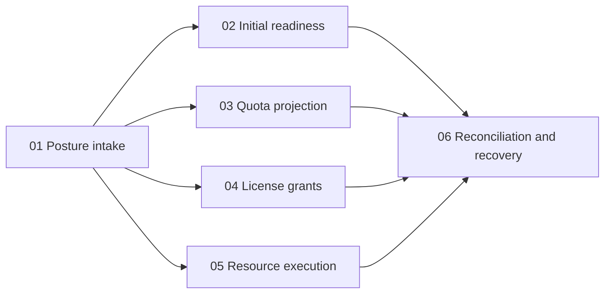

# Decomposition: Entitlements

<!-- toc -->

- [1. Overview](#1-overview)
- [2. Entries](#2-entries)
  - [2.1 Posture intake](#21-posture-intake)
  - [2.2 Initial readiness](#22-initial-readiness)
  - [2.3 Quota projection](#23-quota-projection)
  - [2.4 License grants](#24-license-grants)
  - [2.5 Resource execution](#25-resource-execution)
  - [2.6 Reconciliation and recovery](#26-reconciliation-and-recovery)
- [3. Dependency order and delivery gates](#3-dependency-order-and-delivery-gates)
- [4. Identifier register](#4-identifier-register)
- [5. Coverage and verification](#5-coverage-and-verification)

<!-- /toc -->

**Overall implementation status:**
- [ ] `p1` - **ID**: `cpt-cf-bss-entitlements-status-implementation`

## 1. Overview

This is the implementation allocation for the Entitlements [PRD](PRD.md) and [DESIGN](DESIGN.md). It makes no claim of delivered runtime. Each active FR and NFR has exactly one primary feature below. A feature can reference another requirement as supporting context without becoming its second primary owner. No requirement is retired or deferred in this first version; the deferred quota capabilities (consumption profile, pooling, rate limits) are out of scope in PRD §5.1 and have no ids.

Architecture definitions live in DESIGN, procedures in features, cross-owner prerequisites in [UPSTREAM_REQS](UPSTREAM_REQS.md), and decisions in [DECISIONS](DECISIONS.md). All unchecked entries remain unimplemented. A documented target or passing document check never closes a production dependency.

## 2. Entries

### 2.1 [Posture intake](features/01-posture-intake.md)

- [ ] `p1` - **ID**: `cpt-cf-bss-entitlements-feature-posture-intake`

- **Purpose**: Consume `CommercialPostureV1` from the Subscriptions outbox and recovery reads, authenticate producer and tenant scope, apply the revision/digest fences, persist the accepted posture and emit derivation work per enabled capability in one transaction.
- **Scope**: procedures, intake state rules, fence table, error/recovery paths and acceptance in the linked feature.
- **Out of scope**: Deriving commercial posture (Subscriptions), deciding which capabilities a product needs (Products and the accepted snapshot), any adapter call.
- **Depends On**: None.
- **Provider prerequisites / launch gates**: E-U06 contract versions agreed with Subscriptions; Policy/AMS producer authentication for the posture stream.
- **Design Components**: `cpt-cf-bss-entitlements-component-posture-intake`.
- **Design Principles Covered**: `cpt-cf-bss-entitlements-principle-fenced-application`, `cpt-cf-bss-entitlements-principle-derive-not-decide`.
- **Design Constraints Covered**: `cpt-cf-bss-entitlements-constraint-rules-frozen-in-pricing`.
- **Domain Model Entities / Data**: CommercialPosture intake copy and the posture intake journal in DESIGN §3.1 and §3.7.
- **API / Sequences**: [DESIGN §3.3.1](DESIGN.md#331-commercial-posture-contract) and the posture apply sequence in DESIGN §3.6.

**Requirements Covered (primary)**:

- [ ] `p1` - `cpt-cf-bss-entitlements-fr-posture-intake`

### 2.2 [Initial readiness](features/02-initial-readiness.md)

- [ ] `p1` - **ID**: `cpt-cf-bss-entitlements-feature-initial-readiness`

- **Purpose**: Provider side of IA-2026-10-18: build the readiness manifest for an activation revision, dispatch preparation assignments, authenticate producers, accept observations under the envelope rules, report `ReadinessObservationV1` to Subscriptions, and handle withdrawal and cleanup.
- **Scope**: manifest, producers, observation acceptance, aggregate readiness, withdrawal, cleanup journal, handoff latency measurement and acceptance in the linked feature.
- **Out of scope**: The activation commit, T and the consumer-side gate (Subscriptions); license objects and provisioning engines (adapters and providers); preactivation financial treatment (`ENT-Q13`).
- **Depends On**: `cpt-cf-bss-entitlements-feature-posture-intake`.
- **Provider prerequisites / launch gates**: E-U06; E-U02 or E-U05 for the assignments the service profile requires; joint freshness/withdrawal arbitration (`ENT-Q11`) and cleanup policy (`ENT-Q12`) ratified with Subscriptions and the selected adapter.
- **Design Components**: `cpt-cf-bss-entitlements-component-readiness`.
- **Design Principles Covered**: `cpt-cf-bss-entitlements-principle-no-subscription-id-at-adapters`, `cpt-cf-bss-entitlements-principle-fenced-application`.
- **Design Constraints Covered**: `cpt-cf-bss-entitlements-constraint-no-counters`.
- **Domain Model Entities / Data**: ReadinessManifest, Assignment and Observation in DESIGN §3.1; manifest and observation store in §3.7.
- **API / Sequences**: [DESIGN §3.3.2](DESIGN.md#332-readiness-observation-contract) and the initial readiness sequence in DESIGN §3.6.

**Requirements Covered (primary)**:

- [ ] `p1` - `cpt-cf-bss-entitlements-fr-initial-readiness`
- [ ] `p1` - `cpt-cf-bss-entitlements-nfr-handoff-latency`

### 2.3 [Quota projection](features/03-quota-projection.md)

- [ ] `p1` - **ID**: `cpt-cf-bss-entitlements-feature-quota-projection`

- **Purpose**: Own the semantics of `PlanQuotaRule`, `QuotaBinding` and `AcceptedQuotaSnapshot`; convert accepted quantity to exact integer caps; build the complete `DesiredQuotaSet` with tombstones; apply it through the quota adapter under the fenced apply/read contract; keep the lifecycle table of quota posture by commercial event.
- **Scope**: rule semantics, exact conversion, value table, lots and windows, lifecycle behavior, derive/fence/apply/receipt flow and acceptance in the linked feature.
- **Out of scope**: Storing or accepting rules (Pricing), metric registration (Products), counters, windows and point-of-use decisions (Quota Enforcement); consumption profile, pooling and rate limits (later phases; the p1 quota profile itself is gated on `ENT-Q01` to `ENT-Q08`).
- **Depends On**: `cpt-cf-bss-entitlements-feature-posture-intake`.
- **Provider prerequisites / launch gates**: E-U01 QE apply/read contract; E-U03 Pricing rule block and acceptance freeze; E-U04 Products metric semantics and GTS mapping.
- **Design Components**: `cpt-cf-bss-entitlements-component-quota-projection`.
- **Design Principles Covered**: `cpt-cf-bss-entitlements-principle-derive-not-decide`, `cpt-cf-bss-entitlements-principle-fenced-application`.
- **Design Constraints Covered**: `cpt-cf-bss-entitlements-constraint-rules-frozen-in-pricing`, `cpt-cf-bss-entitlements-constraint-no-counters`.
- **Domain Model Entities / Data**: PlanQuotaRule, QuotaBinding, AcceptedQuotaSnapshot, DesiredQuotaSet and AppliedReceipt in DESIGN §3.1; desired sets, receipts and tombstones in §3.7.
- **API / Sequences**: [DESIGN §3.3.3](DESIGN.md#333-adapter-capability-profile), DESIGN §3.3.4 and the posture apply sequence in DESIGN §3.6.

**Requirements Covered (primary)**:

- [ ] `p1` - `cpt-cf-bss-entitlements-fr-rule-schema`
- [ ] `p1` - `cpt-cf-bss-entitlements-fr-quota-projection`

### 2.4 [License grants](features/04-license-grants.md)

- [ ] `p1` - **ID**: `cpt-cf-bss-entitlements-feature-license-grants`

- **Purpose**: Derive `DesiredGrantSet` from posture members with license capabilities and apply it through the selected license adapter (License Enforcement, native License Manager or a third party) by scope, assignment and generation.
- **Scope**: grant derivation, posture-by-transition table, seat-assignment boundary, fence/apply/receipt flow and acceptance in the linked feature.
- **Out of scope**: Seat assignment, reservation and resets (enforcement owner); license files and native issuance APIs (adapter); a mandatory License Manager.
- **Depends On**: `cpt-cf-bss-entitlements-feature-posture-intake`.
- **Provider prerequisites / launch gates**: E-U02 selected license adapter; E-U03 for grant definitions frozen in acceptance; `ENT-Q09` rights-feed transport and `ENT-Q10` native identity mapping for the selected adapter.
- **Design Components**: `cpt-cf-bss-entitlements-component-license-grants`.
- **Design Principles Covered**: `cpt-cf-bss-entitlements-principle-no-subscription-id-at-adapters`, `cpt-cf-bss-entitlements-principle-fenced-application`.
- **Design Constraints Covered**: `cpt-cf-bss-entitlements-constraint-no-counters`.
- **Domain Model Entities / Data**: DesiredGrantSet and AppliedReceipt in DESIGN §3.1; desired sets and receipts in §3.7.
- **API / Sequences**: [DESIGN §3.3.3](DESIGN.md#333-adapter-capability-profile) and DESIGN §3.3.5.

**Requirements Covered (primary)**:

- [ ] `p1` - `cpt-cf-bss-entitlements-fr-license-grants`

### 2.5 [Resource execution](features/05-resource-execution.md)

- [ ] `p1` - **ID**: `cpt-cf-bss-entitlements-feature-resource-execution`

- **Purpose**: Translate posture into resource work orders (provision, pause, restore, service-stop, export, delete) with immutable resource generations, route them to the resource adapter and record truthful readiness, stop, hold, export and deletion outcomes including partial and unknown.
- **Scope**: work-order kinds, generation fencing, hold-versus-delete arbitration, retention/export requests and acceptance in the linked feature.
- **Out of scope**: The confirmed charging cutoff and disposition eligibility (Subscriptions); provisioning engines, topology and vendor job schemas (adapter and provider); notification delivery.
- **Depends On**: `cpt-cf-bss-entitlements-feature-posture-intake`.
- **Provider prerequisites / launch gates**: E-U05 resource adapter; automatic deletion stays disabled without the proven hold/execution fence.
- **Design Components**: `cpt-cf-bss-entitlements-component-resource-execution`.
- **Design Principles Covered**: `cpt-cf-bss-entitlements-principle-fenced-application`, `cpt-cf-bss-entitlements-principle-derive-not-decide`.
- **Design Constraints Covered**: `cpt-cf-bss-entitlements-constraint-no-counters`.
- **Domain Model Entities / Data**: ResourceWorkOrder and AppliedReceipt in DESIGN §3.1; desired sets and receipts in §3.7.
- **API / Sequences**: [DESIGN §3.3.3](DESIGN.md#333-adapter-capability-profile) and DESIGN §3.3.6.

**Requirements Covered (primary)**:

- [ ] `p1` - `cpt-cf-bss-entitlements-fr-resource-execution`

### 2.6 [Reconciliation and recovery](features/06-reconciliation-recovery.md)

- [ ] `p1` - **ID**: `cpt-cf-bss-entitlements-feature-reconciliation`

- **Purpose**: Replay the outbox by original identity, keep the observation journal, compare complete desired and applied state, record findings, repair through authorized conditional operations only, and keep in-flight work bound to its original adapter and profile through an adapter change. Owns the stale-action fence as an end-to-end property across all capabilities.
- **Scope**: recovery matrix, repair flow, delivery state, findings lifecycle, adapter/profile change and acceptance in the linked feature.
- **Out of scope**: Editing a materialized license, quota counter or resource through Entitlements; changing a commercially invalid posture (Subscriptions).
- **Depends On**: `cpt-cf-bss-entitlements-feature-posture-intake`, `cpt-cf-bss-entitlements-feature-initial-readiness`, `cpt-cf-bss-entitlements-feature-quota-projection`, `cpt-cf-bss-entitlements-feature-license-grants`, `cpt-cf-bss-entitlements-feature-resource-execution`.
- **Provider prerequisites / launch gates**: Authorized recovery reads at every selected adapter (E-U01, E-U02, E-U05); tombstone retention horizon agreed with each provider.
- **Design Components**: `cpt-cf-bss-entitlements-component-reconciliation`.
- **Design Principles Covered**: `cpt-cf-bss-entitlements-principle-fenced-application`.
- **Design Constraints Covered**: `cpt-cf-bss-entitlements-constraint-no-counters`.
- **Domain Model Entities / Data**: AppliedReceipt and Finding in DESIGN §3.1; receipts, tombstones, findings and outbox in §3.7.
- **API / Sequences**: [DESIGN §3.3.3](DESIGN.md#333-adapter-capability-profile), DESIGN §3.3.4 to §3.3.6 and the posture apply sequence in DESIGN §3.6.

**Requirements Covered (primary)**:

- [ ] `p1` - `cpt-cf-bss-entitlements-fr-stale-action-fencing`
- [ ] `p1` - `cpt-cf-bss-entitlements-fr-reconciliation`

## 3. Dependency order and delivery gates

The dependency graph is acyclic: posture intake first; initial readiness, quota projection, license grants and resource execution can then be developed against the intake contract and their own adapter contracts; reconciliation and recovery follows all of them because its recovery matrix spans every capability.

Developing against a test double is possible before an adapter lands. Enabling the corresponding production capability requires the [E-U acceptance signal](UPSTREAM_REQS.md#25-provider-prerequisites-and-bilateral-acceptance) and producer/consumer contract evidence.

| Capability | Must be closed before it is called ready |
| --- | --- |
| Posture intake | E-U06 contract versions; producer authentication; replay, conflict and lost-delivery fixtures |
| Initial readiness | E-U06; the adapters the service profile requires (E-U02, E-U05); `ENT-Q09` to `ENT-Q13` resolved for the enabled profile; handoff latency measured |
| Quota projection | E-U01, E-U03, E-U04; exact-conversion boundary tests; single atomic member unless the provider proves multi-member atomicity |
| License grants | E-U02, E-U03; stale issue after newer revoke and lost-reply fixtures |
| Resource execution | E-U05; late stop, hold racing deletion and reused resource name fixtures |
| Reconciliation and recovery | Authorized recovery reads at every enabled adapter; adapter change keeps in-flight work on the original adapter |

| Stage | Concrete deliverable | Entry and exit evidence |
| --- | --- | --- |
| 1. Intake and stores | Posture intake, fences, intake journal, desired-set stores, outbox | Subscriptions contract modeled by a test double; exit with replay, conflict and lost-delivery fixtures. |
| 2. Capabilities | Readiness manifest and observations, quota projection, grant derivation, work orders, each behind its adapter contract | Each capability enabled only after its E-U owner mapping and joint failure fixtures. |
| 3. Reconciliation | Recovery matrix, findings, repair, adapter change | Lost reply, delayed old request, higher provider revision, drift and metric drift fixtures pass against every enabled adapter. |
| 4. Release proof | Measured handoff latency and outage/recovery evidence for the enabled profile | `nfr-handoff-latency` measured; no document validation substitutes for runtime proof. |

## 4. Identifier register

No identifier was carried over from Subscriptions. The Subscriptions PRD §17.2 records the ids retired there; every id in this set is defined once in its owning document.

## 5. Coverage and verification

The allocation above contains **9 active requirements**: 8 FR and 1 NFR, each exactly once.

Document verification checks this census, incoming `Covers` links, local links/fragments, TOCs, CFS artifact validation and the absence of the subscription identifier in adapter contracts. Runtime validation is not performed by this documentation change: feature DoDs require deterministic unit/transaction tests, producer/consumer conformance, negative authorization/concurrency tests and selected end-to-end acceptance.
