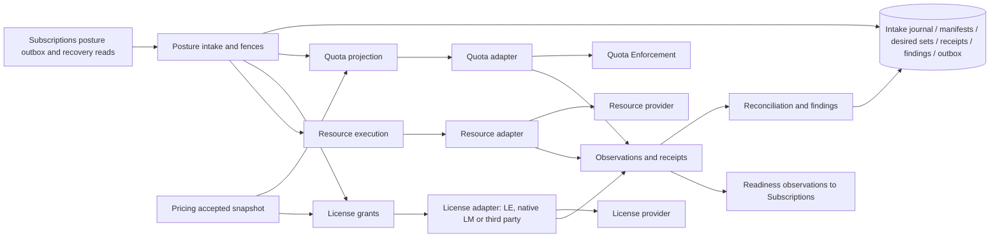

# Technical Design — Entitlements

<!-- toc -->

- [1. Architecture Overview](#1-architecture-overview)
  - [1.1 Architectural Vision](#11-architectural-vision)
  - [1.2 Architecture Drivers](#12-architecture-drivers)
  - [1.3 Architecture Layers](#13-architecture-layers)
- [2. Principles & Constraints](#2-principles--constraints)
  - [2.1 Design Principles](#21-design-principles)
  - [2.2 Constraints](#22-constraints)
- [3. Technical Architecture](#3-technical-architecture)
  - [3.1 Domain Model](#31-domain-model)
  - [3.2 Component Model](#32-component-model)
  - [3.3 API Contracts](#33-api-contracts)
  - [3.4 Internal Dependencies](#34-internal-dependencies)
  - [3.5 External Dependencies](#35-external-dependencies)
  - [3.6 Interactions & Sequences](#36-interactions--sequences)
  - [3.7 Database schemas & tables](#37-database-schemas--tables)
  - [3.8 Deployment Topology](#38-deployment-topology)
- [4. Additional context](#4-additional-context)
  - [4.1 Capability gates](#41-capability-gates)
  - [4.2 Compatibility](#42-compatibility)
- [5. Traceability](#5-traceability)

<!-- /toc -->

- [ ] `p1` - **ID**: `cpt-cf-bss-entitlements-design-main`

**Status, 2026-10-23:** first version. This design is the architecture authority for the Entitlements application layer created by splitting the application of commercial posture out of the Subscriptions design set. It carries the provider side of the initial readiness contract (IA-2026-10-18) and the quota projection draft of 2026-10-18. No adapter, SDK or runtime is delivered; every provider contract below is a requirement for owner adoption, not a shipped API.

## 1. Architecture Overview

### 1.1 Architectural Vision

Entitlements turns the commercial posture published by Subscriptions into the desired state of quota, license and resource providers, applies that state through deployment-selected adapters, and reports readiness and materialization back. It owns the meaning of quota and grant rules, the derivation of provider-desired state, the readiness manifest and observation envelope, stale-action fencing, reconciliation and findings. Subscriptions publishes commercial posture and consumes readiness. Pricing stores and freezes the rules with the plan. Products supplies metric semantics. Providers own counters, grants, point-of-use decisions and physical resources.

**Provider-independent fulfillment boundary, accepted scope 2026-10-14.** BSS does not require the platform's License Manager or OSS implementation. Entitlements depends on abstract capabilities implemented by deployment-selected adapters. The native License Manager, a third-party licensing/service system and a customer integration are alternative implementations of entitlement fulfillment; resource execution and inventory evidence may come from different systems. Historical LM/OSS names identify provenance, not mandatory products or SDK dependencies.

| Abstract role | What Entitlements owns or requires | Outside this design |
| --- | --- | --- |
| Entitlement fulfillment | Versioned desired commercial rights/capacity and validity; durable request correlation; observed application or pending/failure; safe supersession and recovery | License objects, vendor states, native issuance APIs, callbacks, credentials and point-of-use implementation |
| Resource lifecycle execution | A requested resource action where the product needs one; correlated evidence of actual readiness/stop/adoption/deletion and unresolved outcomes | Provisioning engine, topology, vendor job schema and operation transport |
| Enforcement | External application of the accepted access/quantity restrictions, with evidence only where the enabled profile requires it | Seat assignment, quota counters, request-time authorization and enforcement architecture |

Inventory and usage evidence stay with the Subscriptions consumer contracts; Entitlements does not own attribution or import.

Entitlements is the owner of this boundary. Subscriptions publishes commercial posture as a versioned fact of its aggregate and consumes readiness observations; it does not derive provider state, build manifests or specify adapters. The two contracts between the gears are the commercial posture contract ([§3.3.1](#331-commercial-posture-contract)) and the readiness observation contract ([§3.3.2](#332-readiness-observation-contract)). The adapter capability profile ([§3.3.3](#333-adapter-capability-profile)) is the rule every adapter must satisfy before its capability is enabled.

[DESIGN.md](./DESIGN.md) is the architecture authority; [features/](./features/) owns detailed procedures; [DECOMPOSITION.md](./DECOMPOSITION.md) allocates work; [DECISIONS.md](./DECISIONS.md) records the founding decisions `ENT-D-01`, `ENT-D-02` and `ENT-D-03` and the open questions `ENT-Q01` to `ENT-Q13`.

### 1.2 Architecture Drivers

#### Functional Drivers

| Requirement | Design response |
| --- | --- |
| `cpt-cf-bss-entitlements-fr-posture-intake` | One intake path for `CommercialPostureV1`: producer and tenant authentication, revision/digest fences, durable intake journal, derivation work emitted to the outbox in the same transaction. |
| `cpt-cf-bss-entitlements-fr-initial-readiness` | Readiness manifest per activation operation, authenticated producers, observation envelope with high-water marks, aggregate `ready` only when every required assignment is ready for the exact desired revision. |
| `cpt-cf-bss-entitlements-fr-rule-schema` | Versioned semantic schema of `PlanQuotaRule`, `QuotaBinding`, `AcceptedQuotaSnapshot` and grant definitions; Pricing stores and freezes it, Entitlements interprets it. |
| `cpt-cf-bss-entitlements-fr-quota-projection` | Exact decimal/rational conversion from accepted quantity and frozen rule to integer caps; complete `DesiredQuotaSet` per source key with explicit tombstones. |
| `cpt-cf-bss-entitlements-fr-license-grants` | `DesiredGrantSet` derived from posture members with license capabilities; applied through the selected license adapter by scope, assignment and generation. |
| `cpt-cf-bss-entitlements-fr-resource-execution` | Resource work orders with immutable resource generation, hold-versus-delete arbitration at the execution boundary, truthful partial outcomes. |
| `cpt-cf-bss-entitlements-fr-stale-action-fencing` | Compare-and-apply on (source key, revision, digest) at the provider's effect boundary; terminal tombstones; in-flight work covered by the fence, not by dispatch order. |
| `cpt-cf-bss-entitlements-fr-reconciliation` | Outbox replay by original identity, observation journal, desired-versus-applied comparison, durable findings and authorized repair; in-flight work stays on its original adapter. |

#### NFR Allocation

| Requirement | Primary allocation and ratified target | Required verification |
| --- | --- | --- |
| `cpt-cf-bss-entitlements-nfr-handoff-latency` | Initial readiness and posture apply: first delivery to the selected adapter p95 < 5 s, p99 < 15 s after the posture is received; pending beyond 60 s creates an auditable exception. Usable-access time is measured separately and is not a Subscriptions commit guarantee. | Adapter outage and recovery, duplicate and refused acknowledgements, revision ordering under load; targets were ratified on 2026-10-08 as part of the Subscriptions S-Q07 profile and remain unmeasured. |

### 1.3 Architecture Layers



- [ ] `p1` - **ID**: `cpt-cf-bss-entitlements-tech-runtime`

Entitlements is one stateful gear built on ToolKit. Intake, derivation per capability, adapter dispatch and reconciliation are handlers inside that gear. Adapters are separate deployment-selected components behind the capability profile; they need not be gears. Every remote call happens outside the local transaction; every local effect is committed with its outbox entry.

## 2. Principles & Constraints

### 2.1 Design Principles

#### Derive, do not decide

- [ ] `p1` - **ID**: `cpt-cf-bss-entitlements-principle-derive-not-decide`

Derivation introduces no commercial decision. Quantity, validity, posture and holder scope come from the accepted posture; rule values come from the frozen accepted snapshot. An absent posture member or absent rule is not zero and not unlimited: it means no purchased declaration, and the product capability or admission policy must state whether another authority is sufficient. `Bounded(0)` is an explicit cap of zero. `Unbounded` is an explicit unlimited policy, refused in v1 until owners accept a profile and authorization policy. Absence, error or unknown evidence is never translated into an unlimited value. Removal from an existing desired set requires an explicit tombstone.

#### Fenced application

- [ ] `p1` - **ID**: `cpt-cf-bss-entitlements-principle-fenced-application`

Every application is a compare-and-apply on (source key, revision, digest) at the provider's effect boundary. A lower revision is stale; equal revision and equal digest returns the existing result; equal revision and different digest is a conflict; a higher revision replaces only that source's state after validation. A terminal revoke closes the source identity with a tombstone, and a later grant for the same identity is refused even with a higher revision. The fence covers in-flight work: a command that passed a precheck and waited remotely must still be rejected at the effect boundary when a newer revision has applied. Dispatch serialization and callback filtering are additional checks, never the primary fence.

#### No subscription identifier at adapters

- [ ] `p1` - **ID**: `cpt-cf-bss-entitlements-principle-no-subscription-id-at-adapters`

Adapters see authorized scope, concrete assignment and desired revision only. The adapter need not receive or report the subscription identifier; only Subscriptions stores the association between its operation and an assignment. Source keys toward providers are `(authenticated namespace, resource tenant, assignmentId)`. The identifier appears in this design only inside the commercial posture contract ([§3.3.1](#331-commercial-posture-contract)), which is the contract between Subscriptions and Entitlements, not an adapter contract.

### 2.2 Constraints

#### Rules are frozen in Pricing

- [ ] `p1` - **ID**: `cpt-cf-bss-entitlements-constraint-rules-frozen-in-pricing`

Entitlements owns the rule schema and its semantics; it does not store or accept rules (ENT-D-03). Pricing stores quota and grant rules as an optional typed block on the immutable PlanRevision, validates them at publication against Products metric evidence, and freezes them in the same acceptance receipt as the price bindings. Derivation and replay read the frozen rule from the accepted snapshot, never the live plan. A changed quota term requires a new accepted revision even when the price is unchanged.

#### No counters

- [ ] `p1` - **ID**: `cpt-cf-bss-entitlements-constraint-no-counters`

Entitlements holds no counters, windows, seat assignments, reservations or point-of-use decisions. Quota Enforcement owns counters, windows, allocation/reservation/commit/release atomicity, applicable-policy resolution and actual enforcement; it does not decide what was purchased from a caller's cap or infer pooling from multiple records. License Enforcement, where selected, owns named type/instance grants, assignment and licensing-specific yes/no checks; numerical seat limits, counting and leases remain Quota Enforcement responsibilities, and a named grant must not become a second source of the same capacity.

## 3. Technical Architecture

### 3.1 Domain Model

- [ ] `p1` - **ID**: `cpt-cf-bss-entitlements-entity-desired-state-model`

These are logical entities and invariants; transport DTOs belong to the SDK implementation. Exact codecs, bounds, canonical digest rules and SDK versions require owner adoption. Unknown enum variants or unsupported profile versions refuse before application; they do not become "no quota" or "no grant".

| Entity | Owned state and identity |
| --- | --- |
| CommercialPosture (intake copy) | The accepted `CommercialPostureV1` payload as received: identity triple, digest, operation id, tenant axes, members with posture, quantity, validity and holder scope, provenance references. Immutable once accepted; superseded by a higher revision. |
| ReadinessManifest | Operation-owned set of required assignments and producer authorities for one desired revision, with pinned service profile and target references. Built before dispatch; withdrawn as a whole. It is not a license entity or a commercial status. |
| Assignment | Stable identity of one concrete rights assignment or service instance within an authorized scope, its desired revision, pinned profile/target, routing to the selected adapter and current readiness. |
| Observation | One accepted readiness or application observation: event identity, producer, sequence, status, observed time, evidence reference and reason; durable high-water mark per producer stream. |
| PlanQuotaRule (definition) | `rule_id`, immutable revision/digest, Products SKU/version and metric semantics reference/digest, metric code and canonical unit, `kind = Allocation \| Consumption`, `subject_kind`, `capacity = Fixed(exact_quantity) \| PerPlanUnit(exact_coefficient)`, binding applicability, period where applicable, hard-enforcement policy, `combination = ExclusiveSource`, validity policy, suspend/revoke policy, capability profile/version. |
| QuotaBinding (selection) | Plan/revision, rule/revision, applicable item IDs and accepted dimension values, immutable Products references, quantity basis explicitly `PlanQuantity`; selected scope template. It binds semantics, not a caller-selected arbitrary resource or cap. |
| AcceptedQuotaSnapshot (purchase evidence) | Acceptance ID, request/terms digests, order/version/line, plan/revision, original exact plan quantity, complete selected rule/binding snapshots or durable immutable resolvable references with digests, seller/payer/resource tenant axes, authorized subject-binding policy, terms/validity/continuation policy and required provider profile. Subsequent lot/delta acceptances remain separate immutable evidence. |
| DesiredQuotaSet (commercial projection) | Source key `(namespace, resource tenant, assignmentId)`, resource/owner tenant, monotonically increasing aggregate source revision, operation ID, canonical payload digest, complete member set and explicit tombstones, effective interval and posture `Granted \| Restricted \| Revoked`; each member identifies metric/unit, subject, kind/period, exact integer cap, rule identity and complete contributing lot/acceptance provenance. |
| DesiredGrantSet | Source key, revision and digest as above; one member per grant definition reference with quantity, validity interval, holder scope and posture; routing to the selected license adapter and its generation. |
| ResourceWorkOrder | Operation identity, kind (provision, pause, restore, service-stop, export, delete), immutable resource generation, confirmed cutoff or boundary where applicable, requested effect and the adapter it was routed to. |
| AppliedReceipt (provider observation) | Same source key/revision/digest and operation identity, provider/profile identity, member/provider record IDs, status `Applied \| Pending \| Refused \| Unknown \| Superseded`, applied effective time where authoritative, current applied revision/digest, restriction/tombstone evidence and structured reason. Acceptance of dispatch is not `Applied`. |
| Finding | Durable record of a mismatch between desired and applied state, a refused or unknown outcome, a conflicting revision or a blocked metric; closed only on correlated evidence or an explicit audited disposition. |

`ExclusiveSource` means one commercial source controls the effective purchased quota for a resolved `(resource/owner tenant, subject projection type, subject ID, metric, kind, period identity and other compatible quota dimensions)` in this profile. A provider must enforce this ownership/admission condition atomically across different source keys, not merely ensure one row per source key. Several sources targeting the same enforcement tuple require rejection or an explicitly adopted pooling protocol; a metadata convention or a query-before-create check cannot establish exclusivity.

### 3.2 Component Model

#### Posture intake

- [ ] `p1` - **ID**: `cpt-cf-bss-entitlements-component-posture-intake`

Receives `CommercialPostureV1` from the Subscriptions outbox or recovery reads, authenticates the producer and tenant scope, applies the revision/digest fences against the intake journal, persists the accepted posture and emits derivation work per enabled capability to the outbox in the same transaction. Exposes intake state per posture revision. See [posture intake](./features/01-posture-intake.md).

#### Readiness

- [ ] `p1` - **ID**: `cpt-cf-bss-entitlements-component-readiness`

Builds the readiness manifest for an activation revision, dispatches preparation assignments to the selected adapters, authenticates producers, accepts observations under the envelope rules, keeps the high-water mark per producer stream and publishes `ReadinessObservationV1` to Subscriptions. Handles withdrawal and the cleanup journal. See [initial readiness](./features/02-initial-readiness.md).

#### Quota projection

- [ ] `p1` - **ID**: `cpt-cf-bss-entitlements-component-quota-projection`

Interprets the frozen rule snapshot, converts accepted quantity to exact integer caps, builds the complete `DesiredQuotaSet` with tombstones and applies it through the quota adapter under the fenced apply/read contract. Owns the lifecycle table of quota posture by commercial event. See [quota projection](./features/03-quota-projection.md).

#### License grants

- [ ] `p1` - **ID**: `cpt-cf-bss-entitlements-component-license-grants`

Derives `DesiredGrantSet` from posture members with license capabilities and applies it through the selected license adapter (License Enforcement, native License Manager or a third party) by scope, assignment and generation. Seat assignment, reservation and resets stay with the enforcement owner. See [license grants](./features/04-license-grants.md).

#### Resource execution

- [ ] `p1` - **ID**: `cpt-cf-bss-entitlements-component-resource-execution`

Translates posture `Granted`, `Restricted` and `Revoked` into resource work orders with immutable resource generations, routes them to the resource adapter and records truthful readiness, stop, hold, export and deletion outcomes including partial and unknown. See [resource execution](./features/05-resource-execution.md).

#### Reconciliation

- [ ] `p1` - **ID**: `cpt-cf-bss-entitlements-component-reconciliation`

Replays the outbox by original identity, compares complete desired and applied state through authorized adapter reads, records findings, performs authorized repair through conditional operations only, and keeps in-flight work bound to its original adapter and profile through an adapter change. See [reconciliation and recovery](./features/06-reconciliation-recovery.md).

### 3.3 API Contracts

Every contract below is a semantic requirement for owner adoption. Exact SDK types, codecs and transport are delivery work recorded in [UPSTREAM_REQS](./UPSTREAM_REQS.md).

#### 3.3.1 Commercial posture contract

The contract implements `cpt-cf-bss-entitlements-contract-commercial-posture`. `CommercialPostureV1` is published by Subscriptions from the same transaction as the lifecycle change, through its outbox, and is readable through its recovery reads. It is the `EntitlementPosture` entity of the Subscriptions design, carried as a cross-gear contract. A newer revision supersedes the target; earlier outcomes are retained.

| Field group | Content | Rule |
| --- | --- | --- |
| Identity | `(orderingTenantId, subscriptionId, revision)`, payload digest, operation id | The triple orders revisions; the digest identifies content; the operation id is retry identity. None substitutes for the others. The subscription identifier appears only in the Subscriptions-facing contract (`CommercialPostureV1` intake) and never in any adapter contract. |
| Tenant axes | Resource tenant, payer tenant, seller tenant | Fixed for the subscription; the resource tenant becomes the tenant component of every provider source key. |
| Members | One per logical component: capability/product references, quantity as the sum of effective lots, validity interval, posture `Granted \| Restricted \| Revoked`, holder scope | The member set is complete for the revision; a member absent from a newer revision is removed only through an explicit tombstone in the derived desired set. |
| Provenance | Accepted snapshot references (acceptance id, rule/binding snapshot digests) and contributing lot ids | Lots are provenance only; Entitlements does not re-derive quantity from lots. Rules are read from the accepted snapshot the references name. |

Intake fences: a lower revision is stale and refused; equal revision and equal digest is a replay and a no-op; equal revision and different digest is a conflict, refused and visible; a higher revision is accepted and supersedes. The accepted posture and its derivation work are persisted in one local transaction.

#### 3.3.2 Readiness observation contract

The contract implements `cpt-cf-bss-entitlements-contract-readiness-observation`. `ReadinessObservationV1` is published by Entitlements, on behalf of the selected adapter, and consumed by Subscriptions. No subscription identifier crosses this boundary; Subscriptions keeps the association from its operation to the assignment. Subscriptions applies IA-2026-10-18 as a consumer rule: the activation operation stays pending or approved and the subscription stays draft until every assignment in the persisted manifest reports `ready` for the exact desired revision; the commit then rechecks its fences and writes active, T, receipt and outbox atomically. Entitlements reports `ready` for the manifest only when every required assignment is ready for `desiredRevision`.

**Standard semantic envelope.** The following are candidate names for the common adapter contract, not ratified SDK fields or a vendor payload schema.

| Semantic field | Assignment / readiness meaning |
| --- | --- |
| `schemaVersion` | Explicit supported contract version; unsupported versions are quarantined/reported, not interpreted as ready. |
| `scopeId`, `assignmentId` | Authorized tenant scope and stable identity of the concrete rights assignment/service instance. A shared product or customer ID alone is insufficient. Native identity must distinguish multiple environments under one broad right. |
| `desiredRevision` | Immutable desired-state generation bound to exact accepted preparation inputs; it is not a transport idempotency key. Retired identities/revisions cannot be silently reused. |
| `serviceProfileRef`, `targetRef` | Pinned versioned readiness requirements and concrete service target, retained in the descriptor/manifest and bound to results. Target allocation discovered during execution is durably associated before it can satisfy readiness. |
| `eventId` | Identity of an emitted observation for delivery deduplication; repeats keep the original identity/content, conflicting content is refused. A reconciled newer observation has its own identity. |
| `producerId`, `statusSequence` | Trusted responsible authority and durable monotonically ordered observation sequence within the agreed scoped assignment/authority stream. Producer replacement or sequence reset needs an explicit fenced generation mapping. |
| `status` | Semantic observation `pending`, `ready`, `failed` or `withdrawn`; these are preparation observations, not subscription states. Pending includes accepted work; ready means the service profile's complete initial readiness criterion. |
| `observedAt`, `evidenceRef`, `reasonCode` | Observation time, recoverable authoritative evidence and structured reason. Timestamp is diagnostic evidence, not ordering, freshness authority or the commercial start. |

Before acceptance Entitlements authenticates the producer and authorizes its tenant, assignment and profile authority against the saved manifest; an arbitrary publisher's `producerId` is not proof. An identical delivery is a no-op; a conflicting duplicate, wrong scope, unexpected producer or ambiguous association is refused or quarantined without information leakage. An older sequence cannot overwrite a newer `ready`, `withdrawn` or `failed` result. Receipts, broker acknowledgement and license existence alone never satisfy readiness. One adapter's ready result does not satisfy another required producer or assignment.

#### 3.3.3 Adapter capability profile

The adapter translates provider-specific responses into Entitlements' own operation observations and retains correlation/provenance. Provider acceptance of a request is not proof of its application; unknown remains recoverable. Monotonic revisions, idempotency and stale-command suppression are required end-to-end properties of the adapter/provider integration, not demands that every vendor expose our source-revision field or copy our state machine. An adapter may supply serialization, a durable execution journal and reconciliation, but cannot report success or safe ordering that the external system cannot establish. Dispatch serialization alone does not fence an already in-flight old action.

Select and version the required capability profile for the product/deployment, and retain adapter/profile identity with outstanding operations. No resource or licensing integration is mandatory merely because another BSS deployment uses it. A capability explicitly not required by the product is reported as not applicable; an absent adapter for a required capability is unavailable, never fabricated success. This does not waive access or resource evidence required by the accepted product, usage attribution or financial guards. Changing adapters must not replay pending commands against a new system or inherit old completion evidence silently; outstanding work keeps its original routing until a separately supported migration settles it.

Provider-specific APIs, response schemas, status mappings and deployment integration specifications are deferred to their adapter projects. Core design completion requires this abstract boundary; it does not wait for our LM/OSS PRDs. Production enablement of a chosen profile still requires its adapters to demonstrate the applicable safety/recovery guarantees. This design introduces no local license engine, quota service or provider implementation into Entitlements.

#### 3.3.4 Quota apply and read

The contract implements `cpt-cf-bss-entitlements-contract-quota-apply`. The existing CRUD API is insufficient for this protocol. Propose a versioned provider operation equivalent to `apply_source_state(source_key, source_revision, digest, complete_target, effective_boundary, authority)` plus an authorized `read_source_state(source_key)` and durable operation recovery. These are requirements for owner adoption, not names of shipped methods.

The minimal durable provider model is a source-head record keyed by authenticated namespace, resource tenant and assignment, holding revision, digest, terminal posture and recoverable result, plus source-member mappings to QE quota IDs under a unique source/member constraint. A source head must exist even for revoke-before-create. QE, or the equivalent provider owning the final atomic effect, owns this authoritative mapping and fence; the adapter may retain a correlated cache/journal. A unique nullable managed key on quota rows can help distinguish managed from operator records, but cannot replace the source head. The public `QuotaSpec` rejects unknown fields, so implement a separately versioned managed-apply request/API rather than injecting source fields into existing create JSON. Schema placement is provider work; these are proposed guarantees, not permission for BSS to write QE tables.

Use an aggregate source/business key `(authenticated namespace, resource tenant, assignmentId)` for the complete-set fence. A stable member key beneath it adds the logical quota binding and subject; metric, kind, unit and period/window identity are immutable attributes of that member. The separate resolved-tuple exclusivity constraint prevents competing source keys from claiming the same purchased quota scope. These are distinct identities, not interchangeable source-head domains. An aggregate revision is ordering; an operation ID is retry identity; a digest is content identity. None substitutes for the others. The key must survive worker restarts, transport-key changes, renewal and cap updates. A complete-set revision covers every member that must change together; omissions do not implicitly delete unrelated source records. Terminal cancellation tombstones the aggregate before any further member creation can apply, including members the provider has never seen. A new rule/member ID cannot evade the revoked source fence.

At the enforcement effect boundary, atomically:

1. Authorize the caller's source namespace and target scope; prove exclusive ownership or refuse conflict. Bind accepted authority to the exact target and content.
2. Compare the incoming revision/digest with the durable applied source head. Lower revision is stale; equal revision/equal digest returns the existing result; equal revision/different digest conflicts; higher revision may replace only that source's state after validation. A terminal revoke also closes the acquisition/source identity: a later `Granted` request is refused even with a higher revision. Only an explicitly authorized new acquisition with a distinct identity can establish new rights; numeric monotonicity alone is not terminality.
3. Apply the full supported member set/restriction/tombstones and persist its new head, digest and recoverable result as one atomic effect. Counter preservation is part of that effect. Record definitive refusal separately from an unknown result.
4. Expose an authoritative readback of the source head and effective state. Do not acknowledge a queued command as already enforced.

If the provider cannot atomically apply a multi-member change, v1 must restrict the offered profile to a single member (or provide another proved all-or-safe-restricted protocol). Do not partially grant an atomic commercial bundle and report success. A restriction may be applied first for safety, but its durable pending completion and recovery must be explicit.

The fence must cover in-flight work: revision 7 can pass an adapter's precheck, wait remotely, and arrive after revision 8 revoked access. Filtering its late callback cannot undo the resulting grant. The provider's conditional application must reject revision 7 even after a timeout, worker restart or lease loss. A serialized adapter is acceptable only if its execution protocol proves that an earlier operation can no longer apply before a later one is finalized; dispatch serialization alone cannot prove that with the current CRUD boundary.

#### 3.3.5 Grant apply

The contract implements `cpt-cf-bss-entitlements-contract-grant-apply`. The selected license adapter (License Enforcement, native License Manager or a third party) must provide the following guarantees.

| Request | Adapter guarantee |
| --- | --- |
| Correlated application | Accept desired grant state with authorized scope, assignment identity, desired revision and generation. Identity at this boundary is scope, assignment and generation; the adapter neither receives nor reports a subscription identifier. Return applied, pending, refused or unknown evidence with authoritative effective time where known. |
| Stale-action suppression | A delayed issue or resume must not undo a newer revoke or suspend; enforce ordering at the effect boundary, not only when reading a callback. |
| Idempotent recovery | Read or replay the same application operation after a lost response; do not create another grant on retry. |

Preparation grants for initial activation are issued while the subscription is still draft and are reported as readiness observations under [§3.3.2](#332-readiness-observation-contract); `active` is not the trigger (ENT-D-02). Delayed effects of an earlier committed change cannot undo a newer restriction. Seat assignment, counting and leases stay with the enforcement owner.

#### 3.3.6 Resource work orders

The contract implements `cpt-cf-bss-entitlements-contract-resource-work-order`. The selected resource adapter must provide the following guarantees.

| Request | Adapter guarantee |
| --- | --- |
| Physical outcome | Correlate readiness, stop and delete to the work order and the immutable resource generation, with actual effective time and explicit pending, unknown and partial outcomes. |
| Hold/delete arbitration | Confirm hold protection only with execution-boundary arbitration or acknowledged fencing that prevents a stale delete; a local receipt alone is insufficient. |
| Recovery and generations | Retry by original identity, report per-resource partial completion and never apply an old action to a replacement resource with a recycled name. |

A late stop is reported at its actual time; the adapter must not backdate an outcome to hide a technical delay. Subscriptions owns the confirmed charging cutoff and disposition eligibility; Entitlements requests execution and records the physical outcome.

### 3.4 Internal Dependencies

| Dependency | Purpose and status |
| --- | --- |
| Subscriptions | Publishes `CommercialPostureV1` and consumes `ReadinessObservationV1`; owns the activation commit and T. Contract versions agreed bilaterally under E-U06. |
| Pricing | Stores the typed rule block on PlanRevision, validates it at publication and freezes it in the acceptance receipt the posture provenance names. E-U03. |
| Products | Metric, unit and subject semantics and the versioned mapping to QE GTS `MetricId` and `projection_type`. E-U04. |
| Quota Enforcement | Fenced `apply_source_state` and `read_source_state`, counters, windows and enforcement. E-U01. |
| License Enforcement, native License Manager or third party | Grant application by scope, assignment and generation; seat assignment and checks. E-U02. |
| Resource provider | Work-order execution and truthful physical outcomes. E-U05. |
| Policy / AMS | Current authority and delegation for intake producers, observation producers and adapter credentials; authorization on recovery reads as well as writes. |

Inter-gear calls use versioned SDK contracts via ClientHub and propagate SecurityContext. No cross-gear table reads, internal-type coupling or dependency-side writes are permitted. External fulfillment systems are reached through the selected adapters behind the capability profile; they need not be gears or implement ClientHub or our SDK.

### 3.5 External Dependencies

Entitlements accesses its database through ToolKit's secure transactional APIs and publishes through the platform event broker and outbox. Providers are reached only through their adapters. A missing configured adapter for a required capability returns an explicit unavailable dependency result; it is never success, permission or a zero quota.

### 3.6 Interactions & Sequences

#### Initial readiness

- [ ] `p1` - **ID**: `cpt-cf-bss-entitlements-seq-initial-readiness`

```mermaid
sequenceDiagram
    participant S as Subscriptions
    participant E as Entitlements
    participant L as Selected license adapter
    participant O as Selected service adapter
    S->>S: Persist operation and association before dispatch
    S->>E: CommercialPostureV1 for the draft revision (preparation members)
    E->>E: Accept posture, build and persist readiness manifest and producer authorities
    E->>L: Authorized preparation assignments, before active
    L-->>O: Assignment desired state via agreed feed or reconciliation
    O->>O: Reconcile account, purchased environment and required access
    O-->>E: Scoped assignment/revision readiness and evidence
    E->>E: Authenticate producer, accept observation, advance high-water mark
    E-->>S: ReadinessObservationV1 per required assignment
    Note over S,E: Entitlements validates all required producers and reports manifest-level readiness; Subscriptions validates the association and its own fences
    S->>S: Recheck fences, commit active state, fresh T, applied receipt and outbox atomically
    Note over S,E: Post-commit reconciliation cannot first supply required initial access
```

Withdrawal reverses the order: Subscriptions fences its local activation first, Entitlements marks the manifest withdrawn, revokes or supersedes preparation authority at the adapters, reconciles already running external actions and records cleanup obligations. A delayed `ready` for a withdrawn revision cannot activate; it still contributes historical evidence needed for cleanup.

#### Posture apply

- [ ] `p1` - **ID**: `cpt-cf-bss-entitlements-seq-posture-apply`

```mermaid
sequenceDiagram
    participant S as Subscriptions
    participant E as Entitlements
    participant D as Entitlements database
    participant A as Selected adapter
    participant P as Provider
    S->>E: CommercialPostureV1 (outbox delivery or recovery read)
    E->>D: Fence revision/digest against the intake journal
    alt Accepted (higher revision)
        E->>D: Persist posture, derive desired sets per enabled capability, write outbox atomically
        E->>A: apply(source key, revision, digest, complete target, boundary, authority)
        A->>P: Provider-specific conditional application
        P-->>A: Applied, pending, refused or unknown
        A-->>E: AppliedReceipt with applied revision/digest and record ids
        E->>D: Persist receipt against the matching revision; open a finding on refused or unknown
    else Replay (equal revision, equal digest)
        E-->>S: Existing intake result, no new work
    else Stale or conflict
        E->>D: Record refusal and a visible finding; desired head unchanged
    end
```

A result is applied only to its matching source key and revision. A stale success cannot mark a newer desired head complete. Retry and backoff change neither identity nor quantity.

### 3.7 Database schemas & tables

- [ ] `p1` - **ID**: `cpt-cf-bss-entitlements-db-entitlements`

Logical stores share the local transaction where their invariants require it. Actual backend schemas are implementation work, not evidence of deployed tables.

| Store | Required key/constraint and durability |
| --- | --- |
| Posture intake journal | Unique posture identity triple and digest per revision; original intake result retained across response loss; conflicts and stale deliveries recorded with their reason. |
| Manifest + observations | One manifest per activation operation and desired revision with its required assignments and producer authorities; accepted observations keyed by `eventId` with content identity; high-water mark per `(scopeId, assignmentId, producerId)` stream; withdrawal and cleanup journal. |
| Desired sets per capability | `DesiredQuotaSet`, `DesiredGrantSet` and work orders keyed by source key with monotonic revision and digest; complete member sets with explicit tombstones; adapter/profile identity retained with each outstanding operation. |
| Applied receipts | Receipt per source key, revision and operation; version-aware result application; older outcomes retained for audit. |
| Tombstones | Terminal revoke per source identity; a later grant for the same identity refused regardless of revision. |
| Findings | Durable mismatch, refusal, unknown and conflict records with disposition history; closed only on correlated evidence or an audited disposition. |
| Outbox | Transactional outbox committed with the intake, derivation or receipt that created the work; replayable delivery by original identity. |

Keep tombstones and monotonic heads for at least the entire accepted delayed-message/retry horizon, with an explicit retention/namespace-reuse policy. If stale senders cannot be conclusively retired, retain the fence. Counter retention, tombstone retention and commercial history retention have distinct purposes; garbage collection cannot reopen a revoked source.

### 3.8 Deployment Topology

- [ ] `p1` - **ID**: `cpt-cf-bss-entitlements-topology-runtime`

A stateful gear exposes intake, observation and recovery reads backed by tenant-scoped storage; workers partition by resource tenant, lease ownership is shard-local with fencing so an expired lease holder cannot duplicate effects, jobs resume from durable cursors, and the outbox may redeliver with consumers deduplicating by revision identity.

## 4. Additional context

### 4.1 Capability gates

[UPSTREAM_REQS](./UPSTREAM_REQS.md#25-provider-prerequisites-and-bilateral-acceptance) records acceptance evidence for each gate. A closed capability returns an explicit unsupported or dependency result before external effects; it is not approximated by historical semantics.

| Gate | Capability that cannot be enabled while open |
| --- | --- |
| E-U01 QE apply/read contract | Quota projection to Quota Enforcement: no fenced `apply_source_state`/`read_source_state`, no hard-limit profile, no cap application. |
| E-U02 Selected license adapter | License grants: no preparation grants, no grant application, no license-dependent initial readiness profile. |
| E-U03 Pricing rule block and acceptance freeze | Any sale carrying quota or grant rules: without the frozen rule in the acceptance receipt no desired set can be derived. |
| E-U04 Products metric semantics and GTS mapping | Quota members for the affected metrics: no cap can be expressed in a provider unit. |
| E-U05 Resource adapter | Resource execution: no provision, pause, stop, export or delete work orders; automatic deletion stays disabled without the proven hold/execution fence. |
| E-U06 Subscriptions contract versions | Posture intake and readiness reporting: until `CommercialPostureV1` and `ReadinessObservationV1` versions are agreed bilaterally, no activation profile that depends on initial readiness can be enabled. |

### 4.2 Compatibility

No identifiers were carried from Subscriptions; see Subscriptions PRD §17.2 for the retired ids.

## 5. Traceability

- [PRD.md](./PRD.md) owns requirements and acceptance outcomes.
- [DECOMPOSITION.md](./DECOMPOSITION.md) allocates them to [features](./features/).
- [UPSTREAM_REQS.md](./UPSTREAM_REQS.md) records inbound requirements from Subscriptions and the provider gates E-U01 to E-U06.
- [DECISIONS.md](./DECISIONS.md) records `ENT-D-01` to `ENT-D-03` and the open questions `ENT-Q01` to `ENT-Q13`.
- [ADR/0001-application-boundary.md](./ADR/0001-application-boundary.md) records why the application layer is a gear.
