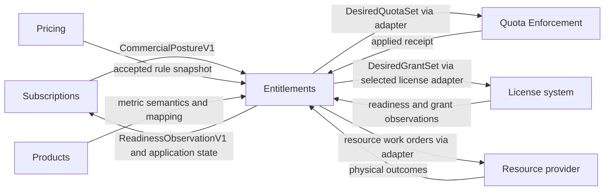

Created: 2026-10-23 by Virtuozzo International GmbH
Updated: 2026-10-23 by Virtuozzo International GmbH

# PRD: Entitlements: Application of Commercial Posture

<!-- toc -->

- [1. Overview](#1-overview)
  - [1.1 Purpose](#11-purpose)
  - [1.2 Background / Problem Statement](#12-background--problem-statement)
  - [1.3 Goals (Business Outcomes)](#13-goals-business-outcomes)
  - [1.4 Glossary](#14-glossary)
- [2. Architecture Alignment](#2-architecture-alignment)
  - [2.1 Terminology and Naming](#21-terminology-and-naming)
  - [2.2 Contract Status](#22-contract-status)
- [3. Actors](#3-actors)
  - [3.1 Human Actors](#31-human-actors)
  - [3.2 System Actors](#32-system-actors)
- [4. Operational Concept & Environment](#4-operational-concept--environment)
  - [4.1 Module-Specific Environment Constraints](#41-module-specific-environment-constraints)
- [5. Scope](#5-scope)
  - [5.1 In Scope](#51-in-scope)
  - [5.2 Out of Scope](#52-out-of-scope)
- [6. Functional Requirements](#6-functional-requirements)
  - [6.1 Posture Intake](#61-posture-intake)
  - [6.2 Initial Readiness](#62-initial-readiness)
  - [6.3 Rules and Quota Projection](#63-rules-and-quota-projection)
  - [6.4 License Grants](#64-license-grants)
  - [6.5 Resource Execution](#65-resource-execution)
  - [6.6 Fencing and Reconciliation](#66-fencing-and-reconciliation)
- [7. Non-Functional Requirements](#7-non-functional-requirements)
  - [7.1 NFR Inclusions](#71-nfr-inclusions)
  - [7.2 NFR Exclusions](#72-nfr-exclusions)
- [8. Five Quality Vectors Analysis](#8-five-quality-vectors-analysis)
- [9. Public Library Interfaces](#9-public-library-interfaces)
  - [9.1 Public API Surface](#91-public-api-surface)
  - [9.2 External Integration Contracts](#92-external-integration-contracts)
- [10. Use Cases](#10-use-cases)
  - [Initial activation readiness](#initial-activation-readiness)
  - [Posture change after activation](#posture-change-after-activation)
  - [Operator repair](#operator-repair)
- [11. User Interaction and Design](#11-user-interaction-and-design)
- [12. Acceptance Criteria](#12-acceptance-criteria)
- [13. Dependencies](#13-dependencies)
- [14. Assumptions](#14-assumptions)
- [15. Open Questions](#15-open-questions)
- [16. Risks](#16-risks)
- [17. Reference Materials](#17-reference-materials)
  - [17.1 Reconciliation Framework](#171-reconciliation-framework)
  - [17.2 Requirement Allocation](#172-requirement-allocation)
  - [17.3 Upstream Requirement Coverage](#173-upstream-requirement-coverage)

<!-- /toc -->

**Design status.** This document specifies target behavior. Provider adoption, concrete SDK mappings and runtime conformance are required before the corresponding capability is enabled.

## 1. Overview

### 1.1 Purpose

Entitlements turns the commercial posture published by Subscriptions into the desired state of enforcement and execution providers, applies it through deployment-selected adapters, and reports readiness and materialization back. It owns the meaning of quota and grant rules; Pricing stores and freezes them with the plan; Products supplies metric semantics; providers own counters, grants, point-of-use decisions and physical resources.

This PRD states what Entitlements guarantees and what it refuses. The architecture is in [DESIGN.md](DESIGN.md). The procedures per capability are in [features](features). Provider obligations and enablement gates are in [UPSTREAM_REQS.md](UPSTREAM_REQS.md). The gear is a design set only; no adapter, SDK or runtime exists yet.

### 1.2 Background / Problem Statement

Commercial lifecycle decisions and provider execution have different owners, evidence and recovery needs. Orders, Rating and Billing consume commercial obligations; quota, license and resource providers consume scoped desired state. Entitlements owns the translation and application boundary so every provider integration follows one identity, fencing and recovery contract.

Subscriptions owns commercial posture and the consumer-side readiness gate. Entitlements derives desired state, persists readiness manifests, integrates adapters and reconciles actual outcomes. Pricing stores immutable accepted rule evidence; Entitlements defines its meaning.

### 1.3 Goals (Business Outcomes)

- Every committed posture revision has one desired provider state per enabled capability and one recoverable application outcome.
- Initial usable service is confirmed before Subscriptions commits active; no first issuance happens after T.
- An older command can never undo a newer revocation at any provider.
- Rules are frozen once, in Pricing acceptance; replay never reads a live plan.

### 1.4 Glossary

| Term | Meaning |
| --- | --- |
| Commercial posture | The versioned fact Subscriptions publishes for a subscription revision: members with capability references, quantity as the sum of effective lots, validity, posture `Granted`, `Restricted` or `Revoked`, holder scope, tenant axes, source revision and digest. |
| Desired state | The provider-facing projection Entitlements derives from one posture revision and the accepted snapshot: a `DesiredQuotaSet`, a `DesiredGrantSet` or a set of resource work orders. |
| Assignment | The stable identity of one concrete rights assignment or service instance inside an authorized tenant scope. Adapters and providers address work by assignment, never by subscription. |
| Readiness manifest | The persisted list of every required scoped assignment for an initial activation, with desired revision, service profile, target and authoritative producer. |
| Observation | A reported fact about an assignment or an applied revision from a trusted producer: `pending`, `ready`, `failed` or `withdrawn` for readiness; `Applied`, `Pending`, `Refused`, `Unknown` or `Superseded` for application. An observation is not a subscription status. |
| Adapter | The deployment-selected integration that translates desired state into provider operations and provider evidence into observations. Native, third-party and customer integrations are alternative adapters. |
| Capability profile | The versioned set of guarantees an adapter must demonstrate before a product profile that needs that capability can be enabled. |
| Rule | A `PlanQuotaRule` or grant definition: the semantics of a purchased limit or grant, independent of a sale. Entitlements owns the schema; Pricing stores the rule on a PlanRevision. |
| Binding | The selection of a rule for a plan item or dimension value inside a PlanRevision. It binds semantics, not a caller-chosen cap. |
| Accepted snapshot | The frozen rule and binding evidence inside Pricing's acceptance receipt for one purchase. Replay reads it; it never reads the live plan. |
| Source key | `(authenticated namespace, resource tenant, assignmentId)`: the key under which a provider holds the applied head for one desired set. |
| Finding | A durable record of a mismatch between desired and observed state, closed only by correlated evidence or an audited disposition. |

## 2. Architecture Alignment

### 2.1 Terminology and Naming

This document says "selected adapter" for the deployment-selected integration and "selected license adapter (LE, native LM or third party)" where a license system is meant. It says "endpoint" and "API method" for interfaces. "Provider" means the system that owns the final effect: Quota Enforcement, a license system or the resource provider. A proposed model name such as `DesiredQuotaSet` is a semantic shape, not a shipped Rust type.

### 2.2 Contract Status

This PRD defines Entitlements requirements under `cpt-cf-bss-entitlements-*`. The [Subscriptions PRD](../../subscriptions/docs/PRD.md) defines the commercial requirements. The two gears agree the posture and readiness contracts under E-U06; [DECISIONS.md](DECISIONS.md) records the application boundary, readiness rules and rule ownership.

## 3. Actors

### 3.1 Human Actors

#### Platform Operator

**ID**: `cpt-cf-bss-entitlements-actor-platform-operator`

- **Role and needs**: Inspects desired and observed state per assignment, resolves findings, requests reconciliation and repair, and changes adapter or profile selection under audit.

### 3.2 System Actors

#### Subscriptions

**ID**: `cpt-cf-bss-entitlements-actor-subscriptions`

- **Role**: Publishes `CommercialPostureV1` from its atomic lifecycle commit and consumes `ReadinessObservationV1` and application state. Owns the commercial lifecycle, T and the consumer-side readiness gate.

#### Pricing

**ID**: `cpt-cf-bss-entitlements-actor-pricing`

- **Role**: Stores quota and grant rules on the immutable PlanRevision, validates them at publication and freezes them in the acceptance receipt together with the price bindings.

#### Products

**ID**: `cpt-cf-bss-entitlements-actor-products`

- **Role**: Owns metric, unit and subject kinds and the versioned mapping from product metrics to the enforcement metric registry.

#### Quota Enforcement

**ID**: `cpt-cf-bss-entitlements-actor-quota-enforcement`

- **Role**: Owns counters, windows, allocation and consumption atomicity, the applied source head and point-of-use quota decisions. Accepts fenced desired quota state through the selected adapter.

#### License Enforcement

**ID**: `cpt-cf-bss-entitlements-actor-license-enforcement`

- **Role**: The selected license adapter (LE, native LM or third party). Owns named grants, seat assignment and license checks. Accepts fenced desired grant state and reports readiness of preparation assignments.

#### Resource Provider

**ID**: `cpt-cf-bss-entitlements-actor-resource-provider`

- **Role**: Executes provision, pause, restore, stop, export and delete work orders and reports physical outcomes with actual effective time and resource generation.

## 4. Operational Concept & Environment

Subscriptions commits a lifecycle transition and the posture in one transaction and publishes the posture through its outbox. Entitlements accepts the posture, derives one desired set per enabled capability, and dispatches adapter work from its own outbox. Each provider applies the set under a fence and returns a receipt or an observation. Entitlements journals the result and exposes it to Subscriptions reads. No call to a provider runs inside a local transaction, and no cross-gear transaction exists.

### 4.1 Module-Specific Environment Constraints

- Intervals are half-open and UTC. A provider whose validity window includes both endpoints needs an agreed exclusive-end mapping before timed quotas are enabled.
- Every adapter call is bound to the resource tenant and proves subject membership through the resource authority. Seller and payer permissions never substitute for resource-tenant authority.
- Event delivery is at least once and can be absent. Recovery reads of posture, source heads and observation streams must be sufficient without events.
- Desired state, outbox intent and journal must agree at each local commit. A process failure cannot expose an accepted posture without its derivation work.
- Adapter and profile identity is retained with every outstanding operation. A changed adapter never replays old commands into a new provider.

## 5. Scope

### 5.1 In Scope

| Capability | Priority | Launch condition |
| --- | --- | --- |
| Posture intake and fencing | p1 | E-AC01 to E-AC03: `CommercialPostureV1` version agreed with Subscriptions (E-U06). |
| Initial readiness (provider side) | p1 | Held-readiness/resolution contract and bounded preparation profile proven with Subscriptions. |
| Quota projection, allocation profile, one atomic member | p1 | E-U01 QE apply/read contract. |
| License grants | p1 | E-U02 selected license adapter (LE, native LM or third party). |
| Resource execution | p1 | E-U05 resource adapter. |
| Reconciliation and repair | p1 | Authorized recovery reads at every enabled adapter. Local fixtures for lost replies, reordered actions and restarts are development evidence only. |
| Consumption quota profile, pooling, rate limits | Deferred | Later phases as defined in the quota projection feature; not a current gate. |

**Initial allocation preparation:** An authorized activation operation MAY establish allocation quota for the purchased environment before T under frozen accepted capacity and scoped preparation actions. Required quota and actual resource readiness MUST precede activation. QE MUST count occupied/reserved resources immediately and preserve the same source/member/allocation identities through T and delayed outcome delivery, without reset, parallel allowance or interruption of prepared usable access. Pre-T preparation cost is platform-borne; occupied capacity remains counted.

Only fenced non-activation authorizes withdrawal/cleanup; block new allocation and release occupied capacity only on confirmed resource release. Unknown activation or cleanup MUST retain the obligation. ENT-Q15/E-U01 gate exact provider support; consumable-limit checks carry a purpose marker under the separately enabled provider profile; execution and quota/accounting treatment remain provider-owned. Unsupported profiles refuse before sale/capture, while temporary outages preserve accepted obligations.

**Blocked is observable:** a capability whose gate is not closed reports unavailable or not applicable. Entitlements never fabricates an applied result, and never lets an unclosed gate pass as a local fixture result.

### 5.2 Out of Scope

Counting, windows, point-of-use decisions, license files and license stores, provisioning engines and topology, the commercial lifecycle, pricing, and storing or accepting rules are external responsibilities. Entitlements calculates no remaining quota, resets no counter, assigns no seat and never decides whether a customer may buy. Cross-subscription pooling, consumption profiles and rate limits are deferred.

## 6. Functional Requirements

FRs define observable guarantees. Mechanisms are in DESIGN; procedures and fixtures are in features. Every active FR needs automated acceptance evidence; an unratified gate stays closed even when a local fixture passes.

### 6.1 Posture Intake

#### Accept and fence a posture revision

- [ ] `p1` - **ID**: `cpt-cf-bss-entitlements-fr-posture-intake`

Entitlements MUST accept `CommercialPostureV1` from the Subscriptions outbox or from its recovery read. The posture carries:

- Identity `(orderingTenantId, subscriptionId, revision)`, payload digest and operation id.
- Tenant axes: resource, payer and seller.
- One member per logical component, with capability and product references, quantity as the sum of effective lots, validity interval, posture `Granted`, `Restricted` or `Revoked`, and holder scope.
- Provenance: acceptance id, rule and binding snapshot digests, and contributing lot ids.

It also carries the lifecycle action and complete resource dispositions defined in DESIGN §3.3.1. Preparation withdrawal and hold/cutoff/schedule/deletion-authorization updates MUST advance the aggregate revision and persist with their local fence and outbox even without a commercial status change. Lots are provenance only; Entitlements MUST NOT re-derive quantity from lots.

Intake MUST authenticate the producer and its tenant scope before acceptance. It MUST compare the revision and digest with its intake journal:

- Lower revision: stale. Record it without applying it.
- Equal revision and equal digest: replay. Make no change.
- Equal revision and different digest: conflict. Refuse it and expose the conflict.
- Higher revision: accept it as the new target and retain earlier outcomes.

On retry or delayed delivery a result MUST apply only to its matching revision. The accepted posture and the derivation work for each enabled capability MUST be persisted in one local transaction with the outbox. Intake state per subscription revision MUST be readable by Subscriptions.

- **Rationale**: One fenced intake per revision keeps every later derivation reproducible and prevents a replay from producing a second application.
- **Actors**: `cpt-cf-bss-entitlements-actor-subscriptions`, `cpt-cf-bss-entitlements-actor-platform-operator`
- **Covers**: `cpt-cf-bss-entitlements-upreq-commercial-posture`

### 6.2 Initial Readiness

#### Readiness manifest, observations and the provider-side boundary

- [ ] `p1` - **ID**: `cpt-cf-bss-entitlements-fr-initial-readiness`

For initial activation, Entitlements MUST build and persist the operation's readiness manifest before sending any preparation request or readiness observation. The manifest lists every required scoped assignment, its desired revision, service profile and target, and the authoritative producer; optional and not-applicable capabilities are explicit. An empty manifest is permitted only when the accepted service profile requires no preparation, never because discovery or an adapter failed. The manifest digest guards composition and logical target changes while preparation runs; those changes require a newer preparation posture, not in-place roster mutation.

Preparation rights MUST be available while the subscription is draft. Waiting for `active` would prevent activation. The selected adapter reconciles each assignment to the required platform state. For PaaS this means creating or linking the account, deploying the environment included in the purchase and establishing usable access; it does not wait for the customer's first login or a later purchase. Entitlements records authority and waits for evidence; it MUST NOT orchestrate vendor steps.

An existing assignment identity is reused when it supplies the required scope, lifetime and revision semantics. The License Resolver is a read and check boundary, not the owner of issuing rights or a delivered change feed. Event delivery, polling or another reliable feed is an integration choice. Persist each assignment intent and its activation association before dispatch. A fast callback must have a saved association to match.

Readiness MUST be reported to Subscriptions as an aggregate `ReadinessObservationV1`, with `schemaVersion`, `orderingTenantId`, `scopeId`, `operationId`, `postureRevision`, `postureDigest`, `manifestId`, `manifestVersion`, `manifestDigest`, complete `requiredAssignments`, `serviceProfileRef`, `eventId`, `producerId`, `statusSequence`, `status`, `observedAt`, `evidenceRef` and `reasonCode`. Entitlements is the authenticated aggregate producer; no subscription identifier is returned. Subscriptions saves its operation and preparation posture before dispatch, then binds the first exact matching manifest result. Refuse a different roster or digest for the same version. Replacement requires a higher preparation posture revision.

Results and sequence changes MUST commit with the outbox and remain recoverable by ordering tenant, operation and posture revision. A manifest confirmed empty by the authoritative profile MUST emit explicit aggregate readiness, not wait for assignment events.

Adapter observations are a separate input carrying scope, assignment, desired revision, profile/target, event, producer, sequence, status and evidence under DESIGN §3.3.2. Before acceptance Entitlements MUST authenticate the producer and authorize its tenant, assignment and profile authority against the saved manifest; an arbitrary publisher's `producerId` is not proof. It MUST:

- Match the exact scope, assignment, desired revision, target and profile.
- Persist the observation, its content identity, the producer sequence high-water mark and provenance. An identical delivery is a no-op.

A conflicting duplicate, a wrong scope, an unexpected producer or an ambiguous association is refused or quarantined without information leakage. An older sequence MUST NOT overwrite a newer `ready`, `withdrawn` or `failed` result; a gap needs authoritative reconciliation unless the agreed full-state snapshot contract proves it covered. Receipts, broker acknowledgement and license existence alone never satisfy readiness. One producer's `ready` does not satisfy another required producer or assignment. An unsupported `schemaVersion` is quarantined, not interpreted as ready.

Entitlements MUST report the manifest as ready only when every assignment reports `ready` for the exact desired revision. Subscriptions performs the guarded commit and owns T. Entitlements MUST NOT claim activation, assign T or treat a ready event as completion. The post-commit outbox may reconcile the same satisfied assignment or deliver nonessential changes; it MUST NOT be the first action that makes required initial access usable. Initial readiness is not an uptime guarantee.

Entitlements MUST persist external effects and durable lookup and reconciliation keys. A lost or unknown result, an absent read result, or a quiet broker does not prove failure or non-execution. Recover the same assignment without allocating a second account or environment. A `failed` observation describes preparation failure, not proof that all partial effects are gone. Withdrawal MUST first fence and revoke or supersede the preparation authority, then reconcile running external actions and record cleanup obligations.

A delayed `ready` for a withdrawn or obsolete revision cannot activate; it still contributes effect evidence for cleanup. Adapter-side ordering MUST prevent delayed preparation from recreating a withdrawn environment, including work already in flight. Pending cleanup is never erased because a draft disappeared. Cleanup targets only resources owned by this operation under the accepted policy, never an existing customer account merely because it was linked. Operational cleanup completion and financial settlement remain separate outcomes.

**Held readiness (SUB-D-57).** A ready result MUST carry a durable commitment to retain the exact prepared assignments until Subscriptions resolves the attempt. Subscriptions owns the serialized activation/non-activation decision; Entitlements MUST recover that immutable outcome after publication loss. Terminal non-activation MUST be recoverable by authenticated operation/preparation revision and digest before a manifest or commitment exists. It MUST carry known bindings, fence late preparation and cover partial or later discovered effects of that generation. Applied MUST match the complete manifest/commitment binding.

Timeout, failed observation, failure of an execution guard or absent/unreachable outcome MUST NOT authorize cleanup. Applied continues the same rights; a proved irreversible non-activation fence permits only authorized cleanup. Known failure blocks activation. Physical outages and independently authorized immediate security blocks remain explicit exceptions to continuous availability. If activation wins the race, retain its applied T and use the later guarded lifecycle/financial policy. Authorized preparation use before T, including never-activated work, MUST be platform-borne and cannot become ordinary customer service charges.

Enabled profiles MUST bound exposure and admission, retain uncertain obligations, and provide authoritative usage boundary/accounting evidence. No quota/trial gate, purchased validity or financial admission rule is waived. [The readiness procedure](features/02-initial-readiness.md) defines settlement and recovery.

- **Rationale**: Usable service is confirmed before commercial activation; a readiness claim without evidence would let Subscriptions commit T on a service that does not work.
- **Actors**: `cpt-cf-bss-entitlements-actor-subscriptions`, `cpt-cf-bss-entitlements-actor-license-enforcement`, `cpt-cf-bss-entitlements-actor-resource-provider`, `cpt-cf-bss-entitlements-actor-platform-operator`
- **Covers**: `cpt-cf-bss-entitlements-upreq-readiness-gate`

Subscriptions MUST snapshot the preparation policy/version, authorized start and deadline for each attempt and include them in preparation context. Entitlements MAY request closure on deadline or definitive failure but MUST recover the authoritative applied/non-activation winner before cleanup. Expired attempts cannot newly activate; retries/restart/profile edits cannot extend them. A prior applied T MUST remain unchanged. Terminal attempt closure MUST preserve the purchase/payment for Orders remediation and MUST NOT initiate commercial cancellation or a refund. Unknown outcomes retain held effects; a successor requires safe predecessor-effect/cleanup fencing.

Credit-trial readiness MUST require an authenticated Billing commitment for one reserved grant bound to the exact activation operation, preparation generation, accepted scope/terms and service profile. Subscriptions supplies its reference/digest as `trialCoverage`; Entitlements MUST retain it with the posture/manifest binding and prepare usable access under the guarantee. The same grant becomes effective at Subscriptions T; later Billing recording MUST require no new issuance decision or initial-access wait. Pre-T/never-activated use MUST be platform-borne and MUST NOT consume the bonus.

Unknown outcomes retain preparation and coverage; only exact fenced non-activation permits release. Applied recovery MUST preserve original T/expiry and newer cancellation, without regrant or a second balance in Entitlements. E-U07/ENT-Q14 require exact provider contracts, bounded exposure/enforcement and executed evidence before the profile is enabled.

For a separately enabled consumption profile, readiness MUST use authoritative provider evidence for the accepted limit, exact scope, window, enforcement/accounting path and access. Entitlements MUST mark readiness-check purpose in the scoped adapter request so the provider can recognize it. Execution and quota/accounting treatment belong to the provider contract; the marker MUST NOT itself imply dry-run, no effects, zero consumption, authorization bypass or a billing exemption. A consuming probe, service allowance or provider-side dry-run API MUST NOT be universally required.

Actual effects MUST retain ordinary recovery/provenance and pre-T cost treatment. Activation/recovery MUST preserve the same rule/counter/window without reset or duplicate allowance. Missing or unenforced configuration MUST NOT produce ready; deferred consumption runtime scope remains unchanged.

Provider restrictions MUST remain distinct from purchased desired rights. Entitlements MUST retain authoritative actual restriction scope/reason/version and expose a fulfillment discrepancy without rewriting accepted terms. Known incompatible offers MUST be refused before acceptance/capture; later restrictions preserve the purchased obligation for remediation. Required initial capability MUST NOT be marked ready under such a mismatch. Applied T/history, held-readiness arbitration and emergency security rules remain unchanged. Provider observations may change independently of commercial revision and MUST be ordered/recoverable; source-state delivery alone MUST NOT count as fulfilled enforcement.

### 6.3 Rules and Quota Projection

#### Rule schema and semantics

- [ ] `p1` - **ID**: `cpt-cf-bss-entitlements-fr-rule-schema`

Entitlements MUST publish the versioned semantic schema of quota rules and grant definitions. Pricing stores and freezes them with the plan (ENT-D-03). A definition describes a limit's semantics independently of a sale. A binding selects that definition for a plan item. An accepted snapshot freezes the selection and its exact semantics. A desired quota is a lifecycle-dependent projection of committed accepted state. A provider's actual record and counters are a fifth, separately observed state.

| Owner | Responsibility | Boundary |
| --- | --- | --- |
| Entitlements | Rule schema and semantics: kinds, capacity forms, subject kinds, validity, suspend and revoke policy, combination; derivation of desired state from posture and accepted snapshot | Does not store or accept rules, count usage, select live catalog terms for replay, assign seats or reset counters. |
| Pricing | Stores `PlanQuotaRule` and `QuotaBinding` on the immutable PlanRevision; validates them at publication against Products evidence; freezes them in the acceptance receipt with the price bindings | Does not own semantics, count usage, resolve mutable resource ownership or issue live quota. A changed quota term needs a new accepted revision even when the price is unchanged. |
| Products | Stable SKU and metric, unit and subject references; versioned mapping of a product metric to the enforcement registry `MetricId` and `projection_type` | A usage meter is evidence of unit semantics, not automatically an enforcement meter. A `usage_type_ref` is not a `MetricId`. |
| Subscriptions | Publishes posture with committed quantity, validity, posture and lot provenance | Does not calculate quota, derive desired state or talk to adapters. |
| Orders and Workflow | Preserve the accepted order line, plan quantity and receipt | Cannot supply an arbitrary cap as purchase authority or invent per-component quantities absent from the accepted contract. |
| Quota Enforcement | Counters, windows, allocation and consumption atomicity, applicable policy and enforcement | Does not decide what was purchased from a caller's cap or infer pooling from several records. |
| License Enforcement, where selected | Named type and instance grants, assignment and licensing yes/no checks | Numerical limits, counting and leases remain with Quota Enforcement; a named grant never becomes a second source of the same capacity. |

| Model | Required content |
| --- | --- |
| `PlanQuotaRule` (definition) | `rule_id`, immutable revision and digest, Products SKU, version and metric semantics reference with digest, metric code and canonical unit, `kind = Allocation \| Consumption`, `subject_kind`, `capacity = Fixed(exact_quantity) \| PerPlanUnit(exact_coefficient)`, binding applicability, period where applicable, hard-enforcement policy, `combination = ExclusiveSource`, validity policy, suspend and revoke policy, capability profile and version. |
| `QuotaBinding` (selection) | Plan and revision, rule and revision, applicable item ids and accepted dimension values, immutable Products references, quantity basis explicitly `PlanQuantity`, selected scope template. It binds semantics, not a caller-selected resource or cap. |
| `AcceptedQuotaSnapshot` (purchase evidence) | Acceptance id, request and terms digests, order, version and line, plan and revision, original exact plan quantity, complete rule and binding snapshots or durable immutable references with digests, seller, payer and resource tenant axes, authorized subject-binding policy, terms, validity and continuation policy, required provider profile. Later lot acceptances are separate immutable evidence. |

Grant rules MUST have a separately typed `GrantDefinition`, `GrantBinding` and `AcceptedGrantSnapshot` under DESIGN §3.1. A definition names the immutable product/capability, supported holder/subject kinds, fixed or per-plan-unit exact quantity semantics, validity/restriction/revoke policy and required provider profile. A binding names selected items/dimensions and the authorized scope template; the receipt freezes the complete selected definitions/bindings, quantity and tenant axes by version/digest. These are named rights, not another quota counter or seat-assignment engine. Pricing MUST support their authoring, publication validation, acceptance freeze and historical read independently of the quota extension; E-U03 requires evidence for both enabled rule kinds.

Unknown enum variants and unsupported profile versions MUST refuse before sale or application; they never mean "no quota". A rule's metric MUST resolve through a registered enforcement metric instance and a versioned Products mapping that retains its version and digest; a string name alone is not enough. Replay MUST read the frozen rule from the acceptance receipt, never the live plan. The existing billing descriptors in Products do not satisfy this schema; Pricing and Products must support the E-U03 and E-U04 requirements.

- **Rationale**: One owner of meaning and one owner of storage keep every accepted cap reproducible after the plan changes.
- **Actors**: `cpt-cf-bss-entitlements-actor-pricing`, `cpt-cf-bss-entitlements-actor-products`, `cpt-cf-bss-entitlements-actor-quota-enforcement`
- **Covers**: `cpt-cf-bss-entitlements-upreq-commercial-posture`

#### Quota projection and exact conversion

- [ ] `p1` - **ID**: `cpt-cf-bss-entitlements-fr-quota-projection`

Entitlements MUST derive a complete `DesiredQuotaSet` from one accepted posture revision and the accepted quota snapshot. The set is keyed by the source key `(authenticated namespace, resource tenant, assignmentId)` and carries the monotonic source revision, operation id, canonical payload digest, the complete member set with explicit tombstones, the effective interval and the posture. Each member identifies metric and unit, subject, kind and period, the exact integer cap, the rule identity and the complete contributing lot and acceptance provenance.

A stable member key beneath the source key adds the logical quota binding and the subject; metric, kind, unit and period identity are immutable attributes of that member.

`PerPlanUnit` uses the accepted plan quantity; it never multiplies by a quantity in a binding selection, by usage, by price or by the number of matching items. A fixed rule applies once per logical quota binding within a subscription, not once per lot or retry. Exact conversion: let `q` be the positive accepted plan quantity, `c` the nonnegative exact coefficient and `s` the accepted exact conversion to the metric's integer unit.

`Fixed(f)` gives `cap = f × s`; `PerPlanUnit(c)` gives `cap = q × c × s`, evaluated with exact decimal or rational arithmetic. The result MUST be integral, nonnegative and at most `9,223,372,036,854,775,807`. Negative values, overflow, unsupported precision, fractional results and incompatible units MUST refuse before effects. No float conversion, rounding, truncation or saturation is allowed, and GB is never assumed to equal GiB. Checked arithmetic MUST be exercised at the chosen precision limits, including intermediate overflow; exactness is verified at every step.

| Value | Required meaning |
| --- | --- |
| `Bounded(0)` | Explicit cap zero. It denies new positive consumption or allocation within its enforcement policy; it does not evict resources or prove all access is denied. |
| Absent member | No purchased quota declaration. It means neither zero nor unlimited nor permission. Removal from an existing desired set needs an explicit tombstone. |
| `Unbounded` | Explicit unlimited policy. Refused in the first profile until owners accept an explicit authorization policy. Absence, error or unknown evidence is never translated into unbounded. |

Several effective lots under the same per-plan-unit rule inside one subscription are summed as a projection, not as pooling across provider records. Lots with different rules, coefficients, units, windows or expiries MUST refuse the affected change until a ratified contribution contract defines the result. A matching item id across PlanRevisions does not prove binding equivalence; Pricing supplies a logical binding id and a semantic-equivalence digest. Allocation and consumption need different evidence and never share a counter.

Quota Enforcement owns window identity; renewal, cap change, replay, suspend and resume MUST preserve the counter and window identity and never act as a disguised reset. Subscriptions intervals are `[start, end)`; a provider window that includes both endpoints needs an exclusive-end contract before timed quotas are enabled. Owner tenant, subject, metric, unit, kind and period are immutable for a continuing member; a change refuses rather than migrates.

| Transition | Required quota behavior |
| --- | --- |
| Draft or future start | Evidence alone grants nothing. Authorized allocation preparation within accepted capacity and allowed resource/actions/schedule counts actual occupancy immediately; consumable-limit preparation uses provider readiness evidence with marked check purpose when that runtime profile is enabled; the marker does not imply zero consumption. |
| Activation | Required allocation quota and resources are ready before T. Continue the same source/member/allocation and occupied amounts without reset or duplicate allowance; quota outside initial readiness may first apply after T. |
| Active increase or addition | Same-rule delta lot projected into the complete set at one revision; original lot and usage unchanged. |
| Suspended increase or addition | Refused by Subscriptions before any posture is published; Entitlements receives no revision. |
| Resume | A newer granted revision; counters, window identity and original expiry retained. An old resume cannot override a later restriction. |
| Cancellation or trial expiry | A newer terminal tombstone; its fence survives restart and retry. Deactivation alone is not proof of denial. |
| Renewal or continuation | Terms re-read from the accepted continuation evidence; counter identity preserved; no refill because a billing period opened. |
| Expiry or reduction below used | Evidence retained; further positive admission denied under the adopted policy; no clamp, refund or eviction. |

Example: plan revision `P7` sells rule `storage-cap/R1` as `PerPlanUnit(107374182400 bytes)` for metric `storage.allocated_bytes` with subject `project`. A sale of three plan units projects `3 × 107374182400 = 322122547200` bytes for source key `(BSS entitlements, tenant-R, assignment-42)` and member `(storage-cap binding, project-42)`. An accepted increase of two units creates a second lot; revision 8 projects five units and cap `536870912000` for the same member without resetting allocation state. A second rule `Fixed(10 projects)` stays ten when the quantity rises; it is neither multiplied nor awarded again. These values are illustrative, not catalog defaults.

- **Rationale**: Exact, reproducible projection keeps the purchased cap equal to what the accepted snapshot says after any replay or plan change.
- **Actors**: `cpt-cf-bss-entitlements-actor-pricing`, `cpt-cf-bss-entitlements-actor-products`, `cpt-cf-bss-entitlements-actor-quota-enforcement`, `cpt-cf-bss-entitlements-actor-subscriptions`
- **Covers**: `cpt-cf-bss-entitlements-upreq-commercial-posture`

### 6.4 License Grants

#### Derive and apply desired grants

- [ ] `p1` - **ID**: `cpt-cf-bss-entitlements-fr-license-grants`

Entitlements MUST derive a `DesiredGrantSet` from the posture members that carry license capabilities. Each grant carries the grant definition reference, quantity, validity, holder scope, the assignment identity within the authorized scope and the generation. The set is applied through the selected license adapter (LE, native LM or third party). The adapter MUST:

- Accept desired grant state with authorized scope, assignment identity, desired revision and generation.
- Return applied, pending, refused or unknown evidence with authoritative effective time where known.

It neither receives nor reports `subscriptionId`.

A delayed issue or resume MUST NOT undo a newer revoke or suspend; ordering is enforced at the effect boundary, not only when reading a callback. The same materialization operation MUST be readable and replayable after a lost response without creating another grant.

Preparation grants for an initial activation are issued while the subscription is still draft and are reported as readiness observations; `active` is not the trigger. Increases and additions while suspended are refused by Subscriptions before any posture reaches Entitlements. Cancellation and trial outcomes materialize their accepted posture; delayed effects of an earlier committed change cannot undo a newer restriction. Credit-dependent access waits for the grant evidence Subscriptions reports as part of the posture; Entitlements applies no trial or grant accounting policy.

Seat assignment, reservation atomicity, resets and point-of-use staleness are owned by enforcement. A named grant never becomes a second source of the same capacity; numerical limits belong to Quota Enforcement. Where the product requires no access gap, the selected license adapter MUST demonstrate that continuity; Entitlements cannot promise issue-before-revoke continuity by sending two asynchronous commands.

- **Rationale**: One derived grant set per revision, fenced at the provider, keeps grants equal to the accepted posture under retries and reordering.
- **Actors**: `cpt-cf-bss-entitlements-actor-license-enforcement`, `cpt-cf-bss-entitlements-actor-subscriptions`
- **Covers**: `cpt-cf-bss-entitlements-upreq-commercial-posture`

### 6.5 Resource Execution

#### Work orders with truthful physical outcomes

- [ ] `p1` - **ID**: `cpt-cf-bss-entitlements-fr-resource-execution`

Entitlements MUST translate posture into resource work orders of the kinds provision, pause, restore, service stop, export and delete, each with the operation identity and the immutable resource generation, and submit them through the selected resource adapter. Subscriptions owns commercial intent, the confirmed charging cutoff and disposition eligibility; the resource provider owns execution and physical outcomes. Inventory and evidence form a separate role, even when one deployment service supplies both.

The adapter MUST correlate readiness, stop and delete outcomes to the operation and the resource generation, with the actual effective time and explicit pending, unknown and partial outcomes. A suspend order MUST preserve data and implement the accepted restricted posture; it is not deletion. Retention and export MUST follow the frozen accepted disposition terms and expose the required read-only export capability; retained data creates no ordinary service charge.

A hold is confirmed only with execution-boundary arbitration or acknowledged fencing that prevents a stale delete; a local receipt is not enough. Retry MUST use the original identity, report per-resource partial completion and never apply an old action to a replacement resource with a recycled name. Entitlements records actual times as reported: a stop at 10:05 after a 10:00 cutoff stays 10:05. Automatic deletion stays disabled without the proven hold fence.

- **Rationale**: Truthful outcomes per resource generation let Subscriptions and Billing act on what happened, not on what was requested.
- **Actors**: `cpt-cf-bss-entitlements-actor-resource-provider`, `cpt-cf-bss-entitlements-actor-subscriptions`, `cpt-cf-bss-entitlements-actor-platform-operator`
- **Covers**: `cpt-cf-bss-entitlements-upreq-commercial-posture`

### 6.6 Fencing and Reconciliation

#### Stale-action fencing at every provider

- [ ] `p1` - **ID**: `cpt-cf-bss-entitlements-fr-stale-action-fencing`

Every application MUST be fenced so an older issue, replace, restore or provision cannot undo a newer revoke, restrict or stop at any provider, including reordered deliveries with different request keys. The fence is a compare-and-apply on the source key, revision and digest at the effect boundary: a lower revision is stale; an equal revision with an equal digest returns the existing result; an equal revision with a different digest conflicts; a higher revision may replace only that source's state after validation.

A terminal revoke closes the source identity: a later `Granted` request is refused even with a higher revision; only an explicitly authorized new acquisition with a distinct identity establishes new rights. An aggregate revision is ordering, an operation id is retry identity, a digest is content identity; none substitutes for another.

The fence MUST cover in-flight work. Revision 7 can pass an adapter precheck, wait remotely and arrive after revision 8 revoked access; the provider's conditional application MUST reject it after a timeout, a worker restart or a lease loss. Filtering a late callback is an additional check, not the fence.

A provider-side revision fence is one implementation; adapter serialization with a durable journal is acceptable only when it proves that an earlier operation can no longer apply before a later one is finalized, including already in-flight external actions. Tombstones and monotonic heads MUST be kept for at least the entire accepted delayed-message and retry horizon. Unsupported ordering blocks the affected profile under the corresponding gate.

Entitlements MUST retain a versioned provider binding for each assignment/capability before dispatch: selected adapter instance, contract/profile, stable provider target and observation authority. Later revisions, retries and recovery MUST use that binding. A priority change, missing plugin or reconfigured instance MUST NOT redirect an existing assignment to another provider. A change of provider requires an explicitly supported settlement of outstanding effects and source ownership; an unknown result never permits automatic fallback. Provider integration is replaceable through the Entitlements-owned plugin boundary; Subscriptions does not select plugins.

An unsupported required profile or unavailable binding remains explicit, with no fabricated application or readiness.

- **Rationale**: Without a fence that covers in-flight work, a delayed grant can restore access after cancellation.
- **Actors**: `cpt-cf-bss-entitlements-actor-quota-enforcement`, `cpt-cf-bss-entitlements-actor-license-enforcement`, `cpt-cf-bss-entitlements-actor-resource-provider`
- **Covers**: `cpt-cf-bss-entitlements-upreq-commercial-posture`

#### Reconciliation, findings and repair

- [ ] `p1` - **ID**: `cpt-cf-bss-entitlements-fr-reconciliation`

Entitlements MUST record adapter acknowledgement, applied revision and structured findings separately from commercial status. A broker delivery receipt is not application; provider success is not evidence of enforcement propagation. Outbox replay MUST use the same request identity and the retained adapter and profile routing. Reconciliation obtains correlated evidence of the applied desired state through the adapter; that evidence may derive from native provider versions, operation status, authoritative state reads or their combination backed by the adapter's durable journal. A dispatch log alone is not proof of external application.

| Recovery situation | Required action |
| --- | --- |
| Remote apply succeeds; local response or write times out | Mark unknown, read the same source key and operation, verify revision and digest, recover the receipt; replay only the same idempotent apply. |
| Local commit succeeds; worker dies before dispatch | Recover the outbox and send the identical desired revision. |
| Delayed old request arrives after revoke | The provider rejects it against the retained tombstone. Local filtering is an additional check. |
| Provider reports a higher revision | Reconcile to known authorized history; mark an unexplained revision as conflict; never overwrite with the local lower head. |
| Record missing, drift or operator edit | Use authoritative readback; repair only through authorized conditional operations; report conflict where another owner or unknown state exists; never create a parallel record. |
| Metric registration or enforcement mode drifts | Report a blocked update or unknown enforcement finding; retain the commercial obligation; obtain owner remediation; never substitute a metric or mark the profile ready. |
| Adapter or profile changes | Keep in-flight work bound to the original adapter and profile; a new adapter never replays old commands into a different provider. |

An authorized operator MUST be able to request reconciliation for a scope, reading desired and observed state with one consistent tenant scope. A missing or mismatched application produces a durable finding and retries the existing desired revision or submits an explicitly authorized successor. A commercially invalid desired posture is changed in Subscriptions; the operator cannot edit a materialized grant, quota or resource through Entitlements.

A finding closes only on correlated evidence or an explicit audited disposition; a consumer outage or a newer desired revision cannot silently erase a historical failed handoff. Entitlements MUST expose desired state, last observed state, source revision, observed time and the mismatch reason to Subscriptions reads, showing pending or failed explicitly instead of implied access.

- **Rationale**: Operators must see whether the accepted posture was applied, and recover it without inventing success.
- **Actors**: `cpt-cf-bss-entitlements-actor-platform-operator`, `cpt-cf-bss-entitlements-actor-subscriptions`, `cpt-cf-bss-entitlements-actor-quota-enforcement`, `cpt-cf-bss-entitlements-actor-license-enforcement`, `cpt-cf-bss-entitlements-actor-resource-provider`
- **Covers**: `cpt-cf-bss-entitlements-upreq-commercial-posture`

## 7. Non-Functional Requirements

Security, tenant isolation, audit and ToolKit integration inherit the [guidelines](../../../../guidelines/README.md), [security requirements](../../../../guidelines/SECURITY.md) and [architecture manifest](../../../../docs/ARCHITECTURE_MANIFEST.md). The threshold below is a launch target measured on the Subscriptions S-Q07 reference workload, not an observed result.

### 7.1 NFR Inclusions

#### Handoff latency

- [ ] `p1` - **ID**: `cpt-cf-bss-entitlements-nfr-handoff-latency`

Each accepted posture revision MUST reach every required adapter, or a visible retry state, within the ratified budget. Ratified target: first delivery p95 < 5 s and p99 < 15 s; pending beyond 60 s produces an auditable exception. Time to confirmed usable access is recorded separately and is never hidden inside a delivery figure.

- **Threshold**: ratified 5 s / 15 s first delivery; 60 s exception threshold.
- **Verification**: provider outage and recovery, duplicate acknowledgement and refusal scenarios with request identity preserved; measured on the reference workload of the Subscriptions PRD §7.1 with healthy providers at p99 response time at most 250 ms.
- **Architecture allocation**: DESIGN outbox dispatch and the readiness and reconciliation components.

- **Rationale**: Delayed application must be visible before anyone infers that access is ready.
- **Actors**: `cpt-cf-bss-entitlements-actor-subscriptions`, `cpt-cf-bss-entitlements-actor-platform-operator`
- **Covers**: `cpt-cf-bss-entitlements-upreq-readiness-gate`

### 7.2 NFR Exclusions

Point-of-use check latency, counter throughput and license issuance time are requirements of the platform owners. A provider's availability is not a promise of this gear; an unavailable provider leaves delivery pending or unknown.

## 8. Five Quality Vectors Analysis

| Vector | Product guarantee | Evidence |
| --- | --- | --- |
| Correctness | Exact projection, one desired set per revision, fenced application. | Numeric boundary, replay, conflict and in-flight race fixtures. |
| Security | Every adapter call is bound to the resource tenant; producers are authenticated against the manifest. | Wrong-tenant observation, foreign subject and seller-as-resource-tenant refusals. |
| Reliability | Accepted posture and its application remain discoverable without events or the original response. | Lost reply, worker death and restart scenarios. |
| Performance | Delivery budget per revision; no per-record dependence on provider latency inside a local transaction. | Reference workload with p95 and p99 per adapter. |
| Operability | Pending, failed and unknown application are visible with cause and owner action. | Fault injection with inspectable findings and repair. |

## 9. Public Library Interfaces

### 9.1 Public API Surface

Entitlements exposes tenant-scoped read endpoints for intake state per subscription revision, readiness state per assignment, desired and observed state per capability, and findings. It exposes one operator API method to request reconciliation for a scope and one to record an audited disposition of a finding. Exact DTOs and SDK types are owner work and are not declared here.

### 9.2 External Integration Contracts

#### Commercial posture

- [ ] `p1` - **ID**: `cpt-cf-bss-entitlements-contract-commercial-posture`

- **Direction**: Required, from Subscriptions.
- **Protocol/format**: `CommercialPostureV1` from the Subscriptions outbox and recovery read; schema in DESIGN.
- **Compatibility**: versions agreed bilaterally; an unsupported version is quarantined and visible, never applied.
- **Contract**: identity `(orderingTenantId, subscriptionId, revision)`, digest, operation id, tenant axes, members with capability references, quantity, validity, posture and holder scope, provenance, lifecycleAction and complete resourceDispositions with cutoff, generation, hold, schedule and explicit deletion-authorization evidence. A newer revision supersedes the target; earlier outcomes are retained.

- **Rationale**: One versioned input keeps intake fences and derivation reproducible.
- **Actors**: `cpt-cf-bss-entitlements-actor-subscriptions`

#### Readiness observation

- [ ] `p1` - **ID**: `cpt-cf-bss-entitlements-contract-readiness-observation`

- **Direction**: Provided, to Subscriptions.
- **Protocol/format**: `ReadinessObservationV1`; envelope fields listed in `cpt-cf-bss-entitlements-fr-initial-readiness`.
- **Compatibility**: versions agreed bilaterally; Subscriptions ignores no field it does not understand and never treats an unsupported version as ready.
- **Contract**: one operation-correlated aggregate result per complete manifest, with Entitlements producer sequence and authoritative full-result recovery; `ready` only when every required producer/assignment is ready; explicit empty-manifest evidence; no `subscriptionId` in the payload.

- **Rationale**: Subscriptions needs evidence it can match to its persisted operation and posture; Entitlements owns the manifest and adapter observations.
- **Actors**: `cpt-cf-bss-entitlements-actor-subscriptions`

#### Quota apply and read

- [ ] `p1` - **ID**: `cpt-cf-bss-entitlements-contract-quota-apply`

- **Direction**: Required, from Quota Enforcement through the selected adapter.
- **Protocol/format**: versioned `apply_source_state(source_key, source_revision, digest, complete_target, effective_boundary, authority)` and `read_source_state(source_key)` with durable operation recovery; names are requirements, not shipped methods.
- **Compatibility**: a separately versioned managed-apply request; the public quota spec is not extended with source fields.
- **Contract**: source head per source key with revision, digest, terminal posture and recoverable result; atomic member set application; terminal tombstones; authoritative readback.

- **Rationale**: Create, update and deactivate without a caller revision cannot fence delayed commands.
- **Actors**: `cpt-cf-bss-entitlements-actor-quota-enforcement`

#### Grant apply

- [ ] `p1` - **ID**: `cpt-cf-bss-entitlements-contract-grant-apply`

- **Direction**: Required, from the selected license adapter (LE, native LM or third party).
- **Protocol/format**: desired grant state keyed by scope, assignment and generation; applied, pending, refused or unknown evidence; readiness observations for preparation assignments.
- **Compatibility**: the adapter normalizes vendor states; a vendor need not expose our revision field or state machine.
- **Contract**: stale-action suppression at the effect boundary, idempotent recovery, preparation grants in draft, continuity demonstrated where the product needs no access gap.

- **Rationale**: Grants must follow the accepted posture under retries and reordering regardless of the vendor.
- **Actors**: `cpt-cf-bss-entitlements-actor-license-enforcement`

#### Resource work order

- [ ] `p1` - **ID**: `cpt-cf-bss-entitlements-contract-resource-work-order`

- **Direction**: Required, from the resource provider through the selected adapter.
- **Protocol/format**: work orders with operation identity and resource generation; outcomes with actual effective time and pending, unknown or partial status.
- **Compatibility**: adapter maps vendor jobs; outcomes are correlated by operation and generation.
- **Contract**: non-destructive suspension, retention and export per frozen disposition, hold and delete arbitration at the execution boundary, retry by original identity, no action on a recycled resource name.

- **Rationale**: Physical outcomes must be truthful per resource generation.
- **Actors**: `cpt-cf-bss-entitlements-actor-resource-provider`

## 10. Use Cases

### Initial activation readiness

**Preconditions**: Subscriptions persisted an activation operation and the posture of a draft subscription; the accepted service profile requires preparation.

**Main flow**: Entitlements persists the readiness manifest, issues preparation assignments through the selected adapters while the subscription is draft, accepts observations against the manifest and reports ready when every assignment is ready for the desired revision. Subscriptions commits active with fresh T.

**Postconditions and alternatives**: A lost ready event is recovered by reading the same assignment. A withdrawal fences preparation and records cleanup. A ready for an old revision never activates.

### Posture change after activation

**Preconditions**: An active subscription with an applied desired set at revision N.

**Main flow**: Subscriptions publishes revision N+1 (increase, suspend, resume or cancel). Entitlements accepts it, derives the new desired sets, dispatches fenced applications and records receipts.

**Postconditions and alternatives**: A delayed revision N command is rejected at the provider. A lost reply is resolved by reading the source head. A refusal is a visible finding; the commercial record is unchanged.

### Operator repair

**Preconditions**: A finding reports a mismatch between desired and observed state.

**Main flow**: The operator reads desired and observed state in one tenant scope, retries the existing desired revision or submits an authorized successor, and closes the finding on correlated evidence or an audited disposition.

**Postconditions and alternatives**: A commercially wrong posture is corrected in Subscriptions; the operator never edits a provider record through Entitlements.

## 11. User Interaction and Design

The operator surface MUST show, per subscription revision and per assignment, the intake state, the desired state per capability, the last observed state with its time and producer, the adapter and profile in use, and open findings with cause and owner action. Pending, unknown and refused states are shown as such; no screen implies usable access from a dispatched command. Repair actions name the desired revision they retry and refuse when the revision is superseded.

## 12. Acceptance Criteria

The scenarios below are required evidence, not assertions of passing tests. A scenario behind an open gate passes for launch only after the gate closes and a real adapter is exercised; unsupported-profile refusal can be tested beforehand. FR suffixes refer to `cpt-cf-bss-entitlements-fr-…`.

| AC | Scenario and required observable result | FR coverage |
| --- | --- | --- |
| E-AC01 | A crash after posture acceptance and before dispatch recovers the same adapter command without losing the desired set or duplicating application. | posture-intake, reconciliation |
| E-AC02 | Issue request N delivered after revoke request N+1 with different command keys: the adapter and provider prevent access restoration and recover evidence that the newer posture is applied, without a vendor-native revision field. | stale-action-fencing |
| E-AC03 | A delayed old result cannot restore the old plan after a newer replacement or cancellation. | stale-action-fencing, reconciliation |
| E-AC04 | The read surface distinguishes delivery pending, application failed and observed success without asserting point-of-use access. | reconciliation |
| E-AC05 | Quantity reduction cannot bypass the enforcement owner's occupied-capacity guard; Entitlements holds no counter to consult. | quota-projection |
| E-AC06 | An unavailable required adapter yields an explicit gated capability and a visible finding; a profile that does not need that capability reports not applicable without fabricated success. | reconciliation |
| E-AC07 | Initial readiness requires the entire pinned assignment and producer manifest; duplicate, wrong-tenant, old-revision and lower-sequence observations cannot produce ready or overwrite a newer withdrawal. | initial-readiness |
| E-AC08 | A lost ready event is recovered through the same assignment status; unknown or not-found does not allocate a second environment. | initial-readiness |
| E-AC09 | Cancellation racing ready is fenced at external execution; partial and late effects retain cleanup obligations. | initial-readiness, stale-action-fencing |
| E-AC10 | PaaS initial readiness covers the account, the purchased environment and required access, without waiting for first login or a later VM creation; Entitlements reports ready and assigns no T. | initial-readiness |
| E-AC11 | A new plan or metric revision published after purchase: replay retains the original rule, unit, quantity and digest; missing history is pending or refused, not unlimited. | rule-schema |
| E-AC12 | A fractional integer result, overflow, negative value or unit mismatch refuses before effects with a specific reason; an exact valid result is accepted; zero is tested separately from absent and unbounded. | quota-projection |
| E-AC13 | Plan quantity three with several item selections: the per-plan-unit rule applies once with quantity three and the fixed rule once; no per-component quantity is invented. | quota-projection |
| E-AC14 | The same purchase delivered with another transport key recovers the same lot and snapshot; no extra quantity or quota; changed content conflicts. | posture-intake |
| E-AC15 | Provider succeeds, reply lost, worker restarts: the source read returns the same applied revision and digest and one effect; unknown is visible until resolved. | reconciliation |
| E-AC16 | An old issue already in flight when a newer revoke applies cannot grant; the terminal tombstone also rejects a later higher-revision grant for the same closed acquisition and survives restart. | stale-action-fencing |
| E-AC17 | Another subscription or an operator record matches subject and metric: no overwrite, deletion, implicit merge or double allowance; atomic ownership admission refuses or follows an adopted policy. | quota-projection |
| E-AC18 | Cap update, renewal, replay, suspend and resume within one consumption window preserve used and reserved values and the window identity. | quota-projection |
| E-AC19 | A failure halfway through a multi-member desired update yields an atomic apply or a safe restricted pending state with recovery; an unsupported multi-member profile is refused; no partial grant is reported complete. | stale-action-fencing, reconciliation |
| E-AC20 | A subject, metric, kind or period change presented as an update refuses the unsupported migration; no fresh allowance is minted under a new record. | quota-projection |
| E-AC21 | Concurrent activations in one scope, a fast callback, a lost aggregate result and an empty manifest: correlate by saved operation/posture; reject changed same-version roster and stale results; recover the full aggregate by operation without allocating another environment. | initial-readiness |
| E-AC22 | Hold placement/release, rescheduling and deletion authorization while status remains revoked: each publishes a complete newer disposition snapshot; lost/reordered delivery cannot reopen stale eligibility; missing notice or generation denies destructive work. | posture-intake, resource-execution, stale-action-fencing |
| E-AC23 | Under an accepted 100 GiB allocation cap, an authorized prepared 20 GiB disk counts before T and leaves 80 GiB available after T under the same source/member/allocation. Required quota and real resources are ready before activation; delayed outcome delivery causes no reset or duplicate allowance. Unsupported runtime or readiness/effect handling refuses before sale/capture; a check marker cannot bypass those gates. | initial-readiness, quota-projection |
| E-AC24 | Grant terms change after purchase: historical receipt replay retains the original definition, binding, quantity semantics and validity; a quota-only receipt cannot satisfy a required grant. | rule-schema, license-grants |
| E-AC25 | Two eligible adapters, a concurrent first dispatch and a crash after binding: exactly one assignment/capability binding is persisted; restart and priority changes preserve it; no command reaches the other provider after an unknown result. | stale-action-fencing, reconciliation |
| E-AC26 | An adapter instance is removed or reconfigured to a different target under the same GTS ID, or its profile becomes incompatible: old work stays blocked/unknown with a finding; a matching ID or advertised capability cannot authorize rerouting or readiness. | stale-action-fencing, reconciliation |
| E-AC27 | A required plugin has metadata but no client, or lacks accepted capability evidence: application stays unavailable/unsupported; no successful no-op or weaker profile. Native adapters use public provider APIs, and a customer-supplied plugin/producer ID gives no authority. | posture-intake, stale-action-fencing |
| E-AC28 | Ready commitment issued; active commits but outcome publication is lost: retain assignments through timeout, recover the exact applied decision/T, and do not clean up or provision twice. A newer cancellation still wins the current desired head; historical recovery cannot regrant. Withdrawal winning instead leaves a permanent non-activation fence. | initial-readiness, reconciliation |
| E-AC29 | Failed observation, unmet accepted purchase start condition or missing outcome read: no timer-only release. An authorized emergency block acts immediately; a racing applied T remains historical truth and triggers later guarded handling. | initial-readiness, stale-action-fencing |
| E-AC30 | Late pre-T and never-activated preparation usage: platform-borne, no ordinary customer tariff; unknown boundary remains unresolved and post-T use retains accepted terms. Missing exposure bounds or owner accounting mapping gates the profile. | initial-readiness |
| E-AC31 | Billing commitment is present and correctly bound before preparation; all essential access is ready before T. Billing recording is delayed or lost after activation: access continues and the same grant is recorded effective at original T/expiry, without a new decision or duplicate grant. | initial-readiness |
| E-AC32 | Abort races activation and the outcome read is unavailable: retain commitment/assignments until exact resolution. Non-activation permits cleanup; an applied result followed by cancellation retains history without regrant or access revival. | initial-readiness, reconciliation |
| E-AC33 | Pre-T and post-T usage arrives while Billing recording is pending: preserve authoritative boundary evidence, no pre-T bonus drawdown, and one same-grant post-T allocation. Unknown boundary remains pending. Wrong-scope/operation commitment or unsupported bounded-enforcement profile cannot produce ready. | initial-readiness, stale-action-fencing |
| E-AC34 | Activation/abort and in-flight allocation race; the outcome or cleanup reply is lost. Unknown retains occupied capacity. Fenced non-activation blocks new allocation; only confirmed resource release and QE settlement frees occupancy once. Applied recovery follows newer cancellation without regrant or deletion of unrelated resources. | initial-readiness, quota-projection, resource-execution |
| E-AC35 | Saved preparation deadline expires while ready/activation and a delayed timeout worker race. Subscriptions recovers the applied winner or fences terminal non-activation with reason. Restart/profile edits do not extend the deadline; old observations cannot activate an expired/closed attempt. | initial-readiness, stale-action-fencing |
| E-AC36 | Closure response/outcome is lost and a successor is requested while old effects or cleanup remain unresolved. Retain held obligations and purchase/payment; no timeout refund, early capacity release or unsafe successor. After safe predecessor settlement, old cleanup cannot damage the authorized successor. | initial-readiness, reconciliation, resource-execution |
| E-AC37 | Readiness-check purpose is delivered with exact scope/assignment/revision/operation and remains correlated through adapter recovery. Provider-owned execution and quota/accounting behavior is preserved; the marker alone grants no dry-run guarantee, exemption or ready result. Real effects remain recoverable and activation/replay preserve rule/counter/window. | initial-readiness, quota-projection |
| E-AC38 | Purchased cap 100 GiB, independent hard ceiling 60 GiB on the same scope: retain desired 100, expose actual restriction/reason, and block required initial readiness. Known incompatible offer cannot be sold; a later mismatch retains remediation. Normal 40 GiB occupancy leaving 60 GiB available is not a ceiling mismatch. | quota-projection, initial-readiness |
| E-AC39 | Provider ceiling changes or recovery evidence is lost/reordered without a commercial revision: preserve terms and counters, recover authoritative restriction state and do not clear the discrepancy from source delivery alone. Reconciliation cannot overwrite operator policy. | quota-projection, reconciliation |
| E-AC40 | Restriction arrives after held readiness: ordinary change follows activation/withdrawal arbitration; an already applied T remains history. Authorized emergency security may restrict immediately with incident evidence. No automatic refund, counter reset or resource eviction. | initial-readiness, stale-action-fencing |
| E-AC41 | Timeout/cancellation closes preparation before Entitlements creates a manifest or before Subscriptions receives any aggregate result. Recover terminal non-activation by authenticated operation/preparation revision and digest without requiring a commitment; retain the fence against late preparation and ready publication. | initial-readiness, posture-intake |
| E-AC42 | One required resource is prepared and another fails before aggregate ready. Close the generation without a readiness commitment; validate known bindings, reconcile partial and later discovered effects, and clean up only authorized resources. Lost closure remains recoverable and cannot affect a successor generation. | initial-readiness, reconciliation, resource-execution |
| E-AC43 | A resource action is unknown or partial when a newer desired revision arrives. Supersede dispatch separately, recover actual execution under the original identity and retain partial effects and cleanup obligations; never infer refusal or change the newer desired head from old outcomes. | resource-execution, reconciliation |
| E-AC44 | Replay a license desired revision after a lost result: equal revision and digest recovers the same operation/grant without duplicate issuance; equal revision with a different digest conflicts. | license-grants, stale-action-fencing, reconciliation |
| E-AC45 | A new desired revision arrives while an earlier license or resource action is unknown or partial. Superseding dispatch preserves recovery; a late exact result updates the original outcome and effects only, never the current desired head or its completion. | license-grants, resource-execution, reconciliation |

## 13. Dependencies

The status column describes required contracts and evidence, not integration approval. [UPSTREAM_REQS.md](UPSTREAM_REQS.md) tracks the inbound requirements and the outgoing gates with closure evidence.

| Dependency | Required input/output | Status and blocked capability |
| --- | --- | --- |
| Subscriptions | `CommercialPostureV1` from the outbox and recovery read; consumption of `ReadinessObservationV1` and application state. | Contract versions agreed bilaterally (E-U06); blocks intake and readiness. |
| Pricing | Typed rule block on PlanRevision, publication validation, freeze in the acceptance receipt, continuation evidence. | Required contract, delivery open (E-U03); blocks quota projection and grants. |
| Products | Metric, unit and subject semantics; versioned mapping to the enforcement metric registry. | Required contract, delivery open (E-U04); blocks quota projection. |
| Quota Enforcement | `apply_source_state` and `read_source_state` with source head, fence and tombstones; runtime primitives. | Required contract, delivery open (E-U01); blocks the quota profile. |
| Selected license adapter (LE, native LM or third party) | Fenced grant application, idempotent recovery, readiness observations. | Adapter selected per deployment (E-U02); blocks grants and readiness profiles. |
| Resource provider | Work orders with generation, truthful outcomes, hold fence. | Adapter selected per deployment (E-U05); blocks resource execution and automatic deletion. |
| Billing promotional-grant provider | Operation-bound coverage commitment effective at Subscriptions T, authorized recovery and later same-grant recording without an access gate. | E-U07 / ENT-Q14; blocks credit-trial readiness profiles only. |
| AMS / Policy | Identity, authorized tenant scope, delegation, producer authentication. | Platform dependency; every command, read and observation intake exercises it. |

## 14. Assumptions

- The Subscriptions posture is complete per revision; Entitlements never fills a missing member from a live catalog.
- Pricing and Products adopt the rule schema and the metric mapping through separate owner PRs; until then the quota profile is gated.
- A provider's SDK signature is not evidence of its runtime; every gate closes on executed conformance cases.
- One adapter per capability and deployment; several concurrent adapters for one capability are not supported in the first profile.

## 15. Open Questions

The open questions of this gear are `ENT-Q01` to `ENT-Q15` in [DECISIONS.md](DECISIONS.md#open-questions). `ENT-Q01` to `ENT-Q08` are the eight quota decisions that block the quota profile. `ENT-Q09` to `ENT-Q15` are the readiness gates: feed transport and recovery, native identity mapping, held-readiness resolution, cleanup policy and timeouts, bounded preparation exposure/accounting, credit-trial coverage effective at T, and allocation preparation continuity/confirmed release. SUB-D-57 accepts the resolution direction and platform ownership of pre-T preparation cost; exact SDK/provider contracts and runtime evidence remain open. None of them reopens a deferred Subscriptions capability.

## 16. Risks

| Risk | Impact | Required mitigation |
| --- | --- | --- |
| A proposed contract is mistaken for a shipped integration | Subscriptions activates a service that no provider enforces. | Capability gates E-U01 to E-U07 and executed conformance cases. |
| A provider without an in-flight fence | A delayed grant restores access after cancellation. | Provider-side compare-and-apply; profile blocked otherwise. |
| Rules read from the live plan during replay | An accepted cap changes when the plan changes. | Frozen snapshot in the acceptance receipt; replay reads only the receipt. |
| `subscriptionId` leaks into an adapter payload | Adapters couple to the commercial aggregate and cannot serve other sources. | Source key by assignment; census grep over adapter contracts. |
| Readiness inferred from a receipt or a license row | Subscriptions commits T without usable service. | Observation acceptance rules; only `ready` for the exact revision counts. |
| Unmeasured latency target treated as a deadline | Retries amplify provider load. | Measured evidence on the reference workload before any release claim. |

## 17. Reference Materials

| Material | Version / role |
| --- | --- |
| [DESIGN.md](DESIGN.md), [DECOMPOSITION.md](DECOMPOSITION.md), [features](features) | Architecture, allocation and procedures of this gear. |
| [UPSTREAM_REQS.md](UPSTREAM_REQS.md), [DECISIONS.md](DECISIONS.md), [ADR](ADR/0001-application-boundary.md) | Inbound requirements, gates, decisions and the boundary record. |
| [Subscriptions PRD](../../subscriptions/docs/PRD.md), [Subscriptions DESIGN](../../subscriptions/docs/DESIGN.md) | Commercial posture and the consumer-side readiness gate. |
| [Quota Enforcement DESIGN](../../../system/quota-enforcement/docs/DESIGN.md) | Repository-local enforcement architecture; E-U01 records the required integration contract. |
| [License Enforcement PRD](../../../system/license-enforcement/docs/PRD.md), [License Resolver DESIGN](../../../system/license-resolver/docs/DESIGN.md) | Named grants and the read/check boundary. |

### 17.1 Reconciliation Framework

| Check | Source of expectation | Compared evidence | Required outcome |
| --- | --- | --- | --- |
| Intake completeness | Subscriptions posture revisions | Intake journal | Every published revision is accepted, stale, replayed or in conflict; none is missing. |
| Readiness | Persisted manifest | Observation journal per producer | Ready only when every assignment is ready for the desired revision. |
| Quota application | `DesiredQuotaSet` per revision | Provider source head readback | Drift and overdue application remain visible. |
| Grant application | `DesiredGrantSet` per revision | Adapter evidence | Same. |
| Resource execution | Work orders per generation | Physical outcomes | No action on a replaced generation; partial outcomes visible. |

### 17.2 Requirement Allocation

[DECOMPOSITION.md](DECOMPOSITION.md) assigns the eight functional requirements and one non-functional requirement to one primary feature each. The feature documents define procedures and acceptance scenarios; [UPSTREAM_REQS.md](UPSTREAM_REQS.md) records required provider contracts and their closure evidence.

### 17.3 Upstream Requirement Coverage

The inbound ids are defined in [UPSTREAM_REQS.md](UPSTREAM_REQS.md).

| Upstream requirement | Implementing FRs / NFRs |
| --- | --- |
| `cpt-cf-bss-entitlements-upreq-commercial-posture` | posture-intake, rule-schema, quota-projection, license-grants, resource-execution, stale-action-fencing, reconciliation |
| `cpt-cf-bss-entitlements-upreq-readiness-gate` | initial-readiness; handoff-latency |
