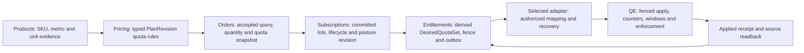

# Feature: Quota Projection

<!-- toc -->

- [1. Feature Context](#1-feature-context)
  - [1.1 Overview](#11-overview)
  - [1.2 Purpose](#12-purpose)
  - [1.3 Actors](#13-actors)
  - [1.4 References](#14-references)
- [2. Actor Flows (CDSL)](#2-actor-flows-cdsl)
  - [Quota projection](#quota-projection)
- [3. Processes / Business Logic (CDSL)](#3-processes--business-logic-cdsl)
  - [Rule semantics](#rule-semantics)
  - [Exact conversion](#exact-conversion)
  - [Quota lifecycle](#quota-lifecycle)
- [4. States (CDSL)](#4-states-cdsl)
  - [Desired quota state](#desired-quota-state)
- [5. Definitions of Done](#5-definitions-of-done)
  - [5.1 Exact, fenced projection with a provider-confirmed receipt](#51-exact-fenced-projection-with-a-provider-confirmed-receipt)
- [6. Acceptance Criteria](#6-acceptance-criteria)

<!-- /toc -->

- [ ] `p1` - **ID**: `cpt-cf-bss-entitlements-featstatus-quota-projection-implemented`
- [ ] `p1` - `cpt-cf-bss-entitlements-feature-quota-projection`

**Status:** proposed implementation; provider contracts and runtime conformance remain delivery gates.

## 1. Feature Context

### 1.1 Overview

Entitlements owns the meaning of quota rules and derives a complete desired quota set per accepted posture revision from the frozen acceptance snapshot. The set is applied through the selected adapter to Quota Enforcement under a source-key fence and read back as an applied receipt. Counting, windows and point-of-use decisions stay in Quota Enforcement; rules are stored and frozen by Pricing; metric semantics come from Products.

### 1.2 Purpose

**Requirements:** `cpt-cf-bss-entitlements-fr-rule-schema`, `cpt-cf-bss-entitlements-fr-quota-projection`.

### 1.3 Actors

| Actor | Role |
| --- | --- |
| `cpt-cf-bss-entitlements-actor-pricing` | Stores and freezes the rule block on the PlanRevision and in the acceptance receipt. |
| `cpt-cf-bss-entitlements-actor-products` | Supplies metric, unit and subject semantics and the mapping to the enforcement registry. |
| `cpt-cf-bss-entitlements-actor-quota-enforcement` | Applies the fenced desired set, owns counters and windows, exposes the source head. |
| `cpt-cf-bss-entitlements-actor-subscriptions` | Publishes the posture with quantity, validity and lot provenance. |

### 1.4 References

- **PRD:** [PRD.md](../PRD.md); **Design:** [adapter capability profile](../DESIGN.md#333-adapter-capability-profile).
- **Build prerequisites:** as allocated in [DECOMPOSITION.md](../DECOMPOSITION.md); decisions in [DECISIONS.md](../DECISIONS.md).
- **Provider prerequisites / integration acceptance:** gates E-U01, E-U03 and E-U04 in [UPSTREAM_REQS.md](../UPSTREAM_REQS.md).

## 2. Actor Flows (CDSL)

### Quota projection

- [ ] `p1` - **ID**: `cpt-cf-bss-entitlements-flow-quota-projection`

**Actor:** Subscriptions, through `CommercialPostureV1` for a committed revision; the selected adapter as the projector into Quota Enforcement (QE).

**Success:** a complete `DesiredQuotaSet` for the revision is derived from the frozen acceptance snapshot, applied under the source-key fence and confirmed by an `AppliedReceipt` with the same revision and digest.

**Errors:** missing or unresolvable rule snapshot, inexact or out-of-bound conversion, incompatible lot combination, stale or conflicting revision at the provider, refused ownership, unknown result, blocked metric.

A **definition** describes the limit's semantics independently of a sale. A **binding** selects that definition and applicable plan item/selection for a purchase. An **accepted snapshot** freezes the selection and its exact semantics. A **desired quota** is a lifecycle-dependent projection of committed accepted state. A provider's actual record and counters are a fifth, separately observed state. Entitlements owns the meaning of the first and derives the fourth; it never holds the fifth (ENT-D-03).

| Owner | Responsibility | Boundary |
| --- | --- | --- |
| Products | Stable SKU and usage metric/unit references; proposed versioned quota semantics, valid subject/resource kinds and available technical capabilities | A usage meter is evidence of unit semantics, not automatically a point-of-use enforcement meter. Non-usage allocation metrics need an explicit descriptor/capability contract; do not add usage-only meter fields to bundles. |
| Pricing | PlanRevision quota rules, fixed/per-plan-unit coefficients, their binding to plan selections, publication validation and immutable acceptance/continuation evidence | Does not count usage, resolve mutable resource ownership or issue live quota. Changes to quota terms require a new accepted revision, even if price is unchanged. |
| Orders / Workflow | Preserve the accepted order-line identity, plan quantity and receipt; execute the existing draft/activation protocol | Cannot supply an arbitrary cap as purchase authority or invent per-component quantities absent from the accepted contract. |
| Subscriptions | Commit the commercial posture with quantity as the sum of effective lots, effective intervals, posture and lot/acceptance provenance; publish it through the outbox and recovery reads | Does not calculate remaining quota, select live catalog terms for replay, assign seats, reserve usage or reset counters. Holds no adapter contract. |
| Entitlements | Rule schema and semantics; derive complete desired quotas from the committed posture and the frozen rule snapshot; fence, dispatch and journal delivery and recovery | Does not store or accept rules, count usage, own counters or make point-of-use decisions. Does not re-derive quantity from lots; lots are provenance. |
| Selected adapter | Verify mapping and authority; translate stable desired state to supported QE operations; correlate applied evidence (ENT-D-01) | An adapter journal is not enough if the final provider cannot fence an already in-flight stale mutation. |
| QE / point-of-use enforcement | Counters, windows, allocation/reservation/commit/release atomicity, applicable-policy resolution and actual enforcement | Does not decide what was purchased from a caller's cap or infer pooling from multiple records. |
| Selected license adapter (LE, native LM or third party), where selected | Named type/instance grants (including user-seat grants), assignment and licensing-specific yes/no checks | Numerical seat limits, counting and leases remain QE responsibilities; grant checks do not answer "how many". A named grant must not become a second source of the same capacity. See [license grants](04-license-grants.md). |

The quota/entitlement descriptor required here is an explicit cross-owner gap: the inspected Products PRD defines descriptors as `gl_code`, `tax_category` and `invoice_line_template`. Products and Pricing must adopt the versioned rule schema and its historical read contract, or select a clearly owned provider descriptor contract, before this profile is enabled (ENT-Q01). The existing billing descriptor fields do not satisfy it.

The rule/snapshot and fenced-apply arrows are proposed extensions; this diagram does not label them delivered. Named license grants use the selected license adapter separately; QE remains the numerical enforcement authority for its metrics.

1. **Derive.** Entitlements accepts the posture revision through [posture intake](01-posture-intake.md) and reads the frozen rule and binding snapshots named by its provenance, never the live plan (ENT-D-03). For every member it evaluates [rule semantics](#rule-semantics) and [exact conversion](#exact-conversion) and builds the complete `DesiredQuotaSet` with explicit tombstones, the posture `Granted | Restricted | Revoked` and the effective interval. An unresolvable snapshot, an inexact result or an incompatible lot combination refuses the revision before any effect and records a finding; it never becomes "no quota".

   A local derivation transaction consumes the durable intake work and atomically persists the desired revision, digest and delivery intent after rechecking the current source and preparation-generation fences. Adapter calls occur only after this commit; a crash between intake and derivation recovers the same work identity.
2. **Fence.** The aggregate source key is `(authenticated namespace, resource tenant, assignmentId)`; Entitlements keeps the association from the posture identity to the assignment and the adapter never receives a subscription identifier. The aggregate revision is ordering, the operation ID is retry identity and the digest is content identity; none substitutes for the others. A terminal `Revoked` tombstones the aggregate before any further member creation can apply, including members the provider has never seen (ENT-Q07).
3. **Apply.** The outbox dispatches the desired revision to the selected adapter, which submits the fenced apply described in [DESIGN §3.3.4](../DESIGN.md#334-quota-apply-and-read). Retry and backoff change neither identity nor quantity. The provider compares revision and digest with its durable source head: lower is stale, equal with equal digest returns the existing result, equal with a different digest conflicts, higher replaces only this source's state after validation and ownership admission. If the provider cannot apply a multi-member change atomically, the offered profile is restricted to a single member or another proved all-or-safe-restricted protocol.
4. **Receipt.** Outbox replay uses the same request identity and retained adapter/profile routing. Reconciliation obtains correlated evidence of the applied desired operation through the adapter; that evidence may derive from native provider versions, operation status, authoritative state reads or a combination backed by its durable journal. An adapter's dispatch log alone is not proof of external application. Only an `AppliedReceipt` carrying the same source key, revision and digest marks the revision applied; acceptance of dispatch, a queued command or a broker acknowledgement does not.

   The receipt is persisted separately from the desired head and reported to Subscriptions as materialization state; a stale success cannot mark a newer desired head complete. Unknown, refused and conflicting outcomes stay visible until [reconciliation](06-reconciliation-recovery.md) resolves them.

**Plan-owned rules versus Products-owned definitions.** Entitlements keeps the meaning of the rule; where it is stored is the owners' choice (ENT-Q01).

| Option | Strength | Cost / risk |
| --- | --- | --- |
| **Recommended v1: Pricing owns typed rules; Products supplies semantics** (ENT-D-03) | Two plans for the same SKU can sell different limits without duplicating SKU identity; quota revisions follow commercial acceptance. A fixed cap and a coefficient are sufficient for the initial model. | Pricing must validate metric/unit/subject semantics against historical Products/provider evidence. Accepted snapshots must preserve these references and values. |
| Products owns immutable quota definitions; Pricing binds a definition version and commercial parameters | Useful if several commercial plans must reuse one governed technical quota template, or product engineering owns invariant limits | Adds a second definition lifecycle, reference protection and a precise split between invariant fields and plan overrides. A live Product edit must never silently alter an accepted cap. |

Choose the first option initially. If reuse later justifies Products-owned templates, retain the same accepted snapshot and provider boundary; introduce an explicit versioned definition reference instead of a general rule language. Existing billing descriptors in Products should not be described as if this quota schema already existed. A Products `usage_type_ref`, including `products.derived/<code>@<n>`, is not automatically a valid QE GTS `MetricId`.

The metric owner must register the enforcement metric as the required GTS instance and supply a versioned Products-to-QE mapping with unit, measurement and supported subject semantics; see the [Products requirements](../UPSTREAM_REQS.md). A Rating-derived quantity is not assumed observable synchronously at point of use. Independent provider constraints follow the purchased-rights and actual-restriction contract below (ENT-Q03).

**Purchased cap and provider restrictions (ENT-Q03).** The frozen purchased cap remains the desired commercial right. Independent operator/provider technical or safety constraints may restrict actual use under their own authority; they do not become a new purchased cap. The provider owns concrete constraint values, enforcement and precedence among its technical controls. Entitlements must not overwrite those records, silently lower the accepted desired cap or continually reapply a source record to bypass a recognized restriction. Existing exclusive commercial-source ownership and no-pooling scope remain unchanged; an operator restriction is not another additive entitlement.

Keep delivery of the desired source state, actual enforcement and commercial fulfillment distinct. A provider may truthfully store the purchased cap while an independent ceiling is more restrictive. Record the applied source revision/digest and the separate restriction observation with comparable scope/metric/unit, effective ceiling where supplied, policy identity/version, reason and recovery evidence. If a provider actually applied a lower source cap, do not claim that the requested cap/digest was fully applied. In either case the lower effective allowance is not full fulfillment.

Unknown or incomparable evidence stays unresolved; Entitlements does not guess a numeric minimum across incompatible policies. Remaining capacity after normal allocation is not a ceiling mismatch: cap 100 GiB with 40 GiB occupied and 60 GiB available is ordinary accounting, unlike an independent hard ceiling of 60 GiB.

For an illustrative purchased cap of 100 GiB and a hard ceiling of 60 GiB on the same scope/metric, retain desired 100 and report actual restriction 60 with its reason. A known incompatible offer cannot be accepted/captured for that scope under the agreed capability/constraint evidence. No universal live provider-health probe is added to every order. If the incompatibility appears after purchase, retain the obligation and enter recovery/operator remediation.

Initial readiness cannot succeed when this prevents a required purchased capability, even if a smaller environment could be created. A required capability cannot be relabelled optional to hide the discrepancy.

A new ordinary restriction affecting a held readiness commitment follows the Subscriptions activation/withdrawal fence before invalidating prepared rights. If activation won, retain T and report the later restriction under the current lifecycle/remediation policy. Independently authorized emergency security restrictions may apply immediately and report truthful incident evidence under SUB-D-57. A provider unable to honor ordinary held continuity cannot enable that preparation profile. Post-activation restriction observations alone do not amend accepted terms, erase service history or create an automatic refund; those remain separate authorized commercial/financial actions.

Restrictions may change without a commercial posture revision. Recover and order their authoritative observations for the same assignment/provider binding independently of desired-state delivery; stale or lost observations cannot falsely clear the discrepancy. Reconciliation retains the desired cap and reports the known restriction rather than overwriting provider policy or claiming convergence from source-state equality alone. The discrepancy clears only on authoritative evidence that actual enforcement again satisfies the required purchased capability, or after a separately authorized commercial change.

Keep occupied/consumed evidence and existing cap-below-used safeguards; no counter clamp, refill, eviction or early resource release follows from a lower ceiling. Exact policy mapping, observation/recovery versions and provider conformance remain ENT-Q03/E-U01 delivery gates.

**Allocation preparation.** The initial profile supports `Allocation` quotas for concurrently occupied resources, with one atomic member or a proved atomic set. A saved, authorized `prepare_activation` operation may establish usable quota for preparing its purchased environment while the subscription remains draft. Derive the cap from frozen accepted rules and quantity, and restrict preparation to the authorized resource scope, operations and schedule; a draft alone grants nothing. The accepted cap is the ceiling, not permission for unrelated customer work. For a separately enabled consumption profile, readiness follows the provider-purpose/evidence contract below.

The desired provider contract distinguishes preparation authority from ordinary service authority without adding a subscription status. Retain the exact activation operation/preparation generation, authorized scope/profile and allowed preparation actions with the source revision/digest. No actual T or customer service-period start is invented. QE counts every occupied/reserved resource immediately under the same durable source/member and allocation identities that will continue after activation. A platform-borne preparation cost does not make an occupied disk disappear from the quota. Entitlements keeps evidence references only; QE owns counters, reservations and release decisions.

Required quota application and actual resource readiness are members of the held-readiness guarantee before T. On authoritative applied T, continue those same records and resources under ordinary service authority, preserving cap, occupied/reserved amounts and any in-flight allocation identity. Delayed outcome/posture delivery cannot interrupt prepared usable access, create a parallel allowance or reset a counter; consumers recover the exact decision under the held obligation. Preparation remains within its authorized scope and allowed actions.

Broader operations outside the initial usable-service guarantee require the applied resolution; no required initial capability may depend on its later delivery. Do not revoke/recreate quotas or require a second provider approval to make the already prepared service usable. Quota permission itself does not reserve physical provider capacity; only actual prepared-resource evidence satisfies readiness.

Cancellation before activation must win the Subscriptions non-activation fence. Then block further positive allocations, fence in-flight requests and execute only authorized cleanup; existing/shared resources are not implicitly disposable. Keep occupied/reserved evidence until the resource provider and QE confirm the corresponding release/settlement. A terminal tombstone blocks stale allocation but does not delete counters or prove physical release. Unknown activation, a lost cleanup reply or a housekeeping timeout cannot free occupied capacity. If activation won first, retain that history and follow current cancellation/resource-retention policy.

Readiness failure or emergency denial may block actions immediately but does not fabricate released resources.

The selected QE/adapter profile must prove these guarantees under ENT-Q15/E-U01, including scoped preparation authorization, same-source continuity, denial of unrelated allocation, and recovery of late allocations/releases. Missing support keeps that profile unavailable before sale/capture; a temporary outage preserves accepted purchase obligations and pending delivery. Quota capabilities outside initial readiness may still apply after T. Consumable-limit checks carry the recognizable purpose defined below; execution and quota/accounting treatment belong to the provider. No counter reset or extra allowance is implied.

**Consumable-limit readiness.** Once its runtime profile is separately supported, prepare the accepted limit, exact authorized subject/metric scope, window and enforcement/accounting path before declaring readiness. Obtain authoritative applied-state/capability evidence for the same assignment and desired revision. A dispatch receipt, stored but unenforced rule, missing counter/window support or a wrong-scope read is not enough.

Entitlements marks readiness-check requests with a recognizable purpose in the scoped adapter context, semantically `purpose = readiness_check`. The adapter/provider chooses how to execute and account for a recognized check under its own contract; it may inspect state, validate without execution or perform a supported real operation. The marker does not itself guarantee dry-run, no effects or zero consumption and creates no quota, authorization or billing exemption. No consuming probe, service allowance or provider-side dry-run API is universally required. Actual effects retain normal accounting provenance, idempotent recovery and authorized cleanup; pre-T preparation cost remains platform-borne.

Activation, retry and recovery retain the same rule/source/member, counter and continuing window. QE alone advances windows under the accepted calendar or supported OneTime lifetime; activation does not reset usage or grant another allowance. Missing/unknown history is not zero. The purpose marker is correlation metadata, not evidence that a service is usable. Unsupported readiness/effect handling cannot produce ready, and the existing deferred consumption runtime/window/conformance gates remain.

**Purchase-to-enforcement example.** Assume Products/provider evidence defines metric `storage.allocated_bytes` with unit `byte` and a supported `project` subject. Pricing publishes plan revision `P7` with rule `storage-cap/R1`: allocation, `PerPlanUnit(107374182400 bytes)`, exclusive source, hard limit, no consumption period. The coefficient is exactly 100 GiB per plan unit. These symbolic identifiers and values are examples, not existing catalog defaults or literal SDK values. An accepted versioned provider mapping must resolve `storage.allocated_bytes` to a registered QE GTS `MetricId` and `project` to the supported GTS `projection_type`, retaining the mapping version/digest; a string name alone is not enough.

1. A new-sale line selects P7 with exact plan quantity `"3"`. BindingSelection contains its item/dimension selection only. Pricing accepts the quota binding/snapshot together with the existing query and bindings through the proposed versioned extension; acceptance fixes cap semantics and tenant axes, not a permission to issue it immediately.
2. Orders reaches durable `in_fulfillment` and creates the subscription draft. The draft retains acceptance evidence and proposed capacity. At the allowed preparation time, Subscriptions persists an authorized activation operation/preparation posture and outbox; draft creation alone issues no quota.
3. The resource owner supplies authorized binding evidence for project `project-42` in resource tenant `tenant-R`. The payer may be `tenant-P` and seller `tenant-S`; neither automatically becomes QE's owner tenant. A bare caller-supplied project ID is not enough.
4. Subscriptions publishes preparation revision 7 with the saved operation, authorized scope and frozen commercial evidence. Entitlements accepts the posture, resolves the frozen rule and derives the exact projection `3 × 107374182400 = 322122547200 bytes`, persisting the desired revision and a durable delivery intent. It does not compute remaining bytes.
5. The adapter submits the proposed fenced apply for aggregate source key `(BSS entitlements, tenant-R, assignment-42)`, revision 7 and digest D7. Its stable member key adds `(storage-cap binding, project-42)` under that aggregate head. The member maps to QE tenant `tenant-R`, subject `(project, project-42)`, metric `storage.allocated_bytes`, allocation type, no period, hard mode and bounded cap `322122547200`. Source `Licensing`, if selected by the owner contract, is provenance only.
6. QE returns/recoverably exposes the applied revision/digest and record identity through the new provider contract. Only that evidence marks quota delivery applied. The authorized resource provider can then prepare an illustrative 20 GiB disk, which QE immediately counts against the 300 GiB cap. Entitlements reports held aggregate readiness only after the quota and required resources are ready. Subscriptions applies T after its remaining guards; the same source/member/allocation continues at 20 GiB occupied and 280 GiB available. Lost applied publication is recovered without a reset or duplicate grant; unknown preparation never claims readiness.
7. For an active subscription, an accepted increase whose agreed delta contract adds two plan units under the same quota rule creates a second immutable lot in Subscriptions. A later posture revision carries quantity five; Entitlements projects cap `536870912000`, replacing the same source-owned quota without resetting allocation state. A duplicate purchase or delivery does not add another lot or another quota record. If the subscription is suspended, Subscriptions refuses the increase before effects; the caller must first complete a separate guarded resume and then request the increase.

A second fixed rule, for example `Fixed(10 projects)`, stays ten when plan quantity rises from three to five. It is neither multiplied by five nor awarded again for the second lot. A separately sold additive quota pack would need an explicit accepted contribution rule; this feature does not infer it from a fixed rule.

For a later consumption profile, a plan might grant a bounded number of request units per UTC calendar month. QE owns the monthly counter/window; activation on the 18th does not create an anniversary month, and renewal or replay does not issue another monthly allowance. Consumption enablement also requires the runtime and window gates in [quota lifecycle](#quota-lifecycle).

## 3. Processes / Business Logic (CDSL)

### Rule semantics

- [ ] `p1` - **ID**: `cpt-cf-bss-entitlements-algo-rule-semantics`

**Input:** the frozen `PlanQuotaRule`, `QuotaBinding` and `AcceptedQuotaSnapshot` named by the posture provenance, and the posture member's quantity. **Output:** the semantic inputs of one desired member (metric, unit, subject, kind, period, capacity formula, policies), or a refusal with a structured reason.

All schemas in this section are proposed semantic shapes owned by Entitlements (ENT-D-03). Exact codecs, bounds, canonical digest rules and SDK versions require owner adoption. Unknown enum variants or unsupported profile versions refuse before sale/application; they do not become "no quota".

| Model | Required content |
| --- | --- |
| `PlanQuotaRule` (definition) | `rule_id`, immutable revision/digest, Products SKU/version and metric semantics reference/digest, metric code and canonical unit, `kind = Allocation \| Consumption`, `subject_kind`, `capacity = Fixed(exact_quantity) \| PerPlanUnit(exact_coefficient)`, binding applicability, period where applicable, hard-enforcement policy, `combination = ExclusiveSource`, validity policy, suspend/revoke policy, capability profile/version. |
| `QuotaBinding` (selection) | Plan/revision, rule/revision, applicable item IDs and accepted dimension values, immutable Products references, quantity basis explicitly `PlanQuantity`; selected scope template. It binds semantics, not a caller-selected arbitrary resource or cap. |
| `AcceptedQuotaSnapshot` (purchase evidence) | Acceptance ID, request/terms digests, order/version/line, plan/revision, original exact plan quantity, complete selected rule/binding snapshots or durable immutable resolvable references with digests, seller/payer/resource tenant axes, authorized subject-binding policy, terms/validity/continuation policy and required provider profile. Subsequent lot/delta acceptances remain separate immutable evidence. |

1. Resolve every rule and binding of the snapshot by digest. A missing or unresolvable snapshot refuses; replay never reads the live plan.
2. `ExclusiveSource` means one commercial source controls the effective purchased quota for a resolved `(resource/owner tenant, subject projection type, subject ID, metric, kind, period identity and other compatible quota dimensions)` in this profile. A provider must enforce this ownership/admission condition atomically across different source keys, not merely ensure one row per source key. It does not authorize taking over an operator record. Several sources targeting the same enforcement tuple require rejection or an explicitly adopted pooling protocol; a metadata convention or a query-before-create check cannot establish exclusivity (ENT-Q03).
3. **Quantity source.** `PerPlanUnit` uses the accepted NewSaleQuery quantity as carried in the posture. It does not multiply by a fictional quantity in each BindingSelection, by usage, price, or the number of matching items. An applicability binding can select a rule once for a chosen item/dimension without changing that quantity basis. Change Orders may introduce quantity lots for components; enabling a quota increase requires an explicit mapping from its accepted delta to quota units.

   Until that extension is ratified, do not infer plan-unit changes from arbitrary component quantity changes (ENT-Q02). A fixed rule applies once per stable logical quota binding within a subscription, not once per purchase lot or retry; an applicability match must not duplicate that binding.
4. Map the capacity value to its required meaning:

| Value | Required meaning |
| --- | --- |
| `Bounded(0)` | Explicit cap zero; QE `Some(0)` is valid. It denies positive new consumption/allocation only within its applicable enforcement policy; it does not evict resources or prove all access is denied. |
| No quota rule / absent member in a new plan | No purchased quota declaration. It does not mean zero, unlimited or permission. Product capability/admission must state whether another authority is sufficient. Removal from an existing desired set requires an explicit tombstone. |
| `Unbounded` | Explicit unlimited commercial policy; QE represents an unbounded cap as `None`. Proposed v1 refuses unbounded sales until owners accept an explicit profile and authorization policy. Never translate absence, error or unknown evidence into `None`. |

### Exact conversion

- [ ] `p1` - **ID**: `cpt-cf-bss-entitlements-algo-exact-conversion`

**Input:** the positive accepted plan quantity `q`, the nonnegative exact coefficient `c` or fixed quantity `f`, and the accepted exact conversion `s` to the QE metric's integer unit. **Output:** one integral cap in the QE unit, or a refusal before effects.

1. Evaluate `Fixed(f): cap = f × s` or `PerPlanUnit(c): cap = q × c × s` with exact decimal/rational arithmetic. No float conversion, rounding, truncation, saturation or assumption that GB equals GiB is allowed. A unit conversion is accepted data, not a runtime guess from the metric's label.
2. Exercise checked multiplication and addition at the chosen Decimal precision/scale limits, including intermediate overflow even when a later conversion would reduce the value. A successful checked operation is not enough if the library rounded its result: verify exactness at every step. Publish bounds for each input and intermediate calculation; an implementation that cannot represent an intermediate exactly refuses it.
3. After exact unit conversion, check integrality and nonnegativity, perform a checked `u64` conversion, then compare with `Quota::MAX_CAP`. The result must be integral, nonnegative and at most `9,223,372,036,854,775,807` (`i64::MAX`, the inspected QE storage bound), even though the SDK cap uses `u64`. Reject negative values, overflow, unsupported precision, fractional results or incompatible units with a specific reason.
4. Boundary tests must include values that lose a fractional part through rounding; such a value must not become an apparently valid integer cap. For example, `q = 2.5` and `c = 4 slots/plan-unit` gives `10 slots`; `q = 2.5` and `c = 1 slot/plan-unit` gives a fractional cap and refuses for an integer-slot metric.

### Quota lifecycle

- [ ] `p1` - **ID**: `cpt-cf-bss-entitlements-algo-quota-lifecycle`

**Input:** the posture transition carried by a new `CommercialPostureV1` revision, its published quantity and effective interval, and the current desired and applied heads. **Output:** the next complete desired revision with its posture, interval and tombstones, or a refusal of the affected transition before effects.

**Lot contribution and combination.** Subscriptions retains every accepted lot with its quantity, binding, effective interval and purchase identity and publishes quantity as the sum of effective lots with the contributing lot ids as provenance. Entitlements derives a complete capacity from that quantity and the frozen rule at each boundary, preserving those source references; it does not re-derive quantity from lots and never overwrites earlier terms with the latest plan revision. An aggregate of quantities under the *same* per-plan-unit rule inside one subscription is a projection calculation, not QE pooling across records.

The minimal profile accepts multiple effective lots only when rule semantics, unit, subject, kind, period and validity treatment are compatible. It computes the single source-owned member from the posture member's quantity; lot ids are provenance only. A different-binding increase stays subject to the Subscriptions gate on distinct commercial bindings and also needs explicit quota-rule compatibility; billing-lot support alone does not settle quota semantics. Two fixed-rule revisions or different coefficients cannot silently select the newest, sum, or take the maximum.

Refuse the affected increase before effects unless a separately ratified versioned contribution contract defines the result (ENT-Q07).

Across PlanRevisions, matching `item_id` does not prove binding equivalence. The current Pricing `AcceptedBinding` carries item, price-entry, SKU/version, dimension and price evidence, but no agreed stable quota-benefit identity. Pricing must define the proposed logical quota binding ID and versioned semantic-equivalence digest, including unit/mapping, coefficient, applicability, subject, window and lifecycle policy; see the [Pricing requirements](../UPSTREAM_REQS.md). Preserve both acceptance identities even when quota semantics are equivalent; a matching price or item must not override the distinct commercial-binding rules.

For future pooling, owners must choose `sum`, `max` or exclusive replacement and define participating source identities, cross-subscription authorization, atomic membership changes, revocation, counter identity, overflow and validity intersections. A sum is meaningful only for compatible units/kinds/windows; a max is a commercial choice; exclusivity denies competing sources. Existing QE allows multiple records and resolves them under its policy; this feature makes no claim that it adds their caps. Keep cross-subscription pooling outside v1.

**Counter and window ownership.** Allocation tracks occupancy/reservations and releases; consumption tracks spent quantity in a window. They require different evidence and cannot share a counter merely because the unit matches. QE validates allocation without a period and consumption with a period. At the pinned baseline, recurring calendar periods are UTC Day, Week (starting Monday), Month and Year. OneTime is a noncalendar, nonresetting lifetime, not another recurring calendar window. Rate is reserved and rejected.

An accepted period must select the provider's exact boundaries, including its week definition. Billing periods, subscription anniversaries and Pricing minimum-fee windows do not override that contract (ENT-Q06).

Renewal, cap changes, identical replay, plan price changes, adapter retry and suspension/resume must preserve the counter/window identity. QE alone advances calendar windows or applies the explicitly supported OneTime lifetime; ordinary renewal never refreshes a OneTime allowance. A new quota record must not be used as a disguised counter reset. The provider must document and demonstrate counter behavior during each supported update before the profile is enabled; model fields alone do not prove it. Anniversary, rolling and arbitrary billing windows require separate provider support and otherwise refuse at acceptance.

Accepted grants with different expiry dates can yield different effective caps. The minimal profile requires a single compatible window/validity policy and rejects combinations needing several concurrent window identities or unsupported timed reductions. Delayed dispatch cannot extend an expired grant. A later extension may support an atomic effective capacity schedule with independent grant provenance, but must retain the same consumption window and already-used amount; it cannot recreate records at each expiry to replenish usage.

**Boundary mismatch.** Posture intervals are `[start, end)`, while the inspected QE `ValidityWindow` includes both endpoints. Blindly mapping `end` grants an extra endpoint. Require a provider contract with exclusive expiry or a proved equivalent boundary fence before timed quotas are enabled. Do not subtract an arbitrary epsilon. Any precision-specific conversion needs an agreed discrete clock domain and proof that it has neither overlap nor a gap. A timer that may run late is not an exclusive-end guarantee (ENT-Q06).

**Lifecycle behavior.** The transition is decided in Subscriptions; the row states what Entitlements derives and what the provider must do.

| Transition / condition | Required quota behavior |
| --- | --- |
| Draft / future start | Retain evidence with no authority from draft alone. At the allowed preparation time, an authorized allocation preparation operation may apply the frozen cap for its exact environment/actions. QE counts occupied/reserved resources immediately; consumable-limit preparation uses provider readiness evidence with marked check purpose when that runtime profile is enabled; the marker does not imply zero consumption. |
| Activation | Required allocation quota and resource readiness precede T. Continue the same source/member, resources and occupied/reserved allocations under service authority without another allowance, reset or access gap; delayed publication is recovered. Only capabilities explicitly outside initial readiness may first apply after T. |
| Fenced non-activation | Block new positive allocation, fence in-flight effects and perform only authorized resource cleanup. Retain occupied capacity until confirmed resource release and QE settlement; unknown activation or cleanup retains the obligation. |
| Active increase/addition | Use immutable delta terms and compatible lot mapping; update complete desired state at one revision. Customer decreases, removals, transfers and plan replacements remain deferred. |
| Suspended increase/addition | Subscriptions refuses before changing quantity, lots, accepted target, facts or provider intents. A separate guarded resume comes first, then a new ordinary active-subscription change. No queued purchase or implicit resume; no desired revision is derived. |
| Resume | Apply a newer guarded granted revision; retain counters, window identity and original expiry. An old resume cannot override a later restriction. |
| Cancellation / trial expiry requiring revocation | Publish a newer terminal tombstone/revoke and preserve its fence. Revocation must prevent the relevant access even where another hierarchy/default policy would otherwise apply. Quota deactivation alone is not proof of denial. Resource stop/retention and license revoke remain their owners' effects. |
| Renewal / accepted continuation | Resolve terms through the accepted continuation contract; freeze new evidence where required. Preserve usage/counter identity for a continuing enforcement window; no refill merely because a billing period opened. Unsupported changed metric/kind/period or quota terms refuse/gate the transition (ENT-Q07). |
| Expiry or authorized capacity reduction below used/occupied | Retain consumed/occupied evidence. Deny further positive consumption/allocation under an agreed policy; do not clamp usage to the new cap, refund usage or silently evict resources. Any occupied-resource revocation requires an explicit owner workflow. If that policy cannot be enforced, the profile is unavailable (ENT-Q05). |

A cap of zero or deactivated specific rule can still leave another policy path permitting access. The selected product must choose an explicit deny/restriction overlay or equivalent enforcement protocol covering fallback. Suspension preserves allocation/consumption state even when access is restricted. Revoke tombstones prevent stale re-creation; they are not destructive counter deletion. A deliberately separate narrow export capability during offboarding must be authorized explicitly, not obtained accidentally through fallback (ENT-Q05).

An owner may evaluate existing `ValidityWindowPatch::Set` as part of a restriction protocol, but an out-of-window quota may merely disappear from the applicable set. It is sufficient only if the selected point-of-use policy proves the required denial, endpoint semantics and counter preservation. Resume must restore the still-valid accepted interval rather than blindly clearing its expiry. This is an option to validate, not an approved shortcut around the restriction and validity guarantees in the [Quota Enforcement requirements](../UPSTREAM_REQS.md).

Treat owner tenant, subject, metric, unit, quota kind and period/window identity as immutable for a continuing source-owned quota. If changed, v1 refuses rather than implementing a create/deactivate "migration" that loses counters or grants overlap. Future migration needs explicit usage transfer, fencing and boundary semantics; legacy-system migration remains outside scope.

Subscriptions rechecks the purchase-state guard at submission and in the completing commercial transaction. If suspension wins before an increase commits, the increase refuses without commercial or quota effects and Entitlements sees no revision for it. If an increase already committed while active, later suspension does not erase its lot or financial obligation; Entitlements recovers its remote outcome against the newer restricted source revision so delayed delivery cannot reopen service. Existing durable recovery and source fences remain mandatory.

## 4. States (CDSL)

### Desired quota state

- [ ] `p1` - **ID**: `cpt-cf-bss-entitlements-state-desired-quota`

Each posture revision carries one `DesiredQuotaSet` and, once observed, its `AppliedReceipt`. These are projection and provider observations, not subscription states; the commercial status stays in Subscriptions.

| Model | Required content |
| --- | --- |
| `DesiredQuotaSet` (commercial projection) | Source key `(namespace, resource tenant, assignmentId)`; Entitlements keeps the association to the posture identity internally. Resource/owner tenant, monotonically increasing aggregate source revision, operation ID, canonical payload digest, complete member set and explicit tombstones, effective interval and posture `Granted \| Restricted \| Revoked`, plus preparation/service authority bound to operation/generation, allowed resource scope/actions and profile; each member identifies metric/unit, subject, kind/period, exact integer cap, rule identity and complete contributing lot/acceptance provenance. |
| `AppliedReceipt` (provider observation) | Same source key/revision/digest and operation identity, provider/profile identity, member/provider record IDs, status `Applied \| Pending \| Refused \| Unknown \| Superseded`, applied effective time where authoritative, current applied revision/digest, restriction/tombstone evidence and structured reason. Acceptance of dispatch is not `Applied`. |

| From | Event / to | Mandatory guard |
| --- | --- | --- |
| none | posture accepted / incomplete | Posture revision persisted by intake; rule snapshot not yet resolved or a member refused. A refused derivation stays `incomplete` with a finding; it never dispatches. |
| incomplete | derivation complete / derived | Every member passed rule semantics and exact conversion; desired revision, digest and delivery intent persisted in one local transaction. |
| derived | receipt `Applied` for the same revision and digest / applied | Receipt carries the same source key, revision and digest; a receipt for another revision or digest does not move this row. |
| derived | receipt `Refused` or conflict / refused | Definitive provider refusal (ownership conflict, equal revision with different digest, blocked metric) recorded separately from an unknown result; a finding is opened. |
| derived, applied or refused | higher posture revision derived / superseded | The newer revision owns the source head from now on; a late receipt for this revision is historical evidence only. |
| applied | terminal `Revoked` revision applied / superseded | The tombstone closes the source identity; a later `Granted` request is refused even with a higher revision. |

An `Unknown` or `Pending` receipt leaves the row `derived`; it is visible to Subscriptions as pending or unknown materialization and is resolved only by the source read or a later receipt. An older revision cannot move the current desired head. Authenticated outcomes for an exact older operation update its historical receipt and cleanup evidence without restoring stale desired state. Each state is readable by assignment, operation and revision after restart.

## 5. Definitions of Done

### 5.1 Exact, fenced projection with a provider-confirmed receipt

- [ ] `p1` - **ID**: `cpt-cf-bss-entitlements-dod-quota-projection`

The implementation must:

- Derive each desired member from the frozen snapshot named by the posture provenance.
- Refuse a missing snapshot, inexact or out-of-bound conversion, or incompatible lot combination before effects.
- Consume durable intake work and persist the desired revision, digest and delivery intent in one local derivation transaction under the current source and preparation-generation fences.
- Dispatch only through the outbox to the selected adapter.
- Move a revision to `applied` only on a receipt with the same source key, revision and digest.

No subscription identifier is written to any adapter payload, source key or member key; the source key is `(namespace, resource tenant, assignmentId)`. Counters, windows and point-of-use decisions are never computed here. Enabling a profile requires the executed conformance evidence and provider readiness named in the [Quota Enforcement requirements](../UPSTREAM_REQS.md); accepted design semantics are separated from implemented code and from deployed capability (ENT-Q08).

**Implements:** `cpt-cf-bss-entitlements-flow-quota-projection`, `cpt-cf-bss-entitlements-algo-rule-semantics`, `cpt-cf-bss-entitlements-algo-exact-conversion`, `cpt-cf-bss-entitlements-algo-quota-lifecycle`, `cpt-cf-bss-entitlements-state-desired-quota`.

## 6. Acceptance Criteria

- [ ] Purchased 100 GiB with an independent hard ceiling of 60 GiB preserves desired 100 and reports restriction 60 with authoritative scope/reason/version. Required initial readiness refuses the mismatch; source delivery alone is not fulfillment. Cap 100 with 40 occupied and 60 available is not misreported as a restriction.
- [ ] A later ceiling change is observed/recovered without rewriting terms, resetting counters or overwriting operator policy. Ordinary changes respect held readiness; emergency security remains immediate and applied T is retained. Only authoritative recovery clears the discrepancy.

- [ ] For a separately enabled consumption profile, readiness-check purpose reaches the adapter/provider with exact scope/assignment/revision/operation. Provider evidence determines readiness and its contract determines execution/quota treatment; the marker implies neither dry-run, no effects, free consumption nor privilege. Activation/replay retain counter/window.

- [ ] Under a 100 GiB accepted cap, a 20 GiB prepared disk leaves 80 GiB available before and after T under the same source/member/allocation identities. Unrelated preparation requests refuse; delayed activation delivery cannot reset counters or grant a second allowance.
- [ ] Abort and activation races recover the exact winner; cleanup timeouts and late resource outcomes cannot free occupied quota early. Proven non-activation denies new allocation, then confirmed resource release settles occupancy once.

- [ ] Publishing a new plan or metric revision after purchase does not change a replayed projection: the original rule, unit, quantity and digest are read from the receipt and missing history is `incomplete`, never unlimited.
- [ ] A fractional integer result, overflow, negative value or unit mismatch refuses before effects with a specific reason; an exact valid result is accepted; cap zero is tested separately from absent and unbounded. Plan quantity three with several item selections applies a per-plan-unit rule once with quantity three and a fixed rule once.
- [ ] A same-rule accepted delta lot produces one higher revision whose complete cap replaces the same source member with usage unchanged; a different-rule combination or an unsupported delta mapping refuses the increase.
- [ ] An old issue already in flight when a newer revoke applies cannot grant, and the terminal tombstone rejects a later higher-revision grant for the same closed acquisition; a lost provider reply is recovered by source read with one effect and a visible unknown until resolved.
- [ ] A cap below the used or occupied amount, a revoked specific quota under a permissive parent policy and a metric that becomes inert after materialization each keep the purchased obligation visible as a finding; no silent eviction, refund, clamp, metric substitution or false readiness occurs.
