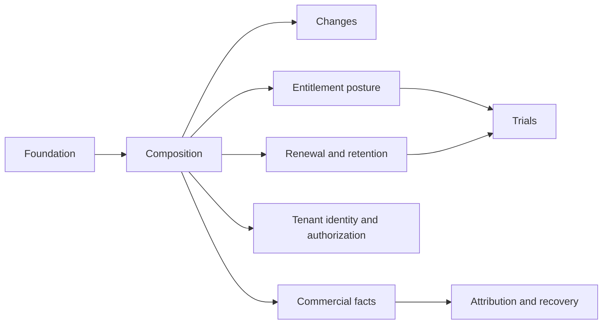

# Decomposition: Subscriptions

**Additional scope reduction — user decision, 2026-10-15.** Defer trial extension and repeat trials, standalone acquisition without Orders, scheduled composition changes and scheduled resume, linked predecessor/successor subscription replacement, and changes of an existing subscription's base plan. Reject these operations before effects, including through operator/direct wrappers; earlier procedures and decisions for them are future traceability only. New paid and trial subscriptions originate through Orders. Existing-subscription lifecycle operations, supported immediate quantity increases/component additions, future order starts, cancellation scheduling, renewal and normal trial timers remain. Technical retry/successor attempts for the same acquisition remain recovery, not linked replacement of an existing subscription.

Free-period and credit trials, normal expiry/conversion and early conversion to the already accepted paid target remain in scope with their Pricing/Billing/financial gates. Trial-to-paid conversion is not a general changePlan capability. Preserve trial history/eligibility evidence and refuse repeat requests for the same payer/plan, including via a new subscription; a transport retry is not a repeat trial. No extension or repeat becomes available from a Pricing policy alone. Independent cancellation and new purchase have separate resource/data lifecycles: there is no automatic resource adoption, data transfer, place handover or continuity promise. Cancellation retains its existing retention/disposition rules; it does not mean immediate deletion. Unsupported plan changes cannot silently become cancel+new.

<!-- toc -->

- [1. Overview](#1-overview)
- [2. Entries](#2-entries)
  - [2.1 Lifecycle and recoverable operations](#21-lifecycle-and-recoverable-operations)
  - [2.2 Composition and accepted commercial terms](#22-composition-and-accepted-commercial-terms)
  - [2.3 Atomic composition and quantity changes](#23-atomic-composition-and-quantity-changes)
  - [2.4 Renewal, grace and resource retention](#24-renewal-grace-and-resource-retention)
  - [2.5 Commercial posture](#25-commercial-posture)
  - [2.6 Trial lifecycle and paid conversion](#26-trial-lifecycle-and-paid-conversion)
  - [2.7 Tenant ownership, payer transfer and legacy import](#27-tenant-ownership-payer-transfer-and-legacy-import)
  - [2.8 Commercial facts, groups and seals](#28-commercial-facts-groups-and-seals)
  - [2.9 Attribution, scope proofs and integration recovery](#29-attribution-scope-proofs-and-integration-recovery)
- [3. Dependency order and delivery gates](#3-dependency-order-and-delivery-gates)
- [4. Identifier register](#4-identifier-register)
- [5. Coverage and verification](#5-coverage-and-verification)

<!-- /toc -->

**Overall implementation status:**
- [ ] `p1` - **ID**: `cpt-cf-bss-subscriptions-status-implementation`

## 1. Overview

This is the proposed implementation allocation for the reconciled [PRD](PRD.md)
and [DESIGN](DESIGN.md). It makes no claim of delivered Subscriptions runtime.
Each active FR/NFR has exactly one primary feature below. A feature can reference
another requirement as supporting context without becoming its second primary
owner. Retired requirements remain in PRD §17.2 and are not implementation work.

Architecture definitions live in DESIGN, procedures in features, cross-owner
prerequisites in UPSTREAM_REQS, and decisions in DECISIONS. All unchecked entries
remain unimplemented. A documented target or passing document check never closes
a production dependency.

## 2. Entries

### 2.1 [Lifecycle and recoverable operations](features/01-foundation.md)

- [ ] `p1` - **ID**: `cpt-cf-bss-subscriptions-feature-foundation`

- **Purpose**: Closed status machine, durable operation receipts, order/attempt identity, create settlement, scheduled-intent recovery and atomic admission.
- **Scope**: procedures, state rules, error/recovery paths and acceptance in the linked feature.
- **Out of scope**: Commercial pricing and invoice posting; enabling cross-attempt succession before S-U01/S-U07/S-U10 provider contracts close. The accepted same-acquisition successor semantics are defined in [ACTIVATION_PROPOSAL §7](ACTIVATION_PROPOSAL.md#7-boundary-failures-and-recovery); amended-version association and reopening cancelled acquisitions are not supplied by that recovery profile.
- **Depends On**: None.
- **Provider prerequisites / launch gates**: S-Q01/S-Q02 core, suspension and prepayment directions accepted; durable pre-capture place/terms and capture/cancel/release recovery contracts OPEN under S-U01/S-U07/S-U10, plus S-U04 for activation. Policy/claim-movement/exemption and runtime gates remain.
- **Design Components**: `cpt-cf-bss-subscriptions-component-lifecycle-foundation`.
- **Design Principles Covered**: `cpt-cf-bss-subscriptions-principle-idempotent-ordered`, `cpt-cf-bss-subscriptions-principle-when-not-math`.
- **Design Constraints Covered**: `cpt-cf-bss-subscriptions-constraint-tenant-isolation`, `cpt-cf-bss-subscriptions-constraint-utc-time`.
- **Domain Model Entities / Data**: applicable owned records and commit boundaries in DESIGN §3.1 and §3.7; no independent schema in this allocation.
- **API / Sequences**: canonical interfaces and interactions in DESIGN §3.3 and §3.6; feature procedures consume those contracts.
- **Cross-contract acceptance**: V01,V02,V03; [vector definitions](RECONCILIATION.md#5-cross-contract-acceptance-vectors).

**Requirements Covered (primary)**:

- [ ] `p1` - `cpt-cf-bss-subscriptions-fr-status-enum`
- [ ] `p1` - `cpt-cf-bss-subscriptions-fr-transitions-guards`
- [ ] `p1` - `cpt-cf-bss-subscriptions-fr-transition-request`
- [ ] `p1` - `cpt-cf-bss-subscriptions-fr-order-originated-create`
- [ ] `p1` - `cpt-cf-bss-subscriptions-fr-cancel-reasons`
- [ ] `p1` - `cpt-cf-bss-subscriptions-fr-intent-protocol`
- [ ] `p1` - `cpt-cf-bss-subscriptions-fr-operation-recovery`
- [ ] `p1` - `cpt-cf-bss-subscriptions-fr-scheduled-intents`
- [ ] `p2` - `cpt-cf-bss-subscriptions-fr-activation-instants`
- [ ] `p1` - `cpt-cf-bss-subscriptions-nfr-lifecycle-latency`
- [ ] `p2` - `cpt-cf-bss-subscriptions-nfr-operational-baselines`
- [ ] `p1` - `cpt-cf-bss-subscriptions-nfr-intent-seam-budget`

### 2.2 [Composition and accepted commercial terms](features/02-composition.md)

- [ ] `p1` - **ID**: `cpt-cf-bss-subscriptions-feature-composition`

- **Purpose**: Effective-dated components, revisions, PriceBook accepted bindings, price ends and immutable term evidence.
- **Scope**: procedures, state rules, error/recovery paths and acceptance in the linked feature.
- **Out of scope**: Old CatalogVersion/cohort/Pricing phase model; unsupported overlays and automatic historical migration.
- **Depends On**: `cpt-cf-bss-subscriptions-feature-foundation`.
- **Provider prerequisites / launch gates**: CURRENT Pricing D-510 provider; Subscriptions adapter target; S-U01/S-U07 durable future-term commitment and final permit for paid future orders; S-U06/S-U08.
- **Design Components**: `cpt-cf-bss-subscriptions-component-composition-versioning`.
- **Design Principles Covered**: `cpt-cf-bss-subscriptions-principle-idempotent-ordered`, `cpt-cf-bss-subscriptions-principle-when-not-math`.
- **Design Constraints Covered**: `cpt-cf-bss-subscriptions-constraint-tenant-isolation`, `cpt-cf-bss-subscriptions-constraint-utc-time`.
- **Domain Model Entities / Data**: applicable owned records and commit boundaries in DESIGN §3.1 and §3.7; no independent schema in this allocation.
- **API / Sequences**: canonical interfaces and interactions in DESIGN §3.3 and §3.6; feature procedures consume those contracts.
- **Cross-contract acceptance**: V04,V05,V14; [vector definitions](RECONCILIATION.md#5-cross-contract-acceptance-vectors).

**Requirements Covered (primary)**:

- [ ] `p1` - `cpt-cf-bss-subscriptions-fr-monotonic-version`
- [ ] `p1` - `cpt-cf-bss-subscriptions-fr-effective-dated-composition`
- [ ] `p1` - `cpt-cf-bss-subscriptions-fr-snapshot-discipline`
- [ ] `p1` - `cpt-cf-bss-subscriptions-fr-accepted-price-bindings`

### 2.3 [Atomic composition and quantity changes](features/03-changes.md)

- [ ] `p1` - **ID**: `cpt-cf-bss-subscriptions-feature-changes`

- **Purpose**: One-revision immediate increases/additions and overlap guards. Base-plan changes, future composition, linked replacement, ramps and historical correction/backdating are deferred.
- **Scope**: procedures, state rules, error/recovery paths and acceptance in the linked feature.
- **Out of scope**: Initial-profile quantity decreases, component removals and transfers between commercial purchase lots (2026-10-14 scope decision); multi-date batch transactions and distributed atomic multi-subscription commit. Linked replacement is deferred in full; its earlier atomic direction is future context. The retained reduction policy is future-phase only and is not a prerequisite for increases/additions.
- **Depends On**: `cpt-cf-bss-subscriptions-feature-foundation`, `cpt-cf-bss-subscriptions-feature-composition`.
- **Provider prerequisites / launch gates**: S-Q02 core/suspended-place/prepayment and limit-decrease preservation directions accepted; residual package accepted 2026-10-08; versioned count/release contract, exact policy/key movement mappings and runtime evidence open; S-U10; supported current policy profile. S-U14 historical correction is deferred.
- **Design Components**: `cpt-cf-bss-subscriptions-component-plan-changes`.
- **Design Principles Covered**: `cpt-cf-bss-subscriptions-principle-idempotent-ordered`, `cpt-cf-bss-subscriptions-principle-when-not-math`.
- **Design Constraints Covered**: `cpt-cf-bss-subscriptions-constraint-tenant-isolation`, `cpt-cf-bss-subscriptions-constraint-utc-time`.
- **Domain Model Entities / Data**: applicable owned records and commit boundaries in DESIGN §3.1 and §3.7; no independent schema in this allocation.
- **API / Sequences**: canonical interfaces and interactions in DESIGN §3.3 and §3.6; feature procedures consume those contracts.
- **Cross-contract acceptance**: V03,V06; [vector definitions](RECONCILIATION.md#5-cross-contract-acceptance-vectors).
- **Accepted purchase-state scope, 2026-10-18**: Refuse suspended seat purchases/increases/additions at submission and commit; require separate guarded resume before normal active change. Preserve the separate S-U01 draft gate and recover committed-before-suspend purchases under the later provider fence. No queued purchase, implicit resume or new synchronous access-ready gate; renewal recovery and unrelated administration retain their own contracts.

**Requirements Covered (primary)**:

- [ ] `p1` - `cpt-cf-bss-subscriptions-fr-plan-change-boundary`
- [ ] `p1` - `cpt-cf-bss-subscriptions-fr-proration-triggers`
- [ ] `p1` - `cpt-cf-bss-subscriptions-fr-proration-ownership`
- [ ] `p1` - `cpt-cf-bss-subscriptions-fr-overlap-cardinality`
- [ ] `p1` - `cpt-cf-bss-subscriptions-fr-update-quantity`
- [ ] `p1` - `cpt-cf-bss-subscriptions-fr-composite-change`

### 2.4 [Renewal, grace and resource retention](features/04-renewal-retention.md)

- [ ] `p1` - **ID**: `cpt-cf-bss-subscriptions-feature-renewal-retention`

- **Purpose**: Accepted term/default sources, renewal identity, grace/nonpayment dwell, suspension and guarded retention/disposition. Co-term, collection pause and customer notifications are deferred.
- **Scope**: procedures, state rules, error/recovery paths and acceptance in the linked feature.
- **Out of scope**: PSP retry execution; legal advice; inferring deletion from elapsed time.
- **Depends On**: `cpt-cf-bss-subscriptions-feature-foundation`, `cpt-cf-bss-subscriptions-feature-composition`.
- **Provider prerequisites / launch gates**: S-Q05 post-stop and confirmed charging-cutoff directions accepted, internal stops split by cause and v1 defaults accepted 2026-10-08, confirmation protocol and owner/runtime evidence open; S-Q07 profile ratified, measurement open; S-U05/S-U06/S-U07/S-U11/S-U13.
- **Design Components**: `cpt-cf-bss-subscriptions-component-suspension-renewal-grace`.
- **Design Principles Covered**: `cpt-cf-bss-subscriptions-principle-idempotent-ordered`, `cpt-cf-bss-subscriptions-principle-when-not-math`.
- **Design Constraints Covered**: `cpt-cf-bss-subscriptions-constraint-tenant-isolation`, `cpt-cf-bss-subscriptions-constraint-utc-time`.
- **Domain Model Entities / Data**: applicable owned records and commit boundaries in DESIGN §3.1 and §3.7; no independent schema in this allocation.
- **API / Sequences**: canonical interfaces and interactions in DESIGN §3.3 and §3.6; feature procedures consume those contracts.
- **Cross-contract acceptance**: V05,V13,V14,V16; [vector definitions](RECONCILIATION.md#5-cross-contract-acceptance-vectors).

**Requirements Covered (primary)**:

- [ ] `p1` - `cpt-cf-bss-subscriptions-fr-suspend-resume`
- [ ] `p2` - `cpt-cf-bss-subscriptions-fr-suspension-billing-posture`
- [ ] `p1` - `cpt-cf-bss-subscriptions-fr-renewal-evaluation`
- [ ] `p1` - `cpt-cf-bss-subscriptions-fr-renewal-auto-manual`
- [ ] `p1` - `cpt-cf-bss-subscriptions-fr-term-source`
- [ ] `p2` - `cpt-cf-bss-subscriptions-fr-failed-renewal-ladder`
- [ ] `p2` - `cpt-cf-bss-subscriptions-fr-grace-policy`
- [ ] `p1` - `cpt-cf-bss-subscriptions-fr-platform-defaults`
- [ ] `p1` - `cpt-cf-bss-subscriptions-fr-resource-disposition`
- [ ] `p1` - `cpt-cf-bss-subscriptions-fr-record-retention`

### 2.5 [Commercial posture](features/05-entitlements.md)

- [ ] `p1` - **ID**: `cpt-cf-bss-subscriptions-feature-entitlements`

- **Purpose**: Derive and publish commercial posture; consume readiness and materialization from Entitlements.
- **Scope**: procedures, state rules, error/recovery paths and acceptance in the linked feature.
- **Out of scope**: Derivation of provider state, adapters, counters, seats (Entitlements).
- **Depends On**: `cpt-cf-bss-subscriptions-feature-foundation`, `cpt-cf-bss-subscriptions-feature-composition`.
- **Provider prerequisites / launch gates**: S-U04 contract versions with Entitlements.
- **Design Components**: `cpt-cf-bss-subscriptions-component-entitlements`.
- **Design Principles Covered**: `cpt-cf-bss-subscriptions-principle-idempotent-ordered`, `cpt-cf-bss-subscriptions-principle-when-not-math`.
- **Design Constraints Covered**: `cpt-cf-bss-subscriptions-constraint-tenant-isolation`, `cpt-cf-bss-subscriptions-constraint-utc-time`.
- **Domain Model Entities / Data**: applicable owned records and commit boundaries in DESIGN §3.1 and §3.7; no independent schema in this allocation.
- **API / Sequences**: canonical interfaces and interactions in DESIGN §3.3 and §3.6; feature procedures consume those contracts.
- **Cross-contract acceptance**: V11; [vector definitions](RECONCILIATION.md#5-cross-contract-acceptance-vectors).

**Requirements Covered (primary)**:

- [ ] `p1` - `cpt-cf-bss-subscriptions-fr-commercial-posture`

### 2.6 [Trial lifecycle and paid conversion](features/06-trials.md)

- [ ] `p1` - **ID**: `cpt-cf-bss-subscriptions-feature-trials`

- **Purpose**: Execute the optional free-period OR credit trial block of accepted Pricing PlanRevision as customer episodes, with explicit expiry/conversion and settlement/access prerequisites.
- **Scope**: procedures, state rules, error/recovery paths and acceptance in the linked feature.
- **Out of scope**: Products trial-policy fields, invented Pricing phases or attribute-only offers; admission before the [Pricing extension](TRIAL_PRICING_PROPOSAL.md) is ratified/delivered.
- **Depends On**: `cpt-cf-bss-subscriptions-feature-foundation`, `cpt-cf-bss-subscriptions-feature-composition`, `cpt-cf-bss-subscriptions-feature-entitlements`, `cpt-cf-bss-subscriptions-feature-renewal-retention`.
- **Provider prerequisites / launch gates**: S-Q06 Pricing trial-offer ownership and documented expansion, settlement-scheme and prepay-failure default directions accepted; exact PlanRevision/receipt/provider contract remains proposed; Billing bonus-accounting/correction ownership accepted; exact S-U15 provider/Ledger integration and coverage remain OPEN; explicit Pricing-policy/refusal framework for trial exceptions accepted; v1 exception ceiling and no rollover/regrant/reactivation accepted 2026-10-08; retry/later paid routing, detailed postpay due/dunning and provider/runtime evidence OPEN; S-U04/S-U07/S-U12, S-U15 for credit trials, plus S-U01 for applicable later paid association.
- **Design Components**: `cpt-cf-bss-subscriptions-component-trials`.
- **Design Principles Covered**: `cpt-cf-bss-subscriptions-principle-idempotent-ordered`, `cpt-cf-bss-subscriptions-principle-when-not-math`.
- **Design Constraints Covered**: `cpt-cf-bss-subscriptions-constraint-tenant-isolation`, `cpt-cf-bss-subscriptions-constraint-utc-time`.
- **Domain Model Entities / Data**: applicable owned records and commit boundaries in DESIGN §3.1 and §3.7; no independent schema in this allocation.
- **API / Sequences**: canonical interfaces and interactions in DESIGN §3.3 and §3.6; feature procedures consume those contracts.
- **Cross-contract acceptance**: V12; [vector definitions](RECONCILIATION.md#5-cross-contract-acceptance-vectors).

**Requirements Covered (primary)**:

- [ ] `p1` - `cpt-cf-bss-subscriptions-fr-trials-not-a-status`
- [ ] `p2` - `cpt-cf-bss-subscriptions-fr-trial-commercial-pattern`
- [ ] `p1` - `cpt-cf-bss-subscriptions-fr-trial-provisioning`
- [ ] `p1` - `cpt-cf-bss-subscriptions-fr-trial-conversion`
- [ ] `p1` - `cpt-cf-bss-subscriptions-fr-trial-early-conversion`
- [ ] `p1` - `cpt-cf-bss-subscriptions-fr-trial-expiry`

### 2.7 [Tenant ownership, payer transfer and legacy import](features/07-tenancy-import.md)

- [ ] `p1` - **ID**: `cpt-cf-bss-subscriptions-feature-tenancy-import`

- **Purpose**: Creation-time tenant axes, delegation, scope isolation and stable tenant provenance. Transfer and import are deferred; the historical feature ID/path is retained.
- **Scope**: procedures, state rules, error/recovery paths and acceptance in the linked feature.
- **Out of scope**: Ownership/payer transfer, import/adoption and predecessor-system migration.
- **Depends On**: `cpt-cf-bss-subscriptions-feature-foundation`, `cpt-cf-bss-subscriptions-feature-composition`.
- **Provider prerequisites / launch gates**: AMS/Policy identity, delegation and current-scope authorization contracts. Ownership transfer, import and administrative historical correction are deferred; S-U09/S-U14 and transfer-specific evidence do not gate this tenancy core.
- **Design Components**: `cpt-cf-bss-subscriptions-component-tenancy-transfer`.
- **Design Principles Covered**: `cpt-cf-bss-subscriptions-principle-idempotent-ordered`, `cpt-cf-bss-subscriptions-principle-when-not-math`.
- **Design Constraints Covered**: `cpt-cf-bss-subscriptions-constraint-tenant-isolation`, `cpt-cf-bss-subscriptions-constraint-utc-time`.
- **Domain Model Entities / Data**: applicable owned records and commit boundaries in DESIGN §3.1 and §3.7; no independent schema in this allocation.
- **API / Sequences**: canonical interfaces and interactions in DESIGN §3.3 and §3.6; feature procedures consume those contracts.
- **Cross-contract acceptance**: V09; V15 is deferred; [vector definitions](RECONCILIATION.md#5-cross-contract-acceptance-vectors).

**Requirements Covered (primary)**:

- [ ] `p1` - `cpt-cf-bss-subscriptions-fr-tenant-axes`
- [ ] `p1` - `cpt-cf-bss-subscriptions-fr-delegation-proofs`
- [ ] `p1` - `cpt-cf-bss-subscriptions-fr-hierarchy-reference`

**Deferred traceability only:** `cpt-cf-bss-subscriptions-fr-import` is not allocated for current implementation or acceptance.

### 2.8 [Commercial facts, groups and seals](features/08-commercial-facts.md)

- [ ] `p1` - **ID**: `cpt-cf-bss-subscriptions-feature-commercial-facts`

- **Purpose**: Money-free immutable fact versions, usage parents, payer groups, complete commercial membership, outbox and period reconciliation.
- **Scope**: procedures, state rules, error/recovery paths and acceptance in the linked feature.
- **Out of scope**: Monetary math, hourly Rating work, invoice state, posting and a competing delta-delivery lane.
- **Depends On**: `cpt-cf-bss-subscriptions-feature-foundation`, `cpt-cf-bss-subscriptions-feature-composition`.
- **Provider prerequisites / launch gates**: S-Q03 Rating valuation direction accepted, owner/routing/accounting evidence open S-U08/S-U13; S-U15 for trial-credit evidence/allocation and invoice coordination; S-Q04 schema and S-Q05 confirmation/correction protocol owner contracts; period geometry from renewal-retention. Fee-bearing capture/activation cannot bypass occurrence, integration or pre-capture protection gates.
- **Design Components**: `cpt-cf-bss-subscriptions-component-events-billing`.
- **Design Principles Covered**: `cpt-cf-bss-subscriptions-principle-idempotent-ordered`, `cpt-cf-bss-subscriptions-principle-when-not-math`.
- **Design Constraints Covered**: `cpt-cf-bss-subscriptions-constraint-tenant-isolation`, `cpt-cf-bss-subscriptions-constraint-utc-time`.
- **Domain Model Entities / Data**: applicable owned records and commit boundaries in DESIGN §3.1 and §3.7; no independent schema in this allocation.
- **API / Sequences**: canonical interfaces and interactions in DESIGN §3.3 and §3.6; feature procedures consume those contracts.
- **Cross-contract acceptance**: V07,V08,V10; [vector definitions](RECONCILIATION.md#5-cross-contract-acceptance-vectors).

**Requirements Covered (primary)**:

- [ ] `p1` - `cpt-cf-bss-subscriptions-fr-event-producers`
- [ ] `p1` - `cpt-cf-bss-subscriptions-fr-event-payload-completeness`
- [ ] `p1` - `cpt-cf-bss-subscriptions-fr-event-ordering`
- [ ] `p1` - `cpt-cf-bss-subscriptions-fr-recurring-idempotency`
- [ ] `p1` - `cpt-cf-bss-subscriptions-fr-versioned-billable-facts`
- [ ] `p1` - `cpt-cf-bss-subscriptions-fr-usage-parent-facts`
- [ ] `p1` - `cpt-cf-bss-subscriptions-fr-billing-groups-seals`
- [ ] `p2` - `cpt-cf-bss-subscriptions-fr-one-time-occurrence`
- [ ] `p1` - `cpt-cf-bss-subscriptions-fr-no-retro-edit`
- [ ] `p1` - `cpt-cf-bss-subscriptions-fr-billing-traceability`
- [ ] `p2` - `cpt-cf-bss-subscriptions-fr-dataset-separation`
- [ ] `p1` - `cpt-cf-bss-subscriptions-nfr-recurring-cut`
- [ ] `p1` - `cpt-cf-bss-subscriptions-nfr-proration-accuracy`

### 2.9 [Attribution, scope proofs and integration recovery](features/09-consumer-contracts.md)

- [ ] `p1` - **ID**: `cpt-cf-bss-subscriptions-feature-consumer-contracts`

- **Purpose**: Historical attribution streams, authorized ownership proofs, consistent discovery/replay and adapters for provider signals.
- **Scope**: procedures, state rules, error/recovery paths and acceptance in the linked feature.
- **Out of scope**: Usage emission/coverage attestation and local point-of-use enforcement.
- **Depends On**: `cpt-cf-bss-subscriptions-feature-foundation`, `cpt-cf-bss-subscriptions-feature-composition`, `cpt-cf-bss-subscriptions-feature-commercial-facts`.
- **Provider prerequisites / launch gates**: S-U01/S-U02/S-U03/S-U04/S-U06/S-U07/S-U10/S-U11; S-U15 for credit grant/outcome recovery; S-Q07 profile ratified, measurement open under S-U11; versioned prepayment reservation/capture recovery and all three occupancy counts.
- **Design Components**: `cpt-cf-bss-subscriptions-component-consumer-contracts`.
- **Design Principles Covered**: `cpt-cf-bss-subscriptions-principle-idempotent-ordered`, `cpt-cf-bss-subscriptions-principle-when-not-math`.
- **Design Constraints Covered**: `cpt-cf-bss-subscriptions-constraint-tenant-isolation`, `cpt-cf-bss-subscriptions-constraint-utc-time`.
- **Domain Model Entities / Data**: applicable owned records and commit boundaries in DESIGN §3.1 and §3.7; no independent schema in this allocation.
- **API / Sequences**: canonical interfaces and interactions in DESIGN §3.3 and §3.6; feature procedures consume those contracts.
- **Cross-contract acceptance**: V07,V09,V10,V16; [vector definitions](RECONCILIATION.md#5-cross-contract-acceptance-vectors).

**Requirements Covered (primary)**:

- [ ] `p1` - `cpt-cf-bss-subscriptions-fr-usage-attribution`
- [ ] `p1` - `cpt-cf-bss-subscriptions-fr-attribution-segments`
- [ ] `p2` - `cpt-cf-bss-subscriptions-fr-event-consumers`
- [ ] `p1` - `cpt-cf-bss-subscriptions-fr-usage-scope-proofs`
- [ ] `p1` - `cpt-cf-bss-subscriptions-fr-billing-recovery`
- [ ] `p2` - `cpt-cf-bss-subscriptions-nfr-horizontal-partitioning`
- [ ] `p1` - `cpt-cf-bss-subscriptions-nfr-availability-recovery`

## 3. Dependency order and delivery gates

The dependency graph is acyclic: foundation first; composition second; changes,
renewal/retention, entitlement posture and tenant identity/authorization can then be developed
against those contracts. Commercial-fact storage depends on foundation and
composition; its period-producing renewal integration is a later conformance
step, not a circular feature dependency. Consumer recovery follows fact storage.
Trials depend on the agreed renewal and entitlement capabilities and remain gated.

Developing against a test double is possible before a provider lands. Enabling the
corresponding production capability requires the [S-U acceptance signal](UPSTREAM_REQS.md#25-provider-prerequisites-and-bilateral-acceptance)
and producer/consumer contract evidence. Multi-instance scheduler claims must be
proven under the chosen platform profile; a process-local mutex is not sufficient.

| Capability | Must be closed before it is called ready |
| --- | --- |
| Order activation | S-Q01/S-Q02 directions including prepayment accepted; durable reservation and future terms before capture, versioned count/release/payment and final-permit contracts OPEN under S-U01/S-U07/S-U10; S-U04, actual Pricing adapter and multi-line compensation evidence also required |
| Recurring billing | Period/fact identity and renewal semantics; S-U06/S-U07/S-U13 as applicable; binding/replay vectors |
| Usage billing | Parent facts, attribution and scope recovery; S-U02/S-U03/S-U11/S-U13; Rating child completeness |
| One-time charges | S-Q03 valuation and S-Q04 charge-action identity directions accepted; exact occurrence schema and S-U08/S-U13 routing, frozen-term replay/correction, posting/prepayment evidence remain open before fee-bearing capture/activation |
| Trials | Both variants and early conversion remain. Both variants require S-U12 immutable PlanRevision/receipt. Credit additionally requires S-U15 staged promotional-grant preparation/finalization, shared allocation/correction and recovery; the free-period variant has no promotional-grant dependency. Financial admission and selected entitlement adapters remain S-U07/S-U04 dependencies. The [trial companion](TRIAL_PRICING_PROPOSAL.md) defines the acceptance cases. Trial exceptions and general plan replacement are deferred, not release gates. |
| Retention and purge | S-Q05 post-stop and confirmed charging-cutoff directions accepted; RO/RB semantics specified; S-U05/S-U13 provider ratification, adapter implementation and executed financial/stop/retention/correction evidence remain open. Known cutoff prevents customer tariff for platform delay without invented stop or early claim release/deletion; no implicit retention charge; use the accepted frozen default/term policy |
| Import | Deferred; S-U09 and V15 are outside current delivery |
| Backdated changes | Deferred; S-U14 is not a current launch dependency |
| Production service | Measured evidence against the ratified S-Q07 profile under S-U11, plus declared auth, load, outage and restoration evidence |

**Current allocation, 2026-10-15:** 55 active FRs and seven NFRs, each with one primary feature. Nine FRs are deferred: import, PlanTier, sale-brand, administrative backdating, ramps, collection pause, co-termination, notices and trial extension. Other excluded operations are explicitly removed from broader requirements; their stable IDs do not create implementation tasks.

**Implementation sequence for the retained scope — 2026-10-15.** Each stage produces executable conformance evidence; none implements the deferred capabilities.

| Stage | Concrete deliverable | Entry and exit evidence |
| --- | --- | --- |
| 1. Foundation and accepted composition | SDK commands/read outcomes, scoped operation/attempt fences, claim and trial-admission keys, immutable accepted terms, transactional receipt/outbox and cancellation schedules | Existing owner contracts can be modeled by explicit test doubles; exit with replay, settle-vs-create, parallel admission and local rollback fixtures. No provider readiness inferred. |
| 2. Commercial facts and recovery | Immutable parent/full-version facts, purchase lots, groups/seals, attribution journal and snapshot/catch-up reads | Exit with missed-event recovery, stale-version refusal, late-period correction discovery and explicit incomplete proof outcomes. |
| 3. Lifecycle integrations | Orders activation, abstract financial admission, renewal/grace, suspend/resume, confirmed-cutoff cancellation/retention and entitlement adapters | Enable each profile only after its S-U owner mapping and joint failure fixtures; preserve actual application versus external completion. |
| 4. Immediate increases/additions | Atomic resulting composition, immutable old/delta lots and full fact replacement | Requires supported Pricing/Rating quantity semantics; no Change Orders authoring, plan switch, decreases or future composition. Unsupported usage allocation remains refused. |
| 5. Trials | Pricing PlanRevision/receipt extension; both initial trial variants, shared Billing bonus and early/normal paid conversion | Free trial requires S-U12; credit also requires S-U15. Prove initial-trial fencing, grant finalization/crash recovery, carryover and correction/liability vectors. These owner extensions can be developed alongside earlier stages. |
| 6. Release proof | Consumer/provider conformance plus selected storage/load/outage/restore profile | S-U11 measurements and applicable S-U gates pass before production enablement; no document validation substitutes for runtime proof. |

For each owner integration record the accepted version, producer and consumer, adapter mapping, refusal for unsupported capabilities and the executed fixture reference. The [current closure register](RECONCILIATION.md#61-remaining-work-and-closure-order) separates semantic completion from these delivery gates.

For owner-specific implementation deltas and examples, use the [component proposals](proposals/README.md). They distinguish the newer Rating/Workflow source designs from this checkout and record exact-money/approval DTO alignment as delivery work, without importing those branches or reopening deferred scope.

## 4. Identifier register

Retired identifiers are listed in [PRD §17.2](PRD.md#172-stable-identifier-and-acceptance-migration). Historical SUB-/CHG- seam addresses are preserved in [SEAMS](SEAMS.md); historical SUB-D decisions keep their meaning and amendment status in [DECISIONS](DECISIONS.md).

## 5. Coverage and verification

The allocation above contains **62 active requirements**: 55 FRs and 7 NFRs, each exactly once.

Document verification checks this census, incoming `Covers` links, stable-ID
migration, local links/fragments, TOCs and CFS artifact validation. Semantic review
checks actual operations and the ownership boundaries against the source baseline.
Runtime validation is not performed by this documentation change: feature DoDs
require deterministic unit/transaction tests, producer/consumer conformance,
negative authorization/concurrency tests and selected end-to-end acceptance.
Compile-fail tests are needed only if an implemented SDK introduces compile-time
guarantees; this documentation set introduces no such code.
