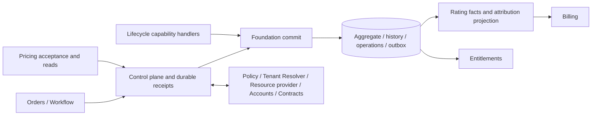

# Technical Design: Subscriptions

<!-- toc -->

- [1. Architecture Overview](#1-architecture-overview)
  - [1.1 Architectural Vision](#11-architectural-vision)
  - [1.2 Architecture Drivers](#12-architecture-drivers)
  - [1.3 Architecture Layers](#13-architecture-layers)
- [2. Principles & Constraints](#2-principles--constraints)
  - [2.1 Design Principles](#21-design-principles)
  - [2.2 Constraints](#22-constraints)
- [3. Technical Architecture](#3-technical-architecture)
  - [3.1 Domain Model](#31-domain-model)
  - [3.2 Component Model](#32-component-model)
  - [3.3 API Contracts](#33-api-contracts)
  - [3.4 Internal Dependencies](#34-internal-dependencies)
  - [3.5 External Dependencies](#35-external-dependencies)
  - [3.6 Interactions & Sequences](#36-interactions--sequences)
  - [3.7 Database schemas & tables](#37-database-schemas--tables)
  - [3.8 Deployment Topology](#38-deployment-topology)
- [4. Additional context](#4-additional-context)
  - [4.1 Capability gates and source precedence](#41-capability-gates-and-source-precedence)
  - [4.2 GTS identifiers](#42-gts-identifiers)
- [5. Traceability](#5-traceability)

<!-- /toc -->

- [ ] `p1` - **ID**: `cpt-cf-bss-subscriptions-design-main`

**Design status.** This document specifies target behavior. The [provider requirements](UPSTREAM_REQS.md#25-provider-prerequisites-and-bilateral-acceptance) define the contracts and evidence required to enable each profile.

## 1. Architecture Overview

### 1.1 Architectural Vision

Subscriptions is the system of record for commercial lifecycle, accepted commercial terms, effective-dated composition, commercial entitlement posture, tenant ownership, durable operation outcomes and resource attribution. Orders owns the purchase document; Workflow orchestrates its effects; Subscriptions determines whether a local subscription transition committed. A workflow receipt in progress is never evidence of active service.

Subscriptions owns commercial **WHEN** and the amount-less evidence from which qualifying obligations can be reproduced. Pricing owns agreed prices/rules. Rating owns tariff valuation, proration, minimum fees and its hourly processing schedule. Billing owns invoice accounting/posting, application of existing prepayment, final invoice rounding and correction documents. Taxes and actual payments remain with their respective owners. Entitlements owns the application of commercial posture to quota, license and resource providers; those providers own point-of-use access, counters and actual resources. These boundaries prevent a subscription change from depending on a mutable catalog or on a consumer's current projection.

**Application boundary.** Entitlements owns the provider-independent application of commercial posture to quota, license and resource providers. Subscriptions publishes `CommercialPostureV1` from the same transaction as the lifecycle change and consumes `ReadinessObservationV1`; initial activation waits for readiness under IA-2026-10-18, except that the local `no_preparation` profile records its empty manifest itself (SUB-D-70). The Entitlements gear is designed in its own document set, which follows this one. No adapter, counter or provider schema lives in this design.

[DESIGN.md](DESIGN.md) is the architecture authority; [features/](features) owns detailed procedures; [DECOMPOSITION.md](DECOMPOSITION.md) allocates work.

**Delivery scope.** New paid and trial subscriptions originate through Orders. Supported operations include lifecycle transitions, immediate quantity increases and component additions, future order starts, scheduled cancellation, renewal and normal trial timers. Tenant axes remain fixed for the subscription.

Import/adoption and migration, payer/resource-owner transfer, administrative backdating, a dedicated audit subsystem, separate `confirmAcceptance`, multi-step ramps, co-termination, collection pause, notification delivery and per-sale brand/PlanTier metadata are outside this version. Trial extension/repeat, standalone acquisition, scheduled composition/resume, linked subscription replacement, base-plan changes, quantity decreases and component removals are also unavailable. Unsupported commands MUST refuse before effects, including through direct/operator wrappers. If required contractual behavior is unavailable, the affected profile stays blocked. The requirement cannot be silently waived.

Free-period and credit trials, normal expiry/conversion and early conversion to the already accepted paid target remain in scope. Their Pricing/Billing/financial gates still apply. Trial-to-paid conversion is not a general changePlan capability. Preserve trial history/eligibility evidence and refuse repeat requests for the same payer/plan, including via a new subscription. A transport retry is not a repeat trial. A Pricing policy alone cannot enable an extension or repeat. Independent cancellation and new purchase have separate resource/data lifecycles: there is no automatic resource adoption, data transfer, place handover or continuity promise. Cancellation follows the existing retention/disposition rules. It does not mean immediate deletion. Unsupported plan changes cannot silently become cancel+new.

Keep ordinary acquisition/lifecycle and current scope authorization. Preserve the fixed tenant axes, immutable accepted terms, current commercial facts/full replacement versions, reliable operations and domain events/outbox. Ordinary retries, late authoritative outcomes and downstream Rating/Billing corrections follow their existing protocols. They do not create an API for administrative edits to the past. A dedicated audit store/query/export/projection is not required. Domain events carry actor, reason and correlation provenance for a later audit consumer.

Operation receipts and financial/source history remain necessary for correctness. A deferred capability cannot be reported as fulfilled. If accepted terms require deferred acceptance, notice or other unavailable behavior, the affected profile remains unavailable. Removing notice implementation does not waive a contractual prerequisite or authorize destructive cleanup without it. Basic opt-out still uses ordinary end-of-term cancellation and does not depend on a notification feature.

**Financial boundary.** Consume the external financial owner's authoritative admission for the accepted operation/terms: allowed, pending or refused. These are semantic outcomes, not a new wire enum. Prepay requires confirmation of the prescribed payment. Postpay requires authorization to serve under accepted credit terms. It does not require immediate payment/card presence. Unknown cannot authorize service. Subscriptions applies lifecycle policy to later authoritative financial outcomes. External owners handle collection, invoicing, credit limits and debt management. Existing pre-capture protection, operation correlation, stale-outcome/recovery and final commercial guards still apply. Exact evidence and adapter contracts remain delivery gates. Pricing trial terms and Billing promotional grants are separately delivered dependencies as recorded in the [PRD](PRD.md#11-purpose) and [trial feature](features/06-trials.md); Products stores no trial policy.

**Initial readiness (IA-2026-10-18).** Initial activation requires confirmed usable service before active and before its service-period/accrual start (SUB-D-55). The subscription is `preparing` from the authorized start of preparation to the activation commit; that status is written only by Subscriptions, in the same transaction as its durable activation operation, and closure without activation, including ordinary withdrawal, returns it to `draft`; only explicit cancellation during preparation yields `cancelled` (SUB-D-58). The adapter reconciles assigned rights and reports readiness by authorized scope, concrete assignment and desired revision, without needing a subscription ID. Subscriptions persists the operation and preparation posture revision/digest before dispatch.

Entitlements persists the complete required-assignment/producer manifest and returns an operation-correlated aggregate readiness result (SUB-D-56). Subscriptions validates the exact current operation and all final guards, then commits active state, fresh local T/period start, applied receipt and outbox together. All initial access prerequisites precede that commit. Capture may precede it under the existing protected purchase protocol. The [initial readiness contract](features/05-entitlements.md#initial-activation-readiness-contract) defines the semantic envelope, recovery and remaining integration gates.

S-Q01 defines accepted start conditions and local clock rules; S-Q02 defines capacity protection. Renewals, guarded resume, trial conversion and active modifications have separate contracts. Provider mappings and runtime proof remain open. SUB-D-57 below selects held-readiness arbitration and platform-borne pre-T preparation; exact owner contracts and exposure bounds remain gates.

**Held readiness (SUB-D-57).** Entitlements' aggregate ready includes a durable operation/posture/manifest-bound commitment to retain preparation until Subscriptions resolves the attempt. Activation and ordinary withdrawal serialize on the same local operation fence. Recover lost outcomes. A timeout cannot release preparation. Authorized pre-T preparation use is platform-borne under bounded enabled profiles. Emergency security denial remains immediate with truthful incident/lifecycle recovery. The [consumer protocol](features/05-entitlements.md#initial-activation-readiness-contract) is authoritative; exact SDK/provider, boundary/accounting and runtime evidence remain gates.

### 1.2 Architecture Drivers

#### Functional Drivers

| Requirement | Design response |
| --- | --- |
| `cpt-cf-bss-subscriptions-fr-status-enum`, `cpt-cf-bss-subscriptions-fr-transitions-guards` | One aggregate commit path, ten legal status edges, guarded terminality. |
| `cpt-cf-bss-subscriptions-fr-transition-request`, `cpt-cf-bss-subscriptions-fr-scheduled-intents` | Durable request identity, replayable receipt, creation business fence, asynchronous effect journal and cancel/settle serialization. |
| `cpt-cf-bss-subscriptions-fr-effective-dated-composition`, `cpt-cf-bss-subscriptions-fr-snapshot-discipline` | Append-only effective history, immutable accepted bindings and frozen BillingTerms. |
| `cpt-cf-bss-subscriptions-fr-plan-change-boundary`, `cpt-cf-bss-subscriptions-fr-proration-ownership` | One committed boundary and versioned replacement facts; no money computation. |
| `cpt-cf-bss-subscriptions-fr-renewal-evaluation`, `cpt-cf-bss-subscriptions-fr-grace-policy` | Term-sequence fence, evaluated terms, explicit grace/dwell clocks and renewal guards. |
| `cpt-cf-bss-subscriptions-fr-commercial-posture` | Versioned posture committed with the transition and published; readiness consumed before initial active. |
| `cpt-cf-bss-subscriptions-fr-event-ordering`, `cpt-cf-bss-subscriptions-fr-recurring-idempotency` | Atomic state/receipt/outbox, independent occurrence and version identities, recoverable full-state reads. |
| `cpt-cf-bss-subscriptions-fr-operation-audit` | Operation-local audit records committed with their outcome; authorized subscription and ordering-tenant recovery independent of events. |
| `cpt-cf-bss-subscriptions-fr-tenant-axes`, `cpt-cf-bss-subscriptions-fr-delegation-proofs` | Effective-dated commercial axes, immutable ordering tenant, authorization on command and recovery reads. |

#### NFR Allocation

[PRD §7.1](PRD.md#71-nfr-inclusions) is authoritative for the ratified v1 workload, thresholds and failure scopes. All seven requirements below use that same profile: 100K subscriptions in a large tenant, 1M across ten tenants, 100 mutation submissions/s and 1,000 authorized reads/s for one hour, then a twice-rate five-minute burst; provider/cardinality/hardware assumptions must be recorded. These are **Ratified v1 acceptance targets, not measured results**. S-U11 still requires an agreed availability SLI and implementation evidence before release.

| Requirement | Primary allocation and ratified target | Required verification |
| --- | --- | --- |
| `cpt-cf-bss-subscriptions-nfr-lifecycle-latency` | Foundation: durable acceptance p95 < 1 s, p99 < 2 s; local application measured separately to the same budget. | Contention, retries and mixed operations under the PRD profile; distinguish pending remote service from local success. |
| `cpt-cf-bss-subscriptions-nfr-recurring-cut` | Commercial facts: boundary-to-publication p95 < 5 s, p99 < 30 s; deliberately missed publication detected and repaired within 15 min. | Period-opening/change crash fixtures and bounded due-fact/seal reconciliation, separate from Rating's hourly scheduler. |
| `cpt-cf-bss-subscriptions-nfr-proration-accuracy` | Commercial facts: 100% exact source facts/intervals/terms in accepted goldens; zero duplicate economic occurrences. | Independent expected Rating values and Billing rounding/corrections; Subscriptions performs no money calculation. |
| `cpt-cf-bss-subscriptions-nfr-horizontal-partitioning` | Consumer contracts: tenant-isolated recovery at the profile scale, all 744 hourly slots in one logical per-parent scope request with bounded pages. | Skewed-key load, resource/proof sizes, cold projection rebuild and no per-hour/per-record N+1 dependency. |
| `cpt-cf-bss-subscriptions-nfr-operational-baselines` | Foundation: bounded read p95 < 200 ms/p99 < 500 ms; consumer event availability p95 < 30 s/p99 < 60 s with healthy broker; every stuck-work class visible. | Mixed load and injected operation, external-leg, outbox, attribution, group, scope and retention backlog; verify source checkpoints and auditable inspection. |
| `cpt-cf-bss-subscriptions-nfr-intent-seam-budget` | Foundation: 100 submissions/s sustained, 200/s burst and explicit outstanding-work/overload bounds. | Saturate admission, recover timeout by original receipt, and demonstrate no dropped acknowledged operation or ambiguous success. |
| `cpt-cf-bss-subscriptions-nfr-availability-recovery` | Consumer contracts: 99.9% monthly control/recovery availability; process restart/failover RPO 0 with durable storage intact; disaster RPO ≤ 15 min and RTO ≤ 60 min. | Ratified SLI, restart/failover/restore drills and source-to-fact reconciliation with measured loss/recovery; surviving receipts cannot be discarded under the disaster allowance. |

#### Key ADRs

| ADR | Applicability |
| --- | --- |
| `cpt-cf-bss-subscriptions-adr-manifest-closed-status-machine` | Six statuses; `preparing` is the only in-flight phase that holds T and so the only one that is a status; trial and other operation progress are separate dimensions; collection pause is deferred. |
| `cpt-cf-bss-subscriptions-adr-when-not-math-split` | Retain timing/math separation; S-Q03 selects Rating for one-time tariff valuation, with owner contracts/runtime evidence still open. |
| `cpt-cf-bss-subscriptions-adr-scheduled-intents-on-aggregate` | Retain durable aggregate intents; scheduled intent is not committed service evidence. |

### 1.3 Architecture Layers



- [ ] `p1` - **ID**: `cpt-cf-bss-subscriptions-tech-runtime`

| Layer | Responsibility | Platform binding |
| --- | --- | --- |
| API | Scoped SDK contracts, REST projection, typed failures and status reads | ToolKit SDK, authenticated OperationBuilder, RFC 9457 Problem |
| Application | Stage remote observations/effects and recover durable operations | ClientHub versioned providers, explicit SecurityContext |
| Domain | Status edges, composition, occurrence identity, guards and evaluated policies | Subscription aggregate and pure validation |
| Persistence | Local atomic commit, read recovery and the versioned formats of stored records (SUB-D-91) | SecureConn/AccessScope through ToolKit DB |
| Workers | Scheduled intents, renewal, retention, outbox, the activation driver (SUB-D-87) and the period reconciler (SUB-D-119) | Lifecycle cancellation and fenced shard leases; the gear's own service principal, with scopes from the decision point (SUB-D-123) |

## 2. Principles & Constraints

### 2.1 Design Principles

#### Manifest-closed status machine

- [ ] `p1` - **ID**: `cpt-cf-bss-subscriptions-principle-manifest-closed-enum`

Statuses are exactly `draft`, `preparing`, `active`, `suspended`, `cancelled`, `archived`. `draft → preparing`, `preparing → active`, `preparing → draft`, `preparing → cancelled`, `draft → cancelled`, `active → suspended`, `suspended → active`, `active → cancelled`, `suspended → cancelled`, `cancelled → archived` are the only ordinary edges. `preparing` is the only status that an in-flight operation owns: it holds the activation boundary T and its fence; service accrual starts only when activation commits at T (SUB-D-55, SUB-D-58). Resume and active changes keep their status while their delivery is asynchronous. Import is deferred and supplies no current creation path. A cancelled relationship cannot resume. A new commercial relationship has a new subscription ID. Trial `conversion-pending` is a separate episode state: status may remain `active` while desired access is restricted. Reads and fact derivation must use episode/posture history; active status alone proves neither access nor served time (SUB-D-66).

#### WHEN, not math

- [ ] `p1` - **ID**: `cpt-cf-bss-subscriptions-principle-when-not-math`

The aggregate selects boundaries, terms and quantities, and stores immutable price references. It does not calculate charge amounts, day-count fractions, tax, FX, minimum-fee deltas or refunds. A zero-obligation replacement declares absence of obligation; it is not a calculated zero-price charge.

#### Idempotent, ordered transitions

- [ ] `p1` - **ID**: `cpt-cf-bss-subscriptions-principle-idempotent-ordered`

Authenticate before replay. A scoped operation key and normalized payload digest identify one durable operation and eventual outcome. Changed payload conflicts. A refusal that stores nothing, retryable or a closed capability other than a successor refusal, persists nothing, so a retry under the same key is judged afresh (SUB-D-82); a recovery under a new key and a command that lost every race persist nothing either (SUB-D-97, SUB-D-99). Aggregate version checks apply after replay lookup (SUB-D-80). Creation also fences its authorized business identity: `(originType, originId, originVersion, attemptId, lineId)`, or `(order_id, order_version, attempt_id, line_id)` within the Orders origin. The identity has no ordering tenant, so one origin line binds at most one subscription in the platform (SUB-D-94). Receiver generation is separate execution authority; it does not change this create identity. Acquisition without Orders is deferred. A new transport key cannot create a second subscription for that origin. A create from an unregistered or disabled acquisition origin is refused before effects (SUB-D-71); only the Orders origin is enabled. Retrying execution retains `attempt_id`. A new business attempt is not replay. It requires S-U01 agreement on predecessor settlement and successor correlation before enablement. State, receipt, revision, audit and outbox effects are committed atomically. Lifecycle sequence is monotonic within immutable `(orderingTenantId, subscriptionId)`. Resource-attribution streams have their own tenant sequence.

#### Fail-closed gate

- [ ] `p1` - **ID**: `cpt-cf-bss-subscriptions-principle-fail-closed-gate`

Policy denial or unavailable authorization prevents a commercial transition. External checks and resource provider work execute outside database locks; their versioned results are staged, and local guards are rechecked inside the completing transaction. An external side effect followed by a failed local guard creates a durable compensation obligation. It cannot be hidden by returning a generic failure. Policy for unavoidable customer cancellation during Policy outage remains an external product/legal decision; this design does not silently bypass authorization.

#### Effective-dated, reproducible composition

- [ ] `p1` - **ID**: `cpt-cf-bss-subscriptions-principle-effective-dated-composition`

Every served interval has frozen accepted terms and committed quantity provenance. History is half-open UTC and append-only; later corrections supersede a version without erasing the previous evidence. A mutable preview, future intent or receipt from an unapplied operation is not evidence that service was supplied.

### 2.2 Constraints

#### Not an authoring System of Record

- [ ] `p1` - **ID**: `cpt-cf-bss-subscriptions-constraint-not-authoring-sor`

Pricing owns PriceBook entries, money models, policy descriptors and accepted bindings; Products owns SKU identity and published descriptors. Subscriptions stores their immutable evidence and owns BillingTerms agreed for the subscription. Published descriptors are preserved as of acceptance.

#### UTC time

- [ ] `p1` - **ID**: `cpt-cf-bss-subscriptions-constraint-utc-time`

Effective intervals, service boundaries and scheduler instants are UTC. Calendar term arithmetic uses the accepted term rule; it is distinct from Rating's fixed hourly processing windows. Within a period, accepted anchor geometry does not change; an anchor change applies from the next period.

#### Tenant isolation; delegation-proofed cross-tenant

- [ ] `p1` - **ID**: `cpt-cf-bss-subscriptions-constraint-tenant-isolation`

Accepted order evidence fixes `resourceTenantId`, `payerTenantId` and `sellerTenantId`. Resolve current tenant identity and ancestry through `TenantResolverClient`. In this version the relationship evidence of a purchase is the accepted Pricing receipt, which names the seller, payer and resource tenants and is checked against the create (SUB-D-108). Commercial accounts, legal parties, issuer bindings, arrangements and account-use grants belong to the proposed [Accounts](../../accounts/docs/DESIGN.md) gear; Account Management holds tenant identity and hierarchy only. Subscriptions is a named Accounts consumer and records the billing assignment of each leg (SUB-D-124, S-U19); none of this is inferred from ancestry. `PolicyEnforcer` validates current authorization and delegation at each request. Work without a request, by the activation driver, the posture worker and the period reconciler, runs as the gear's one service principal (SUB-D-126), discovers work through an authorized tenant roster and uses scopes that the decision point issues for it; until the platform provides that principal and roster, the workers use the gear's discovery warrant with per-row tenant scopes, a known gap (SUB-D-123). An activation is checked again in Tenant Resolver, without the decision point, before its decision commits (SUB-D-114). Historical reads use current caller authority; retained evidence does not grant its former owner continuing access. The ordering tenant is pinned to the initial resource tenant. Tenant transfer is deferred.

A caller acts in an ordering tenant that its grant reaches. Create, activation, the lifecycle commands, receiver commands, reservation commands and the exact attempt and reservation lookups name that tenant explicitly; it is never taken from the caller's security context. The policy decision point is asked about that tenant only, for a single-target scope that passes the returned-scope guard before use: an answer fenced to the target is used unchanged, and an answer that is neither fenced to the target nor fenced only to other tenants is a 503 authority or configuration error; the gear never narrows or widens a scope (SUB-D-125). Tenant Resolver then confirms that the tenant is active. User callers keep tenant barriers; a named service principal crosses a self-managed barrier only through an explicitly authorized internal service path. Until the deployed decision point answers fenced to the target (S-U20), an answer fenced only to other tenants takes the interim of SUB-D-125, a known gap: Tenant Resolver also confirms that the tenant is reachable from the grant's anchor tenant without crossing a self-managed barrier, the gear builds the command scope from that allow, and a service caller whose tenant is behind such a barrier is refused. A write checks every tenant axis it sets in the same way. A refused tenant is a denial (403, or 404 for a lookup and for activation and the lifecycle commands, which read their subscription by id within the named tenant only). `cancel`, `archive` and `release` skip only the active test, so a suspended or deleted tenant can still end its subscriptions and free its places; an outage or timeout of either service is 503 `dependency_unavailable`, never an allow. A user's read by id is filtered by the list of tenants that the grant reaches, which the decision point's expansion limit bounds; a service caller's read by id is a point read that names its tenant and holds above 10,000 tenants (SUB-D-125). So the Orders service identity at the platform root, or a seller principal, acts in a customer's ordering tenant (SUB-D-83).

#### Posted-document immutability

- [ ] `p1` - **ID**: `cpt-cf-bss-subscriptions-constraint-posted-immutability`

Financial documents and subscription history are separate datasets. New fact versions can cause Rating recalculation and Billing corrections; they never edit a posted invoice. Financial evidence retention and legal holds govern eventual purge independently of operational-resource deletion. No purge exists in this version: stored subscriptions, revisions and audit records cannot be deleted (SUB-D-113), and the purge will arrive with its own migration and decision.

## 3. Technical Architecture

### 3.1 Domain Model

- [ ] `p1` - **ID**: `cpt-cf-bss-subscriptions-entity-subscription-model`

These are logical entities and invariants; transport DTOs belong to the SDK implementation.

| Entity | Owned state and identity |
| --- | --- |
| Subscription | ID, closed status, monotonic commercial revision, pinned ordering tenant, effective-dated tenant axes, contract/order references, term window and term sequence, commercial postures. |
| CompositionRevision | Base/optional items keyed by stable line and item identity; half-open PlanLink/AddOn and quantity intervals with complete effective purchase-lot allocations; effective boundary, accepted target and predecessor lineage. |
| PurchaseLot | Stable identity within its component, authorized purchase-business origin, accepted-term provenance and effective-dated quantity history. Transport retries and renewed price versions do not create another purchase lot. |
| AcceptedTerms | Acceptance/hold references and digests, complete AcceptedBinding set, BillingTerms, currency/market and immutable UsageRatingPolicy descriptors; descriptors and money references retained without re-resolving historical facts. |
| TransitionRequest / operation | Request ID, scoped idempotency key/digest, business intent and execution-attempt identity, expected revision, status, outcome, order correlation, observed dependency versions and side-effect/compensation journal. Activation is `approved` from its admission until it resolves (SUB-D-81); each remote effect has its own effect record (SUB-D-88). |
| Activation assignment association | Operation-owned binding of the activation operation and posture revision/digest to Entitlements' manifest identity/version/digest and aggregate observations, including its complete assignment roster, held readiness commitment, snapshotted preparation policy/version/start/deadline and immutable applied/non-activation resolution with its reason. Its activation record, unique per `(subscription, generation)`, also keeps the frozen activation profile, the pause instant, the staged evidence, the blocking cause, the decision version and the driver's next check time and lease (SUB-D-85, SUB-D-87). The manifest, producer authorities and cleanup journal are persisted by Entitlements. It is not a new license entity or commercial status. |
| ScheduledIntent | Due boundary, desired operation, authoring revision, source approval, suppressions, retry deadline and parked/failure disposition; not committed service evidence. |
| TrialAdmission | Payer/plan eligibility key within authorized scope, acquisition origin, reservation/consumed state, association version and retained served-episode history; shared across subscription IDs, with no ordinary TTL release of uncertain acquisition. |
| RenewalEvaluation | Frozen term/grace values and provenance, current term sequence, payment evidence, outcome and any blocked obligation identities. |
| NonpaymentDwell | Suspension episode, evaluated cancellation deadline, dispute holds and void/resolution evidence. |
| CommercialPosture | Desired commercial capabilities, quantity, validity and restriction interval, holder and tenant axes, source aggregate revision and digest; readiness and materialization observations reported by Entitlements. No counters, seats or provider identities. |
| OwnershipInterval | Effective resource/payer/seller axes; approval and delegation evidence; predecessor and successor financial responsibility. |
| ResourceAttributionSegment | Resource/usage-type identity, subscription/line/item and tenant axes, effective interval, replacement version and tenant stream sequence. |
| BillableFact / BillingGroup | Stable economic occurrence plus immutable fact versions; payer-specific group/window, frozen known slices, explicit unresolved intervals with reason/evidence and collection posture. Commercial completeness is separate from priceability. |
| BillableSetSeal | Versioned group membership, predecessor, exact fact ID/version/digest references, set digest and publication instant. |
| RetentionDisposition | Service-stop boundary, retained-resource inventory, export/deletion deadlines, legal holds, confirmed delete outcomes and independent archive/evidence timers. |

Every event carries schema version, aggregate/lifecycle sequence, effective and recorded instants, correlation, tenant context and source revision. Full-state commercial facts and attribution replacement segments remain readable without the event broker.

### 3.2 Component Model

#### Lifecycle Foundation

- [ ] `p1` - **ID**: `cpt-cf-bss-subscriptions-component-lifecycle-foundation`

Owns one commercial commit path, status guards, operation receipts, optimistic revision control, occupancy serialization and outbox. Other handlers propose a change; none bypass this commit path. Remote effect coordination has a durable journal and in-flight fence. See [foundation](features/01-foundation.md).

#### Composition & Versioning handler

- [ ] `p1` - **ID**: `cpt-cf-bss-subscriptions-component-composition-versioning`

Owns as-of composition and accepted-term evidence, logical component identity, quantities and future proposals. Historical accepted terms are never replaced by live Pricing reads. See [composition](features/02-composition.md).

#### Plan & Quantity Changes handler

- [ ] `p1` - **ID**: `cpt-cf-bss-subscriptions-component-plan-changes`

Validates one resulting composition, derives commercial boundary policy and stages all changed items in one transaction. Base-plan changes, linked replacement, future composition scheduling and ramps are deferred. It computes no money. See [changes](features/03-changes.md).

#### Suspension, Renewal & Grace handler

- [ ] `p1` - **ID**: `cpt-cf-bss-subscriptions-component-suspension-renewal-grace`

Owns commercial period/term progression, evaluated grace/dwell and retention disposition. Collection pause, co-term alignment and customer notifications are deferred. It is not Rating's hourly scheduler or Payments' dunning executor. See [renewal and retention](features/04-renewal-retention.md).

#### Commercial posture handler

- [ ] `p1` - **ID**: `cpt-cf-bss-subscriptions-component-entitlements`

Derives posture from accepted terms and committed quantity, commits it with the lifecycle change, publishes it to Entitlements and records the readiness and materialization observations it reports. See [commercial posture](features/05-entitlements.md).

#### Trial Runtime & Conversion handler

- [ ] `p1` - **ID**: `cpt-cf-bss-subscriptions-component-trials`

Executes an optional trial block on accepted Pricing PlanRevision, with either explicit zero-price free period or monetary credit over unchanged ordinary rates; no separate TrialOffer catalog is required. Pricing owns policy/duration/applicability/paid-target terms, Subs accepted evidence and actual episode dates, Products SKU identity/structure, and Entitlements access materialization. Billing owns customer trial-grant issuance/history/balance/allocation/correction under S-U15; exact provider and Ledger financial integration remain open. [The trial feature](features/06-trials.md) separates reusable revision policy from receipt/episode/grant; exact schema and runtime remain gated.

Accepted S-Q06 evaluates the agreed settlement scheme: prepay needs prescribed payment; postpay needs accepted terms and authorization to serve on credit, without immediate payment/card. Authorized postpay starts paid service at `T_paid` and accrual at each component's `B` under SUB-D-67; no applicable authorized route means normal expiry/revocation with existing data retention and no expiry-created debt/setup charge. Failed prepay records its outcome; a still-eligible conversion may retry only before original E. At E, normal expiry closes the trial without paid start. Late capture follows refund or an explicitly assented new Orders purchase; trial extension is deferred. Later paid routing, detailed postpay due/dunning and trial authoring/eligibility/Pricing/settlement/Entitlements/runtime contracts remain open. See [trials](features/06-trials.md).

#### Multi-Tenant Ownership & Transfer handler

- [ ] `p1` - **ID**: `cpt-cf-bss-subscriptions-component-tenancy-transfer`

Preserves authorized tenant axes, delegation and the ordering partition. Ownership/payer transfer and import are deferred; no tenant-rebinding workflow is part of this component. See [tenancy and import](features/07-tenancy-import.md).

#### Event Model & Billing Alignment handler

- [ ] `p1` - **ID**: `cpt-cf-bss-subscriptions-component-events-billing`

Builds money-free versioned facts and complete commercial sets from committed state. Maintains correction lineage and economic occurrence identity. See [commercial facts](features/08-commercial-facts.md).

#### Consumer & Integration Contracts handler

- [ ] `p1` - **ID**: `cpt-cf-bss-subscriptions-component-consumer-contracts`

Exposes scoped operation recovery, composition, attribution, facts and group/seal reads. Delivers versioned outbox events and detects projection gaps. See [consumer contracts](features/09-consumer-contracts.md).

### 3.3 API Contracts


#### 3.3.1 Control plane and operation recovery

The control plane implements `cpt-cf-bss-subscriptions-interface-control-plane` and `cpt-cf-bss-subscriptions-contract-orders-intents`. Operations include Orders-origin create, activate, suspend/resume, cancel/archive, changeComposition and compatible single-item wrappers, renew, trial conversion, supported cancellation-intent withdrawal. Standalone create, changePlan, extendTrial, repeat trial, scheduled composition/resume, linked replacement, transfer, collection pause/resume, confirmAcceptance and import are deferred and are not current control-plane operations. SDK command types require manifest alignment before delivery.

Each mutation returns a durable request reference and either an applied outcome or explicit pending/failed status. The exception is a refusal that stores nothing: a retryable refusal (such as a full occupancy key, a paused receiver generation, a preparation effect in flight or an unresolved capture) or a closed capability other than the two successor refusals. It persists nothing and returns no request reference, so a retry under the same key is judged afresh (SUB-D-82). GET/status recovery identifies a business intent and its authorized Orders origin without repeating a mutation; order version/line and execution wave/attempt apply to the Orders path. The same key and identical content replay the outcome. The same key with changed content conflicts. A different transport key with an existing business identity returns the retained outcome or an explicit business conflict, never a new effect; a recovered outcome writes nothing under the new key (SUB-D-97). A command that loses its race on every run stores nothing and answers the retryable `concurrent_modification` (SUB-D-99). For a change purchase the business identity is the change order, version and line, and the expected revision belongs to the attempt, not to the identity: a new attempt after a definitively unapplied one carries a new expected revision and applies the same purchase at most once after S-U16 Pricing revalidation for that revision (SUB-D-61/62). Withdrawal is a competing serialized operation, not deletion of the operation row. The acquisition envelope supplies three distinct identities. The receiver-control and create keys carry no ordering tenant, so one origin line binds at most one subscription in the platform (SUB-D-94). Every read and write still runs in the authorized tenant context, which receiver commands and the exact lookup name as the ordering tenant (SUB-D-33/59/71/83):

| Identity | Key | Lifetime and fence |
| --- | --- | --- |
| Receiver control | `(originType, originId, originVersion, attemptId, generation, lineId)` | Controls one generation with `open \| paused \| revoked \| settled` state. Closing it prevents new effects under that generation. Unique without the ordering tenant (SUB-D-94). |
| Create business identity | `(originType, originId, originVersion, attemptId, lineId)` | Create and `settle_create` serialize on this key across all generations of one attempt. A retained create result returns the same subscription; a no-create tombstone rejects every later create for that attempt. Unique without the ordering tenant; a line holds one fence whatever its attempt (SUB-D-94, SUB-D-95). |
| Confirmation reservation | `(originType, originId, originVersion, lineId)` | Reserve, consume and release use a separate durable record, kept per ordering tenant (SUB-D-100). Its release tombstone works before any attempt exists and rejects a delayed reserve. The line's activation consumes it (SUB-D-102), and only the fenced release frees it (SUB-D-101). Attempt settlement cannot release or tombstone this purchase-level right. |

For Orders, these keys use the order id/version, attempt, generation and line as applicable. A changed generation never creates a second draft for the same create business identity. After authorization, recovery returns the original create result without authorizing preparation or activation under the new generation, and opens no receiver ledger record for it (SUB-D-97); SUB-D-59's pending resume contract still applies. Changed business content conflicts. Transport-key replay rules remain unchanged: if a changed envelope conflicts with a cached request, exact lookup or a fresh transport key recovers the same business result. The owner-agreed S-U01 mapping must cover this recovery route.

Operations spanning these records serialize their relevant fences in one fixed local lock order: the order line's lock, receiver ledger record, create fence, subscription, activation record, suspension causes, the line's reservation, then occupancy keys sorted by key; each ledger write is conditional on the state read under its lock (SUB-D-90). A reserve, a release and an activation admission of a line take its line lock first, across its origin versions. Separate keys do not allow reservation release to race past capture or activation. No-create settlement closes the attempt's create identity, not the reservation; an authorized successor attempt may exclusively rebind the surviving reservation after predecessor settlement. Cross-attempt replacement is gated by S-U01, including settlement of an already compensated/cancelled predecessor. Until S-U01 opens, a line holds one fence, and a create or settle of a second attempt of the line refuses `capability_closed` (`successor_attempt`) (SUB-D-95).

Failures distinguish authorization, missing resource, revision/idempotency/business conflict, policy denial, closed capability, dependency unconfigured/unavailable and terminal refusal. Pending work is an answer (202 with its operation), never a failure (SUB-D-81). A timeout is an unknown outcome until a durable receipt or settle result resolves it. All adapters use canonical SDK errors and RFC 9457 HTTP mapping. Consumers cannot infer success from HTTP acceptance alone.

**Financial admission semantic contract: design elaboration.** This is the minimum consumer contract of the selected external financial owner, not a new Payments API or a claim of a delivered provider. A purchase establishes its financial basis during acquisition, including agreed future service. Activation consumes that retained basis without a new payment or credit-eligibility decision. Renewal and paid conversion establish evidence only for obligations not already covered by an accepted commitment. It does not replace accepted purchase terms, resource readiness, occupancy or cancellation guards.

| Contract part | Required semantics |
| --- | --- |
| Request scope | Authorized seller/payer context; stable acquisition or operation identity; exclusive attempt association where applicable; subscription/episode or renewal occurrence; accepted terms/version and settlement arrangement; intended charge/coverage scope and requested action. A trial grant is not payment or postpay authority. |
| Allowed evidence | Trusted owner reference, decision identity/version, exact scope and accepted-term binding, and a durable coverage/consumption rule covering the accepted purchase and its agreed future application. Under prepay, reference authoritative satisfaction of the prescribed payment; under postpay, reference authorization to serve under accepted credit terms. Presence of a card, balance or submitted capture is insufficient. |
| Pending / unknown | Preserve the operation and financial references; recover by the original identity. Missing/late responses do not become refusal, success, zero debt or permission. No duplicate capture or protected-claim release. Normal expiry and previously confirmed cutoffs are not extended by uncertainty. |
| Refused | A new uncovered obligation may be refused; an already covered purchase changes only through an explicit disposition under accepted terms. Record its reason/version. Blocked activation has no service start; trial conversion follows normal expiry; renewal follows its accepted grace policy. Existing incurred obligations and financial remedies survive. No automatic switch from prepay to postpay. |
| Application boundary | Stage remote evidence outside the local transaction. At commit recheck local revision, exact terms/attempt/occurrence, retained financial coverage and explicit disposition fences; atomically retain evidence with applied state, facts, receipt and outbox. The owner contract must retain the acquisition-bound financial commitment until application or an authorized disposition, with exclusive consumption and acknowledged cancellation/withdrawal fencing. A revocable detached snapshot or merely fresh read is insufficient; unsupported mappings keep the profile disabled. |
| Replay and changed terms | Same business operation and payload recovers its original outcome without another debit/term/conversion. Changed accepted terms or a new commercial operation require their own admission; reuse of earlier funds needs explicit financial applicability, not an inferred balance or price difference. Unknown original application is resolved first. |
| Later outcomes | A versioned due/unpaid, resolved or disputed outcome binds the original payer/subscription, stable Billing collection-obligation ID, term provenance and effective time, distinct from arrival time. Correction/reissue lineage preserves the same obligation ID; new independent debt has a different ID. Deduplicate/order it before applying the accepted grace/dwell/restriction policy. A late old refusal cannot undo a committed transition, erase historical facts or override newer resolution; resume still requires current guards. Due calculation, collection and financial corrections remain external. |
| Recovery and enablement | Owner read/recovery distinguishes absent, pending, applied and conflicting evidence within authorized scope. Exact SDK names, owner-specific payment/credit mapping and conformance execution are S-U07 ratification/delivery work. No network call or cross-gear database access occurs inside a Subscriptions transaction. |

##### 3.3.1.1 Financial admission integration contract

**FA-: S-U07 target semantic contract.** This refines the accepted external admission boundary. It neither introduces a financial service into Subscriptions nor claims an available Billing/Payments API. The repository has no canonical Billing or Payments provider specification/implementation for this role: [Orders' Payments dependency](../../orders/docs/UPSTREAM_REQS.md#25-payments) is a proposed authorization request. The implemented [LedgerClientV1](../../ledger/ledger-sdk/src/api.rs) records settlement/allocation, balances, returns and disputes; it does not authorize subscription service, execute a PSP capture or underwrite postpay. Ledger settlement records received money, not a request to collect it.

**Owner boundary and required evidence**

| Item | Required contract |
| --- | --- |
| Admission owner | A deployment-selected external financial authority composes the applicable Billing obligation and Payments/credit evidence. Its adapter declares supported prepay/postpay profiles. It is not platform Policy admission, an Orders risk flag, Rating valuation or a Ledger balance read. Missing/unconfigured support blocks the affected paid operation. No assumption of a native financial provider is required. |
| Request identity | Stable business operation and requested action; authorized seller/payer/resource context; acquisition/order/version/line and exclusive attempt association for acquisition, or subscription plus exact renewal/paid-conversion occurrence; accepted terms digest/version and settlement scheme; intended financial coverage scope. Same business/payload recovers even with another transport key; different payload conflicts. |
| Allowed decision | Owner, decision ID/version, request digest, exact coverage/obligation and accepted-term binding, designated Subscriptions consumer/association, accepted future coverage, exclusive consumption fence, and recoverable versioned disposition. Prepay additionally identifies prescribed-payment satisfaction; postpay identifies authorization to serve under those credit terms. Full scope is authoritative; a bare `paid=true`, account balance, card, PSP authorization or HTTP 202 is insufficient. |
| Financial scope | Billing/selected financial owner defines the prescribed amount, currency, funding applicability and covered obligations/lines. Orders display totals/TCV and Rating previews are not debit instructions. Subscriptions verifies references/scope without summing money. Partial funding permits only the explicitly covered scope; an order-wide permission must enumerate all covered lines. Advance reuse must not allocate the same limited funds or credit capacity twice. |
| Process versus service | Orders' begin-fulfillment permission only advances workflow. The acquisition separately establishes durable prepay satisfaction or a postpay commitment covering agreed future service. Subscriptions consumes that same evidence at activation; it does not ask whether to sell again. A process-only approval or temporary card authorization cannot be represented as completed financial coverage. Tolerate-failure cannot satisfy missing prescribed payment or credit commitment, override accepted terms/occupancy or bypass pre-capture protections. |
| Financial execution | Payments owns actual collection, request deduplication and authoritative capture outcomes. For Orders-origin protected capture, Lifecycle owns the capture-start/cancel decision and Workflow delivers its outbox under [AP05/AP07](DESIGN.md#accepted-acquisition-evidence). Billing owns obligations, due dates, allocations and remedies. Ledger records accounting effects. Admission itself is not an extra collection instruction. Trial conversion uses the proposed explicit collection request, recovery and cancellation operations in [the trial contract](#336-trial-terms-and-provider-evidence), with TP-C33 as required S-U07 evidence; `assess_admission`, `read_disposition` and `settle` do not implicitly start collection. |

**Application and concurrency protocol**

Establish financial evidence during acquisition using the same business identity. Prepay becomes financially covered when the prescribed payment is confirmed and allocated to that purchase; postpay becomes covered when the owner durably commits to its accepted credit terms and agreed future service. A confirmed order still awaiting prescribed payment remains financially pending. Before activation, use the saved evidence or recover missing evidence outside the Subscriptions transaction; recovery is not another debit or credit assessment. The owner serializes concurrent claims on finite funding or credit according to its policy; two unrelated operations cannot each spend the same exclusive coverage. Subscriptions never constructs a local credit-limit calculation.

The acquisition-bound financial commitment remains applicable through the agreed future start and preparation delay allowed by the purchase. Technical token/session expiry, a lower current credit limit, a new risk score or an owner flag change cannot invalidate that commitment or trigger another purchase decision. An explicit contractual start limit or financial condition is part of the accepted terms; no technical TTL creates one. Financial coverage may change only through a scoped, versioned disposition supported by those terms, such as purchase cancellation, refund or an applicable financial restriction.

The owner serializes that disposition with consumption through the acknowledged local fence. A complete saved commitment with this fence needs no fresh financial approval at activation. Actual T still obeys accepted start conditions and local authorization, lifecycle, cancellation, readiness and occupancy guards.

At the local serialized commit, Subscriptions either applies once and stores the financial decision/scope reference with state, facts, operation receipt and outbox, or records a terminal unapplied fence. A transient local conflict retries the same covered operation; it cannot mint a second financial commitment or collection. Owner notification of consumption is delivered/recovered after commit. A lost acknowledgement retains the owner's pending reservation/association until the durable local result is recovered. No remote call or cross-gear table access occurs in the commit.

An authorized financial disposition races that same local operation fence; withdrawal is not a discretionary re-assessment of an accepted purchase. If withdrawal wins, late application is rejected and the durable unapplied acknowledgement allows the owner to release/reassign unused authority under its financial rules. If application wins, withdrawal recovers the applied receipt and any cancellation/nonpayment remedy follows ordinary lifecycle rules; it cannot erase service or debt history. Timeout, unknown read, expired token or missing acknowledgement alone is not proof of non-application. Do not recycle coverage or release a protected acquisition before this outcome and AP07 settlement are known. An involuntary later chargeback/return is a new financial outcome, not a retroactive rewrite of a valid applied transition.

**Operation outcomes**

| Operation | Allowed | Pending / unknown / refused |
| --- | --- | --- |
| Initial paid activation | Consume the acquisition's retained payment allocation or postpay commitment and apply at actual T after other guards; no new credit assessment or collection | Missing evidence requires recovery; a confirmed unpaid order waits for its agreed payment. An explicit cancellation/refund/restriction follows its accepted disposition and remedy path. Technical expiry or current credit-limit changes do not revoke purchased coverage. |
| Renewal | Advance the exact term occurrence once under its accepted renewal and financial terms | Do not manufacture a paid renewal from uncertainty. Evaluate the existing accepted grace and bill/waive posture; neither grace, cutoff nor cancellation deadlines are extended by a delayed response. Preserve already incurred obligations. |
| Early or scheduled trial-to-paid conversion | Prepay: prescribed payment satisfied. Postpay: accepted credit-service authority. Apply the paid lifecycle boundary at actual `T_paid`; each component has a rating/allocation boundary `B` under SUB-D-67 (hour-aligned only for hourly components). Billing later owns due/unpaid outcomes | No unauthorized paid period or expiry-created debt/setup fee. Trial ends under its original terms; uncertainty alone grants no free extension. Late payment does not reopen an expired episode or backdate service: recover an applied winner, otherwise use financial remedy or a separately authorized supported paid acquisition. |
| Financially restricted resume | If the accepted resume policy requires financial clearance, obtain current exact-scope authority and pass normal local guards; convert the same retained occupancy right | A generic paid/resolved event cannot resume automatically. Preserve retained occupancy and existing lifecycle/data policy; do not allocate a second place. |

Free-period and credit-trial admission/grant rules remain in the trial contract; a trial bonus is neither prescribed prepayment nor postpay authorization. This package adds no trial offer, credit-scoring algorithm, dunning engine, notification scheduler or general Change Orders behavior.

**Later financial outcomes and recovery**

Later outcomes identify the original obligation/coverage, payer and subscription/term, a stable Billing collection-obligation ID with correction/reissue lineage, owner event ID and monotonic outcome version (or an equivalent recoverable ordering cursor), effective time and recorded time, reason and authoritative recovery reference. Financial states such as not-yet-due, due/unpaid, resolved or disputed do not map blindly to subscription states. Subscriptions applies its accepted grace/restriction policy only after verifying scope and ordering. Duplicate outcomes have no effect; stale outcomes cannot override a newer resolution; a gap or ambiguous ordering requires an authoritative owner read and leaves the last proven posture in force subject to existing cutoffs. Arrival time never substitutes for the agreed due/effective time.

Replay recovers the applied receipt and original financial commitment before any new work, including after a technical credential expires or a later financial disposition arrives. For a nonterminal subscription with an applied term, later valid due/unpaid outcomes open a collection grace anchored at their due/unpaid effective time and keyed by subscription plus stable collection-obligation ID (SUB-D-68); corrected versions continue that episode without resetting its anchor/deadline, while independent debt in the same term receives another episode; they cannot undo the original paid boundary. After cancellation/archive, financial outcomes remain ordered recovery evidence only: no new lifecycle grace, dwell, renewal, access or occupancy is created. A resolved outcome does not revive a terminal subscription or closed trial. Retained receipts and authoritative read/recovery must cover the supported delayed-message/retry lifetime; exact retention/transport versions are provider delivery prerequisites, not a guessed TTL.

**Required conformance scenarios: specified, not executed**

| Case | Intervention | Expected result |
| --- | --- | --- |
| FA-C01 | Prepay has a card/PSP authorization but capture is pending or partial | No paid application without authoritative satisfaction for its full required scope; recover the same capture identity. |
| FA-C02 | Future postpay purchase is committed; credit limit/risk policy changes before activation | Use the retained purchase commitment without a new eligibility decision or card/capture. Only an applicable explicit versioned disposition affects it; later due/unpaid follows accepted policy. |
| FA-C03 | Orders tolerates a failed process authorization | Workflow progress does not prove financial coverage; retained prepay satisfaction or accepted postpay commitment and AP protections remain mandatory. |
| FA-C04 | Old decision arrives after amendment, cancellation or successor association | Scope/fence mismatch prevents application; preserve and reconcile original financial obligations. |
| FA-C05 | Prepaid future purchase waits through preparation delay and technical proof/quote expiry | Preserve payment allocation and accepted terms. Use retained evidence or recover the same commitment without another debit or approval. Only explicit purchased start conditions limit execution; no intersecting technical permission windows. |
| FA-C06 | Accepted cancellation/refund/restriction races application; consumption reply is lost | Exactly one local winner and recoverable applied/unapplied receipt; no recycled coverage, duplicate service or debit. A credit-limit or risk-score change alone cannot authorize withdrawal. |
| FA-C07 | Two lines/operations compete for one advance or finite credit authorization | Owner enforces funding/coverage exclusivity; read balance alone cannot allow both. Full funded line roster is retained. |
| FA-C08 | Trial expires while payment is unknown; success arrives later | The episode ended at expiry (collection started at `E − conversionLeadTime`, SUB-D-65): no extra trial access, backdated paid period or closed-episode revival; the late success is refunded or, with explicit customer assent, becomes a new purchase through the ordinary route. |
| FA-C09 | Renewal decision is delayed/refused, then replayed | One renewal occurrence at most, accepted grace/cutoff posture preserved, no waiting-gap debt invented by the callback. |
| FA-C10 | Due/unpaid v2 arrives after resolved v3, or a sequence gap is discovered | Stale outcome ignored; gaps recovered from owner; no erroneous suspension or terminal resurrection. |
| FA-C11 | Payment returned/disputed after valid activation | Preserve service history and handle new financial outcome under existing policy; no second capture or silent historical rewrite. |
| FA-C12 | Provider outage/restart or foreign-scope decision | Use complete retained purchase coverage with its disposition fence without a live approval call. Missing required evidence stays pending recovery; absence, transport acceptance or foreign-scope evidence grants no permission. |

**Delivery boundary.** Subscriptions specifies the consumer requirements and financial ownership boundary. A Billing/Payments/credit provider must still publish its versioned implementation of this contract, including durable purchase coverage, disposition/consumption fencing, coverage concurrency, capture/release recovery and ordered outcomes, and pass FA-C01-FA-C12. No absent provider document or API is deemed approved. S-U07 remains a capability gate; operational invoice/credit/debt design is outside Subscriptions.

#### 3.3.2 Pricing acceptance and accepted time

Current Pricing D-510 provides seven methods: `PricingReadV1::{resolve, price, current_revision}`, `PricingAcceptanceV1::{acceptance, hold}`, `SellabilityV1::{check, check_fulfilment}`. The provider is implemented. Subscriptions' adapter and joint integration fixture remain target work. Preview `resolve` is not admission; `SellabilityV1::check` creates durable acceptance, `PricingAcceptanceV1::hold` fixes original bindings and activation instant, and `check_fulfilment` observes fresh eligibility. Replaying a receipt/hold neither renews its deadline nor authorizes new work.

The current V1 offer/hold contract checks `start_at <= activation_at < hold_until`, and first admission also requires server time before `hold_until`. The first hold freezes `activation_at`. Another key cannot alter it. Full acceptance identity/axes, market, digest and all binding descriptors are checked; fresh eligibility does not traverse successor prices or reprice accepted money. Renewal resolves with retained pins, slicing at each binding's own `ends_on`, never its informational `effective_to`.

##### Execution-check results

Subscriptions preserves the provider's typed reason and evidence in the attempt outcome. Orders D-190 defines the expiry/closure and market-change mappings; the remaining receiver-to-Workflow mappings still need joint adoption. The table states the consumer requirements for the selected provider version; the adapter and joint cases must cover every result that version can return before S-U01 opens.

| Pricing result | Subscription action and Orders mapping |
| --- | --- |
| Fresh eligible result | Stage the observation and recheck its scope, validity and freshness at the guarded commit. It authorizes no repricing and is not a reusable admission token. |
| `HoldExpired` | Under V1, close the attempt with this reason; map confirmed expiry to `order-binding-expired`. A stored AP03 reference cannot override this V1 refusal. |
| `PriceClosed` | Close the attempt with the original reason. Map confirmed explicit closure/temporary end to `order-binding-expired`. V1 also returns this code for a non-approved price or execution before `effective_from`; the code alone does not prove expiry. S-U01 must provide authoritative cause evidence or an explicit mapping for the broader result; the adapter cannot infer closure from the code. Informational `effective_to` alone is not this result. |
| `SkuRetired` | Close the attempt with the retirement reason. Its distinct Workflow mapping must be agreed under S-U01; never convert it to expiry. |
| `MarketChanged` | Close the attempt and retain `market-divergence` for Orders. This is not ordinary publication drift or a dependency timeout. |
| `AcceptanceMismatch` | Close the attempt with the accepted identity/terms mismatch. Require an explicit Workflow mapping; never replace the accepted receipt or convert the reason to expiry. |
| `ActivationOutsideAcceptedWindow` | Close this attempt with the accepted-window violation. Preserve the original window and require an explicit Workflow mapping; do not move the activation time or extend the accepted window to make the check pass. |
| Denied authorization, including `PermissionDenied` | Close the attempt with the authorization reason `policy_denied` (SUB-D-86). Do not invent a commercial expiry or proceed with activation. A refusal of the gear's own service identity is not a denial of the purchase; it is handled as an unavailable provider (SUB-D-87). |
| `ReceiptNotFound` or unavailable historical evidence | Block activation and recover the original accepted evidence or obtain an explicit owner remedy. Missing evidence does not prove that the purchase expired or may be released. |
| Corrupt provider data | Block activation and retain the provider/data-integrity failure for operator recovery. Do not replace it with a commercial refusal or new terms. |
| Transport failure, unavailable provider or unknown outcome | Keep the attempt pending within its saved deadline. If that deadline closes the attempt, record preparation timeout and the dependency cause, not commercial expiry. |
| Any other result without an agreed mapping | Fail closed with the original result and an integration finding. The selected provider profile cannot be enabled until its mapping and joint cases exist; never default to success or expiry. |

A commercial refusal closes only the technical attempt. Purchase, payment and reservation obligations remain for the agreed Orders remedy; a failed execution check does not cancel or refund the purchase. SUB-D-86 lists the closure reasons, the blocking causes and the only two Orders mappings this design fixes: `hold_expired` to `order-binding-expired` and `market_changed` to `market-divergence`. Ordinary successor publication, an informational `effective_to`, or deprecation for new sales alone does not replace accepted terms. These observations are not permission to ignore an actual provider refusal.

**AP03-aware check — required owner extension.** Current `FulfilmentQuery` contains tenant axes, acceptance, current market and activation time. It has no AP03 commitment input, and V1 checks its own `hold_until` and accepted window. The protected future-purchase profile therefore requires a versioned Pricing contract that accepts the commitment reference/version, exact acquisition/tenant scope, accepted terms digest and requested execution time. Pricing must validate the commitment's current disposition and accepted execution restrictions, return versioned freshness evidence and distinguish ordinary offer expiry from a restriction that actually prevents execution of this purchase. Explicit closure/retirement must be ordered against that commitment; new-sale-only changes cannot silently revoke it. The check still validates market, identity and terms, and never changes accepted bindings. Its exact SDK mapping, supported result set and Orders remediation mappings remain open under S-U01. The current V1 API is not extended by this document, and the adapter cannot suppress its `HoldExpired`, `PriceClosed` or other refusal. Missing support blocks protected acceptance/capture.

**Mid-term continuation.** A successor selected by Pricing at `ends_on` can be adopted automatically only under explicitly accepted continuation policy with its notice/assent prerequisites satisfied (SUB-D-41). Price closure alone is not commercial authorization. Subscriptions freezes the adopted timeline and atomically publishes full affected fact versions and the exact successor seal; Rating consumes those terms. Missing authority, notice/assent or pricing coverage keeps the affected full valuation pending, never a complete prefix or an implicit service/debt decision. The [Rating profile](features/09-consumer-contracts.md#32-consume-current-pricebook-providers-and-serve-frozen-bindings) specifies the proposed detection/reconciliation exchange and the still-open Pricing freshness guarantee.

**Accepted acquisition and actual T.** Pricing validates and durably fixes purchase terms and future coverage at acceptance. Subscriptions activates that acquisition using the immutable evidence, current order/attempt and cancellation fences, financial admission, authorization, occupancy and held readiness. It samples fresh commercial T at the final guarded local decision and persists it with successful application. Offer expiry, price changes or retirement for new sales after purchase do not invalidate or reprice it. Requested dates are lower bounds. Any latest-start restriction must come from the accepted purchase. [Foundation recovery](features/01-foundation.md#acquisition-recovery) specifies the execution and recovery protocol; versioned accepted-purchase SDK mapping and owner/runtime evidence remain open.

**Protected future purchase.** Before capture, confirmation secures both a durable capacity reservation and the accepted Pricing/Products commitment covering the original future terms. The accepted receipt or correlated evidence may represent that commitment. It must survive ordinary later catalog changes. A preview or quote-lifetime V1 hold does not supply the guarantee. Missing supported future coverage prevents acceptance/capture of the profile. Applicable purchased start/delay conditions remain binding. Technical failures preserve the obligation for recovery or agreed cancellation/remedy. Payment authorization and capture remain distinct, and seller tolerance cannot waive protection.

**Capture arbitration:** Orders Lifecycle is the Orders-origin decision owner for capture start versus cancellation, with one local acquisition/version guard and atomic decision/outbox persistence. Workflow transports/reconciles; Payments owns durable execution deduplication and outcome recovery under the same capture identity. Cancellation first prevents debit; capture start first permits cancellation with pending financial recovery/remedy. Neither a lost response nor a retry frees protected claims or creates another collection. Claim/term protections remain valid while the outcome is unknown. Release also requires capture/activation fences and the applicable recorded remedy. The [acquisition recovery protocol](features/01-foundation.md#acquisition-recovery) defines the accepted sequence, direct-path boundary and required failure fixtures. These semantics do not establish shipped Payments capability, external-owner ratification or a universal posted-refund release gate.

##### Accepted acquisition evidence

New acquisitions originate in Orders. These semantic records define required content; exact SDK types and owner implementations remain delivery work. Existing V1 quote/hold methods keep their current semantics. A future date beyond V1 `hold_until` needs versioned initial acceptance that supports that date; it cannot depend on an impossible V1 acceptance or revive expired authority.

| Boundary | Required contract |
| --- | --- |
| AP01 commercial time | Workflow supplies the requested lower bound/common barrier; Subscriptions records actual T against the accepted acquisition and current guards. Lifecycle/Workflow consume the durable applied result. |
| AP02 occupancy | Subscriptions supplies separate active, retained-suspended and confirmed-reserved counts, policy key/limit/version and own claim-set evidence (one claim per distinct key of the composition, SUB-D-63). Suspend retains; own-reservation activation/resume converts once; an addition claims new keys without releasing existing ones; applied cancellation releases the set. Orders changes its read/predicate and deduplicates local versus provider claims |
| AP03 protected future terms | Pricing must expose a separate durable commitment for accepted future terms/date/window, ordered against Products retirement and price closure, plus the [commitment-aware execution check](#execution-check-results). A V1 receipt, hold or copied terms cannot stand in for either capability. Orders confirmation records both AP02/AP03 evidence before capture; missing either prevents capture |
| AP04 accepted purchase execution | Publish/read immutable accepted acquisition and any explicit execution restrictions. Subscriptions applies that purchase under its own order/attempt/readiness/financial fence; no new Pricing decision (repricing or re-acceptance) is required at activation. The fresh execution check follows the [result mapping](#execution-check-results), including market, identity and accepted-window checks. AP03 execution needs the commitment-aware Pricing contract; a stored snapshot alone cannot bypass that check or its outage. |
| AP05 capture ordering | Lifecycle owns the durable capture-start/cancel ordering for the exact acquisition/version and financial scope. Workflow delivers the resulting outbox command; Payments executes/reconciles the same capture identity. Authorization is not capture. Tolerate-failure never bypasses AP02/AP03 or prescribed activation payment |
| AP08 trial admission | For a trial acquisition, Orders confirmation reserves the payer/plan trial-admission key together with the occupancy place, before capture. Replay returns the same reservation, changed content conflicts, and release follows the same non-application settlement as the occupancy claim. A version amendment maps the reservation with its line like a protected claim. Trial enablement requires Orders adoption under S-U01 and executed AP-C16 plus trial-admission concurrency cases; it is not supplied by the existing active-only observation. |
| AP06 dispatch ordering | Workflow obtains/replays the committed signal before activation dispatch. A missing/ambiguous acknowledgement permits recovery only. Signal closes the documented direct-order-cancel boundary; it is not payment protection, actual activation or a fence against all later mediated hold/cancel actions |
| AP07 terminal/recovery boundaries | Keep protected claims/commitments until authoritative payment/application recovery and coordinated release fences/remedy. Operational order outcome and financial completion are separate. No automatic refund amount/timing or wait-for-posted-refund requirement. A technical successor attempt preserves the original acquisition, not a new sale |

| Record / request | Required information and invariant | Durable authority / recovery |
| --- | --- | --- |
| Acquisition association | Seller/catalog scope; order ID, immutable version and line; accepted terms/digest and tenant axes; execution attempt, intended subscription and association generation when known. Acquisition identity is independent of a transport key or attempt | Lifecycle owns the order/version; Subscriptions owns exclusive local create/application association. Same business/payload recovers; conflict refuses. A successor requires the foundation recovery protocol; it never creates a new purchase implicitly |
| Capacity protection | Stable claim ID/revision, acquisition/line, authoritative payer/resource/scope key, evaluated policy/version, held/consumed/released disposition and exclusive association | Subscriptions owns reserve/read/attach/consume/release outcomes. Unconfirmed draft is not a claim. Local confirmation/consumption must serialize on the authoritative key; TTL is not proof of safe release |
| Future-term commitment | Stable commitment ID/revision, acceptance and original complete bindings/policies/digests, acquisition/tenant scope, accepted future date/window, protected Products/price decision evidence and recoverable cancellation/revocation disposition | Pricing owns commercial commitment and coordinates Products protection. It reports committed only after all required producer fences are established. Partial/unknown preparation is recoverable and cannot authorize capture. Original acceptance must qualify at issuance; no retroactive resurrection of expired V1 authority |
| Capture-start evidence | Stable capture business identity and financial amount/obligation scope; exact applicable claim/commitment references for every funded line; authorized order/version; decision/generation and dispatch identity | Lifecycle persists winner and outbox atomically against cancellation. A single order payment binds the complete covered line set, not one convenient receipt. Payments must fence/deduplicate execution; Workflow cannot infer success from an authorization or retry with a new capture identity |
| Accepted execution evidence | Exact acquisition, original terms/digest, supported future coverage and explicit start restrictions; designated local order/attempt association and current cancellation/financial evidence | Pricing preserves accepted evidence; Subscriptions owns one local application decision and actual T. An offer deadline does not become an execution deadline after acceptance. |
| Applied activation | Original acquisition/attempt/line and subscription, operation/revision, actual T, consumed claim, accepted terms digest and held-readiness resolution | Subscriptions is authoritative. Workflow consumes the durable applied outcome; Lifecycle completes only from the exact current line roster after all required outcomes. |
| Release/non-application evidence | Original owner references, definitive applied/unapplied result, cancellation/association fences, capture disposition and required recorded financial remedy, plus per-owner release acknowledgements | Coordinated recovery uses the original identities. A missing read is not a tombstone. Unknown capture/application retains protection; an applied winner is cancelled through ordinary guarded lifecycle rather than erased. No cross-gear database transaction is assumed |

Each request carries authenticated seller/payer/resource scope, a stable business identity, expected revisions, payload digest and correlation. Receipts identify the durable operation, accepted evidence versions, disposition and outstanding effects. Owners distinguish applied/replayed, pending/unknown, refused, stale/conflicting and unavailable. `pending` proves receipt of work, not protection or application. A missing historical read is not proof of non-application.

A complete saved immutable purchase snapshot permits execution without a live Pricing read of the terms; the fresh execution check (SUB-D-60) reads only acceptance validity, price closure and SKU retirement and cannot replace the snapshot. Recover missing historical evidence under the original identity. Explicit cancellation, security denial and financial disposition retain their own authority; catalog drift cannot replace any of them.

**Commercial time.** Requested start is a lower bound. Acceptance time establishes the frozen purchase; `contractEffectiveAt` records contract booking independently of service. Readiness timestamps are diagnostic. Actual `serviceActivatedAt` / T is fresh server time sampled after local fences and guards, immediately before the atomic activation writes. It becomes authoritative only on commit. No remote call occurs between that decision and commit.

T is the commercial effective instant, not a physical WAL/fsync timestamp. A rollback has no activation; a new transaction samples a new T. Recover unknown commit outcomes first and return the original T if applied. Do not carry a time sample across restart or an abandoned transaction. Clock and transaction-duration bounds must support any explicit accepted time conditions. Quote expiry cannot create a new latest-start restriction. All required usable readiness precedes T; service accrual begins at T and authorized pre-T preparation remains platform-borne.

**Occupancy evidence.** The batched read binds the exact payer/resource/scope key and policy version to separate active, retained-suspended and confirmed-reserved counts, an explicit limit, provenance and identifiable caller claims already included. Active count keeps its literal meaning; draft count is diagnostic. An active-only adapter cannot support this profile.

For a new purchase, add only unrepresented requested rights and Orders in-flight claims to protected occupancy. Count each business right once and preserve Orders' in-flight uniqueness rule. Unknown claim identity/deduplication blocks new admission. Never infer a limit of one or change the provider's key locally. A preflight read is not a reservation. Confirmation acquires durable claims before capture; own-reservation activation and unchanged-key resume convert an existing right once, even after a limit decrease. Failed key changes preserve the source claim.

Pricing must order initial acceptance against Products retirement and price closure and retain complete original bindings, quantities, policies, invoice descriptors and BillingTerms. A Products reference kind alone does not prove customer-commitment protection. Use a reference registry only if its owner contract supplies that guarantee. Partial protection cannot authorize capture. Missing compatible provider versions or recovery evidence keeps the affected profile disabled before acceptance/capture.

#### 3.3.3 Commercial facts and seals

A fact version is one `subscriptions-rating/1` document (SUB-D-117), and `BillableFactPublished` carries the complete document (SUB-D-121); the [commercial fact envelope](#commercial-fact-envelope) lists its members. It names the fact ID, version, predecessor and payload digest (SUB-D-116), the immutable BillingGroup, the resource tenant, line, item and order identity, kind `recurring|usage`, timing, period, served extent, and ordered term slices with their complete lot allocations and the accepted terms they name. A BillingGroup fixes subscription, seller, payer, currency and billing window. Every served instant has exactly one temporal term slice, with explicit exclusions. A suspended span is an explicit unresolved slice until accepted terms carry a suspension bill/waive posture; a successor version then carries the suspension ranges and that posture (collection pause is deferred and has no value here). One-time facts and their occurrence identity wait for their capability (SUB-D-122). Usage parents publish at commercial-period opening so Rating can schedule hourly work without a Subscriptions hourly tick. Facts are published in the lifecycle commit and by the period reconciler, from one durable period cursor per subscription (SUB-D-118, SUB-D-119).

**Recurring flat and minimum fee.** Subscriptions publishes, per fact version, the immutable accepted terms, the term slices cut at composition, price, quantity and policy boundaries, the complete lot allocation and the interval and resource evidence; it carries no derived money. How Rating and Pricing value them (one flat per component obligation, one pooled floor per price, subscription, period, currency and scale over the union of chargeable intervals, the per-resource and group minimum scopes, hourly or billing-period windows, the full minimum for a partial calendar hour, and full or proportional partial-period minima) is requested of those owners as `cpt-cf-bss-subscriptions-upreq-valuation-rules` in [UPSTREAM_REQS §2.3](UPSTREAM_REQS.md#23-rating-and-billing) with its examples (SUB-D-46 to SUB-D-54, SUB-D-75). Cross-fact scope remains an open aggregation contract; a configuration that binds one minimum-bearing price on two facts of the same subscription and period refuses before effects meanwhile. Current Pricing rejects resource and hourly minimum fees, so the request needs a coordinated provider extension; resource identity and authoritative inventory, ownership and usage evidence are preserved through valuation and correction independently of invoice-line grouping. See [valuation inputs](features/08-commercial-facts.md#33-derive-stable-facts-and-complete-accepted-term-slices).

**Empty versus zero-valued Rating results.** A complete empty replacement removes this fact's prior monetary contributions under the exact seal and normal Billing guards, retaining history and other facts (SUB-D-45). Active zero valuation retains zero-valued lines, classification, accepted terms and calculation evidence. Missing terms/data produces structured pending without complete monetary delivery. A zero total cannot erase lines. Zero usage still needs coverage and full tariff evaluation, including applicable minimum fees. Billing owns display and financial correction. An empty/zero result does not mean a refund is complete. See the [canonical result contract](DESIGN.md#rating-result-contract).

**Rating pending reasons.** SDK-readable work status binds its state and structured blocker list to an exact fact reference and distinguishes the accepted head (SUB-D-44). Waiting on conditions/data requires a nonempty list of stable codes, affected scopes/dependencies, responsible sources, recoverable evidence and resolution routes. Rating references source `Unresolved` evidence and durably owns its own coverage/recovery findings. A prior complete result retains its own source reference and cannot indicate completion of the current fact. See the [status contract](features/09-consumer-contracts.md#32-consume-current-pricebook-providers-and-serve-frozen-bindings); exact SDK mapping remains open.

**One-time calculation basis.** Qualifying one-time facts retain applied action evidence, frozen accepted terms and `Once` (flat) or `Units { quantity, unit }` (per-unit) (SUB-D-43). Units uses positive exact action-specific quantity and agreed unit; Rating rejects model/unit mismatch or missing quantity without consulting current component quantity or defaulting to one. Once is not seat-multiplied. Later increases do not change the original charge. Corrections to the original action preserve occurrence identity and advance the full fact/exact seal. Additional charges require distinct agreed actions. Exact SDK encoding remains open.

**Explicit unresolved successor.** A known unresolved continuation of an established obligation is published in a new full fact as an explicit `Unresolved` interval, with its exact successor seal, atomically (SUB-D-42). Preserve known intervals and affected lot/quantity/purchase provenance; do not invent missing terms or classify the interval as free. Rating advances the authoritative fact head but leaves the full result pending. Billing cannot satisfy the new seal with an old result. Already posted effects require normal correction/recovery, not automatic reversal. Cancellation limits future service but cannot resolve missing terms for service already delivered. Only authoritative historical continuation evidence and the agreed S-U08/S-U13 remedy path can resolve that blocker. Resolution creates a further fact/seal version. New admission and financial prerequisites remain mandatory. [Feature 08 §3.3](features/08-commercial-facts.md#33-derive-stable-facts-and-complete-accepted-term-slices) defines publication and acceptance cases.

**Lot-aware fact contract (S-U08).** For a quantity-bearing component, each temporal slice contains the complete allocation of effective purchase lots. Each allocation names the stable lot ID, quantity, immutable accepted-term reference and purchase provenance; quantities sum to the component's committed service quantity for that interval. Several lots coexist inside one slice. They are not overlapping temporal slices or independently added parent obligations. All referenced accepted bindings/descriptors remain recoverable at the exact historical version. Subscriptions publishes no calculated amount or live-price fallback. The one-lot case uses the same shape.

For a same-component increase within an unchanged charge kind, payer/group and billing period, retain the fact ID and publish a higher full replacement version. At actual application T, the replacement preserves the pre-T allocation and includes the old plus new lots from T onward; a scheduled proposal is not supplied service. New component obligations retain their own fact identities. Full replacements preserve purchase/lot lineage. Renewal applies Pricing continuation rules per lot without promising permanent prices. [Feature 08 §3.3](features/08-commercial-facts.md#33-derive-stable-facts-and-complete-accepted-term-slices) defines the evidence shape, replay rules and two-interval example.

One authorized purchase business operation creates one lot. Changing the transport key cannot add it twice. The local transaction commits the lot/composition revision, operation result, affected full fact versions, successor commercial seal and outbox publication intents atomically. Rating deduplicates by fact/version/digest, refuses conflicting content under one version and does not replace a newer accepted head with an older one. Billing consumes the complete rated replacement under its existing draft/posted-correction contract. There is no independent monetary delta lane or second collection triggered by replay.

The initial quantity-change profile includes increases and component additions only. A `conversion-pending` trial episode refuses these purchases at submission and commit even while the subscription is active (SUB-D-66). **State restriction:** seat purchases, increases and additions to suspended subscriptions refuse; perform a separate authorized guarded resume first, then submit the normal active change. The [feature 03 source-state matrix](features/03-changes.md#change-operation-state) retains the separate S-U01 draft gate; non-terminality alone is not admission. Purchases come only through Orders Changes with S-U16 delta acceptance; direct/operator wrappers make no purchases (SUB-D-61). Decreases/removals are deferred across Orders and direct/operator wrappers; transfers between commercial purchase lots are excluded. Whole-subscription cancellation and correction of current-system commercial facts retain their own contracts; administrative historical editing is unavailable. Entitlements receives the resulting commercial capacity; the license provider independently governs user assignment/revocation.

The semantic shape and replay direction are accepted; exact SDK encoding, capability negotiation and mirrored Pricing/Rating/Billing contracts plus runtime evidence remain S-U08/S-U13 gates. Until both producer and consumer support the lot-aware profile, differing-binding increases refuse before effects rather than flattening or repricing existing quantities. Same-binding increases and distinct items retain their otherwise supported profiles. A lot allocation does not specify distribution of metered usage across prices, nor permit repeating shared minimum fees or tier thresholds per lot; affected usage profiles still need explicit accepted semantics.

A changed obligation replaces its previous fact version. Removing one publishes an explicit zero-obligation version; absence is never a retraction. S-Q04 assigns a durable charge-occurrence identity to each separately agreed chargeable business action, independently of prices/versions. Retry, including another transport key/attempt or rebuild, keeps the same occurrence; resume and catalog changes create no setup fee. A new connection purchase after cancellation has a distinct charge only when its agreed terms explicitly require it. Other lifecycle/component changes do not automatically qualify. Distinct agreed purchases at the same price remain distinct; corrections keep the original occurrence and version lineage.

Component interval identity, order/attempt identity and charge-occurrence identity are separate. An ID allocation, reservation or prepayment does not prove service or earn a fee; a committed qualifying action under accepted terms drives the fact. Exact occurrence schema and target identity conflict handling remain open. S-Q03 still routes the amount-less fact to Rating for frozen-term tariff valuation and Billing for accounting, advance application and final invoice rounding/corrections. S-U08/S-U13 owner contracts and runtime fixtures remain required before fee-bearing capture/activation; pre-capture protection is unchanged.

`BillableSetSealed` identifies the BillingGroup, `composition_version`, `previous_version`, full exact references `(fact_id, fact_version, payload_digest)`, set digest and `sealed_at`. **Exact-reference semantics:** these are exact versions, not lower bounds (SUB-D-40). A seal establishes complete commercial membership for that version, not usage-source completeness. Any membership or fact-content change requires a successor seal, including a correction with unchanged membership. Billing selects only results whose source fact ID/version/digest matches the selected seal entry; a result for a newer fact version waits for its successor seal.

A new Rating result revision for the same exact fact (for example, corrected usage or calculation) does not require a new commercial seal, but retains Rating completeness, result-version and Billing financial-execution guards. Consumers obtain facts and seals through repeatable scoped recovery reads. [Feature 08](features/08-commercial-facts.md) owns the producer and correction procedures.

##### Commercial fact envelope

The versioned Rating profile is `subscriptions-rating/1`. Rating's fact reader owns it and refuses any member it does not know, so Subscriptions writes exactly the members below, in snake_case (SUB-D-117). Enable a combination only when the selected consumers support its charge kinds, models, lot semantics, evidence and numeric limits.

| Member | Wire form | Source |
| --- | --- | --- |
| `profile` | `subscriptions-rating/1` | The profile |
| `fact_id` | UUID | Fact identity (SUB-D-116) |
| `fact_version` | Integer, 1 or more | The version chain |
| `predecessor_version` | Integer, or `null` on version 1 | The version below it |
| `payload_digest` | 64 lowercase hex digits | SHA-256 of the canonical JSON of the document without this member (SUB-D-116) |
| `source_commercial_revision` | Decimal text | The subscription revision that wrote the version |
| `billing_group` | `{billing_group_id, subscription_id, seller_tenant_id, payer_tenant_id, currency}` | The group identity of SUB-D-116, the fixed tenant axes (SUB-D-113) and the binding currency |
| `resource_tenant_id` | UUID | The subscription's resource tenant |
| `sub_line_key` | Text | The component's line key, for example `plan#1` |
| `item_id` | UUID | The binding's item |
| `order_refs` | Array of `{order_id, order_version, line_id}` | The distinct order lines of the terms records that hold the obligation, sorted |
| `kind` | `recurring` or `usage` | The binding's charge kind; never `one_time` (SUB-D-122) |
| `obligation` | `active` or `zeroed` | `zeroed` for an obligation the period no longer holds (SUB-D-117) |
| `timing` | `advance` or `arrears` | The binding's invoice timing, one per fact |
| `period` | `{start, end}` | The commercial period (SUB-D-118), whole seconds |
| `served` | `{start, end}` | The first to the last slice that holds the obligation; `{period.start, period.start}` when zeroed |
| `billing_terms` | Object | The frozen billing terms record as stored; Rating reads only `anchor_at` |
| `slices` | Array of `{from, to, coverage, reason, terms, lots}` | Contiguous over `served`: `chargeable`, `unresolved` (`suspension_posture_unaccepted` or `binding_ended`) or `nonchargeable` (`not_held`); empty when zeroed |
| `terms` | Array of `{terms_ref, catalog_tenant_id, plan_id, revision_id, binding}` | One per terms record that a chargeable slice names, sorted by `terms_ref`; `binding` is the frozen binding in Rating's binding form |
| `suspensions` | Not written | Until accepted terms carry a suspension posture (SUB-D-117) |
| `occurrence` | Not written | One-time charges are a closed capability (SUB-D-122) |

A lot is `{lot_id, quantity, unit, terms_ref, purchase_origin}`: the quantity as normalized decimal text, the unit of SUB-D-117, `terms_ref` only in a chargeable slice and `purchase_origin` as `order:<order_id>:<order_version>:<line_id>`. Recurring facts carry their lots in every slice but a `nonchargeable` one; usage facts carry none. Every instant is RFC 3339 in UTC at whole seconds (SUB-D-115).

The profile family carries the evidence below as capabilities open. The current version carries the members above; one-time basis, suspension posture and trial or cancellation boundary evidence wait for their capability and for Rating's reader.

| Field group | Required evidence |
| --- | --- |
| Protocol and identity | Profile, schema and digest versions; stable fact ID, monotonic version, predecessor reference and payload digest; exact source commercial revision |
| Commercial group | Immutable billing group, subscription, seller/payer/resource tenant axes, currency and billing window |
| Attribution | Component, line/item and purchase/order references, with historical resource/subject attribution where required |
| Obligation | Recurring, usage or one-time kind; active or explicitly zeroed obligation; accepted billing terms and applied occurrence evidence |
| Timeline | Half-open ordered slices covering the declared extent, explicit nonchargeable intervals and unresolved intervals with reason/evidence; no unexplained gaps or overlapping slices |
| Lots | Complete simultaneous allocations per slice: lot ID, exact quantity/unit, accepted-term reference and purchase origin. Compatible quantities sum to committed quantity |
| Accepted terms | Immutable plan/revision/item/dimension, binding and price/model evidence, currency/stored scale, SKU/version/descriptors, usage/proration policy, validity and acceptance/continuation provenance |
| One-time basis | Stable occurrence, qualifying action, actual applied boundary and `Once` or `Units { quantity, unit }`. Units is positive, exact and frozen for that action; no inferred quantity or current-component lookup |
| Boundary evidence | Applicable trial/grant/policy references, applied paid transition, confirmed cancellation cutoff and actual stop. No derived money, bonus balance or assumed financial completion |

References are tenant-qualified immutable objects with versions and digests. An absent optional field means not applicable, never latest. An explicit zero-obligation successor retains identity, predecessor, purchase provenance and reason; an active zero tariff retains its accepted terms and served extent.

The selected profile uses whole UTC seconds and canonical decimal quantity strings. Unsupported precision refuses before effects, or blocks the period when an instant is already frozen in accepted evidence (`sub_second_instant`, SUB-D-118); it is never truncated. Proposed negotiated limits are 60 integer and 28 fractional digits for quantities, `abs(numerator) < 10^84` and `0 < denominator < 10^64` for exact result fractions. A provider may support a narrower declared range; every enabled combination must agree before admission. Overflow never wraps, clamps, rounds or becomes zero.

The producer digest is the lowercase hex SHA-256 of the canonical JSON text of the whole document without `payload_digest`: members sorted by name in byte order at every depth, no whitespace, decimals as normalized text and instants at whole seconds (SUB-D-116). Transport metadata is outside the document. A stored content digest, over the document without its version members, decides whether a new version is written; it is never published. Consumers verify the producer codec; a locally reconstructed DTO hash cannot replace it. Accepted-term, source fact and Rating calculation digests remain separate.

##### Rating result contract

Rating consumes the exact fact and frozen terms. A mutable subscription read cannot change the meaning of that version. New commercial evidence requires a successor fact and exact successor seal; an authorized engine-only re-evaluation retains the accepted terms.

The complete result identifies its stable family, monotonic revision, predecessor and digest; exact source fact/version/digest; calculation generation and immutable input cut; and full current line contributions. Each contribution retains item/kind, exact major-unit fraction, currency/stored scale, accepted binding/lot/window provenance and immutable invoice descriptors. A full result replaces the previous result, without an independent monetary delta channel. Rating performs no invoice rounding.

A usage result additionally supplies the complete expected child roster, exact selected child results, policy and window geometry, and independent inventory, attribution, usage-coverage and record-set barriers. Expected membership does not depend on received usage. Child reads are recovery inputs, not additional monetary deliveries. Removed children retain explicit replacement lineage. A zero-obligation successor accounts for previous membership without waiting for unrelated future usage; this does not claim measured zero usage.

The result digest covers the full monetary payload and immutable input cut. A membership-only hash is insufficient. Same-version conflicting content remains a conflict even after a newer head exists. Stale computation cannot publish over a newer accepted source or input generation. Full-result publication is independent of Billing's invoice-state projection.

Status reads identify the requested fact, accepted head and structured blockers. Missing terms, a missing child, unsupported boundary splitting or lost history stays pending. A scalar hourly peak cannot be split across a commercial boundary by an assumed proportion. The [consumer recovery feature](features/09-consumer-contracts.md) specifies immutable reads, complete snapshots, ordered catch-up and typed recovery failures.

##### Financial consumer boundary

Subscriptions supplies recoverable commercial facts and exact seals. Billing requires compatible complete Rating results for those exact sources, preserves the full source lineage, and distinguishes receipt, target acceptance and financial completion. A complete replacement removes only that fact's old contributions; missing evidence is not removal. Billing owns invoice grouping, final rounding, advances, benefits and corrections under the [shared money rules](../../docs/ADR/0001-cpt-cf-bss-adr-exact-decimal-boundaries.md).

Invoice mutation, posting, correction execution and financial recovery belong to Billing. Subscriptions neither emits adjustment amounts nor infers a refund from a zero/empty result. A lost financial outcome must be recovered under its original identity before a successor effect can rely on it. This consumer guarantee does not prescribe Billing storage or an invoice workflow.

Cross-fact minima and floors spanning different invoice-line keys require explicit aggregation and allocation contracts. They remain disabled until the owners agree and prove the complete calculation-to-posting result; independent per-fact floors or early monetary rounding are not substitutes, and admission refuses a configuration that would need them meanwhile.

#### 3.3.4 Attribution and recovery

Authoritative `AttributionSegmentChanged` records are full replacement versions with a `segments_stream_seq` per resource tenant. Their resource/usage-type, subscription/line/item, tenant axes and effective interval identify the applicable commercial owner as of service time. Lifecycle sequence must agree with its event envelope. Corrections close/replace intervals explicitly; a live-owner lookup cannot rewrite historical commercial ownership. Tenant transfer is deferred.

Rating maintains a local projection and uses replay/range reads to repair missing sequences. Per-record calls to Subscriptions are excluded. Historical lookup reports exactly one match, no match or ambiguity; zero or multiple owners cannot silently become a billable owner. Batched `scope_for_window` target proofs bind fact version/window, inventory snapshot and barrier, segment barrier, complete expected resource intervals and digest. Target `SubscriptionBillingReadV1` exposes `bindings`, `facts`, `segments_since`, `groups_due`, `scope`, batched `scope_for_window` and `period_facts`.

Pagination binds query/range, authorized scope and immutable read barrier and reports partial/complete status, producer high watermark and cursor retention loss explicitly. A proof names fact ID/version, BillingGroup/window, inventory snapshot/lifecycle barrier, attribution barrier, expected resource/usage-type-version intervals and digest. Inventory completeness must come from the inventory owner; Subscriptions cannot infer it from absence of usage or manufacture a source coverage certificate. [Feature 09](features/09-consumer-contracts.md) owns reads, gap repair and proof assembly.

#### 3.3.5 Entitlement and retention contracts

**RO-2026-10-15 integration.** [RO-2026-10-15](features/04-renewal-retention.md#7-renewal-and-offboarding-integration-contract) specifies frozen term/default evaluation and Contract-end handling, one renewal episode per term and independent dwell causes within a suspension, durable cutoff versus actual stop/cancel, and independent retention/hold/delete/archive generations. Terms or payment events do not mutate running terms or reopen terminal state. Resource/hold adapters must prove stale-action suppression and hold-versus-delete arbitration at the actual execution boundary. Deferred notification delivery is not assumed complete. Exact provider mapping and RO-C01-RO-C16 execution remain open; no native LM/OSS dependency is introduced.

Initial activation follows IA-2026-10-18: Subscriptions commits active only after Entitlements reports aggregate manifest readiness for the exact saved operation/posture ([consumer gate](features/05-entitlements.md#initial-activation-readiness-contract)). Ongoing posture changes publish `CommercialPostureV1`; the provider-side revision fence, adapter recovery and stale-command rules are specified in Entitlements. Applied cancellation terminates normal posture and starts retention; the confirmed charging cutoff does not. Read-only export is a narrow offboarding capability, not paid service access.

**Lifecycle hook boundaries.** Mandatory internal expiry, exhaustion-end, compensation and attempt closure are observer-only: authenticated internal triggers skip `before_apply` and deliver `after_applied` after commit. A caller-supplied reason cannot select this path; validate operation provenance and authority. For initial activation, a definitive veto closes the attempt through the non-application fence and retains the purchase for remediation. A hook timeout/error prevents activation, records `dependency_unavailable` and remains recoverable on that same attempt within its saved deadline; deadline closure uses the same fence. Neither result automatically refunds the purchase or releases held resources. Delivery of `after_applied` is tried again up to an attempt cap per message; a message that reaches the cap is dead-lettered with the hooks that failed and is replayed by an operator (SUB-D-98).

**Applied outcome provenance.** The applied outcome that `after_applied` receives, `AppliedOutcomeV1`, names who acted and the request's correlation, as the operation's audit record keeps them (SUB-D-112). `actor` is an `ActorV1`: `subjectId`, `subjectType` when known, `subjectTenantId` (the subject's home tenant) and `scopeAnchorTenantId` (the grant anchor through which the decision point reached the ordering tenant). `correlationId` is the correlation id that the receipt keeps. Both are optional members added within V1 and are left out when absent, so an outcome queued before them and a reader that does not know them still decode. An outcome whose receipt recorded no home tenant names no actor. An activation resolved by the driver names the subject that admitted it, not the gear's service identity. The actor is evidence for a consumer, never authority for a later request.

**Suspend/resume checks.** Subscriptions selects the checks for each operation. Accepted versioned terms determine conditional requirements; external owners supply evidence. This is not a configurable list of arbitrary checks; a vendor condition is expressed as a `before_apply` lifecycle hook (SUB-D-73), which can veto but cannot add a commercial requirement.

| Check | Suspend | Resume | Authority |
| --- | --- | --- | --- |
| State and concurrency | Require active state, expected revision and no incompatible in-flight transition. | Require suspended state, expected revision and no incompatible in-flight transition. | Subscriptions operation and aggregate records. |
| Authorization | Require current permission for the scoped restriction. | Require current permission for the scoped restoration. | Platform PolicyEnforcer and applicable Policy evidence. |
| Accepted terms | Retain the reason and evaluated `bill`/`waive` posture. | Require valid continuation terms; complete a blocked renewal if one exists. | Subscriptions' retained evaluation of accepted terms and renewal evidence. |
| Financial condition | Apply the accepted restriction policy when financial evidence triggers suspension. | For a financial restriction, require resolution of the blocking obligation or an explicitly authorized override under the accepted policy. | Authoritative Billing/Payments outcomes for the same obligation and episode. |
| Occupancy | Convert the active claim to a retained suspended claim. | Convert the same retained claim to active without another place; a supported key move needs atomic destination admission. | Subscriptions' authoritative claim records and versioned policy. |
| Resource capability and disposition | Require supported non-destructive pause; preserve data-bearing resources. | Target the same retained resources and validate the applicable restoration conditions; deleted resources cannot be restored by changing status. | Correlated Entitlements/provider evidence under the selected integration contract. |

Recheck local state, revision and evidence validity at commit. Missing or unknown required evidence cannot authorize application; retain an explicit pending or refused outcome under the existing recovery rules. Exact provider evidence and freshness requirements remain integration gates. Actual pause and reinstatement are observed separately after the commercial commit. Resume does not reuse the initial-activation held-readiness gate or claim that access is already restored. In this version suspend and resume apply the state and concurrency, authorization, occupancy and posture checks of this table (SUB-D-103, SUB-D-104, SUB-D-106). Every suspension cause is `requested`; feature 04 adds the financial causes and the accepted-terms and financial checks.

**Charging cutoff (S-Q05).** Customer cancellation is confirmed only after authorization, commercial eligibility and durable recording of its charging cutoff; confirmation is independent of resource provider completion. Withdrawal or rescheduling requires an explicit versioned confirmed action before the applicable cutoff, without retroactively restoring charges. After cutoff, new service needs a separate valid guarded route, not undo of the financial commitment. An explicit customer confirmation fixes the business charging cutoff, independently of applied commercial cancellation, actual resource provider stop, callback arrival and physical deletion.

After that cutoff platform technical delay creates no ordinary customer tariff: confirmed 10:00 cutoff with stop at 10:05 retains truthful runtime/platform cost through 10:05 without charging the customer for the delay. A scheduled future cutoff permits normal service under existing terms before then; a request receipt or acceptance for processing does not confirm a cutoff. An authoritative cancellation/offboarding stop also ends ordinary accrual, even when earlier than the scheduled cutoff. This leaves suspension bill/waive policy and transient-outage treatment unchanged.

Persist versioned confirmed financial evidence separately from eventual guarded commercial/resource completion under the required S-U05/S-U13 contract. A late worker preserves the agreed cutoff without fabricating stop or backdating lifecycle state. Unknown stop remains operational uncertainty and may block final closeout, but cannot extend customer billing past a known cutoff. Preserve truthful runtime/usage at its authoritative resource provider/usage owners; Subscriptions retains relevant evidence/lineage and the nonchargeable technical extent with frozen policy under the agreed contract. This adds no raw-usage ingestion/storage, zero catalog prices or collection-pause waiver semantics. Rating values the corrected obligation; Billing corrects erroneous postings and settles overpayment idempotently, without Subscriptions monetary math. This selects no additional goodwill payout, cash-refund method/timing or credit formula.

Correlated authoritative stop evidence may establish an earlier effective cancellation/offboarding stop; callback delay cannot invent extra service. Data presence/export/hold/delayed deletion alone creates no service or storage charge; explicit agreed retained-storage terms, including existing terms, may produce their own obligation. Late pre-cutoff usage/corrections keep original coordinates, attribution, frozen terms and versions. Legitimate prior debt/commitments survive; an erroneous technical-tail charge is not protected as prior debt.

Internal stops follow their cause:

- A platform-fault or maintenance stop beyond the accepted SLA ends ordinary accrual at the authoritative stop. Billing corrects any charged tail as erroneous. SLA credits/remedies remain outside Subscriptions.
- An operator, abuse or policy stop follows the existing suspension bill/waive policy. It creates no charging cutoff by itself. Cancellation still needs the normal confirmed route.

Exact confirmation evidence and capture/compensation/state protocols remain open. A cutoff proves neither deletion nor early archive/claim release: S-Q02 still releases the normal place only at applied cancel. Paid-order remedies and retention/hold/notice safeguards remain unchanged.

Under SUB-D-57, readiness carries a held commitment and the applied/withdrawal posture carries its durable activation resolution; terminal operation recovery prevents timeout cleanup after a lost commit result. The activation operation snapshots service-profile preparation policy/version, authorized preparation start and deadline. Expired attempts cannot newly activate; timeout or definitive failure closes only the attempt through the same local fence and publishes its non-activation resolution. A prior applied winner retains T. Orders remediates the retained purchase/payment; no automatic cancellation/refund or successor from unknown state. The existing successor protocol additionally fences old external effects and cleanup. The same protocol governs emergency exceptions and platform-borne bounded preparation use.

Pausing the preparation deadline does not pause elapsed held-resource age. A profile that permits Orders holds requires an owner-agreed exposure bound and recovery action across Orders/Workflow, Subscriptions and Entitlements before enablement (S-U01/S-U04/S-U10). The bound must account for paused time. Reaching it cannot locally expire held readiness, release a paid claim or authorize cleanup: the authorized owner must revoke/settle through the activation fence and recover non-application first. Unknown outcomes retain protection and remain visible for owner recovery; this design does not invent an automatic hold expiry.

Preparation posture carries the snapshotted attempt policy/version, authorized start and deadline; terminal resolution retains the timeout/failure reason. The [consumer protocol](features/05-entitlements.md#initial-activation-readiness-contract) binds aggregate readiness to the saved operation/posture and immutable manifest, including empty manifests and recovery. The [posture publication protocol](features/05-entitlements.md#apply-a-commercial-posture-and-record-its-observations) also carries lifecycleAction and complete resourceDispositions: cutoff, retained resource generation, terms, hold, schedule and explicit deletion authorization. These changes publish under a newer aggregate revision even without a status transition.

Credit trials additionally carry `trialCoverage`: an authenticated Billing commitment reference/digest, reserved grant identity, accepted terms/scope, exact activation operation/preparation generation and the profile that honors coverage from applied T. The reference is part of the preparation posture digest and retained applied outcome; no bonus amount or balance math enters Subscriptions facts. Billing recording after T cannot gate already prepared access. Consumable-limit readiness uses authoritative provider evidence of configured scope, window and enforcement.

Entitlements labels readiness-check requests with a recognizable purpose. The provider contract defines execution and quota/accounting handling. The marker is not dry-run or a consumption exemption. No probe/service allowance is universally required. Activation/recovery preserve the same counter/window. Provider hard/safety ceilings remain separate from purchased desired rights. Entitlements reports restriction discrepancies with evidence, blocks affected required initial readiness and retains accepted terms for remediation; actual provider restriction is not a subscription amendment. Held-readiness fences and emergency rules still apply. Subscriptions issues no adapter commands.

#### 3.3.6 Trial terms and provider evidence

Pricing owns the optional trial block on immutable PlanRevision. Products owns SKU identity/descriptions; it has no trial-policy fields. Subscriptions owns accepted customer evidence, payer/plan history and episode boundaries. Billing owns the promotional grant and monetary allocation; Rating supplies gross full results. Contracts contributes only explicitly bound terms. There is no separate reusable TrialOffer catalog.

These are semantic requirements, not delivered SDK types. A free-period profile requires no promotional-grant service. A credit profile additionally requires Billing's conditional coverage, ordered recovery and financial integration. Neither trial variant implies acquisition-time capture or a linked card.

| Evidence group | Required validation |
| --- | --- |
| Trial union | Absent, free-period or credit. Reject unknown variants, incomplete terms and a combined free-plus-credit block. Old consumers must reject unsupported capability explicitly rather than strip the block and sell the paid plan. |
| Duration | Explicit duration value/unit and elapsed-time or calendar-boundary semantics, including explicit UTC boundary rules for the current supported profile. No new timezone capability is implied. Derive start from actual applied T and use an exclusive original expiry. Subscriptions records the policy and derived boundary; Billing finalization must reproduce/verify that boundary and refuse inconsistent evidence. Finalization/access delay never resets duration. No default duration or new extension route. For a valid paid conversion, record actual `T_paid` and each component's `B`: hour-aligned for hourly components, otherwise `T_paid` (SUB-D-67). The hourly remainder keeps the previous tariff with valid bonus coverage and platform residual. Original `E` is never rounded; expiry without conversion creates no paid boundary and stopping-delay usage is platform-borne without credit. |
| Conversion lead time | `conversionLeadTime` before the original expiry at which a scheduled prepay collection starts; the collection must be applied or definitively failed before expiry, and an unknown outcome at expiry ends the episode as normal expiry (SUB-D-65). Postpay conversion needs its authorization before expiry under the same rule. |
| Exhaustion action | Credit trials carry `exhaustionAction ∈ {convert, end}` (SUB-D-66): `convert` is the third conversion trigger under the single-episode guard when a paid route is authorized; `end` is the normal trial end action. Pending payment on an accepted prepay route uses the trial-episode state `conversion-pending` with revocation requested and observed separately, only until original expiry. The restriction persists through full posture updates and resume; reads and commercial facts follow the pending interval defined by feature 06. Success may convert before expiry; failure or expiry closes the episode, and late payment follows financial recovery without reopening it. Missing on a credit trial refuses the terms. |
| Free-period bindings | Exact covered items/charge kinds and explicit zero-valued binding evidence, independent of the accepted paid bindings. Every covered contribution, including applicable minimum-fee behavior, must yield zero under the supported rating contract; a zero unit rate with a nonzero mandatory fee is not a free binding. Missing/unsupported evidence refuses. Do not mutate shared live prices or infer zero from absent money. |
| Credit benefit | Exact representable amount/currency, original restrictions and eligible item/charge-kind scope. Ordinary tariff bindings remain unchanged. Billing owns monetary precision/allocation; no FX, implicit all-product coverage or one bonus per item. Unsupported precision/scope fails before grant preparation. |
| Paid target | Exact accepted target and settlement terms with frozen bindings; a rule-based future-resolution target is not part of this version. Early/normal conversion stays within that agreed target; no general plan switch. A different target or unaccepted terms requires separate authorized commercial handling, not an automatic substitution. |
| Acceptance and history | Authorized acquisition/order/version/line, tenant axes, revision/variant, trial and paid-term digests, duration/applicability/initial eligibility evidence and acceptance provenance. Historical read/replay retains this exact evidence after revision replacement/retirement. Subscriptions supplies authoritative payer/plan trial history; Pricing eligibility does not replace its atomic no-repeat fence. |

Pricing publication/acceptance and reference protection use the accepted-acquisition owner fences; a detached Products read is insufficient. An active customer's trial is not rewritten by a newer offer. Storefront description, accepted policy, customer episode and individual grant remain four distinct records with existing Plan/PlanRevision as the offer identity; no TrialOffer catalog is introduced.

| Boundary | Required contract |
| --- | --- |
| TP01 storefront and authoring | Add a separately versioned optional trial block to existing PlanRevision authoring/read/publication. Preserve current V1; absent block means no trial. Products remains SKU/description authority with no trial fields. |
| TP02 accepted evidence and execution | Extend acceptance and immutable read/replay to cover selected trial terms, the paid target and supported future execution. A copied revision or quote-lifetime V1 hold cannot establish accepted future coverage. |
| TP03 shared promotional grant | A separate Billing benefit provider implements durable coverage commitment, same-grant effectiveness at Subscriptions T, later recording, fenced abort/read, shared allocation and ordered recovery under the credit preparation protocol. Do not fabricate settlement, grant per item or reuse the cash wallet as a bonus API. |
| TP04 gross and correction | The trial profile requires canonical full gross replacements with source/version lineage, served-time and lifecycle boundary evidence; Billing owns bonus/platform/customer allocation. Legacy delta-only delivery cannot enable this profile. The [financial consumer boundary](DESIGN.md#financial-consumer-boundary) specifies the required commercial handoff; provider/transport implementation remains open. |
| TP05 startup and conversion | Prove the payer/plan admission fence, operation-bound conditional coverage and usable readiness before T, same-grant recording after T without an access gap, and guarded conversion/recovery. Grant balance/outcome alone never starts paid service. |
| TP06 provider mapping | Publish the provider contract and financial posting mapping, then execute the trial acceptance cases. Ledger boundary notes are not a grant implementation or approval of journal/tax/recognition rules. |

Subscriptions retains amount-less served/boundary evidence and exact provider references. It never computes remaining credit or duplicates Billing's benefit ledger. A grant/receipt is not a setup-charge occurrence, payment capture or credit-service permission. The existing cash-funded Ledger credit application is not a promotional-grant API; the Billing/financial posting mapping must be agreed separately.

[Trial preparation and recovery](features/06-trials.md#credit-preparation-and-recovery) defines the consumer protocol. [Trial acceptance cases](features/06-trials.md#trial-integration-cases) define required integration evidence. Missing supported versions, scope/precision or historical recovery blocks the affected profile. Extension, repeat, stacking, extra bonus, rollover, regrant, transfer and closed-episode reactivation remain unavailable.

**Scheduled conversion collection (proposed S-U07 contract).** Subscriptions owns the due timer at `E − conversionLeadTime` and durably writes one collection request to its outbox for the conversion operation and original episode. The selected financial owner establishes the Billing obligation and directs Payments; Subscriptions does not call a new assumed Payments method. Early and exhaustion-triggered prepay use the same request/recovery contract and stable paid-conversion occurrence; competing triggers cannot start separate collections. Delivery and recovery retain authorized seller/payer/resource scope, the selected financial owner, operation/episode and obligation identity, accepted terms and exclusive expiry E. Before enabling scheduled prepay conversion, owners must agree the exact request/read protocol and a capture-start fence against E and episode closure, including delayed outbox requests. At expiry or earlier terminal closure, Subscriptions durably requests cancellation/void of unstarted collection and unused authorization. The financial owner rejects a delayed capture start for the closed episode. An already-started or unknown capture remains recoverable under its original identity; a late success follows FA-C08 and never reopens the trial. Cancellation acknowledgement alone is not proof that no capture happened. This is an enablement requirement, not a claim that the current SDK provides it.

#### 3.3.7 Adapter plugins and profiles

The deployment-selected seams of this design are ToolKit plugins in the pattern of [TOOLKIT_PLUGINS.md](../../../../docs/TOOLKIT_PLUGINS.md): the SDK declares a public trait for callers and a plugin trait for implementers, the plugin specification is a GTS type registered by this gear, each adapter is a GTS instance that registers a scoped client in ClientHub, and Subscriptions resolves the instance through the types registry (SUB-D-74).

| Seam | Plugin specification (`gts.cf.toolkit.plugins.plugin.v1~…`) | Plugin trait | Declared capabilities |
| --- | --- | --- | --- |
| Financial admission (S-U07) | `cf.bss.subscriptions.financial_admission.v1~` | `FinancialAdmissionPluginV1`: `assess_admission`, `read_disposition`, `settle`, `capabilities` | `prepay`, `postpay`, `trial_credit_coverage`, `dispute_signals` |
| Historical inventory (S-U02) | `cf.bss.subscriptions.historical_inventory.v1~` | `HistoricalInventoryPluginV1`: `snapshot`, `barrier`, `deleted_since`, `capabilities` | `lifecycle_barrier`, `deleted_history`, `typed_gaps` |
| Usage coverage (S-U03) | `cf.bss.subscriptions.usage_coverage.v1~` | `UsageCoveragePluginV1`: `coverage_for`, `capabilities` | `coverage_declarations`, `peak_split` |
| Lifecycle hooks (S-U18) | `cf.bss.subscriptions.lifecycle_hook.v1~` | `LifecycleHookPluginV1`: `before_apply`, `after_applied`, `capabilities` | operations and points subscribed (SUB-D-73) |

Every trait carries `capabilities()`, which returns the declared capability set and the contract version the instance implements; the declaration is read at startup and on configuration change, never per request. An instance that declares a capability it cannot honor fails its conformance cases (the acceptance evidence of the matching gate), not a runtime guard.

**Selection.** The deployment names one instance per seam in gear configuration (selection by vendor). The policy set (SUB-D-72) may name a different instance per seller tenant for financial admission and usage coverage (selection by tenant); historical inventory and lifecycle hooks are selected per deployment only. A missing instance leaves the seam unconfigured, which closes every profile that needs it.

**Profiles.** A profile is resolved for one seller-tenant scope and its effective policy set, using only the adapter instances selected for that scope, their declared capabilities and the applicable gate states in [UPSTREAM_REQS.md](UPSTREAM_REQS.md). Installing an unrelated adapter cannot enable a capability. `ProfileResolutionV1` records the seller-tenant scope, effective policy version/provenance, selected instance identities and contract versions, gate evidence and its own resolution version. Resolve it at startup or before the scope is first admitted; recompute or invalidate affected scoped resolutions on configuration, selection, gate or Settings effective-value changes. New work cannot use a stale resolution. An admitted operation retains its original resolution, policy snapshot, selected owners and evidence for effects and recovery. A settings edit or provider replacement cannot silently reroute it; missing original recovery capability leaves it pending/unavailable until the agreed owner migration or recovery protocol resolves it. A missing selected instance, capability or closed gate refuses new work as `capability_closed` before effects.

#### 3.3.8 REST projection

The REST surface is a projection of the control-plane operations and reads of this section, not a second API: every path is an `OperationBuilder` operation that the SDK also exposes, so REST and SDK cannot drift (SUB-D-77). The full OpenAPI document is produced with the code; this is its resource model. Create, the receiver commands, the reservation commands and the exact attempt and reservation lookups are service-only: SDK methods that the public router does not mount, marked "SDK only" below (SUB-D-127). The gear accepts them only from the principal named for each once a deployment configures the Orders service principal; until then only policy limits who calls them, a known gap (S-U01). The request id of an SDK call comes from its trace context.

| Path | Operation | Notes |
| --- | --- | --- |
| `GET /subscriptions/v1/subscriptions` | list | Shared list format (`limit`, `cursor`), OData `$filter` on status, tenant axes, plan and revision, `$select`; authorized by `read` within the caller's scope |
| `GET /subscriptions/v1/subscriptions/{id}` | read | `ETag` is the aggregate revision; includes `serviceActivatedAt` once activated (SUB-D-86), `attributes`, trial episode state, pending-since/original expiry and blocking reason, correlated operation outcome, desired restriction revision and separately observed posture/revocation state; suspension causes with their accepted outcome heads and individual dwell deadlines/holds. `composition` is the typed composition in its canonical form, or, for a subscription stored before compositions were typed, the object as stored (SUB-D-107, SUB-D-109) |
| `GET /subscriptions/v1/subscriptions/{id}/composition` | composition read | Optional `at`, RFC 3339, now when absent (SUB-D-110). The aggregate revision read, status, tenant axes and `at`; the components held then, each with its lots (before service, the lots the create accepted); the term slice that starts at `at`, whose lots carry each line's accepted binding reference with its state; and the accepted terms they name, each with its `evidence_digest`, not the evidence document. `subscription_read` for the listed scope; a subscription outside it is 404, as an absent one (SUB-D-83). A malformed `at` is 400; a denial 403; a corrupt row 500; an unavailable decision point 503. The cancellation intent state (including pending/failed), the confirmed cutoff and the pending-conversion purchase restriction join as optional members with the features that own them ([feature 03](features/03-changes.md)); Orders checks cancellation and the S-U08 differing-binding capability before approval |
| `GET /subscriptions/v1/subscriptions/{id}/composition/slices` | composition slices read | Required `from` and `to`, RFC 3339 (SUB-D-110). The half-open UTC term slices of `[from, to)` in order, each with its service state, the composition revision in force and, while served or suspended, its components with each lot and the lot's frozen bindings and their state; and the accepted terms the slices name, each with its `evidence_digest`. A missing or malformed instant, a `to` not after `from` or within its millisecond, or a range of more changes than one answer reads (narrow it) is 400. Authorization and the other answers are those of the composition read |
| `GET /subscriptions/v1/subscriptions/{id}/audit` | `audit_since` | Audit records by cursor (SUB-D-76) |
| `GET /subscriptions/v1/recovery/audit` | `audit_since` by ordering tenant | Required ordering-tenant scope; ordered audit records with cursor and bounded pages (SUB-D-76) |
| `GET /subscriptions/v1/recovery/bindings` | `bindings` | Required subscription and historical period/revision selectors; frozen accepted bindings, including complete lot/slice evidence |
| `GET /subscriptions/v1/recovery/facts` | `facts` by group or composition version | Required named billing group or subscription/composition-version selector; bounded complete-set recovery, distinct from the exact fact lookup below |
| `GET /subscriptions/v1/operations/{operationId}` | status read | `operation_read` within the tenants the grant reaches (SUB-D-83, SUB-D-96). Durable receipt: applied, pending, failed or refused, with the operation's profile version and resolution. An activation also carries its progress: phase, service profile, frozen profile version, deadline, pause, readiness, reason, Orders mapping, cause and T (SUB-D-86). An activation closed while its preparation effect is still out reads `approved` with no operation reason and progress phase `closed` with the closure reason, until the commit that resolves the last effect fails it (SUB-D-81). The receipt and the progress come from one read snapshot (SUB-D-93) |
| SDK only (SUB-D-127) | create | Body carries `AcquisitionOriginV1` (SUB-D-71) and the typed `composition` (SUB-D-107); a disabled origin refuses `origin_disabled`, a line bound in another ordering tenant `origin_line_bound` (SUB-D-94), and another attempt of a line that holds a fence `capability_closed` (`successor_attempt`, SUB-D-95). The create reads its Pricing receipt as the gear's service principal, by a pinned read in the seller's catalog (SUB-D-108, SUB-D-126): an acceptance Pricing does not hold refuses 400 `invalid_state` (`acceptance_missing`), and a receipt of another order line, tenant, plan, quantity, selection or terms 409 `acceptance_mismatch`, both stored. No Pricing, no Pricing service read path, or no principal of the gear, refuses 501 (`accepted_terms`); Pricing refusing that principal, and a receipt that cannot be read or does not hold together, 503; these store nothing. A member the composition does not define is 422 |
| `POST /subscriptions/v1/subscriptions/{id}/activate` | activate | Orders-origin activation; body carries the ordering tenant (`ordering_tenant_id`, required, SUB-D-83), the origin with its generation and an optional `requested_start` (SUB-D-85). A subscription that is not in that tenant answers 404. Answers 200 with the subscription, the operation and `applied` when the operation is resolved by the time the request answers (a `no_preparation` activation is driven once within the request budget), otherwise 202 with the `approved` receipt: while `preparing`, and after a closure whose preparation effect is still out (SUB-D-81). A draft that holds no accepted terms refuses 400 `invalid_state` (`acceptance_missing`), stored (SUB-D-85). The commit that activates opens the first composition revision at T (SUB-D-109) |
| `POST /subscriptions/v1/subscriptions/{id}/suspend`, `/resume`, `/cancel`, `/archive` | lifecycle commands | Body carries the ordering tenant (`ordering_tenant_id`, required, SUB-D-83); a cancel also carries its `reason`, the GTS instance id of a cancel reason, and an optional `mode`, a typed value `immediate`, `end_of_term` or `explicit_date` (SUB-D-01, SUB-D-105). `If-Match` and `Idempotency-Key` are required. A subscription that is not in that tenant answers 404. Always resolved in the request: 200 with the subscription, the receipt and the new `ETag`, never 202 (SUB-D-103). A wrong status refuses `invalid_state`, a stale revision `revision_conflict` and a veto `hook_vetoed`, each stored; a closed capability (501) and an owner or hook stage that cannot answer (503) store nothing. Suspend and resume follow SUB-D-104, cancel SUB-D-105 and archive SUB-D-72 |
| `POST /subscriptions/v1/subscriptions/{id}/renew`, `/convert-trial`, `/withdraw-intent` | lifecycle operations | One action endpoint per operation of [§3.3](#33-api-contracts) |
| `POST /subscriptions/v1/subscriptions/{id}/change-composition` | changeComposition | The atomic multi-item change of [feature 03](features/03-changes.md) with its S-U16 delta acceptance reference |
| SDK only (SUB-D-127) | receiver ledger commands: `pause`, `unpause`, `revoke`, `settle` | Body carries the ordering tenant, the full `AcquisitionOriginV1` tuple and command identity; no subscription ID is required. Orders Workflow only: the caller check of SUB-D-127, and until the Orders principal is configured, policy configuration (SUB-D-59, SUB-D-83, SUB-D-96). `settle` answers `AttemptOutcomeV1` with its own receipt id; `pause`, `unpause` and `revoke` answer `ReceiverOutcomeV1` (SUB-D-84). A `settle` whose attempt is already final writes nothing and names no receipt (SUB-D-97); `pause`, `unpause` and `revoke` always write their own receipt. |
| SDK only (SUB-D-127) | exact attempt lookup | The ordering tenant and all origin tuple fields are required (SUB-D-83). Returns the requested receiver generation state separately from the stable create result or no-create tombstone and optional subscription reference. A missing generation record does not hide the attempt-wide create result. A generation that `pause` or `revoke` recorded before any create is returned with no create result and no subscription reference; 404 when neither a create result nor a record of the generation exists (SUB-D-84). |
| SDK only (SUB-D-127) | reserve | Orders Lifecycle at confirmation, before capture. Body carries the ordering tenant, the order line (`origin_type`, `origin_id`, `origin_version`, `line_id`), its tenant axes and its typed composition (SUB-D-107); Pricing is not asked. `reserve_place` on the operation resource type in that tenant; an ordering, payer or seller tenant outside the caller's reach is 403 (SUB-D-83, SUB-D-96). 200 with the reservation and the receipt; another key of the same line and subject returns the reservation with its original receipt and writes nothing (SUB-D-97). Each refusal and whether it is stored follow SUB-D-100 |
| SDK only (SUB-D-127) | release | Body carries the ordering tenant and the order line. `release_place` on the operation resource type in that tenant; outside the caller's reach 403. 200 with the reservation and the receipt: released under the capture fence, the line's new tombstone when it had no reservation, or unchanged with the receipt reason `already_consumed` or `already_released`. `activation_in_progress` and `capture_unresolved` store nothing (SUB-D-101) |
| SDK only (SUB-D-127) | exact reservation lookup | The ordering tenant and every line field are required. `recover` on the operation resource type (`operation_recover`) in that tenant. Returns the reservation, a tombstone included, with every place it holds or held; 404 when the line has none, or when the tenant is outside the caller's reach or the lookup is denied there (SUB-D-83, SUB-D-100) |
| `GET /subscriptions/v1/occupancy` | occupancy read | One key by `payer_tenant_id`, `resource_tenant_id` and `overlap_scope_key`, the stored key of SUB-D-63 (the payer leaves it with the occupancy rollout, S-U21): active, retained and reserved counts, limit and policy version; `subscription_read` in the resource tenant; 404 for a key with no record (SUB-D-89) |
| `GET /subscriptions/v1/recovery/period-facts`, `/groups-due`, `/facts/{factId}`, `/segments-since`, `/scope-proofs` | recovery reads | The pull reads of [feature 09](features/09-consumer-contracts.md) for financial consumers |

Concurrency follows the identity the operation controls:

- Mutations of an existing subscription require `If-Match` with its quoted aggregate revision. A missing `If-Match` is an invalid request (400) that writes nothing. A different revision refuses `revision_conflict` (409) after the replay lookup and is stored as the failed receipt with its audit record, so a replay returns the same refusal (SUB-D-80).
- Create has no existing aggregate ETag and does not require `If-Match`. It requires the full authorized `AcquisitionOriginV1` and an `Idempotency-Key`. The stable create identity excludes generation and serializes first create, duplicate create and prior settlement; receiver authority is checked separately before new effects. The same business identity cannot create twice even under different transport keys or ordering tenants (SUB-D-94).
- Receiver commands address the ordering tenant and the origin tuple, including attempt and generation, rather than an aggregate revision (SUB-D-83). They use the SUB-D-59 receiver state machine and serialize with the stable create fence and activation in the SUB-D-90 lock order. `settle` also resolves the attempt-wide create identity and may record its no-create tombstone before any subscription exists; this does not release the separate reservation. A later create or stale command cannot reopen a revoked or settled generation; an applied attempt returns its original result. A new attempt follows the S-U01 successor protocol, never an inferred aggregate ETag.
- Reservation commands address the ordering tenant and the order line, without attempt or generation, rather than an aggregate revision (SUB-D-83, SUB-D-100). They serialize with each other and with the line's activation admission on the line lock, in the SUB-D-90 lock order.

Every mutation requires an `Idempotency-Key`. After authorization, an identical replay recovers the existing receipt before new business checks; changed content refuses `idempotency_mismatch`. An SDK create returns the created subscription and its receipt reference, or the pending receipt. An applied action or recovered result returns `200`; pending work returns `202` with `Location` pointing to the operation status. For activation, a closure without activation is also a resolved result once no preparation effect of it is still out: `200` with `applied = false` and the reason. A closure whose effect is still being withdrawn answers `202` with the `approved` receipt until the commit that resolves the last effect fails it (SUB-D-81). A refusal that stores nothing persists nothing under the key, so a retry with the same key and body is judged afresh (SUB-D-82). A create recovered under a new key, a reserve recovered under a new key and a `settle` whose attempt is already final return the retained outcome and also store nothing under the key (SUB-D-97). A command that loses its race on every run stores nothing and answers the retryable `concurrent_modification` (409); the caller retries with the same key (SUB-D-99). HTTP response caching follows platform idempotency rules; durable business outcomes and no-create tombstones survive independently of that cache.

Errors are RFC 9457 problems from §4.2 with `error_domain = subscriptions.v1`; a category without a platform reason code identifies its single registered reason (SUB-D-79). A member that a request body does not define is refused by the request decoder with 422, before any check of the gear (SUB-D-107). REST members are snake_case; the names in this design are the SDK's camelCase names (SUB-D-78). Existing-subscription operations use its resource type. Create uses the `create` permission with PDP-derived creation constraints and validated origin/tenant evidence. Receiver control and lookup use the operation resource type with the exact origin/attempt scope, even before its row exists; the reservation commands and their lookup use it with the order line's scope; the operation read uses `operation_read` on the same type (SUB-D-96). Caller-supplied tenant values alone cannot establish that scope: the request names the ordering tenant, the policy decision point must find that the caller's grant reaches it, and Tenant Resolver must find it active, except for `cancel`, `archive` and `release`, and reachable without crossing a self-managed barrier (SUB-D-83). Recovery, audit and attempt reads reauthorize each request and page; a cursor or origin ID grants nothing.

### 3.4 Internal Dependencies

| Dependency | Purpose and status |
| --- | --- |
| Pricing SDK/providers | Current D-510 acceptance/read/sellability contracts; Subscriptions consumer adapter and fixture target. |
| Products / registry | Versioned SKU, item constraints, classification and overlap dimensions; do not re-create a catalog in Subscriptions. |
| Orders / Workflow | Business intent, attempt identity, confirmation/reservation, create/activate/settle/compensation; versioned occupancy evidence distinguishes actual active, retained suspended and explicit order reservations. Reservations may precede draft creation; attempt attachment/rebinding remains an agreed contract. Existing active-only observations cannot enforce this rule. Orders consumes the termination receipt of Subscriptions to end its grant, and passes the attachment category and the source user actor (SUB-D-124, S-U21). |
| Contracts | Optional explicit binding of current term/grace/retention/default overrides; record evaluated source version. ContractSigned never creates a subscription. |
| Rating / Billing | Target commercial facts, seals, corrections and frozen financial responsibility. S-Q03 valuation and S-Q04 charge-action identity directions accepted; occurrence schema and S-U08/S-U13 contracts/runtime evidence remain gates. Billing applies existing advances without duplicate collection. |
| Entitlements | `CommercialPostureV1` out, `ReadinessObservationV1` in; contract versions agreed under S-U04. |
| Tenant Resolver | `TenantResolverClient` from `tenant-resolver-sdk` supplies current tenant identity and required ancestry through ClientHub; backend selection stays inside the resolver. |
| AuthZ / PolicyEnforcer | Current command, query and recovery authorization; PDP-derived `AccessScope` and verified delegation. Tenant ancestry is evidence, not permission. Every call takes a single-target scope from the decision point and passes it through the returned-scope guard (SUB-D-125). Until the deployed decision point answers fenced to the target (S-U20), the gear builds the command scope from the anchor answer, a known gap (SUB-D-83). |
| Accounts ([proposed](../../accounts/docs/DESIGN.md)) | Billing accounts, legal parties, issuer bindings, arrangements and account-use grants; these are not inferred from tenant ancestry. Subscriptions is a named consumer: `authorize_use` and outcome recording for renewal, quantity increase and transfer, grant status reads, and the payer account and debtor of each billing assignment that Subscriptions records (SUB-D-124). No create depends on Accounts in this version (S-U19). Account Management keeps tenant identity and hierarchy only, below. |
| Settings Service | `SettingsClientV1` from `settings-service-sdk` resolves the lifecycle policy setting `gts.cf.core.settings.setting_type.v1~cf.bss.subscriptions.lifecycle_policy.v1~` with value type `gts.cf.bss.subscriptions.policy_set.v1~` for the platform and seller-tenant scopes with value, version and provenance (SUB-D-72); Subscriptions freezes what it resolved and never reads it inside a running deadline. |
| Historical inventory provider | Authoritative inventory and sequence barrier for attribution scope. The expected default provider is the Infrastructure Resource Manager: its lifecycle states, revision history and soft-delete retention (`cpt-cf-infrastructure-resource-manager-fr-lifecycle-states`, `-fr-revisions-history`, `-fr-soft-delete-retention`) keep deleted resources and their history, and the sequence barrier and typed-gap read are the S-U02 ask on it. Subscriptions reads inventory evidence only and never changes OSS resource topology itself; fulfillment outcomes come through Entitlements. |
| Financial admission / Payments | Authoritative admission/payment evidence and retry-exhaustion/dispute inputs; no PSP execution here. Notifications are deferred. |

Inter-gear calls use versioned SDK contracts via ClientHub and propagate SecurityContext. A request propagates its caller's SecurityContext. The gear has one service principal, homed in the platform-root tenant, with narrow roles assigned at the root and a context that only the AuthN client-credentials exchange supplies (SUB-D-126). The system workers, which work after the request, run as that principal under scopes that the decision point issues for it; the activation driver calls providers as that principal under the ordering tenant's scope. Until the platform provides that principal, the workers use the gear's discovery warrant with per-row tenant scopes, and a drive asks its providers as a first-party identity of the gear (SUB-D-87, SUB-D-123). One call of a request is the exception: a create reads its Pricing acceptance receipt as that principal, by a pinned read in the seller's catalog under that tenant's single-target scope, through Pricing's service read path, because Pricing answers a caller's receipt read only in the catalog's own tenant (SUB-D-108, Pricing D-523). No cross-gear table reads, internal-type coupling or dependency-side writes are permitted.

**Platform service bindings.** [AM](../../../system/account-management/docs/DESIGN.md) owns the tenant records; its [Tenant Resolver plugin](../../../system/account-management/docs/tr-plugin/DESIGN.md) exposes them through the platform resolver. Use the public Tenant Resolver SDK for identity/topology and `PolicyEnforcer` from `authz-resolver-sdk` for authorization, following the [platform security boundary](../../../../docs/toolkit_unified_system/06_authn_authz_secure_orm.md). Infrastructure adapters may implement narrow domain ports for the facts Subscriptions needs; they must not implement another tenant resolver, read account-management tables, or call resolver plugins directly. Declare the required ancestry/barrier semantics for each operation. Never replace a missing answer with a guessed root or parent. The current Tenant Resolver interface supplies topology, not a commercial delegation receipt or a historical topology-version API. A required historical proof must have an explicit authority and versioned contract. Do not manufacture one from the current tree. Missing required evidence leaves the affected operation unavailable or pending under its existing recovery protocol.

Subscriptions consumes public Pricing, Products and fulfillment-owner contracts. It performs no discovery of quota, license or resource adapters. Its infrastructure layer resolves typed clients. Domain lifecycle rules do not branch on native versus third-party providers. Use the SDK's supported binding for the selected deployment: ClientHub lookup alone does not establish that a remote transport exists. Authorization applies equally to local calls, replay and recovery. Verified historical evidence cannot widen current PDP-derived scope.

External fulfillment systems are reached through the selected adapters behind these abstract capabilities; they need not be Gears or implement ClientHub/our SDK. Native SDKs, external protocols and credentials remain adapter concerns, outside the core lifecycle model.

### 3.5 External Dependencies

Subscriptions accesses databases through ToolKit's secure transactional APIs and publishes through the platform event broker/outbox. PSPs and infrastructure providers are reached only by their owning adapters. A missing configured provider returns an explicit unconfigured/unavailable dependency result. It never grants commercial permission or implies zero usage.

### 3.6 Interactions & Sequences

#### Policy-gated transition

- [ ] `p1` - **ID**: `cpt-cf-bss-subscriptions-seq-policy-gated-transition`

```mermaid
sequenceDiagram
  participant W as Caller
  participant S as Subscriptions
  participant D as Local DB
  participant X as Policy / accepted terms / account authority
  participant E as Entitlements
  W->>S: Command + identity + expected revision
  S->>D: Authorised replay / persist operation
  S->>X: Read scoped authority and accepted evidence
  X-->>S: Versioned evidence
  opt Initial activation preparation
    S->>D: Commit preparation revision, operation binding and outbox
    S->>E: CommercialPostureV1 via outbox
    E-->>S: ReadinessObservationV1 with held commitment
  end
  S->>D: Recheck guards; atomically commit state, new revision, receipt and outbox
  S->>E: Committed CommercialPostureV1 via outbox
  S-->>W: Applied outcome or durable recovery reference
```

There is no database lock spanning the external call. Persisting only an operation receipt or progress leaves the commercial revision unchanged. Every committed change to desired posture, including preparation, withdrawal and resource disposition, advances the aggregate revision and writes its posture/outbox atomically even when status stays unchanged. Successful activation advances the revision once more with active state and T. Preparation revisions create no served-service facts. Concurrent resource-affecting work is fenced. Failed completing guards cause compensation and a recoverable operation outcome.

#### Plan/quantity change boundary

- [ ] `p1` - **ID**: `cpt-cf-bss-subscriptions-seq-change-boundary`

**Suspended purchase refusal.** Seat purchases, quantity increases and component additions to a suspended subscription MUST refuse before commercial effects (SUB-D-39). First perform a separate authorized resume through its existing guards; only then submit the normal change against the active subscription and its current revision. Purchase never resumes the subscription and is not queued for later application. Check this state rule at submission and again in the completing transaction: if suspension wins the race, the unapplied change refuses and any already staged external work is recovered/compensated.

If the change committed first, preserve its accepted lots, facts and financial obligations; reconcile its delivery under the later suspension revision, whose provider fence prevents a stale grant from restoring access. This narrow rule covers Orders change purchases, not renewal recovery or unrelated administration. The separately gated S-U01 draft-change contract remains; non-terminality alone is not purchase admission. Entitlement materialization remains asynchronous under the existing selected-provider contract; this decision adds no synchronous access-ready gate. Accrual for an applied change starts at its commit boundary, as [feature 03](features/03-changes.md#commercial-boundary-and-correction) states; a late or failed delivery does not move it.

All items share one resulting composition and effective instant. Future composition scheduling is deferred. Only successful immediate application publishes changed service facts. The same commit fixes composition, quantity history, posture and affected fact versions. Rating re-evaluates the frozen served slices; Billing corrects through new documents.

**DEFERRED:** linked replacement and base-plan changes are future work. Independent cancellation and new acquisition provide no resource/data/claim handover. Trial conversion to the accepted paid target remains a separate supported operation.

#### Renewal + grace ladder

- [ ] `p2` - **ID**: `cpt-cf-bss-subscriptions-seq-renewal-grace`

Pending non-renewal suppresses extension. A successful term-sequence operation extends once and freezes renewed bindings; failure records an evaluated grace ladder without fabricating next-term recurring obligations. Payment resolution can complete that same obligation using historical composition/payer and actual service/suspension intervals. Renewal never rewrites service activation history.

#### Trial conversion

- [ ] `p2` - **ID**: `cpt-cf-bss-subscriptions-seq-trial-conversion`

Subject to S-Q06 owner/runtime gates, conversion validates the already accepted explicit target terms, the retained financial basis for that target or satisfaction of its still-outstanding agreed financial prerequisites, cancellation precedence, the agreed settlement scheme and current operation state before committing paid posture. Unchanged accepted terms need no new customer assent on conversion/retry. New or changed terms require explicit supported assent. An expired initial trial hold is not paid-conversion authority.

Prepay requires the payment prescribed by accepted terms before transition; method presence is not success and no universal capture mechanism is inferred. Postpay requires accepted terms and authoritative credit-service authorization. It does not require payment at conversion or a linked card. Its paid service/facts begin at actual `T_paid`; component accrual begins at `B` under SUB-D-67. Invoice/payment follow the agreed due date. Delinquency starts only when due and unpaid, then follows agreed recorded failure/retry/restriction policy. Detailed postpay due/dunning contracts remain OPEN.

Definitive prescribed-prepay failure at trial end defaults to no paid-period start: record the outcome and apply normal expiry/revocation with existing data retention. A payment retry can support conversion only while the episode remains eligible and before original E; recovering an old payment outcome is still allowed after closure. Trial extension is deferred; automatic grace/free extension and inherited paid-renewal grace are excluded. A late capture after E or episode closure follows refund, or a new Orders purchase only with explicit customer assent. It cannot convert the closed episode. A new purchase starts service at its own guarded boundary, with no backdated waiting-gap coverage or debt. A still-valid trial conversion uses component accrual boundary `B` under SUB-D-67; a separate later paid acquisition follows its own accepted terms. Payment success is not unconditional application or instant access through Entitlements.

Expired/cancelled trial episodes and terminal cancelled subscriptions remain closed. Later paid acquisition uses supported guarded routing and existing retention/reuse policy; exact Orders/Subscriptions association and retry/recovery require S-U01/S-U07/S-U12 agreement as applicable. Unknown payment cannot be treated as failure/success/absence. It cannot release protected prepaid claims or justify duplicate collection. Its durable outcome remains recoverable. No automatic new trial, terminal revival or setup occurrence is created.

Without an applicable authorized settlement route, normal expiry/revocation retains data under existing policy and creates no paid period, debt or setup occurrence by expiry alone; that rule does not waive valid postpay accrual. Relevant owner unknown/outage is neither established absence nor authorization and cannot authorize conversion or extend the trial. Evidence is specific to the arrangement; invoice/postpay does not require an unrelated card-provider call. This direction introduces no trial-start card requirement, automatic migration of existing/prepaid customers to credit or forgiveness of prior debt; pre-capture and prepaid-remedy contracts remain unchanged.

Trial extension, repeat, additional bonus, transfer and stacking are unavailable in the current profile even if Pricing policy permits them. Retain payer/plan history and same-acquisition replay; early paid conversion preserves eligible unused credit under the original grant expiry and restrictions. Initial eligibility, settlement and authorization remain required. No closed-episode reactivation or rollover is enabled.

Renewal, grace, suspension dwell and retention/archive use versioned configuration with explicitly bound agreed terms taking precedence. Freeze the selected provenance and deadlines. Later changes cannot rewrite running intervals. Current defaults are grace 7 calendar days, nonpayment dwell 90 days, retention 30 days and archive dwell 90 days. At bound Contract expiry, complete the running term and evaluate the explicit successor/default binding at next renewal. Notice scheduling is deferred. The enabled profile accepts only notice-free terms that require no additional unavailable assent; refuse unsupported notice/assent requirements at acceptance. Do not accept such terms and defer discovery until renewal or deletion.

Credit-trial commercial facts and normal rated value exist before successor paid conversion. Bonus allocation and customer payable amount are separate owner evidence. Subscriptions retains amount-less facts and policy/grant references, not raw metering, bonus amounts or mutable balance. Billing's proposed S-U15 contract must provide exactly-once grant/ordered outcome recovery and shared allocation across items. Canonical full Rating replacements retain prior accepted allocation/version lineage and adjust the same grant once at original terms; duplicate versions do not restore again and conflicts refuse/recover.

Valid/applicable-grant downward correction can restore availability for an active trial or eligible paid usage after early guarded conversion, only until the same original expiry. An early valid guarded paid transition retains unused credit on the same grant for eligible paid-plan expenses until its original expiration, with unchanged currency/product/item/charge-kind restrictions. Closing the trial by this conversion does not revoke that eligibility or extend the grant. Balance alone grants no service permission.

After grant expiry, Billing corrects history/accounting but preserves expiration and zero spend permission. Correction never extends or reopens the trial. A later correction cannot automatically reopen a trial already ended by exhaustion, even before original expiry: restored accounting balance grants no service/spend permission for that closed episode and does not reverse an applied paid conversion. V1 has no reactivation route for a closed trial episode.

A new acquisition is a fresh paid purchase; repeat trials are deferred even with explicit policy, with supported guarded routing and owner contracts still required. Billing draft replacement/posted correction and agreed Ledger postings remain required. Existing cash-funded Ledger grants do not provide free-bonus capability. For eligible expenses before each component's paid rating/allocation boundary `B`, the platform bears full rated value beyond bounded, applicable bonus coverage, including positive corrections and in-flight overrun; it creates no customer trial-overage debt. `B` is `T_paid` for non-hourly components and the first UTC-hour boundary at or after `T_paid` for hourly components (SUB-D-67).

The hourly remainder `[T_paid, B)` keeps the previous tariff: zero for free-period components, or valid bounded bonus plus platform residual for credit components. Original exclusive expiry `E` limits grant eligibility; exhausted or expired credit covers nothing. Residual from `B` follows accepted paid-plan/settlement terms. Facts retain `T_paid`, component `B`, `E`, served extents and the frozen rule version for replay/correction. Without conversion, expiry starts revocation at `E` and all stopping-delay usage remains platform-borne without trial credit, even after the next hour. Classify by supported served evidence, never arrival time or assumed minute proration of a scalar hourly peak; missing allocation evidence stays pending. Rating retains gross value; Billing separates bounded bonus allocation, platform cost and customer obligation, using existing idempotent invoice corrections when needed. Exact provider/Ledger integration, boundary evidence, detection/enforcement/recovery and other liability cases gate launch; no negative grant, unlimited top-up or new accounting schema is inferred.

Unknown balance is neither zero nor spend permission. Exhaustion/expiry does not authorize paid service, automatic overage debt or terminal revival. Stacking is refused, transfer is deferred, and v1 has no new-period rollover, regrant or reactivation route. Retained credit does not satisfy upfront-payment requirements unless the agreed coverage/settlement contract allows it.

Early and scheduled conversion serialize on one trial episode. Neither assumes a Pricing phase field. Expiry records revocation intent with asynchronous completion by Entitlements separately observable, without claiming instant access removal or freeing occupancy before the applicable applied lifecycle transition. Legitimate prior obligations, explicit paid-retention terms, prepaid-order remedies and S-Q04 charge-trigger restrictions survive. Trial authoring, eligibility/repeat/duration and Pricing/payment/Entitlements contracts plus runtime evidence remain required.

### 3.7 Database schemas & tables

- [ ] `p1` - **ID**: `cpt-cf-bss-subscriptions-db-subscriptions`

Logical stores share the aggregate transaction where their invariants require it. Actual backend schemas are implementation work, not evidence of deployed tables.

| Store | Required key/constraint and durability |
| --- | --- |
| Aggregate + immutable revision | `(orderingTenantId, subscriptionId)` and unique revision; append-only historical snapshot, effective ownership history. A cancelled subscription keeps its cancel instant and reason on the aggregate and its snapshot (SUB-D-105). The ordering, resource, payer and seller tenants are written at create only: a database trigger on both backends refuses any update that changes one of them, past the repositories too, and every snapshot keeps the tenants it was written with (SUB-D-113). Database triggers also refuse a delete of a subscription and an update or a delete of a snapshot, on both backends; on PostgreSQL they also refuse a truncate of either table, and on SQLite a replace of a stored subscription. |
| Audit record | `gts.cf.bss.subscriptions.audit.v1~`: one record per applied or refused operation, written in that operation's transaction (an activation closed while its preparation effect is still out: in the commit that fails it, SUB-D-81) with revision before and after, operation identity and kind, the asserting principal (subject, subject type and home tenant) and the grant anchor through which the decision point reached the ordering tenant as its delegation evidence (SUB-D-112), reason instance, correlation, status before and after, T and outcome (SUB-D-76), and a refusal detail where the refusal has one, such as the hook instance and reason of a veto (SUB-D-86); retained with the financially referenced history and read through `audit_since`. A refusal that stores nothing persists no operation and writes no audit record (SUB-D-82), and neither does a recovery or a command that lost every race (SUB-D-97, SUB-D-99). Append-only: database triggers refuse an update or a delete of a record on both backends, and a truncate on PostgreSQL (SUB-D-113). |
| Operation + business fence + tombstone | Scoped command-key uniqueness and payload digest; unique create identity excluding receiver generation and the ordering tenant, with one fence per origin line (SUB-D-94, SUB-D-95); create and settle lock that same fence; original result retained across response loss. The receiver-control ledger has a separate key including generation, also without the ordering tenant. Reservation records and release tombstones are a separate store, below. A receipt keeps, fixed at admission, the asserting principal's subject, type and home tenant, the grant anchor of the ordering tenant and the request's correlation id; a resolution after the request reuses them (SUB-D-112). A database trigger refuses a change of its ordering tenant, subject, type, home tenant or anchor (SUB-D-113). A receipt or audit record written before provenance was recorded keeps none, and nothing backfills it. A revert of the provenance storage is refused while any receipt or audit record holds provenance; its read and its drops run in one transaction, on PostgreSQL with bounded lock waits, in the order a command writes the tables (SUB-D-113). |
| Order-line reservation | Unique `(orderingTenantId, originType, originId, originVersion, lineId)`, excluding attempt and generation; in one ordering tenant at most one origin version of a line is `held` or `consumed`. States `held → consumed` or `held → released`; a release tombstone is `released` with no place. It keeps the subject digest, the claim-set version, the commitment reference and version, the subscription that consumed it, the reserving, consuming and releasing operations, and the capture and remedy references and record version of its release. One reserved place per claim-set key, scoped by the key's resource tenant, `held`, `consumed` or `released`; the key's reserved count is its held places (SUB-D-100, SUB-D-101). |
| Order-line lock | One row per `(orderingTenantId, originType, originId, lineId)`, across origin versions, inserted if absent and locked first by every reserve, release and activation admission of the line (SUB-D-90). |
| Composition + quantity + accepted terms | Append-only stores, each scoped by the ordering tenant (SUB-D-109). Accepted terms: unique `(subscription, acceptance)`, with the acceptance reference, catalog, request, terms and evidence digests, accepted instant, currency, region and the versioned evidence document. Component: unique `(subscription, line key)`, with its kind (`plan`), the line key `<kind>#<ordinal>`, plan and plan revision. Lot: unique `(component, ordinal)` and unique per purchase `(subscription, purchase kind, origin type, origin id, origin version, line id)`, with its terms, quantity and purchase kind (`acquisition`). Composition revision: keyed by `(subscription, aggregate revision)`, with its effective instant, predecessor, operation and allocation digest. A subscription has one first revision and each revision at most one successor; a successor names an existing revision of its subscription (a foreign key) and takes effect no earlier (a trigger). Allocation: one row per lot of a revision, with its component and quantity. The repositories only insert and read, and database triggers refuse an update or a delete of any row on both backends and a truncate on PostgreSQL, so applied evidence cannot be edited in place. A revert of these stores is refused while any accepted terms exist; its count and its drops run in one transaction, on PostgreSQL after an exclusive lock on the accepted terms, so no create commits terms between them. Scheduled proposals stay distinct from served history; this version writes none. |
| Occupancy | Accepted S-Q02: `(resourceTenantId, overlapScopeKey, declared product dimensions)`, with the payer only where the product declares it, stored as `(payerTenantId, resourceTenantId, overlapScopeKey)` until the occupancy rollout with Orders (SUB-D-63, S-U21), and explicit `maxConcurrentActive` from versioned policy. Actual active + retained suspended + explicit order reservations consume capacity, each right counted once. Confirmation reserves before capture; confirmed-order activation atomically converts its own reservation to active. Other supported unreserved paths use ordinary atomic admission and cannot bypass pre-capture safeguards if collecting upfront. Suspend/resume retain/convert the same place; applied cancel releases the active/suspended claim. Order reservation cancellation also requires capture/consumption fences and recorded financial disposition. Plain draft alone reserves nothing. One counter record per key holds the three counts, the limit and the policy version; unreserved activation checks capacity read-only at admission and claims every key at the guarded decision (SUB-D-89). A subscription's claim is `active`, `retained` or `released`; a released claim stays as history with the command that released it (SUB-D-104, SUB-D-105). |
| Activation record | One per activation operation, unique per `(subscription, generation)`, at most one `preparing` per subscription: frozen activation profile, start, deadline and pause instant, staged evidence, readiness and manifest binding, the line's reservation it consumes on the reserved path, blocking cause, reason, T, decision version, next check time and driver lease (SUB-D-85, SUB-D-87, SUB-D-102). |
| Intent / approval / effects | Durable desired action, approval, retry/parked deadline, remote effect references and compensation progress; late confirmation cannot resurrect terminal operation. One effect record per remote effect with its state; a non-terminal effect is the subscription's in-flight marker (SUB-D-88). |
| Renewal / renewal grace | Unique `(subscriptionId, currentTermSequence)` occurrence for extension and its renewal grace; retained term-boundary anchor, evaluated policy and applied result. |
| Collection grace | Unique scoped `(subscriptionId, stable Billing collection-obligation ID)`; applied term provenance, invoice/fact references and correction lineage, accepted outcome head, original due/unpaid anchor, evaluated deadline/policy and resolution. Corrected versions do not create another episode or restart its clock. |
| Suspension / dwell | One suspension with a set of causes; each financial cause is unique by originating renewal/collection episode and retains exact blocking obligation references, accepted outcome head, own start/deadline, evaluated countdown and hold intervals. Attaching a second cause changes no occupancy claim. Resolution voids only that cause's timer; resume requires all blocking causes cleared plus normal guards. Terminal cancellation voids lifecycle timers while preserving financial evidence. In this version a cause has the kind `requested` and the state `blocking`, `discharged` or `voided` (SUB-D-104). |
| Posture + Entitlements publication | Unique source revision; version-aware observation application; dispatch outbox committed with desired posture. A lifecycle posture row is unique per `(subscription, revision)`, with the action `restrict`, `reinstate` or `revoke`, the state `pending`, `dispatched`, `observed` or `superseded`, the observed outcome and note, its attempts and its next attempt (SUB-D-106). |
| Facts + seals | Four stores, each scoped by the ordering tenant. Fact version: keyed by `(fact_id, fact_version)`, with the subscription, component, item, dimension value, kind, billing group, period index, start and end, obligation, source revision, the stored document, its payload and content digests, the predecessor, the writing operation and the recording instant. Version 1 names no predecessor; a higher version names the version below it, as a foreign key that a missing predecessor cannot pass (SUB-D-116). Period cursor: one per subscription, with its state, frozen schedule, current start, next index, next start, block reason and instant, due instant and failed attempts. An open cursor holds a schedule, a next start and a due instant; a cursor is blocked exactly when it holds a reason and a block instant; only an open cursor counts failed attempts; on PostgreSQL the next start is after the current start (SUB-D-118, SUB-D-119). Partial indexes serve the reconciler's reads: the open cursors by due instant and by next start, and the blocked cursors. The migration that creates these stores gives every subscription whose service had started a blocked `history_missing` cursor (SUB-D-118). Journal head: one per ordering tenant with its last position, which only moves forward and never changes tenant; a trigger refuses its delete on both backends and its truncate on PostgreSQL. Journal: unique `(orderingTenantId, position)` from 1, each entry naming a stored fact version (SUB-D-120). Fact versions and journal entries are financial evidence: database triggers refuse an update or a delete on both backends and a truncate on PostgreSQL. A revert of these stores is refused while any fact version exists; its count and its drops run in one transaction, on PostgreSQL with bounded lock waits, after exclusive locks on the period cursor, the fact versions, the journal head and the journal, in that order, the order in which every commercial writer reaches them (SUB-D-120). Seals add a monotonic group composition chain; zero-obligation versions remain readable. |
| Attribution + resource inventory proof | Immutable replacement versions and resource-tenant sequence; indexed interval/range and recovery reads with explicit barrier. |
| Retention / outbox | Hold/deletion fencing and immutable outcomes; transactional outbox with replayable delivery. |

Revision/receipt/outbox durability is required on both supported database backends. Storage fails closed: the subscription and revision status, the operation kind and state, the create fence outcome, the receiver ledger state, the audit record's operation kind, outcome and status before and after, the claim state, the reservation and reserved-place state, the suspension cause kind and state, the posture action, state and outcome, the component kind, ordinal and line key, the lot ordinal and purchase kind, the normalized quantity text of a lot and an allocation, the accepted currency, the composition revision (1 or more) and its predecessor (below it), the fact kind (`recurring`, `usage`) and obligation (`active`, `zeroed`), the fact version (1 or more), the period cursor state (`open`, `finished`, `blocked`) and block reason (the reasons of SUB-D-118), and the lowercase 64-character hex form of every digest carry database checks on both backends, so a value outside its closed set cannot be stored. The operation kinds are `create`, `settle_attempt`, `activate`, `pause_attempt`, `unpause_attempt`, `revoke_attempt`, `suspend`, `resume`, `cancel`, `archive`, `reserve_place` and `release_place`. Stored records with structure carry a format version and gain new optional members without a new version; the persistence layer owns their encoding, and payload, posture, allocation and evidence digests are computed in the domain over canonical JSON of the normalized values (SUB-D-91). Occupancy with a configurable limit requires a serialized counter/key owner or equivalent serializable predicate: a unique index alone only implements limit one and cannot prevent all write-skew cases. Multi-key transfer acquires keys in deterministic order. Background leases use fencing, so an expired lease holder cannot duplicate local effects.

**Local recovery storage profile:** recovery requires append-only commercial and attribution journals, transactional partition heads, immutable version/head membership history and scoped snapshot descriptors. The journal record, immutable versions and outbox commit with the owning mutation. Serialize head allocation through a locked transactional row so the published high-watermark cannot skip an uncommitted lower position; independent tenant/stream partitions expose a barrier vector, not a global clock. Snapshot pages resolve historical membership at those barriers with stable keyset continuation and fresh authorization, without holding a database transaction across client requests.

A commercial catch-up feed discovers later corrections regardless of their economic period. Typed snapshot expiry, history loss and complete bootstrap generation installation follow the [recovery implementation profile](features/09-consumer-contracts.md#38-recover-gaps-cursor-loss-and-retained-history). Use the toolkit's scoped transaction/repository primitives on both supported backends; exact schema/SDK, consumer adoption, retention configuration and measured throughput remain implementation/release evidence.

Occupancy evidence retains durable claim identity/state, authorized tenant scope, order/version/line or subscription association, evaluated key, limit, source and version. Missing policy never defaults to one. An explicit order-confirmation reservation is independent of an ephemeral draft or transport attempt and may exist before Workflow creates a draft. Attaching the intended draft/attempt cannot allocate another place; changed versions or new attempts cannot steal or duplicate the right.

S-U01 successor/rebind rules remain required. Held reservations count while payment is pending. Active count still means actual active subscriptions; retained suspended places and order reservations are reported separately. Reservation-to-active and active-to-suspended conversions leave total claimed capacity unchanged. Suspend and unchanged-key resume preserve the same place without competition; applicable payment, Policy, term and resource guards still apply. Materialization by Entitlements remains asynchronous and separately observable after the atomic state/claim/posture-intent commit; retaining a place guarantees neither usable access nor a billing waiver.

**Successor-attempt association:** recover technical retries under the original attempt. For the same still-valid acquisition, admit a separately authorized successor only after durable predecessor non-application/create and activation fences plus financial-outcome recovery. In one local transaction consume settlement evidence, compare-and-swap the association generation, retain the same claim and financial references, and persist the receipt/outbox. Competing successors conflict. A failed commit preserves the claim and prior association. A lost response replays the winner. Remote provider association remains staged outside the transaction and gates successor activation. Recover already applied predecessors without recreating them. See the [protocol and fixtures](features/01-foundation.md#acquisition-recovery) for accepted-term, remedy and stale external-effect boundaries. Exact current owner contracts remain required; legacy-system migration is excluded.

**Commercial version boundary:** an Orders amendment is a fresh commercial assessment governed by Orders' existing state/field and approval/acceptance rules, not a new technical attempt. New-version capture/activation needs explicit line/claim/commitment mapping and Billing/Payments evidence of applicable funding or authorized postpay. Preserve original financial lineage; neither the old capture nor an indicative order-total difference authorizes payment for the amended version. Fence superseded capture/activation at effect owners and retain protected old obligations through partial handover or uncertainty. An Orders version commit and remote protection transfer are separate durable stages. The [amendment protocol](features/01-foundation.md#acquisition-recovery) records failure behavior and remaining exact mapping/financial-contract gates without expanding the amendment window. Until that mapping exists, a reserve or an activation of a line whose other origin version holds a place, or went live without a reservation, refuses `capability_closed` (`version_amendment`) and writes nothing, also after that version's subscription was cancelled or archived (SUB-D-100, SUB-D-102).

Cancel releases the normal subscription claim only in its applied commercial cancellation transaction. Pending, scheduled or failed cancellation retains it. TTL/dwell expiry cannot silently release a suspended claim; an accepted timeout policy may submit normal guarded cancellation, with release only at successful application. Resource retention or legal hold after cancellation does not retain normal occupancy. Supported composition key changes on admitted active targets lock source and target keys and move the claim in the same commercial transaction.

A target conflict preserves the old claim. Exclude self once. A versioned limit decrease preserves all existing protected active, retained-suspended and explicit order-reserved claims, even when their total exceeds the new limit; it never evicts or releases a claim solely for that change. Reject new admissions that would exceed the current limit until room exists. Unchanged-key resume and activation consuming an existing reservation convert the same protected right without another slot; their other guards remain.

Applied cancellation releases its own claim. Policy/key/claim movement requires an established destination/version mapping and atomic move; unsupported or failed movement preserves the source claim and refuses the move. Exact provider contracts remain open; import and its mapping are deferred.

Paid confirmed reservations survive the future-date wait, ordinary holds and TTL; technical fulfillment failure retains the paid commitment for remediation or explicit cancellation with the agreed financial remedy. Unknown capture or payment timeout is not failure: recover the durable financial outcome before terminal release, and fence late capture against cancellation and activation. Cancellation records a recoverable financial-remedy obligation and fences consumption/capture; its detailed protocol and refund policy remain owner work, with neither an unconditional automatic-refund guarantee nor a blanket wait-for-posted-refund rule.

Plain unpaid abandoned-draft cleanup is housekeeping with a configurable TTL and cannot steal paid or payment-uncertain rights; a confirmed unpaid prepay order holds its claim until the versioned payment deadline from the accepted order terms and then releases only through the order's cancel route. Reservation itself creates no service fact, access or normal service period; prepayment belongs to Billing/Payments.

The current Orders active-count-only observation and release-on-leaving-active recommendation cannot represent retained places and confirmed-order reservations. S-Q02/S-U10 require aligned versioned evidence for all three counts, key/limit provenance, order binding and release/consumption semantics. No new delivered wire API is asserted. Plain unconfirmed drafts are not reservations. Linked replacement and its predecessor exemption are deferred; a link cannot authorize claim or resource handover. Future-dated Orders bookings still count from confirmation with no date-sliced pool. Legacy migration is excluded; current policy/key changes require an explicit supported mapping; self-exclusion grants no second subscription an exception. Prepayment stays gated before capture until the occupancy, future-commercial-commitment and financial contracts align.

### 3.8 Deployment Topology

- [ ] `p1` - **ID**: `cpt-cf-bss-subscriptions-topology-runtime`

A stateful gear exposes control-plane and recovery reads backed by tenant-scoped storage. Workers partition by immutable ordering tenant; resource-attribution publication additionally sequences by resource tenant. Lease ownership is shard-local, not a single global executor. Jobs are cooperatively cancelled on shutdown and resume from durable cursors. Jobs use business fences rather than leases for exactly-once effects. The outbox may redeliver. Consumers deduplicate by version identity. No deployment adds a Subscriptions hourly rating timer or local entitlement-check service.

**Activation driver (SUB-D-87).** Beside the outbox, the gear runs two activation driver workers: one drives unresolved activations and one sends withdrawals. Each worker wakes every poll interval, takes up to `batch` due records and runs up to `concurrency` of them at a time, each under a lease. Every resolution is a conditional write on the activation's decision version: the lease only avoids double work, and correctness does not depend on it. On stop, the gear stops the workers first and the outbox last; when the fact events are enabled, the producer's own pipeline stops after the outbox (SUB-D-121). The posture worker of SUB-D-106 runs beside them under the same settings; its rows hold no lease. The period reconciler of SUB-D-119 also runs beside them, under its own `commercial.periods` settings below, and holds no lease. The three workers run as the gear's own service principal, under scopes that the decision point issues for it (SUB-D-123). Each discovery read of a worker runs within the budget of one drive (20 s); a read of due work still running then is dropped and fails its pass, logged with its cause. The owner call timeout also bounds the tenant check of every command that names its tenant, and a create's read of its Pricing acceptance (SUB-D-108). The `activation_driver` configuration section is checked at startup:

| Setting | Default | Bounds |
| --- | --- | --- |
| `poll_interval` | 1 s | Above zero, at most 60 s |
| `batch` | 32 | 1 to 1,000 |
| `lease` | 30 s | Longer than one drive's budget (20 s), at most 600 s |
| `concurrency` | 4 | 1 to 64 |
| `max_backoff` | 60 s | Above zero, at most 1 hour |
| `provider_call_timeout` | 3 s | Above zero; three calls plus the largest hook budget (10 s) must leave 1 s of the 20 s drive budget |
| `request_drive_budget` | 5 s | Above zero, at most one drive's budget |
| `withdrawal_warn_after` | 10 | 1 to 1,000 failed withdrawal tries; each later failure is logged as an error and counted, and the withdrawal is still asked again |
| `posture_overdue_after` | 10 | 1 to 1,000 back-offs of a posture row in one state; one warning when a back-off crosses it, an `overdue` count on every later back-off, and the row is still sent or observed again; a failed apply is retried by the posture owner, never sent again (SUB-D-106) |

The activation driver and the posture worker count what their passes did on these metrics, whose labels are closed sets that never name a tenant:

- `bss_subscriptions_activation_driver_outcomes_total{outcome}`, with the outcome labels:
  - `applied`: a drive committed its decision.
  - `closed`: a drive closed its activation without activating.
  - `waiting`: a drive left its activation waiting for a cause.
  - `paused`: a drive found its generation paused.
  - `failed`: a drive failed; its activation backs off.
  - `timed_out`: a drive ran out of its budget; its activation backs off.
  - `withdrawn`: a withdrawal that its owner took.
  - `withdrawal_failed`: a withdrawal that its owner did not take, that failed or that ran out of its budget; it is asked again after its back-off.
  - `panicked`: a drive, a withdrawal or a whole pass that panicked, and a request's own drive of its activation that panicked.
  - `discovery_failed`: a pass of the drive or the withdrawal worker whose discovery of due activations or withdrawals failed or ran past the drive budget; nothing was driven or sent, and the worker backs off.
- `bss_subscriptions_posture_outcomes_total{outcome}`, with the outcome labels:
  - `dispatched`: the posture owner took a pending posture.
  - `observed`: the posture owner reported a dispatched posture applied.
  - `pending`: the posture owner reported a dispatched posture not applied yet; the row backs off.
  - `failed`: the posture owner reported a dispatched posture failed; the row stays dispatched with the failure recorded and backs off, and it never counts as applied.
  - `unavailable`: the posture owner gave no usable answer, or the row could not be read or written; the row backs off. A pass whose discovery of due rows failed or ran past the drive budget counts one too.
  - `panicked`: the handling of a row panicked, or a whole pass panicked.
  - `overdue`: a back-off past `posture_overdue_after` attempts of a row in one state, counted beside the outcome of that back-off.

**Lifecycle commands (SUB-D-103).** A lifecycle command runs its `before_apply` stage within its own budget. Its tenant check and its two owner stages each run within `activation_driver.provider_call_timeout`. The `lifecycle` configuration section is checked at startup:

| Setting | Default | Bounds |
| --- | --- | --- |
| `hook_budget` | 2 s | 100 ms to 10 s; three provider call timeouts plus this budget must leave 1 s of the 20 s drive budget, so the defaults use 11 s |

**Hook delivery (SUB-D-98).** The outbox delivers each applied outcome to the `after_applied` hooks, each hook under its own call deadline, and dead-letters a message that reaches its attempt cap. The `hooks` configuration section is checked at startup:

| Setting | Default | Bounds |
| --- | --- | --- |
| `call_timeout_ms` | 5,000 ms | Above zero, at most half the outbox lease budget |
| `max_attempts` | 10 | 1 to 32,767 deliveries of one message before it is dead-lettered |

**Commercial publication (SUB-D-118 to SUB-D-121).** The fact versions and the recovery journal are always written. The `commercial` configuration section is checked at startup, after the other sections and in the order of this table; an unknown key is refused, and the poll interval is a duration text:

| Setting | Default | Bounds |
| --- | --- | --- |
| `events.enabled` | `false` | Off: no fact event is enqueued and no broker is asked, whatever producer ids are written |
| `events.producer_subject_id` | none | Required and not nil when the events are enabled: the subject the producer is bound as |
| `events.producer_tenant_id` | none | Required and not nil when the events are enabled: the platform-root tenant of that subject; the producer binds only once the tenant resolver names this tenant as the platform root (SUB-D-121) |
| `periods.poll_interval` | 60 s | 1 s to 5 min: the longest wait between two good passes of the reconciler |
| `periods.batch` | 64 | 1 to 1,000 due cursors in one pass |
| `periods.concurrency` | 4 | 1 to 64 subscriptions repaired at a time |
| `periods.catch_up` | 12 | 1 to 120 periods of one subscription in one pass |

The checks run in the order poll interval, batch, concurrency, catch-up, then the events. The fact queue `bss-subscriptions-facts` and the producer queue `bss-subscriptions-events` take the partition count of `outbox.partitions`, as `after_applied` does.

Publication is visible through these metrics, whose labels are closed sets that never name a tenant:

- `bss_subscriptions_commercial_periods_total{outcome}`, with the outcome labels:
  - `opened`: a period opened by the reconciler.
  - `versioned`: fact versions that an opened period wrote, counted one per version, not per period.
  - `finished`: a cursor that the reconciler finished.
  - `blocked`: a cursor blocked, counted once where it is blocked, by a lifecycle commit or by the reconciler, once that commit lands.
  - `skipped`: a period that another writer moved first, or that a stop left to a later pass.
  - `failed`: a period whose opening failed or ran out of its budget, a period lost to another writer twice in a row at the same index, and a pass whose discovery of due cursors failed or ran past the drive budget.
  - `panicked`: a period whose opening panicked, and a pass that panicked.
  - `stuck`: a cursor whose repair failed ten times in a row, counted once, when it gets stuck, with one warning. From one second doubling, the tenth failure comes about eight and a half minutes after the first, within the fifteen-minute repair budget; the cursor is still tried, at most fifteen minutes apart. Like `versioned`, it counts something other than periods.
- `bss_subscriptions_commercial_backlog_age_seconds`: a gauge of the age of the oldest period that has started and is not opened, whether its cursor is due or backs off a failed repair.
- `bss_subscriptions_commercial_blocked`: a gauge of the blocked cursors.
- `bss_subscriptions_fact_conflicts_total`: fact versions stored again with another payload digest (SUB-D-116).
- `bss_subscriptions_commercial_opening_lag_seconds`: a histogram of the time from the start of a period to its opening by the reconciler.

Publication logs under `bss_subscriptions.commercial` and the reconciler under `bss_subscriptions.commercial_periods`.

**SQLite servers (SUB-D-93).** A Subscriptions command reads its receipt, fence and ledger rows and then writes in the same transaction, beside the outbox workers that write on other connections. A deferred SQLite transaction that started as a reader cannot upgrade to a writer once another connection has written: it fails at once with `SQLITE_BUSY_SNAPSHOT` instead of waiting under `busy_timeout`. The SQLite server this gear uses must set `transaction_mode: immediate`, so a command takes the write lock when it begins and waits for it. A read runs in one read-only transaction and takes no write lock; on PostgreSQL it is `REPEATABLE READ`, so every query of one read sees the same snapshot. The development configuration on SQLite runs the period reconciler one subscription at a time (`commercial.periods.concurrency: 1`). PostgreSQL needs no further setting.

## 4. Additional context

### 4.1 Capability gates and source precedence

The local [owner requirements](UPSTREAM_REQS.md) define required contracts and acceptance evidence. A target specification or existing provider method does not prove consumer integration or runtime readiness.

| Gate | Capability that cannot be enabled while open |
| --- | --- |
| S-Q01 implementation contracts | Accepted-purchase evidence and future coverage, Orders association/cancellation fences, actual T and runtime/recovery mapping require owner adoption and evidence. |
| S-Q02 / S-U10 | Core occupancy, retained places, reservation before capture and preservation of protected claims on a limit decrease accepted. Versioned three-count evidence, Pricing/Products future commitment, Billing/Payments capture/cancel fencing, attempt binding and runtime fixtures remain required. Future bookings count from confirmation; housekeeping cleanup and payment-deadline cancellation preserve protected rights. Technical attempt succession is recovery; linked subscription replacement is deferred. Supported current policy/key mappings remain delivery work. |
| S-Q03 / S-Q04 contracts | Rating valuation and durable charge-action identity directions accepted by Subscriptions, Rating ratification (R-19) pending; mirrored routing/accounting, occurrence schema and replay/correction/prepayment evidence remain open. Direction alone cannot enable fee-bearing capture/activation. |
| S-Q05 / S-U05 / S-U13 | Post-stop and confirmed cancellation charging-cutoff directions accepted; no customer tariff for platform delay after the confirmed cutoff. RO specifies confirmation, cutoff/stop separation and retention/hold execution fencing; RB specifies financial correction. Provider ratification, versioned adapter mappings and runtime closeout evidence remain open. |
| S-Q06 | Both PlanRevision trial variants and early paid conversion are in scope. Semantic startup, same-grant accounting and recovery are specified in the [trial feature](features/06-trials.md); both variants require S-U12 Pricing ratification/implementation; credit additionally requires S-U15 Billing benefit and Rating/Ledger integration. Extension/repeat/transfer/stacking/rollover/regrant/reactivation are unavailable. Eligible residual before component `B`, including the hourly remainder, is platform-borne; residual from `B` follows paid terms. Original grant expiry and access boundaries stay exact (SUB-D-67). |
| S-U08 | Supported recurring, usage, one-time and quantity-change valuation under the exact accepted bindings, concurrent lots and complete replacements; current Rating documents describe a different continuation and one-time behavior, so no valuation profile is ready until Rating adopts the contract. |
| S-U17 | Settings owner adoption and scoped effective-value/provenance recovery are required for activation/preparation, renewal, grace/dwell, retention, hold release and purge. Resolve and freeze required policy before admission, including the activation profile (SUB-D-85); missing settings never silently fall back to hardcoded defaults. Existing operations retain their saved policy and deadlines. |
| S-U16 | Order-originated increases and additions: the Pricing change-delta acceptance keyed by change order/version/line and target subscription/revision, with bindings pinned at submit and the frozen instant at the applied commit. A changed expected revision requires immutable Pricing revalidation of the same acceptance and unchanged purchase terms; hold and expiry are not extended (SUB-D-61). |
| S-Q07 | PRD §7 profile ratified as product target v1; production performance, availability/recovery and handoff readiness claims still need measured evidence under S-U11. |
| External owner acceptance | Entitlements contract versions (S-U04), complete inventory proofs, Contracts events/default overrides and joint Rating/Billing recovery fixtures. |

A closed capability returns an explicit unsupported/dependency result before external effects. Historical semantics cannot substitute for the required behavior. Basic document authoring and independent local implementation can proceed around these gates.

### 4.2 GTS identifiers

This gear owns the namespace `subscriptions` inside the `bss` package: `gts.cf.bss.subscriptions.*`. Only this gear allocates identifiers under it. The identifiers below are the registration plan for the cross-gear contract surface; registering them is implementation work, and the [event-broker SDK](../../../system/event-broker/event-broker-sdk/src/gts.rs) declarations govern the envelope. An identifier that ends in `~` is a type; one without it is a well-known instance.

#### Subject and contract types

| Type | Purpose |
| --- | --- |
| `gts.cf.bss.subscriptions.subscription.v1~` | The aggregate. Subject type of every lifecycle and posture event and the authorization `resource_type`. |
| `gts.cf.bss.subscriptions.operation.v1~` | The durable operation record, including the receiver ledger entry (SUB-D-59). |
| `gts.cf.bss.subscriptions.billable_fact.v1~` | One commercial fact version ([feature 08](features/08-commercial-facts.md)); the subject type of `BillableFactPublished`, registered at the gear's init with the authorization labels (SUB-D-121). |
| `gts.cf.bss.subscriptions.billing_group_seal.v1~` | One billing-group seal version. |
| `gts.cf.bss.subscriptions.usage_scope_proof.v1~` | One usage-scope proof; subject of `UsageScopeSealed`, separate from a billing-group seal. |
| `gts.cf.bss.subscriptions.attribution_segment.v1~` | One attribution segment version ([feature 09](features/09-consumer-contracts.md)). |
| `gts.cf.bss.subscriptions.acquisition_origin.v1~` | `AcquisitionOriginV1` (SUB-D-71). The Orders origin is the instance `gts.cf.bss.subscriptions.acquisition_origin.v1~cf.bss.subscriptions.orders_origin.v1`; another origin type is a further instance, enabled only with its adapter contract. |
| `gts.cf.bss.subscriptions.commercial_posture.v1~` | `CommercialPostureV1` ([feature 05](features/05-entitlements.md)); the `data` of the posture event below. |
| `gts.cf.core.settings.setting_type.v1~cf.bss.subscriptions.lifecycle_policy.v1~` | Settings declaration key; category `subscriptions`, with `value_type_id = gts.cf.bss.subscriptions.policy_set.v1~`. |
| `gts.cf.bss.subscriptions.policy_set.v1~` | The registered value type for that setting: grace, dwell, retention, archive dwell, hold-release policy, preparation duration per profile, abandoned-draft TTL, occupancy rule and approved override bounds (SUB-D-72). |
| `gts.cf.bss.subscriptions.cancel_reason.v1~` | Cancellation reason type with the members `id`, `financial_class`, `initiator` and `display_name`; `financial_class` and `initiator` are the required traits that rules read. Platform instances `…cancel_reason.v1~cf.bss.subscriptions.<name>.v1` for the six reasons: `customer` (`early_termination_eligible`, `customer`), `operator` (`early_termination_eligible`, `platform`), `order_compensation` and `saga_superseded` (`correction`, `platform`), `term_expired` and `nonpayment_exhausted` (`no_fee`, `platform`). Vendor instances live under the vendor's own namespace (SUB-D-73, SUB-D-105). |
| `gts.cf.bss.subscriptions.attributes.v1~` | Base type of the aggregate's typed `attributes` slot; a vendor derives its own attribute type from it (SUB-D-73). |
| `gts.cf.bss.subscriptions.profile_resolution.v1~` | `ProfileResolutionV1`: the versioned record of resolved capabilities, instances, policy-set version and gate evidence (SUB-D-74). |
| `gts.cf.bss.subscriptions.audit.v1~` | The audit record of one applied or refused operation (SUB-D-76). |

`ReadinessObservationV1` is owned and registered by Entitlements under its own namespace; this design consumes it and cites that identifier once Entitlements registers it.

#### Events and topics

All events derive from the platform event base through one abstract family, so a consumer can grant or restrict the whole family with one wildcard. `gts.cf.core.events.event.v1~cf.bss.subscriptions.event.v1~` is `x-gts-abstract` and carries the common `data` members `orderingTenantId`, `subscriptionId`, `revision`, `occurredAt` (whole seconds) and `correlation`. Each concrete type is `x-gts-final`:

| Event type (under `gts.cf.core.events.event.v1~cf.bss.subscriptions.event.v1~`) | Name in this design | Subject type | `data` |
| --- | --- | --- | --- |
| `cf.bss.subscriptions.transition_outcome.v1~` | `SubscriptionTransitionOutcome` | subscription | Operation identity, accepted versus applied outcome, status before and after, T where applied |
| `cf.bss.subscriptions.intent_scheduled.v1~` | `SubscriptionIntentScheduled` | subscription | Intent identity, kind, effective time, provenance |
| `cf.bss.subscriptions.entitlement_posture_changed.v1~` | `EntitlementPostureChanged` | subscription | `CommercialPostureV1` |
| `cf.bss.subscriptions.billable_fact_published.v1~` | `BillableFactPublished` | billable_fact | The common members, `factId`, `factVersion`, `payloadDigest` and `fact`, the complete `subscriptions-rating/1` document of the version (SUB-D-117, SUB-D-121); subject `<factId>/v<version>` |
| `cf.bss.subscriptions.billable_set_sealed.v1~` | `BillableSetSealed` | billing_group_seal | Seal identity and version, exact fact references |
| `cf.bss.subscriptions.attribution_segment_changed.v1~` | `AttributionSegmentChanged` | attribution_segment | Segment identity, version, resource tenant, partition position |
| `cf.bss.subscriptions.usage_scope_sealed.v1~` | `UsageScopeSealed` | usage_scope_proof | Scope proof identity, fact/version/window, barrier vector |
| `cf.bss.subscriptions.renewal_evaluated.v1~` | renewal outcome | subscription | Term sequence, outcome (renewed, refused, grace opened), evaluated terms reference |
| `cf.bss.subscriptions.grace_episode_changed.v1~` | grace and dwell outcome | subscription | Episode kind (renewal or collection, SUB-D-68), episode/cause identity, anchor, state and accepted outcome head; complete current cause set is recoverable |
| `cf.bss.subscriptions.retention_disposition_changed.v1~` | retention and disposition outcome | subscription | Disposition generation, deadline, hold scope, outcome |

Each concrete Rust event implements `TypedEvent` with its identifier and subject type as compile-time constants; `SOURCE` and the producer identity are `bss-subscriptions`. The envelope `tenant_id` is the platform-root tenant as in Orders D-95; the business tenant axes travel in `data`. Two topics carry the family: `gts.cf.core.events.topic.v1~cf.bss._.subscriptions.v1` for every event but attribution, with event trait `partition_key = /data/subscriptionId`, and `gts.cf.core.events.topic.v1~cf.bss._.subscriptions_attribution.v1` for `attribution_segment_changed`, with event trait `partition_key = /data/resourceTenantId`, because the attribution stream has its own ordering ([feature 09](features/09-consumer-contracts.md)). Each concrete event schema declares its partition field. Subscription IDs identify the aggregate across ordering tenants; these explicit pointers avoid the platform-root `/tenant_id` default. Event payloads are not indexed in this gear's database; the Event Broker is the replay surface, and the pull reads of feature 09 are the event-independent recovery.

In this version the contract holds the topic instance, the abstract family and `billable_fact_published` only, as GTS inventory entries that the types registry seeds and Event Broker loads; the other rows are added with their capabilities (SUB-D-121). The final fact type restates every common member with the family's exact schema and closes `data`, so the broker can check `/data/subscriptionId` against the type's own `data`; `fact` stays open for Rating's reader to check. The producer is bound only when `commercial.events.enabled` is set, and only once the tenant resolver names its tenant as the platform root, with the managed deduplication key `bss-subscriptions-events-v1`. The event is enqueued on the outbox queue `bss-subscriptions-facts` in the transaction that writes the version, and waits there, unleased, until the producer binds; a relay in the producer's own pipeline then hands it, at least once, to the producer's queue `bss-subscriptions-events` (SUB-D-121). `correlation` is the operation of the lifecycle commit that wrote the version, or the fact ID when the reconciler wrote it.

#### Refusal reasons

Refusals are derived GTS error types under the abstract base `gts.cf.bss.subscriptions.err.v1~`; each key uses the listed name in underscores, for example `gts.cf.bss.subscriptions.err.v1~cf.bss.subscriptions.revision_conflict.v1~`. The wire contract is the platform `ContractError` derive with `error_domain = subscriptions.v1`, the explicit `error_code` and the canonical category; the HTTP status and title are the category's SDK mapping (RFC 9457, [§2.1](#21-design-principles)). Startup tests reject duplicate keys and missing mappings. The platform carries no `error_code` for the categories `AlreadyExists`, `Unimplemented`, `ResourceExhausted` and `ServiceUnavailable`; each has exactly one reason below, so its category identifies it, and the problem detail names the key, capability or occupancy key part affected (SUB-D-79). The business detail of a refusal, such as `origin_line_bound` (SUB-D-94) or `generation_paused` (SUB-D-85), travels in the problem detail; the [stored receipt reasons](#stored-receipt-reasons) list which details a stored refusal keeps as its reason.

| Registered reason | `error_code` | Canonical category | Raised by |
| --- | --- | --- | --- |
| `revision_conflict` | `REVISION_CONFLICT` | Aborted | Expected aggregate revision differs |
| `idempotency_mismatch` | `IDEMPOTENCY_MISMATCH` | AlreadyExists | Same key, changed content |
| `business_conflict` | `BUSINESS_CONFLICT` | Aborted | Existing business identity with conflicting content, an origin line bound in another ordering tenant (SUB-D-94), an order line whose reservation conflicts, was released or consumed or whose capture is unresolved (SUB-D-100 to SUB-D-102), a Pricing receipt that accepted another order line, tenant, plan, quantity, selection or terms than the create names (`acceptance_mismatch`, SUB-D-108), or a conflicting change in flight |
| `concurrent_modification` | `CONCURRENT_MODIFICATION` | Aborted | Every run of a command lost its race to a concurrent writer; nothing is stored, and the caller retries with the same key (SUB-D-99) |
| `invalid_state` | `INVALID_STATE` | FailedPrecondition | Source status refuses the operation (suspended purchase, `preparing`, terminal), a reserve finds no durable purchase commitment (SUB-D-100), an archive comes before its dwell or its retention disposition (SUB-D-72), or a create names an acceptance that Pricing does not hold, or an activation a draft that holds no accepted terms (`acceptance_missing`, SUB-D-85, SUB-D-108) |
| `cancellation_pending` | `CANCELLATION_PENDING` | FailedPrecondition | Cancellation guard on purchases (SUB-D-64) |
| `future_boundary` | `FUTURE_BOUNDARY` | FailedPrecondition | Requested past or future boundary (CHG-S5 refused) |
| `delta_acceptance_missing` | `DELTA_ACCEPTANCE_MISSING` | FailedPrecondition | No valid S-U16 delta acceptance (SUB-D-61) |
| `occupancy_full` | `OCCUPANCY_FULL` | ResourceExhausted | A claim-set key is at its limit (SUB-D-63) |
| `origin_disabled` | `ORIGIN_DISABLED` | FailedPrecondition | Create, receiver command, reserve or release from a disabled or unregistered acquisition origin (SUB-D-71) |
| `execution_check_refused` | `EXECUTION_CHECK_REFUSED` | FailedPrecondition | Fresh execution check before activation (SUB-D-60) |
| `capability_closed` | `CAPABILITY_CLOSED` | Unimplemented | A gated capability, a deferred operation, or a provider that is not configured |
| `policy_denied` | `POLICY_DENIED` | PermissionDenied | Policy Engine or authorization denial |
| `dependency_unavailable` | `DEPENDENCY_UNAVAILABLE` | ServiceUnavailable | A configured provider is unreachable, times out or answers out of contract; an unconfigured provider is `capability_closed` |
| `hook_vetoed` | `HOOK_VETOED` | FailedPrecondition | A `before_apply` lifecycle hook vetoed the operation; `context.data` carries the hook instance and its typed reason (SUB-D-73). A veto that closes an activation after its answer keeps `hook_vetoed` as the closure reason and the instance and reason in the audit record (SUB-D-86) |
| `unknown_outcome` | `UNKNOWN_OUTCOME` | Aborted | Timeout without a durable receipt |

#### Stored receipt reasons

A stored receipt `reason` is always lowercase. It is the business detail of a `business_conflict`, the registered reason of any other stored refusal, the closure reason of an activation, or the reason of an applied settle or release. An uppercase `error_code` is never stored as a reason (SUB-D-79). A refusal that stores nothing is never a receipt reason: `idempotency_mismatch`, an authorization denial at the request, `dependency_unavailable`, `concurrent_modification` and the refusals of SUB-D-82, among them `occupancy_full`, `generation_paused`, `effect_in_flight`, `capture_unresolved` and every closed capability but the two successor refusals. A receipt and its audit record name one of the operation kinds that §3.7 lists. The reasons in force for the [foundation](features/01-foundation.md) and [composition](features/02-composition.md) features:

| Stored `reason` | Receipt | Wire `error_code` | Recorded when |
| --- | --- | --- | --- |
| `settled_no_create` | `applied` settle | none | A settle records the no-create tombstone (SUB-D-84) |
| `already_created` | `applied` settle | none | A settle finds that the attempt's create applied (SUB-D-84) |
| `already_consumed` | `applied` release | none | A release finds the line's reservation consumed by its activation; the receipt names that subscription (SUB-D-101) |
| `already_released` | `applied` release | none | A release finds the line's reservation released, or its tombstone (SUB-D-101) |
| `payload_changed` | `failed` | `BUSINESS_CONFLICT` | A create whose business key holds a create of other content (SUB-D-33) |
| `attempt_settled` | `failed` | `BUSINESS_CONFLICT` | A create of an attempt settled with no create (SUB-D-33) |
| `origin_line_bound` | `failed` | `BUSINESS_CONFLICT` | A create, settle or receiver command whose origin line or generation is bound in another ordering tenant (SUB-D-94) |
| `generation_closed` | `failed` | `BUSINESS_CONFLICT` | A create or an activation under a `revoked` or `settled` generation (SUB-D-59, SUB-D-85) |
| `generation_unknown` | `failed` | `BUSINESS_CONFLICT` | An activation of a generation with no record (SUB-D-85) |
| `activation_in_progress` | `failed` | `BUSINESS_CONFLICT` | An activation of another generation of the same subscription while one is `preparing` (SUB-D-85). The same reason stores nothing when another origin version of the line prepares, and at a reserve or a release (SUB-D-82) |
| `reservation_conflict` | `failed` | `BUSINESS_CONFLICT` | A reserve of a line whose reservation was made for another subject (SUB-D-100), or an activation of a reserved line whose subscription is another subject than its reservation (SUB-D-102) |
| `reservation_released` | `failed` | `BUSINESS_CONFLICT` | A reserve or an activation of a line whose reservation was released or tombstoned (SUB-D-100, SUB-D-102) |
| `reservation_consumed` | `failed` | `BUSINESS_CONFLICT` | An activation of a line whose reservation was already consumed (SUB-D-102) |
| `line_active` | `failed` | `BUSINESS_CONFLICT` | A reserve of a line whose subscription of the same origin version went live without a reservation (SUB-D-100) |
| `acceptance_mismatch` | `failed` | `BUSINESS_CONFLICT` | A create whose Pricing receipt accepted another order line, tenant, plan, quantity, selection or terms than the create names; the audit record keeps the part that differs: `order_line`, `tenants`, `plan`, `quantity`, `selections` or `terms_digest` (SUB-D-108) |
| `origin_disabled` | `failed` | `ORIGIN_DISABLED` | A create, receiver command, reserve or release from a disabled or unregistered origin (SUB-D-71, SUB-D-100, SUB-D-101) |
| `capability_closed` | `failed` | `CAPABILITY_CLOSED` | A successor that the stored records refuse, named in the problem detail and the stored refusal: `successor_attempt` (SUB-D-95) or `successor_activation` (SUB-D-85). Every other closed capability stores nothing (SUB-D-82) |
| `revision_conflict` | `failed` | `REVISION_CONFLICT` | The expected aggregate revision differs (SUB-D-80) |
| `invalid_state` | `failed` | `INVALID_STATE` | The source status refuses an activation or a lifecycle command, and the refused status is the detail; a reserve finds no durable purchase commitment, detail `commitment_missing` (SUB-D-100); or an archive comes before its dwell, detail `archive_dwell`, or before its retention disposition is complete, detail `retention_pending` (SUB-D-72); or a create names an acceptance that Pricing does not hold, or an activation a draft that holds no accepted terms, detail `acceptance_missing` (SUB-D-85, SUB-D-108). A lifecycle command's audit record keeps the detail, and so does the audit record of an `acceptance_missing` refusal (SUB-D-76) |
| `hook_vetoed` | `failed` | `HOOK_VETOED` | A `before_apply` hook vetoed a lifecycle command; the audit record keeps the hook instance and its reason (SUB-D-103) |
| A closure reason of SUB-D-86, such as `withdrawn` or `deadline_expired` | `failed` activation | none | An activation closes without activation, written once no preparation effect of it is still out (SUB-D-81, SUB-D-86) |

The closed capabilities that store nothing are `activation_settings`, `entitlements_preparation`, `future_start` (SUB-D-85), `occupancy_policy` (SUB-D-89, SUB-D-100, SUB-D-104), `purchase_commitment` (SUB-D-100), `version_amendment` (SUB-D-100, SUB-D-102), `key_movement` (SUB-D-102, SUB-D-104), `capture_fence` (SUB-D-101), `scheduled_cancel`, `vendor_cancel_reason`, `offboarding` (SUB-D-105), `lifecycle_settings`, `retention_disposition` (SUB-D-72), `lifecycle_posture` (SUB-D-106), `accepted_terms` (SUB-D-108) and `one_time_charges` (SUB-D-122).

#### Permissions

Operations are authorized against permission instances named `<resource>_<action>`, for example `gts.cf.toolkit.authz.permission.v1~cf.bss.subscriptions.subscription_create.v1` with `resource_type = gts.cf.bss.subscriptions.subscription.v1~`: `create`, `activate`, `suspend`, `resume`, `cancel`, `archive`, `change_composition`, `renew`, `convert_trial`, `withdraw_intent`, `read`, `recover` (the recovery reads of feature 09) and `administer_hold`. Each subscription permission uses the `subscription_` prefix; its `action` remains the action listed above. The lifecycle commands ask `subscription_suspend`, `subscription_resume`, `subscription_cancel` and `subscription_archive` in the ordering tenant they name (SUB-D-83, SUB-D-103). Receiver commands use instances `operation_pause_attempt`, `operation_unpause_attempt`, `operation_revoke_attempt` and `operation_settle_attempt` with `resource_type = gts.cf.bss.subscriptions.operation.v1~` and the corresponding unprefixed action. Exact attempt lookup uses `operation_recover` on that same resource type with action `recover`, distinct from `subscription_recover`. The operation read `GET /operations/{operationId}` uses `operation_read` with action `read` on that same resource type. The order-line reservations use `operation_reserve_place` and `operation_release_place` with the actions `reserve_place` and `release_place` on that same resource type, and their exact lookup uses `operation_recover` (SUB-D-100, SUB-D-101). Until a deployment configures the Orders service principal for the caller check of SUB-D-127 (S-U01), `subscription_create`, the four receiver permissions and the two reservation permissions are granted only to the Orders service account, never in a default or customer role. The create fence binds an origin line for every tenant (SUB-D-94), a reserve holds places against its tenant's occupancy limits, and a release can tombstone a line of a tenant its grant reaches before the order reserves it (SUB-D-96). An operator holds `operation_release_place` only for the incident release of SUB-D-101. The occupancy read uses `subscription_read` in the resource tenant of the key (SUB-D-89). The composition reads use `subscription_read` for the listed scope of the grant (SUB-D-83, SUB-D-110). One permission ID names one resource/action pair. Creation and pre-create receiver access use PDP creation/attempt constraints tied to validated origin and tenant evidence, not a fabricated subscription ID. The actor-to-operation matrix stays gear-versioned configuration, as in Orders; startup fails when an operation is missing from it.

#### Plugin specifications

The deployment-selected adapters are ToolKit plugins with these specification types: `gts.cf.toolkit.plugins.plugin.v1~cf.bss.subscriptions.financial_admission.v1~`, `gts.cf.toolkit.plugins.plugin.v1~cf.bss.subscriptions.historical_inventory.v1~`, `gts.cf.toolkit.plugins.plugin.v1~cf.bss.subscriptions.usage_coverage.v1~` and, for lifecycle hooks, `gts.cf.toolkit.plugins.plugin.v1~cf.bss.subscriptions.lifecycle_hook.v1~` (SUB-D-73: the instance declares its operations and point, `before_apply` or `after_applied`). A vendor adapter or hook is an instance of one of them. The trait each implements, the capabilities it declares and the profile model are specified in [§3.3.7](#337-adapter-plugins-and-profiles) (SUB-D-74).

#### What is deliberately not GTS

The six statuses, the transition table, the operation kinds, the evaluated episodes and the posture delivery states are internal: no other gear addresses them by identifier, and their meaning is this gear's behaviour. They stay Rust domain types and plain closed strings. The trial union and the suspend/resume check set also stay closed: they are commercial semantics bound to money and gates (S-U12, S-U07), and a vendor condition enters through a lifecycle hook, not through a new variant (SUB-D-73).

## 5. Traceability

- [PRD.md](PRD.md) owns requirements and acceptance outcomes.
- [DECOMPOSITION.md](DECOMPOSITION.md) allocates them to [features](features).
- [UPSTREAM_REQS.md](UPSTREAM_REQS.md) records bilateral dependency gates. [DECOMPOSITION.md](DECOMPOSITION.md#31-cross-contract-acceptance) defines cross-contract acceptance scenarios.
- [DECISIONS.md](DECISIONS.md) and [ADR](ADR) record current decisions and rationale.
