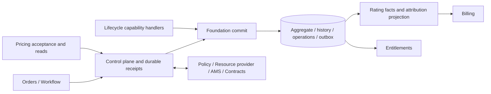

# Technical Design — Subscriptions

<!-- toc -->

- [1. Architecture Overview](#1-architecture-overview)
  - [1.1 Architectural Vision](#11-architectural-vision)
  - [1.2 Architecture Drivers](#12-architecture-drivers)
  - [1.3 Architecture Layers](#13-architecture-layers)
- [2. Principles & Constraints](#2-principles--constraints)
  - [2.1 Design Principles](#21-design-principles)
  - [2.2 Constraints](#22-constraints)
- [3. Technical Architecture](#3-technical-architecture)
  - [3.1 Domain Model](#31-domain-model)
  - [3.2 Component Model](#32-component-model)
  - [3.3 API Contracts](#33-api-contracts)
  - [3.4 Internal Dependencies](#34-internal-dependencies)
  - [3.5 External Dependencies](#35-external-dependencies)
  - [3.6 Interactions & Sequences](#36-interactions--sequences)
  - [3.7 Database schemas & tables](#37-database-schemas--tables)
  - [3.8 Deployment Topology](#38-deployment-topology)
- [4. Additional context](#4-additional-context)
  - [4.1 Capability gates and source precedence](#41-capability-gates-and-source-precedence)
- [5. Traceability](#5-traceability)

<!-- /toc -->

- [ ] `p1` - **ID**: `cpt-cf-bss-subscriptions-design-main`

**Current status — 2026-10-23:** the retained-scope product decisions and semantic design are consolidated for implementation. The [closure register](RECONCILIATION.md#61-remaining-work-and-closure-order) records the AP activation, FA financial admission, TP trial, RB financial handoff and RO renewal/offboarding contracts, their scenarios and delivery gates. External-owner ratification, versioned SDK/provider mappings, implementation and executed conformance evidence remain required; documentation alignment does not establish provider or runtime readiness. The scope exclusions below supersede earlier approvals of trial exceptions, linked replacement, transfer and other deferred operations. [DECISIONS](DECISIONS.md) retains that dated history; [RECONCILIATION](RECONCILIATION.md) records the frozen source baseline.
## 1. Architecture Overview

**Current semantic baseline — 2026-10-23:** the retained scope and contract/failure scenarios have completed the documented design pass. See the [closure register](RECONCILIATION.md#61-remaining-work-and-closure-order) for external ratification, implementation and release gates; this status does not assert delivered providers or runtime readiness.

### 1.1 Architectural Vision

Subscriptions is the system of record for commercial lifecycle, accepted commercial terms, effective-dated composition, commercial entitlement posture, tenant ownership, durable operation outcomes and resource attribution. Orders owns the purchase document; Workflow orchestrates its effects; Subscriptions determines whether a local subscription transition committed. A workflow receipt in progress is never evidence of active service.

Subscriptions owns commercial **WHEN** and the amount-less evidence from which qualifying obligations can be reproduced. Pricing owns agreed prices/rules. Rating owns tariff valuation, proration, minimum fees and its hourly processing schedule; S-Q03's one-time valuation direction was user-accepted on 2026-10-07. Billing owns invoice accounting/posting, application of existing prepayment, final invoice rounding and correction documents. Taxes and actual payments remain with their respective owners. Entitlements owns the application of commercial posture to quota, license and resource providers; those providers own point-of-use access, counters and actual resources. These boundaries prevent a subscription change from depending on a mutable catalog or on a consumer's current projection.

**Application boundary, 2026-10-23.** Entitlements owns the provider-independent application of commercial posture to quota, license and resource providers (the Entitlements design, next PR). Subscriptions publishes `CommercialPostureV1` from the same transaction as the lifecycle change and consumes `ReadinessObservationV1`; initial activation waits for readiness under IA-2026-10-18. No adapter, counter or provider schema lives in this design.

[DESIGN.md](./DESIGN.md) is the architecture authority; [features/](./features/) owns detailed procedures; [DECOMPOSITION.md](./DECOMPOSITION.md) allocates work.

**Migration scope — user decision, 2026-10-14:** migration from a predecessor deployed subscription/billing model is not required and is outside this design's delivery scope. No historical database conversion, old/new billing cutover, legacy occurrence remapping or migration execution plan is a completion or launch prerequisite. Import/adoption is also deferred by the subsequent user instruction; neither capability is allocated in the current version. Ordinary supported tenant/claim movement, API versioning and the documentation identifier cross-reference register remain distinct concerns; their names do not imply a legacy-system migration project. Earlier migration gates are superseded to this extent.

**Import deferred — user decision, 2026-10-14:** import/adoption of existing subscriptions is not part of the current version and is not a design-completion or launch prerequisite. Its retained IDs, historical examples and V15 identify future work only; no import endpoint, adoption workflow, legacy identity store or import fixture is allocated for current implementation. Ordinary new acquisition, tenant ownership/transfer and current-system correction/recovery retain their existing scope. This supersedes the earlier same-day statement retaining import while excluding migration.

**Current delivery scope — user decision, 2026-10-15.** Defer the audit subsystem (to be built later from events), separate customer acceptance confirmation (`confirmAcceptance`), Contracts-authored multi-step ramps, co-termination/date alignment, collection pause/resume, all customer notification scheduling/delivery, payer/resource-owner transfer, administrative historical correction/backdating, and per-sale brand/PlanTier metadata. These capabilities are not current implementation or release prerequisites. Their retained IDs, historical decisions and examples are future traceability only and do not enable commands through direct/operator wrappers. Migration is excluded and import remains deferred.

**Additional scope reduction — user decision, 2026-10-15.** Defer trial extension and repeat trials, standalone acquisition without Orders, scheduled composition changes and scheduled resume, linked predecessor/successor subscription replacement, and changes of an existing subscription's base plan. Reject these operations before effects, including through operator/direct wrappers; earlier procedures and decisions for them are future traceability only. New paid and trial subscriptions originate through Orders. Existing-subscription lifecycle operations, supported immediate quantity increases/component additions, future order starts, cancellation scheduling, renewal and normal trial timers remain. Technical retry/successor attempts for the same acquisition remain recovery, not linked replacement of an existing subscription.

Free-period and credit trials, normal expiry/conversion and early conversion to the already accepted paid target remain in scope with their Pricing/Billing/financial gates. Trial-to-paid conversion is not a general changePlan capability. Preserve trial history/eligibility evidence and refuse repeat requests for the same payer/plan, including via a new subscription; a transport retry is not a repeat trial. No extension or repeat becomes available from a Pricing policy alone. Independent cancellation and new purchase have separate resource/data lifecycles: there is no automatic resource adoption, data transfer, place handover or continuity promise. Cancellation retains its existing retention/disposition rules; it does not mean immediate deletion. Unsupported plan changes cannot silently become cancel+new.

Keep ordinary acquisition/lifecycle, current scope authorization, tenant axes fixed for the subscription, immutable accepted terms, current commercial facts/full replacement versions, reliable operations and domain events/outbox. Ordinary retries, late authoritative outcomes and downstream Rating/Billing corrections remain part of their existing protocols; they do not create an administrative past-edit API. A dedicated audit store/query/export/projection is not required: domain events carry relevant actor, reason and correlation provenance for a later audit consumer, while operation receipts and financial/source history remain necessary for correctness. A deferred capability cannot be reported as fulfilled. If accepted terms require deferred acceptance, notice or other unavailable behavior, the affected profile remains unavailable; removing notice implementation does not silently waive a contractual prerequisite or authorize destructive cleanup without it. Basic opt-out still uses ordinary end-of-term cancellation, independently of a notification feature.

**Financial boundary confirmed — 2026-10-15.** Consume the external financial owner's authoritative admission for the accepted operation/terms: allowed, pending or refused (semantic outcomes, not a new wire enum). Prepay requires the prescribed payment to be confirmed; postpay requires authorization to serve under accepted credit terms, not immediate payment/card presence. Unknown cannot authorize service. Subscriptions applies lifecycle policy to subsequent authoritative financial outcomes; collection, invoicing, credit limits and debt management stay with external owners. Existing pre-capture protection, operation correlation, stale-outcome/recovery and final commercial guards still apply. Exact evidence and adapter contracts remain delivery gates. Pricing trial terms and Billing promotional grants are separately delivered dependencies as recorded in the [PRD](PRD.md#11-purpose) and [trial proposal](TRIAL_PRICING_PROPOSAL.md); Products stores no trial policy.

**Initial readiness amendment accepted — 2026-10-18 (IA-2026-10-18).** Initial activation requires confirmed usable service before active and before its service-period/accrual start (SUB-D-55). Keep the subscription draft and track preparation in its durable activation operation; no new commercial enum is introduced. The adapter reconciles assigned rights and reports readiness by authorized scope, concrete assignment and desired revision, without needing a subscription ID. Subscriptions persists the association before dispatch; Entitlements persists the complete required-assignment/producer manifest (SUB-D-56). Subscriptions validates the exact current operation and all final guards, then commits active state, fresh local T/period start, applied receipt and outbox together. All initial access prerequisites precede that commit; capture may precede it under the existing protected purchase protocol. The [initial readiness contract](features/05-entitlements.md#initial-activation-readiness-contract) defines the semantic envelope, recovery and remaining integration gates. This supersedes only the earlier initial-access-may-follow-T rule; S-Q01 local clock/permit bounds, S-Q02 protection, renewals, guarded resume, trial conversion and active modifications keep their separate contracts. Provider mappings, freshness/revocation arbitration, preactivation exposure/financial treatment and runtime proof remain open.

**Application layer split accepted — 2026-10-23 (SUB-D-56).** The application of commercial posture to quota, license and resource providers is specified in the separate Entitlements design, delivered in the next PR. This design keeps the commercial posture, committed with each transition, and the consumer-side readiness gate of SUB-D-55. Adapter contracts, readiness manifests and rule semantics are specified there.

### 1.2 Architecture Drivers

#### Functional Drivers

| Requirement | Design response |
| --- | --- |
| `cpt-cf-bss-subscriptions-fr-status-enum`, `cpt-cf-bss-subscriptions-fr-transitions-guards` | One aggregate commit path, seven legal status edges, guarded terminality. |
| `cpt-cf-bss-subscriptions-fr-transition-request`, `cpt-cf-bss-subscriptions-fr-scheduled-intents` | Durable request identity, replayable receipt, creation business fence, asynchronous effect journal and cancel/settle serialization. |
| `cpt-cf-bss-subscriptions-fr-effective-dated-composition`, `cpt-cf-bss-subscriptions-fr-snapshot-discipline` | Append-only effective history, immutable accepted bindings and frozen BillingTerms. |
| `cpt-cf-bss-subscriptions-fr-plan-change-boundary`, `cpt-cf-bss-subscriptions-fr-proration-ownership` | One committed boundary and versioned replacement facts; no money computation. |
| `cpt-cf-bss-subscriptions-fr-renewal-evaluation`, `cpt-cf-bss-subscriptions-fr-grace-policy` | Term-sequence fence, evaluated terms, explicit pause/grace clocks and suppression. |
| `cpt-cf-bss-subscriptions-fr-commercial-posture` | Versioned posture committed with the transition and published; readiness consumed before initial active. |
| `cpt-cf-bss-subscriptions-fr-event-ordering`, `cpt-cf-bss-subscriptions-fr-recurring-idempotency` | Atomic state/receipt/outbox, independent occurrence and version identities, recoverable full-state reads. |
| `cpt-cf-bss-subscriptions-fr-tenant-axes`, `cpt-cf-bss-subscriptions-fr-delegation-proofs` | Effective-dated commercial axes, immutable ordering tenant, authorization on command and recovery reads. |

#### NFR Allocation

[PRD §7.1](./PRD.md#71-nfr-inclusions) is authoritative for the ratified v1 workload, thresholds and failure scopes. All seven requirements below use that same profile: 100K subscriptions in a large tenant, 1M across ten tenants, 100 mutation submissions/s and 1,000 authorized reads/s for one hour, then a twice-rate five-minute burst; provider/cardinality/hardware assumptions must be recorded. These are **ratified v1 acceptance targets (2026-10-08), not measured results**. S-U11 still requires an agreed availability SLI and implementation evidence before release.

| Requirement | Primary allocation and ratified target | Required verification |
| --- | --- | --- |
| `cpt-cf-bss-subscriptions-nfr-lifecycle-latency` | Foundation: durable acceptance p95 < 1 s, p99 < 2 s; local application measured separately to the same budget. | Contention, retries and mixed operations under the PRD profile; distinguish pending remote service from local success. |
| `cpt-cf-bss-subscriptions-nfr-recurring-cut` | Commercial facts: boundary-to-publication p95 < 5 s, p99 < 30 s; deliberately missed publication detected and repaired within 15 min. | Period-opening/change crash fixtures and bounded due-fact/seal reconciliation, separate from Rating's hourly scheduler. |
| `cpt-cf-bss-subscriptions-nfr-proration-accuracy` | Commercial facts: 100% exact source facts/intervals/terms in accepted goldens; zero duplicate economic occurrences. | Independent expected Rating values and Billing rounding/corrections; Subscriptions performs no money calculation. |
| `cpt-cf-bss-subscriptions-nfr-horizontal-partitioning` | Consumer contracts: tenant-isolated recovery at the profile scale, all 744 hourly slots in one logical per-parent scope request with bounded pages. | Skewed-key load, resource/proof sizes, cold projection rebuild and no per-hour/per-record N+1 dependency. |
| `cpt-cf-bss-subscriptions-nfr-operational-baselines` | Foundation: bounded read p95 < 200 ms/p99 < 500 ms; consumer event availability p95 < 30 s/p99 < 60 s with healthy broker; every stuck-work class visible. | Mixed load and injected operation, external-leg, outbox, attribution, group, scope and retention backlog; verify source checkpoints and auditable inspection. |
| `cpt-cf-bss-subscriptions-nfr-intent-seam-budget` | Foundation: 100 submissions/s sustained, 200/s burst and explicit outstanding-work/overload bounds. | Saturate admission, recover timeout by original receipt, and demonstrate no dropped acknowledged operation or ambiguous success. |
| `cpt-cf-bss-subscriptions-nfr-availability-recovery` | Consumer contracts: 99.9% monthly control/recovery availability; process restart/failover RPO 0 with durable storage intact; disaster RPO ≤ 15 min and RTO ≤ 60 min. | Ratified SLI, restart/failover/restore drills and source-to-fact reconciliation with measured loss/recovery; surviving receipts cannot be discarded under the disaster allowance. |

#### Key ADRs

| ADR | Applicability |
| --- | --- |
| `cpt-cf-bss-subscriptions-adr-manifest-closed-status-machine` | Retain the five statuses; trial and operation progress are separate dimensions; collection pause is deferred. |
| `cpt-cf-bss-subscriptions-adr-when-not-math-split` | Retain timing/math separation; S-Q03 selects Rating for one-time tariff valuation, with owner contracts/runtime evidence still open. |
| `cpt-cf-bss-subscriptions-adr-scheduled-intents-on-aggregate` | Retain durable aggregate intents; scheduled intent is not committed service evidence. |

### 1.3 Architecture Layers



- [ ] `p1` - **ID**: `cpt-cf-bss-subscriptions-tech-runtime`

| Layer | Responsibility | Platform binding |
| --- | --- | --- |
| API | Scoped SDK contracts, REST projection, typed failures and status reads | ToolKit SDK, authenticated OperationBuilder, RFC 9457 Problem |
| Application | Stage remote observations/effects and recover durable operations | ClientHub versioned providers, explicit SecurityContext |
| Domain | Status edges, composition, occurrence identity, guards and evaluated policies | Subscription aggregate and pure validation |
| Persistence | Local atomic commit and read recovery | SecureConn/AccessScope through ToolKit DB |
| Workers | Scheduled intents, renewal, retention, outbox and reconciliation | Lifecycle cancellation and fenced shard leases |

## 2. Principles & Constraints

### 2.1 Design Principles

#### Manifest-closed status machine

- [ ] `p1` - **ID**: `cpt-cf-bss-subscriptions-principle-manifest-closed-enum`

Statuses are exactly `draft`, `active`, `suspended`, `cancelled`, `archived`. `draft → active`, `draft → cancelled`, `active → suspended`, `suspended → active`, `active → cancelled`, `suspended → cancelled`, `cancelled → archived` are the only ordinary edges. Import is deferred and supplies no current creation path. A cancelled relationship cannot resume; a new commercial relationship has a new subscription ID.

#### WHEN, not math

- [ ] `p1` - **ID**: `cpt-cf-bss-subscriptions-principle-when-not-math`

The aggregate selects boundaries, terms and quantities, and stores immutable price references. It does not calculate charge amounts, day-count fractions, tax, FX, minimum-fee deltas or refunds. A zero-obligation replacement declares absence of obligation; it is not a calculated zero-price charge.

#### Idempotent, ordered transitions

- [ ] `p1` - **ID**: `cpt-cf-bss-subscriptions-principle-idempotent-ordered`

Authenticate before replay. A scoped operation key plus normalized payload digest yields one durable operation and eventual outcome; changed payload conflicts. Aggregate version checks apply after replay lookup. Creation also fences its authorized business origin: `(order_id, order_version, attempt_id, line_id)` for Orders; acquisition without Orders is deferred. A new transport key cannot create a second subscription for that origin; standalone create is refused before effects. Retrying execution retains `attempt_id`; a new business attempt is not replay and requires S-U01 agreement on predecessor settlement and successor correlation before enablement. State, receipt, revision, audit and outbox effects are committed atomically. Lifecycle sequence is monotonic within immutable `(orderingTenantId, subscriptionId)`; resource-attribution streams have their own tenant sequence.

#### Fail-closed gate

- [ ] `p1` - **ID**: `cpt-cf-bss-subscriptions-principle-fail-closed-gate`

Policy denial or unavailable authorization prevents a commercial transition. External checks and resource provider work execute outside database locks; their versioned results are staged, and local guards are rechecked inside the completing transaction. An external side effect followed by a failed local guard creates a durable compensation obligation. It cannot be hidden by returning a generic failure. Policy for unavoidable customer cancellation during Policy outage remains an external product/legal decision; this design does not silently bypass authorization.

#### Effective-dated, reproducible composition

- [ ] `p1` - **ID**: `cpt-cf-bss-subscriptions-principle-effective-dated-composition`

Every served interval has frozen accepted terms and committed quantity provenance. History is half-open UTC and append-only; later corrections supersede a version without erasing the previous evidence. A mutable preview, future intent or receipt from an unapplied operation is not evidence that service was supplied.

### 2.2 Constraints

#### Not an authoring System of Record

- [ ] `p1` - **ID**: `cpt-cf-bss-subscriptions-constraint-not-authoring-sor`

Pricing owns PriceBook entries, money models, policy descriptors and accepted bindings; Products owns SKU identity and published descriptors. Subscriptions stores their immutable evidence and owns BillingTerms agreed for the subscription. Legacy `CatalogVersion`, cohort and Pricing phase models are superseded by SUB-D-29. The old PlanTier requirement is a descriptor/as-of derivation need, not permission to invent a PriceBook field.

#### UTC time

- [ ] `p1` - **ID**: `cpt-cf-bss-subscriptions-constraint-utc-time`

Effective intervals, service boundaries and scheduler instants are UTC. Calendar term arithmetic uses the accepted term rule; it is distinct from Rating's fixed hourly processing windows. Within a period, accepted anchor geometry does not change; an anchor change applies from the next period.

#### Tenant isolation; delegation-proofed cross-tenant

- [ ] `p1` - **ID**: `cpt-cf-bss-subscriptions-constraint-tenant-isolation`

AMS supplies `resourceTenantId`, `payerTenantId`, `sellerTenantId` and account hierarchy. Cross-tenant changes require an auditable delegation proof checked at request and commit. Authorization on historical reads uses current caller authority; retaining old evidence does not grant its former owner continuing access. The ordering tenant is pinned to the initial resource tenant and never changes during transfer.

#### Posted-document immutability

- [ ] `p1` - **ID**: `cpt-cf-bss-subscriptions-constraint-posted-immutability`

Financial documents and subscription history are separate datasets. New fact versions can cause Rating recalculation and Billing corrections; they never edit a posted invoice. Financial evidence retention and legal holds govern eventual purge independently of operational-resource deletion.

## 3. Technical Architecture

### 3.1 Domain Model

- [ ] `p1` - **ID**: `cpt-cf-bss-subscriptions-entity-subscription-model`

These are logical entities and invariants; transport DTOs belong to the SDK implementation.

| Entity | Owned state and identity |
| --- | --- |
| Subscription | ID, closed status, monotonic commercial revision, pinned ordering tenant, effective-dated tenant axes, contract/order references, term window and term sequence, commercial postures. |
| CompositionRevision | Base/optional items keyed by stable line and item identity; half-open PlanLink/AddOn and quantity intervals with complete effective purchase-lot allocations; effective boundary, accepted target and predecessor lineage. |
| PurchaseLot | Stable identity within its component, authorized purchase-business origin, accepted-term provenance and effective-dated quantity history. Transport retries and renewed price versions do not create another purchase lot. |
| AcceptedTerms | Acceptance/hold references and digests, complete AcceptedBinding set, BillingTerms, currency/market and immutable UsageRatingPolicy descriptors; descriptors and money references retained without re-resolving historical facts. |
| TransitionRequest / operation | Request ID, scoped idempotency key/digest, business intent and execution-attempt identity, expected revision, status, outcome, order correlation, observed dependency versions and side-effect/compensation journal. |
| Activation assignment association | Operation-owned association of the activation operation to its required scoped assignments and desired revision, plus the observations received for them. The manifest, producer authorities and cleanup journal are persisted by Entitlements. It is not a new license entity or commercial status. |
| ScheduledIntent | Due boundary, desired operation, authoring revision, source approval, suppressions, retry deadline and parked/failure disposition; not committed service evidence. |
| TrialAdmission | Payer/plan eligibility key within authorized scope, acquisition origin, reservation/consumed state, association version and retained served-episode history; shared across subscription IDs, with no ordinary TTL release of uncertain acquisition. |
| RenewalEvaluation | Frozen term/grace values and provenance, current term sequence, payment evidence, outcome and any blocked obligation identities. |
| NonpaymentDwell | Suspension episode, evaluated cancellation deadline, dispute holds and void/resolution evidence. |
| CommercialPosture | Desired commercial capabilities, quantity, validity and restriction interval, holder and tenant axes, source aggregate revision and digest; readiness and materialization observations reported by Entitlements. No counters, seats or provider identities. |
| OwnershipInterval | Effective resource/payer/seller axes; approval and delegation evidence; predecessor and successor financial responsibility. |
| ResourceAttributionSegment | Resource/usage-type identity, subscription/line/item and tenant axes, effective interval, replacement version and tenant stream sequence. |
| BillableFact / BillingGroup | Stable economic occurrence plus immutable fact versions; payer-specific group/window, frozen known slices, explicit unresolved intervals with reason/evidence and collection posture. Commercial completeness is separate from priceability. |
| BillableSetSeal | Versioned group membership, predecessor, exact fact ID/version/digest references, set digest and publication instant. |
| RetentionDisposition | Service-stop boundary, retained-resource inventory, export/deletion deadlines, legal holds, confirmed delete outcomes and independent archive/evidence timers. |

Every event carries schema version, aggregate/lifecycle sequence, effective and recorded instants, correlation, tenant context and source revision. Full-state commercial facts and attribution replacement segments remain readable without the event broker.

### 3.2 Component Model

#### Lifecycle Foundation

- [ ] `p1` - **ID**: `cpt-cf-bss-subscriptions-component-lifecycle-foundation`

Owns one commercial commit path, status guards, operation receipts, optimistic revision control, occupancy serialization and outbox. Other handlers propose a change; none bypass this commit path. Remote effect coordination has a durable journal and in-flight fence. See [foundation](./features/01-foundation.md).

#### Composition & Versioning handler

- [ ] `p1` - **ID**: `cpt-cf-bss-subscriptions-component-composition-versioning`

Owns as-of composition and accepted-term evidence, logical component identity, quantities and future proposals. Historical accepted terms are never replaced by live Pricing reads. See [composition](./features/02-composition.md).

#### Plan & Quantity Changes handler

- [ ] `p1` - **ID**: `cpt-cf-bss-subscriptions-component-plan-changes`

Validates one resulting composition, derives commercial boundary policy and stages all changed items in one transaction. Base-plan changes, linked replacement, future composition scheduling and ramps are deferred. It computes no money. See [changes](./features/03-changes.md).

#### Suspension, Renewal & Grace handler

- [ ] `p1` - **ID**: `cpt-cf-bss-subscriptions-component-suspension-renewal-grace`

Owns commercial period/term progression, evaluated grace/dwell and retention disposition. Collection pause, co-term alignment and customer notifications are deferred. It is not Rating's hourly scheduler or Payments' dunning executor. See [renewal and retention](./features/04-renewal-retention.md).

#### Commercial posture handler

- [ ] `p1` - **ID**: `cpt-cf-bss-subscriptions-component-entitlements`

Derives posture from accepted terms and committed quantity, commits it with the lifecycle change, publishes it to Entitlements and records the readiness and materialization observations it reports. See [commercial posture](./features/05-entitlements.md).

#### Trial Runtime & Conversion handler

- [ ] `p1` - **ID**: `cpt-cf-bss-subscriptions-component-trials`

Executes an optional trial block on accepted Pricing PlanRevision, with either explicit zero-price free period or monetary credit over unchanged ordinary rates; no separate TrialOffer catalog is required. Pricing owns policy/duration/applicability/paid-target terms, Subs accepted evidence and actual episode dates, Products SKU identity/structure, and Entitlements access materialization. Billing owns customer trial-grant issuance/history/balance/allocation/correction under S-U15; exact provider and Ledger financial integration remain open. [The contract proposal](TRIAL_PRICING_PROPOSAL.md) separates reusable revision policy from receipt/episode/grant; exact schema and runtime remain gated. Accepted S-Q06 evaluates the agreed settlement scheme: prepay needs prescribed payment; postpay needs accepted terms and authorization to serve on credit, without immediate payment/card. Authorized postpay starts paid accrual; no applicable authorized route means normal expiry/revocation with existing data retention and no expiry-created debt/setup charge. Failed prepay defaults to recorded failure/retry and normal expiry without paid start; trial extension is deferred. Later paid routing, detailed postpay due/dunning and trial authoring/eligibility/Pricing/settlement/Entitlements/runtime contracts remain open. See [trials](./features/06-trials.md).

#### Multi-Tenant Ownership & Transfer handler

- [ ] `p1` - **ID**: `cpt-cf-bss-subscriptions-component-tenancy-transfer`

Preserves authorized tenant axes, delegation and the ordering partition. Ownership/payer transfer and import are deferred; no tenant-rebinding workflow is part of this component. See [tenancy and import](./features/07-tenancy-import.md).

#### Event Model & Billing Alignment handler

- [ ] `p1` - **ID**: `cpt-cf-bss-subscriptions-component-events-billing`

Builds money-free versioned facts and complete commercial sets from committed state; maintains correction lineage and economic occurrence identity. See [commercial facts](./features/08-commercial-facts.md).

#### Consumer & Integration Contracts handler

- [ ] `p1` - **ID**: `cpt-cf-bss-subscriptions-component-consumer-contracts`

Exposes scoped operation recovery, composition, attribution, facts and group/seal reads; delivers versioned outbox events and detects projection gaps. See [consumer contracts](./features/09-consumer-contracts.md).

### 3.3 API Contracts

**RB-2026-10-15 retained-profile amendment.** [RB-2026-10-15](proposals/rating-billing-contract.md#subscriptions-rating-and-billing-replacement-contract) specifies the Subscriptions → Rating → Billing target: money-free full fact versions and commercial seals; Rating valuation of recurring, usage and separately agreed one-time occurrences; immutable full rated replacements and complete usage-child manifests; Billing draft replacement/posted corrections with invoice-version fencing, advance/benefit allocation and recovery. Legacy delta-only/one-time-bypass wording does not govern this profile. Commercial membership, usage/rating coverage and financial completion are independent proofs. Missing evidence is pending, not zero. No current-catalog repricing, extra collection or migration/import capability is implied. Exact SDK/provider mapping and RB-C01-RB-C16 runtime proof remain open; Rating/Billing delivery is not established by specifications.

**TP-2026-10-15:** The [reciprocal trial contract](TRIAL_PRICING_PROPOSAL.md#10-reciprocal-trial-delivery-contract) refines the optional PlanRevision variants, accepted evidence, shared grant startup/correction and paid-target conversion. The component proposals record required Pricing, Orders, Rating and Ledger changes; adoption in their own documents, Billing provider delivery and exact transport/accounting mappings remain open. Current V1 does not implement the trial extension.

#### 3.3.1 Control plane and operation recovery

The control plane implements `cpt-cf-bss-subscriptions-interface-control-plane` and `cpt-cf-bss-subscriptions-contract-orders-intents`. Operations comprise Orders-origin create, activate, suspend/resume, cancel/archive, changeComposition and compatible single-item wrappers, renew, trial conversion, supported cancellation-intent withdrawal. Standalone create, changePlan, extendTrial, repeat trial, scheduled composition/resume, linked replacement, transfer, collection pause/resume, confirmAcceptance and import are deferred and are not current control-plane operations. SDK command types require manifest alignment before delivery.

Each mutation returns a durable request reference and either an applied outcome or explicit pending/failed status. GET/status recovery identifies a business intent and its authorized Orders origin without repeating a mutation; order version/line and execution wave/attempt apply to the Orders path. Same key and identical content replays; same key and changed content conflicts. A different transport key with an existing business identity returns the retained outcome or an explicit business conflict, never a new effect. Withdrawal is a competing serialized operation, not deletion of the operation row. Create-vs-settle shares exactly the `(order_id, order_version, attempt_id, line_id)` fence; a terminal no-create tombstone rejects a delayed create. Cross-attempt replacement is gated by S-U01, including settlement of an already compensated/cancelled predecessor.

Failures distinguish authorization, missing resource, revision/idempotency/business conflict, policy denial, closed capability, dependency unconfigured/unavailable, pending external effect and terminal refusal. A timeout is an unknown outcome until a durable receipt or settle result resolves it. All adapters use canonical SDK errors and RFC 9457 HTTP mapping; no consumer infers success from an HTTP acceptance alone.

**Financial admission semantic contract — design elaboration, 2026-10-15.** This is the minimum consumer contract of the selected external financial owner, not a new Payments API or a claim of a delivered provider. Activation, renewal and paid conversion evaluate it independently for their actual obligation. It does not replace Pricing authority, resource readiness, occupancy or cancellation guards.

| Contract part | Required semantics |
| --- | --- |
| Request scope | Authorized seller/payer context; stable acquisition or operation identity; exclusive attempt association where applicable; subscription/episode or renewal occurrence; accepted terms/version and settlement arrangement; intended charge/coverage scope and requested action. A trial grant is not payment or postpay authority. |
| Allowed evidence | Trusted owner reference, decision identity/version, exact scope and accepted-term binding, and a validity/consumption rule covering the actual local application. Under prepay, reference authoritative satisfaction of the prescribed payment; under postpay, reference authorization to serve under accepted credit terms. Presence of a card, balance or submitted capture is insufficient. |
| Pending / unknown | Preserve the operation and financial references; recover by the original identity. Missing/late responses do not become refusal, success, zero debt or permission. No duplicate capture or protected-claim release. Normal expiry and previously confirmed cutoffs are not extended by uncertainty. |
| Refused | Record the authoritative reason/version. Activation has no service start; trial conversion follows normal expiry; renewal follows its accepted grace policy. Existing incurred obligations and financial remedies survive. No automatic switch from prepay to postpay. |
| Application boundary | Stage remote evidence outside the local transaction. At commit recheck local revision, exact terms/attempt/occurrence, cancellation fence and validity; atomically retain evidence with applied state, facts, receipt and outbox. The owner contract must provide commit-valid bounded authority or an equivalent consumption/fencing protocol. A revocable detached snapshot or merely fresh read is insufficient; unsupported mappings keep the profile disabled. |
| Replay and changed terms | Same business operation and payload recovers its original outcome without another debit/term/conversion. Changed accepted terms or a new commercial operation require their own admission; reuse of earlier funds needs explicit financial applicability, not an inferred balance or price difference. Unknown original application is resolved first. |
| Later outcomes | A versioned due/unpaid, resolved or disputed outcome binds the original payer/obligation/term and effective time, distinct from arrival time. Deduplicate/order it before applying the accepted grace/dwell/restriction policy. A late old refusal cannot undo a committed transition, erase historical facts or override newer resolution; resume still requires current guards. Due calculation, collection and financial corrections remain external. |
| Recovery and enablement | Owner read/recovery distinguishes absent, pending, applied and conflicting evidence within authorized scope. Exact SDK names, owner-specific payment/credit mapping and conformance execution are S-U07 ratification/delivery work. No network call or cross-gear database access occurs inside a Subscriptions transaction. |

##### 3.3.1.1 Financial admission integration contract

**FA-2026-10-15 — S-U07 target semantic contract.** This refines the accepted external admission boundary. It neither introduces a financial service into Subscriptions nor claims an available Billing/Payments API. The repository has no canonical Billing or Payments provider specification/implementation for this role: [Orders' Payments dependency](../../orders-lifecycle/docs/UPSTREAM_REQS.md#25-payments) is a proposed authorization request. The implemented [LedgerClientV1](../../ledger/ledger-sdk/src/api.rs) records settlement/allocation, balances, returns and disputes; it does not authorize subscription service, execute a PSP capture or underwrite postpay. Ledger settlement records received money, not a request to collect it.

**Owner boundary and required evidence**

| Item | Required contract |
| --- | --- |
| Admission owner | A deployment-selected external financial authority composes the applicable Billing obligation and Payments/credit evidence. Its adapter declares supported prepay/postpay profiles. It is not platform Policy admission, an Orders risk flag, Rating valuation or a Ledger balance read. Missing/unconfigured support blocks the affected paid operation. No assumption of a native financial provider is required. |
| Request identity | Stable business operation and requested action; authorized seller/payer/resource context; acquisition/order/version/line and exclusive attempt association for acquisition, or subscription plus exact renewal/paid-conversion occurrence; accepted terms digest/version and settlement scheme; intended financial coverage scope. Same business/payload recovers even with another transport key; different payload conflicts. |
| Allowed decision | Owner, decision ID/version, request digest, exact coverage/obligation and accepted-term binding, designated Subscriptions consumer/association, validity interval or equivalent consumption fence, and recoverable disposition. Prepay additionally identifies prescribed-payment satisfaction; postpay identifies authorization to serve under those credit terms. Full scope is authoritative; a bare `paid=true`, account balance, card, PSP authorization or HTTP 202 is insufficient. |
| Financial scope | Billing/selected financial owner defines the prescribed amount, currency, funding applicability and covered obligations/lines. Orders display totals/TCV and Rating previews are not debit instructions. Subscriptions verifies references/scope without summing money. Partial funding permits only the explicitly covered scope; an order-wide permission must enumerate all covered lines. Advance reuse must not allocate the same limited funds or credit capacity twice. |
| Process versus service | Orders' begin-fulfillment authorization permits workflow progress only. It may precede the final decision and may go stale during a future-date wait. At actual paid application Subscriptions requires FA evidence independently. Tolerate-failure cannot satisfy prepay, authorize postpay, override Pricing/occupancy or bypass pre-capture protections. No implicit settlement-scheme switch. |
| Financial execution | Payments owns actual collection, request deduplication and authoritative capture outcomes. For Orders-origin protected capture, Lifecycle owns the capture-start/cancel decision and Workflow delivers its outbox under [AP05/AP07](ACTIVATION_PROPOSAL.md#13-orders-and-pricing-reciprocal-activation-contract). Billing owns obligations, due dates, allocations and remedies. Ledger records accounting effects. Admission itself is not an extra collection instruction. |

**Application and concurrency protocol**

Prepare/recover financial evidence outside the Subscriptions transaction using the same business identity. For prepay, an already satisfied obligation is recovered without another debit; for postpay, the owner must authorize the intended service/coverage without requiring a card or acquisition-time capture. The owner serializes concurrent claims on finite funding or credit according to its policy; two unrelated operations cannot each spend the same exclusive coverage. Subscriptions never constructs a local credit-limit calculation.

An allowed decision must remain usable through its declared bounded application interval unless the consumer has acknowledged a durable withdrawal fence. Issuance and withdrawal are serialized by the owner. An owner flag change or a detached fresh read cannot revoke a usable decision between validation and commit. The deployment must prove clock/validity bounds or an equivalent exclusive consumption protocol. The financial decision and Pricing permit are independent; actual T must satisfy both plus current local authorization, lifecycle, terms, cancellation, resource and occupancy guards. No numeric TTL or clock margin is selected here.

At the local serialized commit, Subscriptions either applies once and stores the financial decision/scope reference with state, facts, operation receipt and outbox, or records a terminal unapplied fence. A transient local conflict may retry the same still-valid operation; it cannot mint a second permission or collection. Owner notification of consumption is delivered/recovered after commit. A lost acknowledgement retains the owner's pending reservation/association until the durable local result is recovered. No remote call or cross-gear table access occurs in the commit.

Withdrawal races that same local operation fence. If withdrawal wins, late application is rejected and the durable unapplied acknowledgement allows the owner to release/reassign unused authority under its financial rules. If application wins, withdrawal recovers the applied receipt and any cancellation/nonpayment remedy follows ordinary lifecycle rules; it cannot erase service or debt history. Timeout, unknown read, expired token or missing acknowledgement alone is not proof of non-application. Do not recycle coverage or release a protected acquisition before this outcome and AP07 settlement are known. An involuntary later chargeback/return is a new financial outcome, not a retroactive rewrite of a valid applied transition.

**Operation outcomes**

| Operation | Allowed | Pending / unknown / refused |
| --- | --- | --- |
| Initial paid activation | Apply at actual T once all guards pass; funds/credit authorization alone creates no service start or setup occurrence | No activation. Recover the original financial/application identity; preserve protected paid/uncertain rights. Definitive refusal uses the existing Orders remediation/cancellation path, with financial remedy separate from operational completion. |
| Renewal | Advance the exact term occurrence once under its accepted renewal and financial terms | Do not manufacture a paid renewal from uncertainty. Evaluate the existing accepted grace and bill/waive posture; neither grace, cutoff nor cancellation deadlines are extended by a delayed response. Preserve already incurred obligations. |
| Early or scheduled trial-to-paid conversion | Prepay: prescribed payment satisfied. Postpay: accepted credit-service authority. Apply one paid boundary at actual T; Billing later owns due/unpaid outcomes | No unauthorized paid period or expiry-created debt/setup fee. Trial ends under its original terms; uncertainty alone grants no free extension. Late payment does not reopen an expired episode or backdate service: recover an applied winner, otherwise use financial remedy or a separately authorized supported paid acquisition. |
| Financially restricted resume | If the accepted resume policy requires financial clearance, obtain current exact-scope authority and pass normal local guards; convert the same retained occupancy right | A generic paid/resolved event cannot resume automatically. Preserve retained occupancy and existing lifecycle/data policy; do not allocate a second place. |

Free-period and credit-trial admission/grant rules remain in the trial contract; a trial bonus is neither prescribed prepayment nor postpay authorization. This package adds no trial offer, credit-scoring algorithm, dunning engine, notification scheduler or general Change Orders behavior.

**Later financial outcomes and recovery**

Later outcomes identify the original obligation/coverage, payer and subscription/term, owner event ID and monotonic outcome version (or an equivalent recoverable ordering cursor), effective time and recorded time, reason and authoritative recovery reference. Financial states such as not-yet-due, due/unpaid, resolved or disputed do not map blindly to subscription states. Subscriptions applies its accepted grace/restriction policy only after verifying scope and ordering. Duplicate outcomes have no effect; stale outcomes cannot override a newer resolution; a gap or ambiguous ordering requires an authoritative owner read and leaves the last proven posture in force subject to existing cutoffs. Arrival time never substitutes for the agreed due/effective time.

Replay recovers applied receipt before re-evaluating current permission, including after permit expiry or a subsequent refusal. Later valid due/unpaid outcomes may drive a new restriction operation; they cannot undo the original paid boundary. A resolved outcome does not revive a terminal subscription or closed trial. Retained receipts and authoritative read/recovery must cover the supported delayed-message/retry lifetime; exact retention/transport versions are provider delivery prerequisites, not a guessed TTL.

**Required conformance scenarios — specified, not executed**

| Case | Intervention | Expected result |
| --- | --- | --- |
| FA-C01 | Prepay has a card/PSP authorization but capture is pending or partial | No paid application without authoritative satisfaction for its full required scope; recover the same capture identity. |
| FA-C02 | Postpay is authorized without a card or acquisition-time payment | Paid service may start after all other guards; ordinary obligations accrue from applied service and become delinquent only when due/unpaid. |
| FA-C03 | Orders tolerates a failed process authorization | Workflow progress grants no service permission; final prepay/postpay admission and AP protections remain mandatory. |
| FA-C04 | Old decision arrives after amendment, cancellation or successor association | Scope/fence mismatch prevents application; preserve and reconcile original financial obligations. |
| FA-C05 | Financial permission expires while Pricing remains valid, or vice versa | No new application outside the overlap of valid authorities; recover an already applied winner before requesting anything new. |
| FA-C06 | Owner withdraws while the consumer applies; consumption reply is lost | Exactly one local winner, recoverable applied/unapplied receipt; no recycled coverage, duplicate service or debit. |
| FA-C07 | Two lines/operations compete for one advance or finite credit authorization | Owner enforces funding/coverage exclusivity; read balance alone cannot allow both. Full funded line roster is retained. |
| FA-C08 | Trial expires while payment is unknown; success arrives later | No extra trial access, backdated paid period or closed-episode revival; recover prior application or remedy/authorized later acquisition. |
| FA-C09 | Renewal decision is delayed/refused, then replayed | One renewal occurrence at most, accepted grace/cutoff posture preserved, no waiting-gap debt invented by the callback. |
| FA-C10 | Due/unpaid v2 arrives after resolved v3, or a sequence gap is discovered | Stale outcome ignored; gaps recovered from owner; no erroneous suspension or terminal resurrection. |
| FA-C11 | Payment returned/disputed after valid activation | Preserve service history and handle new financial outcome under existing policy; no second capture or silent historical rewrite. |
| FA-C12 | Provider outage/restart or foreign-scope decision | No permission from absence, transport acceptance or unauthorized evidence; durable identity/read recovery and local authorization remain required. |

**Delivery boundary.** Consumer requirements, proposed Orders changes and Ledger's accounting boundary are documented within Subscriptions and its component proposals. Adjacent-owner documents remain unchanged in this PR. A Billing/Payments/credit provider must still publish its versioned implementation of this contract, including commit-valid authority, coverage concurrency, capture/release recovery and ordered outcomes, and pass FA-C01-FA-C12. No absent provider document or API is deemed approved. S-U07 remains a capability gate; operational invoice/credit/debt design is outside Subscriptions.

#### 3.3.2 Pricing acceptance and accepted time

Current Pricing D-510 provides seven methods: `PricingReadV1::{resolve, price, current_revision}`, `PricingAcceptanceV1::{acceptance, hold}`, `SellabilityV1::{check, check_fulfilment}`. Provider implementation is current; Subscriptions' adapter and joint integration fixture are target work. Preview `resolve` is not admission; `SellabilityV1::check` creates durable acceptance, `PricingAcceptanceV1::hold` fixes original bindings and activation instant, and `check_fulfilment` observes fresh eligibility. Replaying a receipt/hold does not renew its deadline or authorize new work.

Accepted activation satisfies `start_at <= activation_at < hold_until`, and first admission also requires server time before `hold_until`. A first hold freezes `activation_at`; another key cannot alter it. Full acceptance identity/axes, market, digest and all binding descriptors are checked; fresh eligibility does not traverse successor prices or reprice accepted money. Renewal resolves with retained pins, slicing at each binding's own `ends_on`, never its informational `effective_to`.

**Mid-term continuation accepted, 2026-10-16.** A successor selected by Pricing at `ends_on` can be adopted automatically only under explicitly accepted continuation policy with its notice/assent prerequisites satisfied (SUB-D-41). Price closure alone is not commercial authorization. Subscriptions freezes the adopted timeline and atomically publishes full affected fact versions and the exact successor seal; Rating consumes those terms. Missing authority, notice/assent or pricing coverage keeps the affected full valuation pending, never a complete prefix or an implicit service/debt decision. The [Rating profile](proposals/rating-proposal.md#binding-authority-and-calculation-evidence) specifies the proposed detection/reconciliation exchange and the still-open Pricing freshness guarantee.

**S-Q01 direction accepted by the user, 2026-10-07; implementation contract open.** Workflow supplies the scheduling lower bound, Pricing supplies bounded activation authority on original terms, and Subscriptions records commercial T in its successful applied transaction after required readiness. Current Orders and exact-time Pricing V1 contracts still require alignment with this selected direction. No call sequence can claim exact commit equality with a previously held timestamp without a protocol change. [ACTIVATION_PROPOSAL.md](./ACTIVATION_PROPOSAL.md) compares the alternatives and proposes a versioned bounded authorization consumed by the Subscriptions transaction. The direction is accepted; the detailed versioned provider contract remains proposed and is not an interpretation of V1 `hold` or `check_fulfilment`. Order-path activation is capability-gated until this is resolved. Contract booking, actual service start and later customer acceptance stay distinct instants; none silently backdates actual service.

**Confirmed-order commitment accepted, 2026-10-07:** before actual Billing/Payments capture, order confirmation must obtain both a durable occupancy reservation and Pricing/Products commercial commitment covering the original accepted future start and fulfillment conditions. Payment authorization is distinct from capture; tolerating authorization failure cannot waive this pre-debit guard. Current V1 holds and fresh sellability observations do not provide that future commitment. This requires versioned owner contracts, distinct from the final bounded S-Q01 activation permit. An expired V1 hold or final permit is never extended or silently replaced by repriced terms; paid commitments remain held for agreed remediation or explicit cancellation. Until occupancy, future commercial commitment and capture fencing are demonstrated together, the prepayment profile refuses before capture.

**Capture arbitration accepted, 2026-10-14:** Orders Lifecycle is the Orders-origin decision owner for capture start versus cancellation, with one local acquisition/version guard and atomic decision/outbox persistence. Workflow transports/reconciles; Payments owns durable execution deduplication and outcome recovery under the same capture identity. Cancellation first prevents debit; capture start first permits cancellation with pending financial recovery/remedy. Neither a lost response nor a retry frees protected claims or creates another collection. Claim/term protections remain valid through uncertainty, and release additionally requires capture/activation fences and applicable recorded remedy. The [activation companion](ACTIVATION_PROPOSAL.md#7-boundary-failures-and-recovery) defines the accepted sequence, direct-path boundary and required failure fixtures. These semantics do not establish shipped Payments capability, external-owner ratification or a universal posted-refund release gate.

#### 3.3.3 Commercial facts and seals

Target `BillableFactPublished` contains `fact_id`, `fact_version`, `payload_digest`, immutable BillingGroup, resource tenant, line/item identity, kind `recurring|usage|one_time`, timing, period/occurrence identity, served extent, frozen term slices, quantity/suspension timeline and collection posture. A BillingGroup fixes subscription, seller, payer, currency and billing window. Every served instant has exactly one temporal term slice, with explicit exclusions. Usage parents publish at commercial-period opening so Rating can schedule hourly work without a Subscriptions hourly tick.

**Recurring flat and minimum fee accepted, 2026-10-16.** Flat applies once per component obligation and covered time under identical applicable terms, not per seat or purchase lot; distinct lot provenance remains (SUB-D-46). Different concurrent flat tariffs remain unsupported; authorized sequential changes use separate slices. Recurring proration and supported period floors use exact covered UTC seconds over billing-period UTC seconds. Rating sums eligible base charges once per price/subscription/period/currency/scale and computes one top-up against the minimum prorated by union coverage. Different price IDs have separate floors. Subscriptions carries immutable terms and interval evidence, not derived money. Cross-fact scope remains an open aggregation contract; no independent per-fact floor or new admission ban is accepted. See [valuation](proposals/rating-proposal.md#valuation-and-completeness); owner adoption and runtime proof remain open.

**Per-resource minimum required, 2026-10-16.** The Jelastic use case requires a separate minimum per resource. Retain the accepted pooled price/subscription/period profile for its own terms; it is not the only target scope. Clarified on 2026-10-17: the scope selects eligible consumption (for example storage or traffic) and an individual container or a node group pooling container storage. The user selected individual/group scope as alternative tariff settings on 2026-10-17; the same eligible usage does not receive both minima. Cross-price eligibility and historical membership contracts remain open. The user selected a monetary minimum on 2026-10-17: rate eligible usage, then add any shortfall to the selected target's floor. The tariff selects an hourly or billing-period minimum, accepted on 2026-10-17. Accepted 2026-10-18: a partial eligible hour retains the full hourly monetary minimum once per selected target/window, without time proration or multiplication by group members. The user also selected calendar-hour windows: 10:50–11:10 covers two hourly minima, each compared with its own eligible base; excess in one hour does not offset the other. Accepted 2026-10-18: partial billing-period minimum treatment is an explicit tariff setting, full minimum or proportional to eligible time, preserved in accepted terms. The full minimum for partial calendar hours is unchanged. Exact resource/group identities, timezone/SDK mapping and eligible-duration evidence remain open. Current Pricing rejects resource/hourly minimum fees, so [PC-P07](proposals/pricing-proposal.md#required-changes) and the [Rating valuation contract](proposals/rating-proposal.md#valuation-and-completeness) require a coordinated provider extension. Preserve resource identity and authoritative inventory/ownership/usage evidence through minimum calculation and correction, independently of invoice-line grouping. No existing terms are silently reinterpreted (SUB-D-47, SUB-D-48, SUB-D-49, SUB-D-50, SUB-D-51, SUB-D-52, SUB-D-53, SUB-D-54).

**Empty versus zero-valued Rating results accepted, 2026-10-16.** A complete empty replacement removes this fact's prior monetary contributions under the exact seal and normal Billing guards, retaining history and other facts (SUB-D-45). Active zero valuation retains zero-valued lines, classification, accepted terms and calculation evidence. Missing terms/data produces structured pending without complete monetary delivery. A zero total cannot erase lines; zero usage still needs coverage and full tariff evaluation, including applicable minimum fees. Billing owns display and financial correction; empty/zero is not refund completion. See the [canonical result contract](proposals/rating-proposal.md#canonical-result-and-billing-handoff).

**Rating pending reasons accepted, 2026-10-16.** SDK-readable work status binds its state and structured blocker list to an exact fact reference and distinguishes the accepted head (SUB-D-44). Waiting on conditions/data requires a nonempty list of stable codes, affected scopes/dependencies, responsible sources, recoverable evidence and resolution routes. Rating references source `Unresolved` evidence and durably owns its own coverage/recovery findings. A prior complete result retains its own source reference and cannot indicate completion of the current fact. See the [status contract](proposals/rating-proposal.md#errors-and-capability-negotiation); exact SDK mapping remains open.

**One-time calculation basis accepted, 2026-10-16.** Qualifying one-time facts retain applied action evidence, frozen accepted terms and `Once` (flat) or `Units { quantity, unit }` (per-unit) (SUB-D-43). Units uses positive exact action-specific quantity and agreed unit; Rating rejects model/unit mismatch or missing quantity without consulting current component quantity or defaulting to one. Once is not seat-multiplied. Later increases do not change the original charge; original-action corrections preserve occurrence identity and advance the full fact/exact seal. Additional charges require distinct agreed actions. Exact SDK encoding remains open.

**Explicit unresolved successor accepted, 2026-10-16.** A known unresolved continuation of an established obligation is published in a new full fact as an explicit `Unresolved` interval, with its exact successor seal, atomically (SUB-D-42). Preserve known intervals and affected lot/quantity/purchase provenance; do not invent missing terms or classify the interval as free. Rating advances the authoritative fact head but leaves the full result pending. Billing cannot satisfy the new seal with an old result; already posted effects require normal correction/recovery, not automatic reversal. Resolution creates a further fact/seal version. New admission and financial prerequisites remain mandatory. [Feature 08 §3.3](./features/08-commercial-facts.md#33-derive-stable-facts-and-complete-accepted-term-slices) defines publication and acceptance cases.

**Lot-aware fact contract accepted, 2026-10-14 (S-U08).** For a quantity-bearing component, each temporal slice contains the complete allocation of effective purchase lots. Each allocation names the stable lot ID, quantity, immutable accepted-term reference and purchase provenance; quantities sum to the component's committed service quantity for that interval. Several lots coexist inside one slice; they are not overlapping temporal slices or independently added parent obligations. All referenced accepted bindings/descriptors remain recoverable at the exact historical version. Subscriptions publishes no calculated amount or live-price fallback. The one-lot case uses the same shape.

For a same-component increase within an unchanged charge kind, payer/group and billing period, retain the fact ID and publish a higher full replacement version. At actual application T, the replacement preserves the pre-T allocation and includes the old plus new lots from T onward; a scheduled proposal is not supplied service. New component obligations retain their own fact identities. Full replacements preserve purchase/lot lineage; renewal applies Pricing continuation rules per lot without promising permanent prices. [Feature 08 §3.3](./features/08-commercial-facts.md#33-derive-stable-facts-and-complete-accepted-term-slices) defines the evidence shape, replay rules and two-interval example.

One authorized purchase business operation creates one lot; changing the transport key cannot add it twice. The local transaction commits the lot/composition revision, operation result, affected full fact versions, successor commercial seal and outbox publication intents atomically. Rating deduplicates by fact/version/digest, refuses conflicting content under one version and does not replace a newer accepted head with an older one. Billing consumes the complete rated replacement under its existing draft/posted-correction contract. There is no independent monetary delta lane or second collection triggered by replay.

The initial quantity-change profile includes increases and component additions only. **Accepted state restriction, 2026-10-18:** seat purchases, increases and additions to suspended subscriptions refuse; perform a separate authorized guarded resume first, then submit the normal active change. The [feature 03 source-state matrix](features/03-changes.md#change-operation-state) retains the separate S-U01 draft gate; non-terminality alone is not admission. Decreases/removals are deferred across Orders and direct/operator wrappers; transfers between commercial purchase lots are excluded. Latest-purchase-first reduction remains a future-phase rule, not a launch dependency. Whole-subscription cancellation and authorized historical corrections retain their own contracts. Entitlements receives the resulting commercial capacity; the license provider independently governs user assignment/revocation.

The semantic shape and replay direction are accepted; exact SDK encoding, capability negotiation and mirrored Pricing/Rating/Billing contracts plus runtime evidence remain S-U08/S-U13 gates. Until both producer and consumer support the lot-aware profile, differing-binding increases refuse before effects rather than flattening or repricing existing quantities. Same-binding increases and distinct items retain their otherwise supported profiles. A lot allocation does not specify distribution of metered usage across prices, nor permit repeating shared minimum fees or tier thresholds per lot; affected usage profiles still need explicit accepted semantics.

A changed obligation replaces its previous fact version. Removing one publishes an explicit zero-obligation version; absence is never a retraction. The user-accepted S-Q04 direction assigns a durable charge-occurrence identity to each separately agreed chargeable business action, independently of prices/versions and removed Pricing phases. Retry, including another transport key/attempt or rebuild, keeps the same occurrence; resume and catalog changes create no setup fee. A new connection purchase after cancellation has a distinct charge only when its agreed terms explicitly require it. Other lifecycle/component changes do not automatically qualify. Distinct agreed purchases at the same price remain distinct; corrections keep the original occurrence and version lineage.

Component interval identity, order/attempt identity and charge-occurrence identity are separate. An ID allocation, reservation or prepayment does not prove service or earn a fee; a committed qualifying action under accepted terms drives the fact. Import/adoption and legacy fee-lineage mapping are deferred; neither is an implementation gate. Exact occurrence schema and target identity conflict handling remain open. S-Q03 still routes the amount-less fact to Rating for frozen-term tariff valuation and Billing for accounting, advance application and final invoice rounding/corrections. S-U08/S-U13 owner contracts and runtime fixtures remain required before fee-bearing capture/activation; pre-capture protection is unchanged.

`BillableSetSealed` identifies the BillingGroup, `composition_version`, `previous_version`, full exact references `(fact_id, fact_version, payload_digest)`, set digest and `sealed_at`. **Exact-reference semantics accepted, 2026-10-16:** these are exact versions, not lower bounds (SUB-D-40). A seal establishes complete commercial membership for that version, not usage-source completeness. Any membership or fact-content change requires a successor seal, including a correction with unchanged membership. Billing selects only results whose source fact ID/version/digest matches the selected seal entry; a result for a newer fact version waits for its successor seal. A new Rating result revision for the same exact fact (for example, corrected usage or calculation) does not require a new commercial seal, but retains Rating completeness, result-version and Billing financial-execution guards. Consumers obtain facts and seals through repeatable scoped recovery reads. [Feature 08](./features/08-commercial-facts.md) owns the producer and correction procedures.

#### 3.3.4 Attribution and recovery

Authoritative `AttributionSegmentChanged` records are full replacement versions with a `segments_stream_seq` per resource tenant. Their resource/usage-type, subscription/line/item, tenant axes and effective interval identify the applicable commercial owner as of service time. Lifecycle sequence must agree with its event envelope. Corrections close/replace intervals explicitly; a live-owner lookup cannot rewrite historical commercial ownership. Tenant transfer is deferred.

Rating maintains a local projection and uses replay/range reads to repair missing sequences. Per-record calls to Subscriptions are excluded. Historical lookup reports exactly one match, no match or ambiguity; zero or multiple owners cannot silently become a billable owner. Batched `scope_for_window` target proofs bind fact version/window, inventory snapshot and barrier, segment barrier, complete expected resource intervals and digest. Target `SubscriptionBillingReadV1` exposes `bindings`, `facts`, `segments_since`, `groups_due`, `scope`, batched `scope_for_window` and `period_facts`. Pagination binds query/range, authorized scope and immutable read barrier and reports partial/complete status, producer high watermark and cursor retention loss explicitly. A proof names fact ID/version, BillingGroup/window, inventory snapshot/lifecycle barrier, attribution barrier, expected resource/usage-type-version intervals and digest. Inventory completeness must come from the inventory owner; Subscriptions cannot infer it from absence of usage or manufacture a source coverage certificate. [Feature 09](./features/09-consumer-contracts.md) owns reads, gap repair and proof assembly.

#### 3.3.5 Entitlement and retention contracts

**RO-2026-10-15 integration.** [RO-2026-10-15](features/04-renewal-retention.md#7-renewal-and-offboarding-integration-contract) specifies frozen term/default evaluation and Contract-end handling, one renewal/dwell episode, durable cutoff versus actual stop/cancel, and independent retention/hold/delete/archive generations. Terms or payment events do not mutate running terms or reopen terminal state. Resource/hold adapters must prove stale-action suppression and hold-versus-delete arbitration at the actual execution boundary. Deferred notification delivery is not assumed complete. Exact provider mapping and RO-C01-RO-C16 execution remain open; no native LM/OSS dependency is introduced.

Initial activation follows IA-2026-10-18: Subscriptions commits active only after Entitlements reports every required assignment ready for the exact desired revision ([consumer gate](features/05-entitlements.md#initial-activation-readiness-contract)). Ongoing posture changes publish `CommercialPostureV1`; the provider-side revision fence, adapter recovery and stale-command rules are specified in the Entitlements design (next PR). Cancellation terminates normal posture and starts retention; read-only export is a narrow offboarding capability, not paid service access.

**S-Q05 post-stop and confirmed cancellation charging-cutoff directions accepted, 2026-10-07; internal stops split by cause accepted 2026-10-08; confirmation protocol owner contracts open.** Customer cancellation is confirmed only after authorization, commercial eligibility and durable recording of its charging cutoff; confirmation is independent of resource provider completion. Withdrawal or rescheduling requires an explicit versioned confirmed action before the applicable cutoff, without retroactively restoring charges. After cutoff, new service needs a separate valid guarded route, not undo of the financial commitment. An explicit customer confirmation fixes the business charging cutoff, independently of applied commercial cancellation, actual resource provider stop, callback arrival and physical deletion. After that cutoff platform technical delay creates no ordinary customer tariff: confirmed 10:00 cutoff with stop at 10:05 retains truthful runtime/platform cost through 10:05 without charging the customer for the delay. A scheduled future cutoff permits normal service under existing terms before then; a request receipt or acceptance for processing does not confirm a cutoff. An authoritative cancellation/offboarding stop also ends ordinary accrual, even when earlier than the scheduled cutoff. This leaves suspension bill/waive policy and transient-outage treatment unchanged.

Persist versioned confirmed financial evidence separately from eventual guarded commercial/resource completion under the required S-U05/S-U13 contract. A late worker preserves the agreed cutoff without fabricating stop or backdating lifecycle state. Unknown stop remains operational uncertainty and may block final closeout, but cannot extend customer billing past a known cutoff. Preserve truthful runtime/usage at its authoritative resource provider/usage owners; Subscriptions retains relevant evidence/lineage and the nonchargeable technical extent with frozen policy under the agreed contract. This adds no raw-usage ingestion/storage, zero catalog prices or collection-pause waiver semantics. Rating values the corrected obligation; Billing corrects erroneous postings and settles overpayment idempotently, without Subscriptions monetary math. This selects no additional goodwill payout, cash-refund method/timing or credit formula.

Correlated authoritative stop evidence may establish an earlier effective cancellation/offboarding stop; callback delay cannot invent extra service. Data presence/export/hold/delayed deletion alone creates no service or storage charge; explicit agreed retained-storage terms, including existing terms, may produce their own obligation. Late pre-cutoff usage/corrections keep original coordinates, attribution, frozen terms and versions. Legitimate prior debt/commitments survive; an erroneous technical-tail charge is not protected as prior debt. Internal stops are split by cause: a platform-fault or maintenance stop beyond the accepted SLA ends ordinary accrual at the authoritative stop and Billing corrects any charged tail as erroneous, with SLA credits/remedies outside Subscriptions; an operator, abuse or policy stop follows the existing suspension bill/waive policy, creates no charging cutoff by itself, and cancellation still needs the normal confirmed route. Exact confirmation evidence and capture/compensation/state protocols remain open. A cutoff proves neither deletion nor early archive/claim release: S-Q02 still releases the normal place only at applied cancel. Paid-order remedies and retention/hold/notice safeguards remain unchanged.

### 3.4 Internal Dependencies

| Dependency | Purpose and status |
| --- | --- |
| Pricing SDK/providers | Current D-510 acceptance/read/sellability contracts; Subscriptions consumer adapter and fixture target. |
| Products / registry | Versioned SKU, item constraints, classification and overlap dimensions; do not re-create a catalog in Subscriptions. |
| Orders / Workflow | Business intent, attempt identity, confirmation/reservation, create/activate/settle/compensation; versioned occupancy evidence distinguishes actual active, retained suspended and explicit order reservations. Reservations may precede draft creation; attempt attachment/rebinding remains an agreed contract. Existing active-only observations cannot enforce this rule. |
| Contracts | Optional explicit binding of current term/grace/retention/default overrides; record evaluated source version. ContractSigned never creates a subscription. |
| Rating / Billing | Target commercial facts, seals, corrections and frozen financial responsibility. S-Q03 valuation and S-Q04 charge-action identity directions accepted; occurrence schema and S-U08/S-U13 contracts/runtime evidence remain gates. Billing applies existing advances without duplicate collection. |
| Entitlements | `CommercialPostureV1` out, `ReadinessObservationV1` in; contract versions agreed under S-U04. |
| Policy / AMS | Current authority and delegation, scoped identity/topology references. |
| resource provider / inventory | Resource work-order outcomes and authoritative inventory barrier for attribution scope. |
| Financial admission / Payments | Authoritative admission/payment evidence and retry-exhaustion/dispute inputs; no PSP execution here. Notifications are deferred. |

Inter-gear calls use versioned SDK contracts via ClientHub and propagate SecurityContext. No cross-gear table reads, internal-type coupling or dependency-side writes are permitted.

External fulfillment systems are reached through the selected adapters behind these abstract capabilities; they need not be Gears or implement ClientHub/our SDK. Native SDKs, external protocols and credentials remain adapter concerns, outside the core lifecycle model.

### 3.5 External Dependencies

Subscriptions accesses databases through ToolKit's secure transactional APIs and publishes through the platform event broker/outbox. PSPs and infrastructure providers are reached only by their owning adapters. A missing configured provider returns an explicit unconfigured/unavailable dependency result; it is never commercial permission or a zero usage result.

### 3.6 Interactions & Sequences

#### Policy-gated transition

- [ ] `p1` - **ID**: `cpt-cf-bss-subscriptions-seq-policy-gated-transition`

```mermaid
sequenceDiagram
  participant W as Caller
  participant S as Subscriptions
  participant D as Local DB
  participant X as Policy / Pricing / Resource provider
  W->>S: Command + identity + expected revision
  S->>D: Authorised replay / persist operation
  S->>X: Stage checks and idempotent external work
  X-->>S: Versioned observations / confirmed effect
  S->>D: Recheck guards; atomically commit state, receipt, outbox
  S-->>W: Applied outcome or durable recovery reference
```

There is no database lock spanning the external call. The operation's async intent commit does not advance commercial revision; its successful commercial commit does so once. Concurrent resource-affecting work is fenced; failed completing guards cause compensation and a recoverable operation outcome.

#### Plan/quantity change boundary

- [ ] `p1` - **ID**: `cpt-cf-bss-subscriptions-seq-change-boundary`

**Suspended purchase refusal — accepted, 2026-10-18.** Seat purchases, quantity increases and component additions to a suspended subscription MUST refuse before commercial effects (SUB-D-39). First perform a separate authorized resume through its existing guards; only then submit the normal change against the active subscription and its current revision. Purchase never resumes the subscription and is not queued for later application. Check this state rule at submission and again in the completing transaction: if suspension wins the race, the unapplied change refuses and any already staged external work is recovered/compensated. If the change committed first, preserve its accepted lots, facts and financial obligations; reconcile its delivery under the later suspension revision, whose provider fence prevents a stale grant from restoring access. This narrow rule covers Orders and direct/operator purchase wrappers, not renewal recovery or unrelated administration. The separately gated S-U01 draft-change contract remains; non-terminality alone is not purchase admission. Entitlement materialization remains asynchronous under the existing selected-provider contract; this decision adds no synchronous access-ready gate.

All items share one resulting composition and effective instant. Future composition scheduling is deferred; only successful immediate application publishes changed service facts. The same commit fixes composition, quantity history, posture and affected fact versions. Rating re-evaluates the frozen served slices; Billing corrects through new documents.

**DEFERRED, 2026-10-15:** linked replacement and base-plan changes are future work. Independent cancellation and new acquisition provide no resource/data/claim handover. Trial conversion to the accepted paid target remains a separate supported operation.

#### Renewal + grace ladder

- [ ] `p2` - **ID**: `cpt-cf-bss-subscriptions-seq-renewal-grace`

Pending non-renewal suppresses extension. A successful term-sequence operation extends once and freezes renewed bindings; failure records an evaluated grace ladder without fabricating next-term recurring obligations. Payment resolution can complete that same obligation using historical composition/payer and actual service/suspension intervals. No renewal rewrites service activation history.

#### Trial conversion

- [ ] `p2` - **ID**: `cpt-cf-bss-subscriptions-seq-trial-conversion`

Subject to S-Q06 owner/runtime gates, conversion validates the already accepted explicit target terms, current Pricing/financial operation authority, cancellation precedence, the agreed settlement scheme and current operation state before committing paid posture. Unchanged accepted terms need no new customer assent on conversion/retry; new or changed terms require explicit supported assent. An expired initial trial hold is not paid-conversion authority. Prepay requires the payment prescribed by accepted terms before transition; method presence is not success and no universal capture mechanism is inferred. Postpay requires accepted terms and authoritative credit-service authorization, not payment at conversion or a linked card. Its paid service/facts/accrual begin at the actual boundary; invoice/payment follow the agreed due date. Delinquency starts only when due and unpaid, then follows agreed recorded failure/retry/restriction policy. Detailed postpay due/dunning contracts remain OPEN.

Definitive prescribed-prepay failure at trial end defaults to no paid-period start: record the outcome, allow retry through the agreed recovery path and apply normal expiry/revocation with existing data retention. Trial extension is deferred; automatic grace/free extension and inherited paid-renewal grace are excluded. Later successful payment starts paid accrual only at a valid applied paid transition under normal guards/S-Q01, with no backdated waiting-gap coverage or debt. Payment success is not unconditional application or instant access through Entitlements.

Expired/cancelled trial episodes and terminal cancelled subscriptions remain closed. Later paid acquisition uses supported guarded routing and existing retention/reuse policy; exact Orders/Subscriptions association and retry/recovery require S-U01/S-U07/S-U12 agreement as applicable. Unknown payment cannot be treated as failure/success/absence, release protected prepaid claims or justify duplicate collection; its durable outcome remains recoverable. No automatic new trial, terminal revival or setup occurrence is created.

Without an applicable authorized settlement route, normal expiry/revocation retains data under existing policy and creates no paid period, debt or setup occurrence by expiry alone; that rule does not waive valid postpay accrual. Relevant owner unknown/outage is neither established absence nor authorization and cannot authorize conversion or extend the trial. Evidence is specific to the arrangement; invoice/postpay does not require an unrelated card-provider call. This direction introduces no trial-start card requirement, automatic migration of existing/prepaid customers to credit or forgiveness of prior debt; pre-capture and prepaid-remedy contracts remain unchanged.

Trial extension, repeat, additional bonus, transfer and stacking are unavailable in the current profile even if Pricing policy permits them. Retain payer/plan history and same-acquisition replay; early paid conversion preserves eligible unused credit under the original grant expiry and restrictions. Initial eligibility, settlement and authorization remain required. No closed-episode reactivation or rollover is enabled.

Renewal, grace, suspension dwell and retention/archive use versioned configuration with explicitly bound agreed terms taking precedence. Freeze selected provenance and deadlines; changes cannot rewrite running intervals. Current defaults are grace 7 calendar days, nonpayment dwell 90 days, retention 30 days and archive dwell 90 days. At bound Contract expiry, complete the running term and evaluate the explicit successor/default binding at next renewal. Notice scheduling is deferred: if accepted terms require notice or another unavailable prerequisite, keep the affected renewal/deletion action blocked; do not assume delivery or waive the condition.

Credit-trial commercial facts and normal rated value exist before successor paid conversion; bonus allocation and customer payable amount are separate owner evidence. Subscriptions retains amount-less facts and policy/grant references, not raw metering, bonus amounts or mutable balance. Billing's proposed S-U15 contract must provide exactly-once grant/ordered outcome recovery and shared allocation across items. Canonical full Rating replacements retain prior accepted allocation/version lineage and adjust the same grant once at original terms; duplicate versions do not restore again and conflicts refuse/recover. Valid/applicable-grant downward correction can restore availability for an active trial or eligible paid usage after early guarded conversion, only until the same original expiry. An early valid guarded paid transition retains unused credit on the same grant for eligible paid-plan expenses until its original expiration, with unchanged currency/product/item/charge-kind restrictions. Closing the trial by this conversion does not revoke that eligibility or extend the grant; balance alone grants no service permission. After grant expiry, Billing corrects history/accounting but preserves expiration and zero spend permission; correction never extends or reopens the trial. A later correction cannot automatically reopen a trial already ended by exhaustion, even before original expiry: restored accounting balance grants no service/spend permission for that closed episode and does not reverse an applied paid conversion. V1 has no reactivation route for a closed trial episode. A new acquisition is a fresh paid purchase; repeat trials are deferred even with explicit policy, with supported guarded routing and owner contracts still required. Billing draft replacement/posted correction and agreed Ledger postings remain required; existing cash-funded Ledger grants are not free-bonus capability. For eligible accepted-trial expenses served before the authoritative applied paid boundary, the platform bears full rated value beyond bounded bonus coverage, including positive corrections, errors and accounting/stopping-delay or in-flight overrun; it creates no customer trial-overage debt. Usage actually served after a valid guarded paid transition follows accepted paid-plan/settlement terms after eligible bonus coverage. Classify by served time and the applied boundary, never rating/event/correction arrival; split crossing usage using supported evidence and never backdate paid conversion. Rating retains gross value; Billing separates bounded bonus allocation, platform cost and customer obligation, using existing idempotent invoice corrections when needed. Exact provider/Ledger integration, boundary evidence, detection/enforcement/recovery and other liability cases gate launch; no negative grant, unlimited top-up or new accounting schema is inferred. Unknown balance is not zero or spend permission; exhaustion/expiry does not authorize paid service, automatic overage debt or terminal revival. Stacking is refused, transfer is deferred, and v1 has no new-period rollover, regrant or reactivation route (accepted 2026-10-08). Retained credit does not satisfy upfront-payment requirements unless the agreed coverage/settlement contract allows it.

Early and scheduled conversion serialize on one trial episode; no removed Pricing phase field is assumed. Expiry records revocation intent with asynchronous completion by Entitlements separately observable, without claiming instant access removal or freeing occupancy before the applicable applied lifecycle transition. Legitimate prior obligations, explicit paid-retention terms, prepaid-order remedies and S-Q04 charge-trigger restrictions survive. Trial authoring, eligibility/repeat/duration and Pricing/payment/Entitlements contracts plus runtime evidence remain required.

### 3.7 Database schemas & tables

- [ ] `p1` - **ID**: `cpt-cf-bss-subscriptions-db-subscriptions`

Logical stores share the aggregate transaction where their invariants require it. Actual backend schemas are implementation work, not evidence of deployed tables.

| Store | Required key/constraint and durability |
| --- | --- |
| Aggregate + immutable revision | `(orderingTenantId, subscriptionId)` and unique revision; append-only historical snapshot, effective ownership history. |
| Operation + business fence + tombstone | Scoped command-key uniqueness and payload digest; unique business creation/attempt identity; create and settle lock the same fence; original result retained across response loss. |
| Composition + quantity + accepted terms | Stable item IDs, non-overlapping applied intervals per logical item, immutable descriptors/digests; scheduled proposals distinguished from served history. |
| Occupancy | Accepted S-Q02: `(payerTenantId, resourceTenantId, overlapScopeKey)` and explicit `maxConcurrentActive` from versioned policy. Actual active + retained suspended + explicit order reservations consume capacity, each right counted once. Confirmation reserves before capture; confirmed-order activation atomically converts its own reservation to active. Other supported unreserved paths use ordinary atomic admission and cannot bypass pre-capture safeguards if collecting upfront. Suspend/resume retain/convert the same place; applied cancel releases the active/suspended claim. Order reservation cancellation also requires capture/consumption fences and recorded financial disposition. Plain draft alone reserves nothing. |
| Intent / approval / effects | Durable desired action, approval, retry/parked deadline, remote effect references and compensation progress; late confirmation cannot resurrect terminal operation. |
| Renewal / grace / dwell | Unique `(subscriptionId, currentTermSequence)` extension and suspension-episode evidence; hold intervals and evaluated rules retained. |
| Posture + Entitlements publication | Unique source revision; version-aware observation application; dispatch outbox committed with desired posture. |
| Facts + seals | Unique occurrence ID and immutable versions/digests; monotonic group composition chain; zero-obligation versions remain readable. |
| Attribution + resource inventory proof | Immutable replacement versions and resource-tenant sequence; indexed interval/range and recovery reads with explicit barrier. |
| Retention / outbox | Hold/deletion fencing and immutable outcomes; transactional outbox with replayable delivery. |

Revision/receipt/outbox durability is required on both supported database backends. Occupancy with a configurable limit requires a serialized counter/key owner or equivalent serializable predicate: a unique index alone only implements limit one and cannot prevent all write-skew cases. Multi-key transfer acquires keys in deterministic order. Background leases use fencing, so an expired lease holder cannot duplicate local effects.

**Local recovery storage profile, 2026-10-14:** recovery requires append-only commercial and attribution journals, transactional partition heads, immutable version/head membership history and scoped snapshot descriptors. A journal record, immutable versions and outbox commit with the owning mutation. Serialize head allocation through a locked transactional row so the published high-watermark cannot skip an uncommitted lower position; independent tenant/stream partitions expose a barrier vector, not a global clock. Snapshot pages resolve historical membership at those barriers with stable keyset continuation and fresh authorization, without holding a database transaction across client requests. A commercial catch-up feed discovers later corrections regardless of their economic period. Typed snapshot expiry, history loss and complete bootstrap generation installation follow the [recovery implementation profile](features/09-consumer-contracts.md#38-recover-gaps-cursor-loss-and-retained-history). Use the toolkit's scoped transaction/repository primitives on both supported backends; exact schema/SDK, consumer adoption, retention configuration and measured throughput remain implementation/release evidence.

Occupancy evidence retains durable claim identity/state, authorized tenant scope, order/version/line or subscription association, evaluated key, limit, source and version. Missing policy never defaults to one. An explicit order-confirmation reservation is independent of an ephemeral draft or transport attempt and may exist before Workflow creates a draft. Attaching the intended draft/attempt cannot allocate another place; changed versions or new attempts cannot steal or duplicate the right. S-U01 successor/rebind rules remain required. Held reservations count while payment is pending. Active count still means actual active subscriptions; retained suspended places and order reservations are reported separately. Reservation-to-active and active-to-suspended conversions leave total claimed capacity unchanged. Suspend and unchanged-key resume preserve the same place without competition; applicable payment, Policy, term and resource guards still apply. Materialization by Entitlements remains asynchronous and separately observable after the atomic state/claim/posture-intent commit; retaining a place guarantees neither usable access nor a billing waiver.

**Successor-attempt association accepted, 2026-10-14:** recover technical retries under the original attempt. For the same still-valid acquisition, admit a separately authorized successor only after durable predecessor non-application/create and activation fences plus financial-outcome recovery. In one local transaction consume settlement evidence, compare-and-swap the association generation, retain the same claim and financial references, and persist the receipt/outbox. Competing successors conflict; failed commit preserves the claim and prior association, while lost response replays the winner. Remote provider association remains staged outside the transaction and gates successor activation. Already applied predecessors are recovered, not technically recreated. See the [protocol and fixtures](ACTIVATION_PROPOSAL.md#7-boundary-failures-and-recovery) for permit, remedy and stale external-effect boundaries. Exact current owner contracts remain required; legacy-system migration is excluded.

**Commercial version boundary accepted, 2026-10-14:** an Orders amendment is a fresh commercial assessment governed by Orders' existing state/field and approval/acceptance rules, not a new technical attempt. New-version capture/activation needs explicit line/claim/commitment mapping and Billing/Payments evidence of applicable funding or authorized postpay. Preserve original financial lineage; neither the old capture nor an indicative order-total difference authorizes payment for the amended version. Fence superseded capture/activation at effect owners and retain protected old obligations through partial handover or uncertainty. An Orders version commit and remote protection transfer are separate durable stages. The [amendment protocol](ACTIVATION_PROPOSAL.md#7-boundary-failures-and-recovery) records failure behavior and remaining exact mapping/financial-contract gates without expanding the amendment window.

Cancel releases the normal subscription claim only in its applied commercial cancellation transaction. Pending, scheduled or failed cancellation retains it. TTL/dwell expiry cannot silently release a suspended claim; an accepted timeout policy may submit normal guarded cancellation, with release only at successful application. Resource retention or legal hold after cancellation does not retain normal occupancy. Supported composition key changes on admitted active targets lock source and target keys and move the claim in the same commercial transaction; target conflict preserves the old claim. Exclude self once. A versioned limit decrease preserves all existing protected active, retained-suspended and explicit order-reserved claims, even when their total exceeds the new limit; it never evicts or releases a claim solely for that change. Reject new admissions that would exceed the current limit until room exists. Unchanged-key resume and activation consuming an existing reservation convert the same protected right without another slot; their other guards remain. Applied cancellation releases its own claim. Policy/key/claim movement requires an established destination/version mapping and atomic move; unsupported or failed movement preserves the source claim and refuses the move. Exact provider contracts remain open; import and its mapping are deferred.

Paid confirmed reservations survive the future-date wait, ordinary holds and TTL; technical fulfillment failure retains the paid commitment for remediation or explicit cancellation with the agreed financial remedy. Unknown capture or payment timeout is not failure: recover the durable financial outcome before terminal release, and fence late capture against cancellation and activation. Cancellation records a recoverable financial-remedy obligation and fences consumption/capture; its detailed protocol and refund policy remain owner work, with neither an unconditional automatic-refund guarantee nor a blanket wait-for-posted-refund rule. Plain unpaid abandoned-draft cleanup is housekeeping with a configurable TTL and cannot steal paid or payment-uncertain rights; a confirmed unpaid prepay order holds its claim until the versioned payment deadline from the accepted order terms and then releases only through the order's cancel route. Reservation itself creates no service fact, access or normal service period; prepayment belongs to Billing/Payments.

The current Orders active-count-only observation and release-on-leaving-active recommendation cannot represent retained places and confirmed-order reservations. S-Q02/S-U10 require aligned versioned evidence for all three counts, key/limit provenance, order binding and release/consumption semantics. No new delivered wire API is asserted. Plain unconfirmed drafts are not reservations. Linked replacement and its predecessor exemption are deferred; a link cannot authorize claim or resource handover. Future-dated Orders bookings still count from confirmation with no date-sliced pool. Legacy migration is excluded; current policy/key changes require an explicit supported mapping; self-exclusion grants no second subscription an exception. Prepayment stays gated before capture until the occupancy, future-commercial-commitment and financial contracts align.

### 3.8 Deployment Topology

- [ ] `p1` - **ID**: `cpt-cf-bss-subscriptions-topology-runtime`

A stateful gear exposes control-plane and recovery reads backed by tenant-scoped storage. Workers partition by immutable ordering tenant; resource-attribution publication additionally sequences by resource tenant. Lease ownership is shard-local, not a single global executor. Jobs are cooperatively cancelled on shutdown, resume from durable cursors and rely on business fences rather than leases for exactly-once effects. The outbox may redeliver; consumers deduplicate by version identity. No deployment adds a Subscriptions hourly rating timer or local entitlement-check service.

## 4. Additional context

### 4.1 Capability gates and source precedence

Current Pricing provider facts supersede obsolete Atlas method ownership. Atlas describes a target chain; PR #5131 and Rating PR #5175 describe proposed owner contracts. Neither a target nor a single author's statement proves joint acceptance. [UPSTREAM_REQS.md](./UPSTREAM_REQS.md) records acceptance evidence.

| Gate | Capability that cannot be enabled while open |
| --- | --- |
| S-Q01 implementation contracts | Selected activation direction is user-accepted; versioned Pricing authority, Orders alignment, clock/fencing and integration evidence remain required. |
| S-Q02 / S-U10 | Core occupancy, retained places, reservation before capture and preservation of protected claims on a limit decrease user-accepted. Versioned three-count evidence, Pricing/Products future commitment, Billing/Payments capture/cancel fencing, attempt binding and runtime fixtures remain required. Future bookings count from confirmation; housekeeping cleanup and payment-deadline cancellation preserve protected rights. Technical attempt succession is recovery; linked subscription replacement is deferred. Supported current policy/key mappings remain delivery work. |
| S-Q03 / S-Q04 contracts | Rating valuation and durable charge-action identity directions accepted; mirrored routing/accounting, occurrence schema and replay/correction/prepayment evidence remain open. Direction alone cannot enable fee-bearing capture/activation. |
| S-Q05 / S-U05 / S-U13 | Post-stop and confirmed cancellation charging-cutoff directions accepted; no customer tariff for platform delay after the confirmed cutoff. RO specifies confirmation, cutoff/stop separation and retention/hold execution fencing; RB specifies financial correction. Provider ratification, versioned adapter mappings and runtime closeout evidence remain open. |
| S-Q06 | Both PlanRevision trial variants and early paid conversion are in scope. Semantic startup, same-grant accounting and recovery are specified in the [trial companion](TRIAL_PRICING_PROPOSAL.md); Both variants require S-U12 Pricing ratification/implementation; credit additionally requires S-U15 Billing benefit and Rating/Ledger integration. Extension/repeat/transfer/stacking/rollover/regrant/reactivation are unavailable. Eligible pre-paid-boundary trial overrun is platform-borne; paid usage follows accepted paid terms. |
| S-Q07 | PRD §7 profile ratified as product target v1 (2026-10-08); production performance, availability/recovery and handoff readiness claims still need measured evidence under S-U11. |
| External owner acceptance | Entitlements contract versions (S-U04), complete inventory proofs, Contracts events/default overrides and joint Rating/Billing recovery fixtures. |

A closed capability returns an explicit unsupported/dependency result before external effects; it is not approximated by historical semantics. Basic document authoring and independent local implementation can proceed around these gates.

## 5. Traceability

- [PRD.md](./PRD.md) owns requirements and acceptance outcomes.
- [DECOMPOSITION.md](./DECOMPOSITION.md) allocates them to [features](./features/).
- [UPSTREAM_REQS.md](./UPSTREAM_REQS.md) records bilateral dependency gates; [RECONCILIATION.md](./RECONCILIATION.md) records pinned evidence and conflicts.
- [DECISIONS.md](./DECISIONS.md) and [ADR](./ADR/) preserve rationale; current capability gates take precedence over unamended historical claims. [SEAMS.md](./SEAMS.md) keeps the seam addresses other gears cite.
