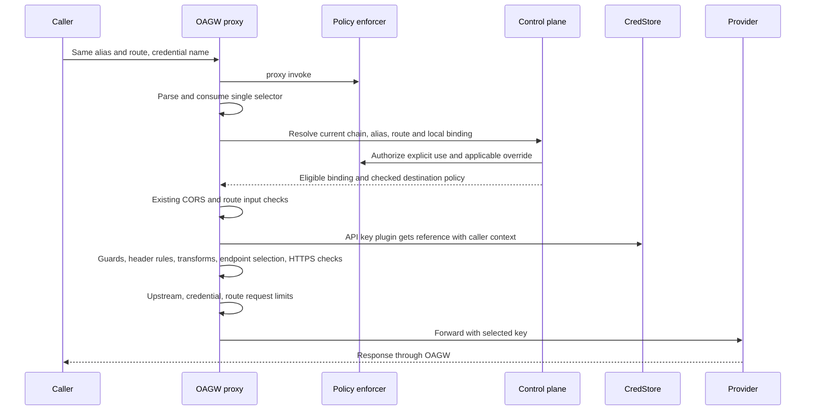

# Explicit Credential Bindings on an Upstream

<!-- toc -->

- [Context and Problem Statement](#context-and-problem-statement)
- [Decision Drivers](#decision-drivers)
- [Considered Options](#considered-options)
- [Decision Outcome](#decision-outcome)
  - [Resource and management API](#resource-and-management-api)
  - [Ownership and sharing](#ownership-and-sharing)
  - [Request sequence and SDK](#request-sequence-and-sdk)
  - [Errors and observability](#errors-and-observability)
  - [Request limits](#request-limits)
  - [Storage and provisioning](#storage-and-provisioning)
  - [Revocation and deployment](#revocation-and-deployment)
  - [Consequences](#consequences)
  - [Confirmation](#confirmation)
- [Pros and Cons of the Options](#pros-and-cons-of-the-options)
  - [A. Alternate hostname alias](#a-alternate-hostname-alias)
  - [B. Route authentication](#b-route-authentication)
  - [C. Allowlisted secret reference](#c-allowlisted-secret-reference)
  - [D. Named upstream credential](#d-named-upstream-credential)
- [Open Questions](#open-questions)
- [Traceability](#traceability)

<!-- /toc -->

**ID**: `cpt-cf-oagw-adr-credential-bindings`

## Context and Problem Statement

A tenant has two accounts with a provider. Both use the same host, HTTP method and path. The LLM gateway chooses the account and owns retries across accounts, token accounting, prices, spend and budgets. It needs to ask OAGW to use a specific credential and enforce a request-count limit for it. OAGW must either use that credential or return an error before forwarding under any other identity.

Evidence on main at `51dbede676ff270d97951822f28cde747a904a6e`. Source paths in this list are relative to `gears/system/oagw/`:

- [alias.rs](../../oagw/src/domain/services/management/alias.rs), lines 55–98 and 154–175: a single hostname derives its alias, including a nonstandard port. Pools may derive a common suffix. IPs or non-derivable pools require an explicit alias. [Upstream entity](../../oagw/src/infra/storage/entity/upstream.rs), line 20, [duplicate-create test](../../oagw/src/domain/services/management/tests.rs), line 287, and [metric labels](../../oagw/src/domain/ports/metric_labels.rs), line 65, establish tenant uniqueness, conflict and the registry's `duplicate_alias` reason.
- [Resolution](../../oagw/src/domain/services/management/resolution.rs), lines 69–150 and 205–239, selects visible **enabled** upstreams, revalidates the selected server and finds a route across the eligible chain. [Config merge](../../oagw/src/domain/services/management/merge.rs), lines 17–37, 78–115 and 250–258, distinguishes sharing from eligibility to send auth to a specific endpoint set. [Bind checks](../../oagw/src/domain/services/management/bind.rs), lines 56–108 and 257–271, distinguish absent auth from private auth and account for enforced ancestors.
- [Plugin contract](../features/0003-cpt-cf-oagw-feature-plugin-system.md), line 194 at the base SHA, and [data plane](../../oagw/src/infra/proxy/service.rs), lines 562–587, 689–724 and 790–822: proxy invocation is authorized before target resolution, and the auth plugin runs with the merged upstream config. [API key plugin](../../oagw/src/infra/plugin/apikey_auth.rs), lines 36–63, reads CredStore with the caller's security context. [Route overlap](../../oagw/src/domain/services/management/validation.rs), line 484, tests path, priority and a common method.
- [V1 SDK](../../oagw-sdk/src/api.rs), lines 120–156, exposes preview as an upstream/route pair and proxy as an HTTP request. [OAuth implementation](../../oagw/src/infra/plugin/oauth2_client_cred_auth.rs), lines 28–65 and 116–124, has a configurable token destination and already isolates cached tokens by tenant, subject, method and config. [Internal headers](../../oagw/src/infra/proxy/headers.rs), line 84, strips the entire reserved prefix, including headers an old binary does not recognize.

## Decision Drivers

- Preserve the existing alias and route policy chain and the endpoint owner's authority over where OAGW sends credentials.
- Make explicit selection deterministic, authorized, and observable without exposing secret values. Maintain compatibility for callers that omit the selector.
- Isolate each account's request bucket while retaining shared upstream limits. Support memory and database deployments and safe credential revocation.

## Considered Options

1. Allow another hostname alias for the same provider.
2. Attach authentication to routes.
3. Accept a per-request secret reference from an upstream allowlist.
4. Name a credential under the upstream.

## Decision Outcome

Chosen option: **D, named upstream credentials**, initially for tenant-local API keys. It lets the caller select an authorized account on the same route while keeping one destination policy chain. [ADR-0010](0010-resource-identification.md) describes Layer 2 as a tenant binding and explicitly represents it as a tenant-scoped upstream row in the MVP (line 590). Extend that row with zero or more credentials. Keep its Layer 3 correlation identity distinct from the new `credential_id`. Routes continue to bind guards and transforms. The upstream selects the auth plugin and its injection policy.

### Resource and management API

Use `/oagw/v1/upstreams/{id}/credentials` (parent GTS identifier, same parser as upstream CRUD). POST the collection to create (201); GET it to list (200, existing limit/offset). GET, PUT and DELETE `/{name}` read (200), replace (200) and remove (204). Preserve management write-mode restrictions on every transport. The [proposed schema](../schemas/credential.v1.schema.json) defines the create body and the registry declaration. PUT accepts the mutable fields using create defaults for omitted optional fields. Tenant, parent, name and UUID are immutable. A duplicate name returns 409, including a registry/API collision.

A binding has its own UUID, owner tenant, parent UUID, name, normalized CredStore reference, optional request limit, enabled flag, tags, timestamps, management source and the endpoint approval described below. Names are case-sensitive lowercase ASCII, 1–63 characters, starting with a letter, then letters, digits, underscores or hyphens. Reject noncanonical input. Reserve `default`: an explicit selector or create with that name is invalid. Omission invokes exactly the existing upstream auth path, including upstreams with no auth. Owners need no data migration or synthetic default row.

For this delivery the selected local parent must itself configure the built-in API-key plugin. Copy the parent's header name and prefix; substitute only the binding's `secret_ref`. Reject unavailable/incompatible parent auth on create or replacement, and fail closed if it becomes incompatible later. Apply existing upstream validation and prohibit injection into reserved internal/routing headers. Resolve a typed CredStore reference on write under the acting security context; on every proxy use fetch its value under the invoking security context. Record the reference, never the secret value. Authorized management detail may return the reference; use/preview returns only safe identifiers. With named OAuth deferred, implicit OAuth continues to use its existing cache. A future OAuth binding must authorize issuer/token endpoint and method at the upstream and extend the subject-scoped cache identity with credential and rotation identity.

### Ownership and sharing

Only the owner tenant can attach a credential to its local upstream. A descendant creates a local same-alias upstream through existing bind checks before adding its own key. Named credentials are never exported in this version, even if an ancestor shares its upstream. Use the selected local upstream UUID for lookup; neither the route owner's UUID nor a bare credential name identifies the binding.

Proposed PEP actions on the upstream resource are `credential_manage` (CRUD/list) and `credential_use` (explicit invoke/preview). Use current `SecurityContext`, resolved parent UUID, trusted owner tenant and, for an existing item, the stored credential UUID and name. For creation, authorize on the verified local parent and validated proposed name. For list, apply the authorized scope before pagination and only return authorized rows. A parent-level permission alone must not turn a caller-supplied name into an authorization grant. Check use on every explicit invocation and preview. Deny by default until policies grant the actions.

| Applicable visible ancestor auth above the local parent | Create/replace local binding | Use/preview local name | Manage ancestor binding as descendant | Use/preview ancestor name |
|---|---|---|---|---|
| No visible ancestor | Local manage | Local use | Invisible | Invisible |
| Absent auth on a visible ancestor | Local manage + override_auth on that ancestor | Local use + override_auth | Invisible | Invisible |
| private | Local manage | Local use | Invisible | Invisible |
| inherit | Local manage + override_auth on that ancestor | Local use + override_auth | Invisible | Invisible |
| enforce anywhere in the effective chain | Block | Block, including pre-existing rows | Invisible | Invisible |

Bind permission still governs the local upstream's creation or rebind. Apply the visible closest ancestor override check using the existing bind semantics; any farther sticky enforce wins. Re-evaluate the hierarchy for each explicit use/preview. The runtime override check is a proposed conservative choice: delegates using a descendant override need that grant as well as use. An owner can inspect, disable and delete its local rows with manage even if a new ancestor policy blocks their use. An owner's own enforce can expose its implicit default to descendants; descendants cannot select the owner's named keys. Read/cleanup must remain possible when the parent plugin changes.

Store a snapshot of the local credential owner's normalized endpoint tuples (host, port, scheme) on creation. At use, require the selected server to be within that approved set using `server_within`, in addition to existing merge-time auth/header-owner checks. This also protects existing bindings if a local upstream later grows its endpoint pool. Target-host may only select a member of the checked pool. Changing a parent's endpoints never silently extends that approval. Narrowing the pool is safe. To approve an expansion in v1, explicitly delete and recreate the binding under the new pool; rotation, enable/disable, registry replay and ordinary PUT preserve its approved set. A failed check stops before fetching a secret. Never drop the named auth and continue anonymously.

### Request sequence and SDK

A REST client can send either of the following requests to select its account. Authentication of the calling service is omitted from this illustration.

```http
POST /oagw/v1/proxy/api.openai.com/v1/chat/completions HTTP/1.1
Content-Type: application/json
X-OAGW-Credential: research

{"model":"example","messages":[]}
```

```http
POST /oagw/v1/proxy/api.openai.com/v1/chat/completions HTTP/1.1
Content-Type: application/json
X-OAGW-Credential: production

{"model":"example","messages":[]}
```



Treat header names case-insensitively. Require exactly one value matching the name grammar after ordinary HTTP parsing. Reject empty, repeated (including identical), comma-joined or invalid values. Never place the selector in the query or URI. Remove it from inbound headers used by the pipeline; exclude this header at final outbound handoff too, after all mutations. Prevent header rules/transforms from removing or replacing the selected auth header to send under a different identity: validate the final header equals the single value injected by auth, fail closed before forwarding on mismatch, and never log the compared values. Keep existing guard, SSRF/pinned-address, timeout, TLS, CORS, route and disabled-upstream checks. SSE counts once per HTTP request; WebSocket counts once on upgrade, with the same checks on its outbound handshake. Existing CORS preflight performs no forwarding and consumes no bucket.

Keep `ServiceGatewayClientV1` unchanged. Publish a separate proposed SDK trait `ServiceGatewayCredentialsClientV1` and register it alongside the existing trait through ClientHub. It exposes CRUD/list and `preview_credential(ctx, alias, method, path, name)`. Preview requires invoke + the same target/selection authorization, visibility, enabled and endpoint checks. Return only upstream, route and credential IDs and the resolved name. Do not execute auth, fetch a secret, debit a bucket or forward. Existing `resolve_proxy_target` keeps its old signature and semantics. A deployment without the new capability must fail an explicit capability lookup. The administration and proxy calls below illustrate the proposed SDK; only the credential client and its model are new.

```rust
let binding = CreateCredential::builder("research", "cred://openai-research")
    .requests_per_minute(60)
    .build()?;
credentials.create_credential(ctx.clone(), upstream_id, binding).await?;
let req = http::Request::post("/api.openai.com/v1/chat/completions")
    .header("content-type", "application/json")
    .header("x-oagw-credential", "research")
    .body(Body::from(r#"{"model":"example","messages":[]}"#))?;
let response = gateway.proxy_request(ctx, req).await?;
```

### Errors and observability

Use the existing canonical SDK error to RFC 9457 Problem mapping. Reject an invalid selector as invalid argument (400). Scope lookup by tenant and selected parent first; map missing, foreign and concealed item-level use/read denial to the same 404 with no candidate metadata. An operation-wide PEP denial is 403 independent of whether a name exists. For an authorized local binding, forbidden override/destination or incompatible parent policy blocks use (403). A disabled row returns 503 with the administrative Retry-After as for [UpstreamDisabled](../../oagw/src/api/rest/error.rs), line 296. A deleted row is absent. A missing/inaccessible secret uses the existing auth error and no outbound call. Failures to read authoritative configuration return a gateway availability error. Duplicate names use conflict; invalid/unsupported create payloads use invalid argument. Error messages never echo secret values, auth headers or untrusted selector bytes.

Record authorized selections in access logs with `credential_id` alongside upstream/route/request correlation. Record at most `credential_mode=default|named` as a new metric dimension. Keep IDs, names and secret references out of metric labels. A locally exhausted bucket returns the existing gateway 429 and Retry-After. Preserve a provider 429, its error source and provider retry guidance. Neither triggers an automatic second request.

### Request limits

Expose only `rate_limit.requests_per_minute`, a positive u32. An omitted limit disables the credential bucket. Use the existing local token bucket with this capacity, initialized full, refilling at that many requests per minute, cost 1, reject strategy and global scope **within the binding UUID**. Thus 60/minute allows a burst of 60 and then refills at one per second; it is not a rolling-window or cluster quota. Add `RateLimitResource::Credential`; key `oagw:ratelimit:credential:{uuid}:global:minute` using the existing window-label convention (see [key builder](../../oagw/src/domain/rate_limit.rs), line 343). One credential shared by several subjects on a replica shares one bucket.

Check effective upstream first (retain `pool_owner_id`), credential second, route third. Stop on first rejection. Successful earlier debits count attempts and are not refunded. Fold success headers as [the current data plane](../../oagw/src/infra/proxy/service.rs), lines 1484–1528, does: minimum remaining count, earlier bucket wins ties, emit if any participating policy enables headers. The credential limit enables rate headers; a rejecting bucket supplies its existing retry/header metadata. A secret rotation with identical rate preserves the bucket; a rate change resets capacity per existing limiter semantics. Removing a limit evicts its buckets. Delete evicts by credential UUID prefix. Re-creation gets a fresh UUID and cannot inherit old counters. Cross-replica eviction is best effort with the change feed and idle sweep; old counters for a deleted UUID are unreachable. See [ADR-0004](0004-rate-limiting.md), line 340, for per-instance enforcement. Provider health, circuit breakers and account cooldown are outside this decision.

### Storage and provisioning

Use an additive child table with PK UUID, composite parent FK `(tenant_id, upstream_id)`, unique `(tenant_id, upstream_id, name)`, case-stable validated name, normalized secret reference, enabled, limit, approved endpoints, management source, optional registry identity, tags and timestamps. Use [ADR-0009](0009-storage-schema.md) and [ADR-0018](0018-optional-persistence.md). No backfill. Return metadata and UTC timestamps from stored state; use the SDK's existing parent UUID internally. Enforce ownership in both repositories with PEP-derived access scope on credential operations and scoped DB access. Write parent existence, unique name, snapshot and row atomically. Serialize memory writes with parent lifecycle; use a DB transaction/parent lock and constraint on every supported DB. Concurrent duplicate creates yield one 201 and one 409. PUT replaces one row atomically, concurrent valid replacements are last committed write wins. A delete racing a child create yields either a rejected create or a child deleted with its parent; never leave an orphan. An explicit authorized parent delete cascades managed children under existing ownership rules. Protect a registry-managed dependent on an API parent by refusing the parent delete with 409 until reconcile removes the dependent. [ADR-0011](0011-concurrency-control.md) concerns in-flight requests; it does not define CRUD consistency.

Register proposed GTS type `gts.cf.core.oagw.credential.v1~`. The registry declaration uses the schema's registry form: the instance envelope supplies the source UUID, the payload specifies the parent UUID and optional tenant (omission uses the existing registry default). This first version uses canonical UUIDs for registry parent references. The API obtains owner/parent from context/path and rejects both fields in the create body. A unique registry source UUID identifies the declaration across reconciles; the local binding UUID identifies one lifecycle. Reconcile updates the same binding for the same live declaration. Reappearance after confirmed removal receives a fresh binding UUID. Reject name/parent changes to a live declaration; require removal/re-creation. Registry-managed rows are read-only to API writes; collisions never transfer ownership.

Extend the generation, content hash, precheck, retry, metrics and cleanup of the [current registry reconcile](0018-optional-persistence.md#provisioning-from-the-types-registry). Validate normalized content and duplicates across declarations before writing. Reject every participant in a duplicate name group; keep its last valid row, if any. Materialize eligible parents before children, validate references as the registry actor for that tenant, defer inaccessible references and report permanent invalid declarations separately. Delete disappeared registry children first. Under the same parent lock, recheck surviving routes **and credentials** before deleting a disappearing registry parent. An API-managed child or retained registry child keeps that parent in use. An old registry reconciler lacks this new dependency check: fence old writers before creating bindings on registry parents. Registry code alone gets reconciliation access across tenants; public APIs never inherit that scope.

### Revocation and deployment

For named proxy **and** preview, propose authoritative reads on every admission. Resolve current hierarchy, upstream candidates, applicable routes and credential; use a consistent primary DB snapshot for the OAGW rows or a consistent in-memory view. Do not use ADR-0020 stale alias/route hits, positive or negative credential entries, or cached authorization on this path. Preserve the common resolution/merge algorithms, including SSRF and endpoint-owner checks. Keep external tenant resolver and PEP decisions tied to the requesting context. Complete the read before CredStore or network I/O; no DB lock is held across either call.

With a shared primary DB, when an update, disable or delete has committed and returned success, every named admission whose snapshot starts afterwards observes it or fails closed, even on another replica after a lost event or during a slow/failed read. A request already admitted, including an established stream, may finish. In memory this guarantee is per process; independent memory replicas have independent management state. This guarantee covers OAGW state, not propagation times inside CredStore or the policy service. Reads timing out return 503. New bindings and repaired parent policies are visible on the same terms. This deliberately trades a DB read transaction on named traffic for a zero stale-admission window.

[ADR-0020](0020-proxy-config-cache.md), lines 78–102 and 176–188, serves raw candidates and can answer stale data after a slow/failed reload. Leave omitted-selector traffic on that path. No name or absence enters the alias/route cache. Binding-only writes cannot change an omitted-selector result, so do not evict unrelated routes. Extend write notifications for limit removal/deletion and parent cascades to evict local counter prefixes and publish affected credential IDs after commit. Retain existing parent/alias/route invalidations. Notifications accelerate cleanup; revocation never depends on receiving one.

An old replica strips the selector and can forward with its default account. Use this deployment order:

1. Apply the additive schema. Deploy capable proxy, management and registry instances with named traffic held at ingress/callers and credential writes held. Keep the existing deployment generation fence for registry ownership.
2. Verify **every reachable REST and in-process proxy target**, autoscaling image, failover pool and registry writer supports the new contract. Then enable credential writes/provisioning, publish grants and allow the LLM gateway to send selectors. A header check in a new replica cannot protect a call that lands on an old one.
3. Before rollback, close named admission on all caller/ingress paths and drain outstanding named traffic. Freeze credential writes and old registry reconciliation for parents with bindings, or remove those dependencies deliberately before resuming old writers. Retain the additive table on rollback. Keep named requests rejected until all serving targets are capable again.

### Consequences

Existing consumers continue using one upstream and the implicit credential. A consumer using multiple accounts stores `(alias, credential name)` alongside its account configuration. Rotating its secret reference preserves that identity. Name reuse can intentionally designate a new binding; use the UUID in audit records. Operators must coordinate first use with rollout and plan for a DB read per named request. Descendants needing their own keys provision a local upstream; they cannot borrow an ancestor's named credential in v1.

### Confirmation

The [acceptance scenarios](../../scenarios/credential-bindings/explicit-selection.md) specify observable requests, denials, counters, races, revocation and rollout. Phase 2 must run the store-dependent cases using the backend matrix of [the four-level alias tests](../../oagw/src/domain/services/management/tests.rs), line 868. Assert the mock provider's received header and request count, the CredStore call context/count, Problem type/source and retry headers, database state and cache behavior. Use a controlled clock for limiter tests. Run SDK round trips and existing V1 implementors. Phase 1 supplies specifications only.

## Pros and Cons of the Options

### A. Alternate hostname alias

Existing upstream CRUD could represent each account. However, policy resolution follows the alias, so an additional alias could skip an enforced ancestor. Safe support would require redefining destination identity across existing upstreams.

### B. Route authentication

Existing route objects could carry auth configuration, but equal path/method/priority can collide. Different priorities still select one winner for both requests. Neither permits the caller to choose an account on that same route.

### C. Allowlisted secret reference

This requires only a small wire change initially. It couples callers to CredStore naming and leaves per-key authorization, rotation, audit identity and request limits to a separate mechanism.

### D. Named upstream credential

The credential UUID survives secret rotation and gives rate limiting, authorization and audit the same identity. The caller can choose a key without learning its secret reference. The cost is a child resource with its own persistence and reconciliation plus an authoritative read for named traffic.

## Open Questions

Reviewers are asked to accept or amend (1) tenant-local API keys with runtime override authorization, reserving named OAuth and export for a later ADR; (2) authoritative named reads and their availability/latency cost for immediate post-commit revocation; (3) the all-target rollout and registry rollback fence; and (4) the per-replica, one-minute token bucket and its burst semantics. These are proposed implementation choices pending approval.

## Traceability

- `cpt-cf-oagw-fr-credential-bindings` in [PRD](../PRD.md)
- [Credential resolution](../features/0004-cpt-cf-oagw-feature-proxy-engine.md#credential-resolution) and [alias resolution](../features/0004-cpt-cf-oagw-feature-proxy-engine.md#alias-resolution) in the proxy engine
- [Hierarchical config merge](../features/0005-cpt-cf-oagw-feature-tenant-hierarchy.md#hierarchical-config-merge) in the tenant hierarchy
- [System design](../DESIGN.md) and [planned work](../DECOMPOSITION.md)
