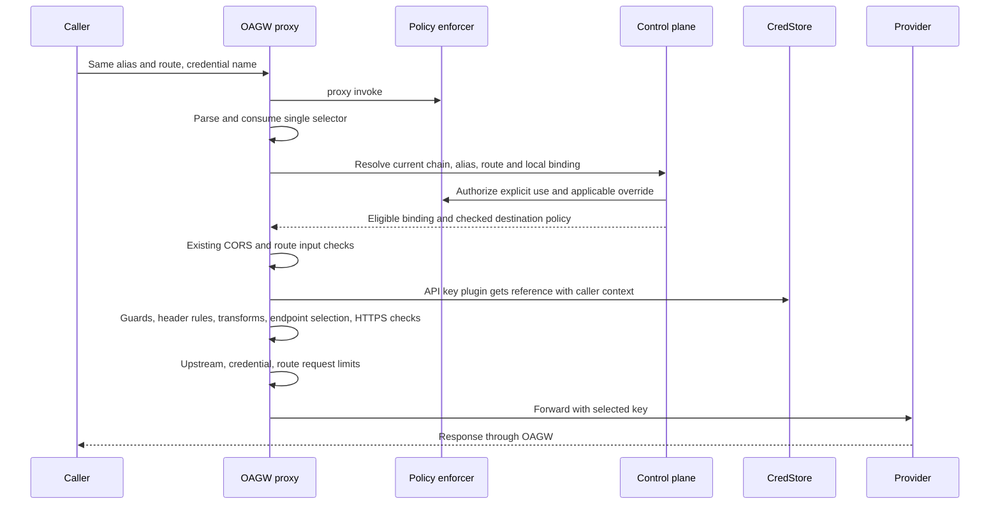

# Explicit Credential Bindings on an Upstream

<!-- toc -->

- [Context and Problem Statement](#context-and-problem-statement)
- [Decision Drivers](#decision-drivers)
- [Considered Options](#considered-options)
- [Decision Outcome](#decision-outcome)
  - [Resource and management API](#resource-and-management-api)
  - [Ownership and sharing](#ownership-and-sharing)
  - [Request sequence and SDK](#request-sequence-and-sdk)
  - [Errors and observability](#errors-and-observability)
  - [Request limits](#request-limits)
  - [Storage and provisioning](#storage-and-provisioning)
  - [Revocation and deployment](#revocation-and-deployment)
  - [Consequences](#consequences)
  - [Confirmation](#confirmation)
- [Pros and Cons of the Options](#pros-and-cons-of-the-options)
  - [A. Alternate hostname alias](#a-alternate-hostname-alias)
  - [B. Route authentication](#b-route-authentication)
  - [C. Allowlisted secret reference](#c-allowlisted-secret-reference)
  - [D. Named upstream credential](#d-named-upstream-credential)
- [Open Questions](#open-questions)
- [Traceability](#traceability)

<!-- /toc -->

**ID**: `cpt-cf-oagw-adr-credential-bindings`

## Context and Problem Statement

A tenant uses two accounts at `api.openai.com`. Both call `POST /v1/chat/completions`. The LLM gateway chooses the account, decides whether to retry with another account and tracks tokens, prices, spend and budgets. It needs a way to tell OAGW which key to use. If OAGW cannot use that key, the caller needs an error: a successful call under the default account would charge the wrong account.

Today OAGW derives the alias of a single-host upstream from its hostname and includes a nonstandard port. Pools can share a domain suffix, and IP addresses or pools without a usable suffix need an explicit alias. Within a tenant, two upstreams cannot claim the same alias: management returns a conflict and registry provisioning reports `duplicate_alias`. See the [alias rules](../../oagw/src/domain/services/management/alias.rs) and [upstream model](../../oagw/src/infra/storage/entity/upstream.rs).

The proxy first checks permission to invoke, then [resolves the alias and route](../../oagw/src/domain/services/management/resolution.rs) across visible, enabled upstreams. It revalidates the selected server. When it [merges tenant policies](../../oagw/src/domain/services/management/merge.rs), it also checks whether the credential owner approved the destination. Sharing an alias alone does not grant permission to send a key. The [bind rules](../../oagw/src/domain/services/management/bind.rs) distinguish missing auth from private auth and preserve an ancestor's enforced policy.

Today the upstream selects the [auth plugin](../features/0003-cpt-cf-oagw-feature-plugin-system.md). The [API-key plugin](../../oagw/src/infra/plugin/apikey_auth.rs) reads the secret from CredStore under the caller's security context. As a result, two calls to the same route use the same upstream auth configuration.

## Decision Drivers

- Preserve the existing alias and route policy chain and the endpoint owner's authority over where OAGW sends credentials.
- Make explicit selection deterministic, authorized, and observable without exposing secret values. Maintain compatibility for callers that omit the selector.
- Isolate each account's request bucket while retaining shared upstream limits. Support memory and database deployments and safe credential revocation.

## Considered Options

1. Allow another hostname alias for the same provider.
2. Attach authentication to routes.
3. Accept a per-request secret reference from an upstream allowlist.
4. Name a credential under the upstream.

## Decision Outcome

We propose **D, named upstream credentials**, starting with API keys that belong to one tenant. Both accounts keep the same route and destination policies. [ADR-0010](0010-resource-identification.md) calls the tenant's upstream row a Layer 2 tenant binding. That row can now have several credentials, each with its own `credential_id` for Layer 3 logs. The upstream still chooses the auth plugin and how it sends the key. Routes can attach guards and transforms.

### Resource and management API

Manage bindings at `/oagw/v1/upstreams/{id}/credentials`. The path takes the same parent GTS identifier as upstream CRUD. POST creates a binding (201). GET lists bindings (200) with the existing limit and offset. On `/{name}`, GET reads the binding (200), PUT replaces it (200), and DELETE removes it (204). All transports respect the management write mode.

The [schema](../schemas/credential.v1.schema.json) describes the request bodies and registry declaration. PUT applies the create defaults to optional fields the caller omits. Callers cannot change a binding's tenant, parent, name or UUID. If the name already exists, OAGW returns 409, including when an API request conflicts with a registry declaration.

A binding records its UUID, tenant and parent IDs, name, CredStore reference, optional request limit, enabled flag, tags, timestamps, management source and approved endpoints. Names start with a lowercase ASCII letter and may contain lowercase letters, digits, underscores and hyphens, up to 63 characters. OAGW rejects other spellings and reserves `default`: callers cannot create or explicitly select that name. To use the upstream's current auth behavior, callers omit the selector. This also works for upstreams without auth and requires no migration or default row.

The local parent must configure the built-in API-key plugin. The plugin takes the header name and prefix from that upstream and substitutes only the binding's `secret_ref`. OAGW rejects a create or replacement if the parent lacks compatible auth. If the parent changes later, OAGW checks compatibility again on use. The usual upstream validation applies, and the plugin cannot inject a key into reserved internal or routing headers.

On write, OAGW checks that the acting caller can access the CredStore reference. On each proxy request it fetches the secret under the invoking caller's security context. OAGW stores only the reference. An authorized management read can return it. Preview exposes only identifiers and the name.

Named OAuth credentials are outside this proposal. Existing OAuth requests keep their token cache. Any future extension must keep the upstream in control of the issuer, token endpoint and auth method. It must also preserve [the cache's tenant, subject, method and configuration checks](../../oagw/src/infra/plugin/oauth2_client_cred_auth.rs) when adding binding identity and rotation.

### Ownership and sharing

A tenant can attach a credential only to an upstream it owns. A descendant that needs its own key first creates a local upstream with the same alias and passes the existing bind checks. Ancestors can share an upstream, but their named credentials stay private. OAGW looks up a name under the caller's tenant and the selected local upstream UUID, even when an ancestor owns the matched route.

The policy enforcer checks two actions on the upstream: `credential_manage` for management (including list) and `credential_use` for each named proxy request or preview. It checks the caller's `SecurityContext`, the resolved parent UUID and its owner. For an existing binding it also checks the stored credential UUID and name. On create it checks the verified parent and the validated new name. The list operation filters by the caller's access scope before pagination. Knowing a name grants no access. Both actions require an explicit policy grant.

| Applicable visible ancestor auth above the local parent | Create/replace local binding | Use/preview local name | Manage ancestor binding as descendant | Use/preview ancestor name |
|---|---|---|---|---|
| No visible ancestor | Local manage | Local use | Invisible | Invisible |
| Absent auth on a visible ancestor | Local manage + override_auth on that ancestor | Local use + override_auth | Invisible | Invisible |
| private | Local manage | Local use | Invisible | Invisible |
| inherit | Local manage + override_auth on that ancestor | Local use + override_auth | Invisible | Invisible |
| enforce anywhere in the effective chain | Block | Block, including pre-existing rows | Invisible | Invisible |

A descendant needs bind permission when it creates or rebinds its local upstream. The closest visible ancestor determines the override check, but a more distant ancestor's `enforce` still takes precedence. OAGW checks that hierarchy on every named request and preview. Where the table requires `override_auth`, the caller using the key needs that grant as well as `credential_use`.

An owner with `credential_manage` can still inspect, disable or delete a binding after an ancestor blocks its use or the parent changes plugins. An owner's `enforce` policy can share its implicit default with descendants. Named keys remain local.

When a tenant creates a binding, OAGW records the upstream's approved endpoints as normalized host, port and scheme tuples. Before it fetches the secret, OAGW uses `server_within` to check every endpoint in the selected server against that set. The existing auth and header ownership checks still apply. The target-host header can select only a member of the checked pool.

For example, removing an endpoint leaves the binding usable. Adding an endpoint outside the approved set blocks the binding, even if the upstream keeps the same alias. To approve the larger pool, the owner deletes and recreates the binding. Rotation, PUT, enable/disable and registry replay preserve the original approval.

### Request sequence and SDK

These requests differ only in the account the LLM gateway chose. Both use the same route and body.

```http
POST /oagw/v1/proxy/api.openai.com/v1/chat/completions HTTP/1.1
Content-Type: application/json
X-OAGW-Credential: research

{"model":"example","messages":[]}
```

```http
POST /oagw/v1/proxy/api.openai.com/v1/chat/completions HTTP/1.1
Content-Type: application/json
X-OAGW-Credential: production

{"model":"example","messages":[]}
```



HTTP header names are case-insensitive. OAGW accepts exactly one credential name in the header and rejects empty, malformed, repeated or comma-separated values, even if both names match. The URI and query carry no selector. OAGW removes the header before running the pipeline and strips it again before forwarding, in case a header rule or transform adds it back.

After all header changes, OAGW checks that the outbound request still carries exactly the auth value the plugin supplied. If a rule removes, replaces or duplicates that value, OAGW stops before forwarding and never logs the values it compared. The usual guards, SSRF and pinned-address checks, timeout, TLS, CORS, route and disabled-upstream rules apply. Each SSE request or WebSocket upgrade counts once. CORS preflight neither forwards a request nor consumes capacity.

The [existing SDK](../../oagw-sdk/src/api.rs) already accepts an HTTP request in `ServiceGatewayClientV1::proxy_request`. Callers can set the same header there. Keep V1 and its `resolve_proxy_target` upstream/route result intact. Register a separate `ServiceGatewayCredentialsClientV1` in ClientHub for management and `preview_credential(ctx, alias, method, path, name)`. If a deployment lacks this capability, the lookup fails.

Preview checks invoke permission, use permission, visibility, enabled state and destination eligibility just as the proxy does. It returns the upstream, route and credential IDs and the resolved name. It never fetches a secret, consumes capacity or calls the provider. The example uses the proposed management client and the existing proxy client:

```rust
let binding = CreateCredential::builder("research", "cred://openai-research")
    .requests_per_minute(60)
    .build()?;
credentials.create_credential(ctx.clone(), upstream_id, binding).await?;
let req = http::Request::post("/api.openai.com/v1/chat/completions")
    .header("content-type", "application/json")
    .header("x-oagw-credential", "research")
    .body(Body::from(r#"{"model":"example","messages":[]}"#))?;
let response = gateway.proxy_request(ctx, req).await?;
```

### Errors and observability

OAGW maps SDK errors to RFC 9457 Problems. The response depends on what the caller may know about the binding:

| Condition | Proxy or management response |
|---|---|
| Invalid selector or unsupported create payload | 400, invalid argument |
| No such binding under the selected parent, another tenant owns it, or the caller lacks access to that item | 404, with no information about other bindings |
| The caller lacks permission for the operation itself | 403, whether or not the name exists |
| A policy forbids the override or destination, or the parent has incompatible auth | 403 for a caller who can see the binding |
| The caller can use the binding but the owner has disabled it | 503 with the same administrative `Retry-After` as a [disabled upstream](../../oagw/src/api/rest/error.rs) |
| The name already exists on create | 409, conflict |

After deletion, lookup returns 404. If CredStore cannot supply the secret, OAGW returns its existing auth error and never contacts the provider. If OAGW cannot read current configuration, it returns an availability error. Errors never include secret values, auth headers or raw selector input.

For authorized selections, OAGW logs `credential_id` with the upstream, route and request IDs. Metrics distinguish only `credential_mode=default|named`. IDs, names and secret references stay out of metric labels. When OAGW exhausts a local bucket, it returns its own 429 with `Retry-After`. When the provider returns 429, OAGW preserves the upstream error source and retry guidance. In either case the LLM gateway decides whether to try again.

### Request limits

A binding can set `rate_limit.requests_per_minute` to a positive u32. Without it, only the existing upstream and route limits apply. Each replica keeps one token bucket per binding UUID. All callers using that credential on the replica share it. A limit of 60 starts with capacity for 60 requests and refills at one request per second. Each request costs one token. The limit applies per replica, as in [ADR-0004](0004-rate-limiting.md).

Add `RateLimitResource::Credential` to the [key builder](../../oagw/src/domain/rate_limit.rs). Its global scope covers the one binding: `oagw:ratelimit:credential:{uuid}:global:minute`.

OAGW checks the effective upstream bucket first (including its shared `pool_owner_id`), then the credential, then the route. It stops at the first rejection. Earlier buckets keep their debits because they count attempts. On success the [data plane](../../oagw/src/infra/proxy/service.rs) reports the smallest remaining count. The first bucket wins ties. OAGW sends rate headers if any participating policy enables them, and the credential limit enables them. On rejection, the rejecting bucket supplies the retry and rate headers.

Rotating a secret keeps its bucket if the rate stays the same. Changing the rate resets the bucket's capacity. Removing a limit evicts its buckets. Deleting a binding evicts by UUID prefix. A new binding with the same name gets a fresh UUID, so it cannot use the old counters even if another replica misses the cleanup notification. The change feed and idle sweep handle cleanup on other replicas. This proposal covers request limits only. Provider health, circuit breakers and account cooldown have separate policies.

### Storage and provisioning

Add a child table with a UUID primary key, a foreign key on `(tenant_id, upstream_id)` and a unique constraint on `(tenant_id, upstream_id, name)`. Store the validated name with case-sensitive comparison, the normalized secret reference, enabled flag, limit, approved endpoints, tags, management source, optional registry identity and UTC timestamps. Return stored metadata on reads. The SDK continues to identify the parent by UUID. Existing upstreams need no backfill. See [storage conventions](0009-storage-schema.md) and [persistence](0018-optional-persistence.md).

Both repositories enforce ownership using the access scope from the policy enforcer. Creating a binding must check the parent and name, capture the endpoint set and insert the row in one operation. The database repository locks the parent in a transaction and uses database constraints. The memory repository serializes creation with parent changes. If two callers create the same name, one gets 201 and the other 409. PUT replaces one row atomically. For concurrent valid replacements, the last transaction to commit wins.

An authorized parent delete removes its children under the existing ownership rules. If deletion races with creation, the create either fails or the delete removes the new child too. If the registry owns a child of an API-managed parent, OAGW returns 409 until the registry removes that child. [ADR-0011](0011-concurrency-control.md) covers concurrency limits for in-flight requests.

The proposed GTS type is `gts.cf.core.oagw.credential.v1~`. The registry envelope supplies the declaration's source UUID. Its payload supplies the parent's canonical UUID and optionally the tenant. When the declaration omits the tenant, the registry uses its existing default. By contrast, the management API takes the owner from the calling context and the parent from the path, and rejects both fields in the create body.

The registry source UUID identifies a declaration across runs. The local binding UUID identifies the lifetime of the credential. Reapplying a live declaration updates the same binding. Removing it and adding it again creates a fresh binding UUID. To change the name or parent, remove and recreate the declaration. The management API cannot modify a registry-owned row or take it over through a name collision.

The [registry reconciler](0018-optional-persistence.md#provisioning-from-the-types-registry) includes credentials in its generation and content-hash checks, validation, retries, metrics and cleanup. Before writing, it normalizes declarations and checks for duplicate names. If several declarations claim a name, it rejects all of them and keeps their last valid rows, if any. It creates parents before children and checks secret references as the registry actor for the owning tenant. It retries inaccessible references and reports permanently invalid declarations separately.

On removal, the reconciler deletes missing registry children first. Before deleting a parent, it locks that parent and checks for surviving routes and credentials. An API-managed child or a retained registry child keeps the parent alive. Older reconcilers do not know about credential children, so operators must stop those writers before they enable bindings on registry parents. Only reconciliation has cross-tenant access.

### Revocation and deployment

For each named request or preview, OAGW reads the hierarchy and checks the caller's current permissions. It resolves the upstream, route and credential from one consistent snapshot of its primary database, or one consistent view of the memory store. It runs the usual merge, SSRF and endpoint-owner checks. It does not reuse an earlier lookup, including a miss, or a cached permission decision. OAGW releases database locks before calling CredStore or the provider.

Suppose an operator disables a key on replica A and receives a successful response. If replica B starts its database snapshot after that response, it must refuse the key, even if it missed the change notification. The same rule covers creation, rotation, deletion and changes to the parent policy. A slow read must finish within its deadline or OAGW returns 503. Requests that already passed the checks can finish, including open streams.

This guarantee costs one read transaction per named request. It covers replicas that share a primary database. Each in-memory process has its own state, and CredStore and the policy service have their own propagation times.

Requests without a selector continue to use the [proxy configuration cache](0020-proxy-config-cache.md), which can serve stale candidates when a reload fails or runs slowly. Changes to a binding alone do not affect these requests, so they need no route eviction. Keep the existing invalidation for parent, alias and route changes. When OAGW removes a limit or deletes a binding, including through a parent cascade, it evicts local counters by prefix and publishes the affected credential IDs after commit. Notifications speed up cleanup. A replica can enforce revocation even if it never sees the notification.

An old replica strips the selector and can forward with its default account. Use this deployment order:

1. Apply the schema and deploy the new proxy, management API and registry workers. Keep selectors off at callers and ingress, and keep credential writes off. Keep the registry's existing deployment generation check.
2. Check every REST and in-process proxy target, autoscaling image, failover pool and registry writer. Once all of them support bindings, enable writes and provisioning, grant permissions and let the LLM gateway send selectors.
3. Before rollback, block new named requests at callers and ingress and drain those already in progress. Freeze credential writes. Keep older reconcilers away from parents that still have bindings, or remove those dependencies before restarting the old writers. Keep the new table. Allow named requests again only when every serving target supports them.

### Consequences

Consumers with multiple accounts store the alias and credential name with each account. They can rotate a secret without changing that pair. If they delete a binding and reuse its name, the new UUID distinguishes it in audit logs. Consumers that omit the selector keep their existing upstream behavior. A descendant that needs its own key must provision a local upstream. Operators must budget for the extra database read on named requests and coordinate when callers start sending selectors.

### Confirmation

The [acceptance scenarios](../../scenarios/credential-bindings/explicit-selection.md) cover forwarding, denials, limits, concurrent writes, revocation and rollout. Run the storage cases on the same backends as the [four-level alias tests](../../oagw/src/domain/services/management/tests.rs). Check which key the mock provider receives and how often it receives a request. Check the caller context and number of CredStore reads, the Problem type, error source, retry headers, stored rows and cache behavior. Use a controlled clock for the rate limiter. Exercise the new SDK round trips and compile existing V1 implementations.

## Pros and Cons of the Options

### A. Alternate hostname alias

Existing upstream CRUD could represent each account. However, policy resolution follows the alias, so an additional alias could skip an enforced ancestor. Safe support would require redefining destination identity across existing upstreams.

### B. Route authentication

Existing route objects could carry auth configuration, but equal path/method/priority can collide. Different priorities still select one winner for both requests. Neither permits the caller to choose an account on that same route.

### C. Allowlisted secret reference

This requires only a small wire change initially. It couples callers to CredStore naming and leaves per-key authorization, rotation, audit identity and request limits to a separate mechanism.

### D. Named upstream credential

The credential UUID survives secret rotation and gives rate limiting, authorization and audit the same identity. The caller can choose a key without learning its secret reference. The cost is a child resource with its own persistence and reconciliation plus an authoritative read for named traffic.

## Open Questions

- Should the first release cover only tenant-local API keys and require `override_auth` on use where the hierarchy calls for it? The proposal leaves named OAuth and sharing keys with descendants for a later ADR.
- Is immediate revocation across replicas worth a database read per named request and a 503 when that read times out?
- Can every caller, proxy target and registry writer follow the proposed rollout and rollback order?
- Does a per-replica token bucket with a one-minute refill period allow the burst callers need?

## Traceability

- `cpt-cf-oagw-fr-credential-bindings` in [PRD](../PRD.md)
- [Credential resolution](../features/0004-cpt-cf-oagw-feature-proxy-engine.md#credential-resolution) and [alias resolution](../features/0004-cpt-cf-oagw-feature-proxy-engine.md#alias-resolution) in the proxy engine
- [Hierarchical config merge](../features/0005-cpt-cf-oagw-feature-tenant-hierarchy.md#hierarchical-config-merge) in the tenant hierarchy
- [System design](../DESIGN.md) and [planned work](../DECOMPOSITION.md)
